# PHP Learning Modules

[](https://www.php.net/) [](#learning-roadmap) [](#learning-modules--subtopics) [](#learning-modules--subtopics) [](#tech-stack--tools) [](./LICENSE)


## Project Description

**PHP Learning Modules** is an exhaustive, production-grade educational curriculum designed to take software engineers and aspiring backend developers from fundamental language syntax through modern PHP 8.2+ paradigms, advanced object-oriented software engineering, relational database architectures, and secure RESTful backend services.

Structured across **18 pedagogical modules** encompassing **300 fully standalone, executable PHP programs**, this repository bridges academic theory with practical, industry-grade implementation. Every lesson is paired with its verified terminal execution capture rendered directly from executed runtime processes, guaranteeing reproducible behavior across diverse operating environments. Whether learning PHP as a first backend language, transitioning from another programming ecosystem, upgrading legacy skillsets to modern PHP (PHP 8.2–8.4+), or mastering enterprise patterns (PSR standards, PDO data access, MVC architecture, the Repository Pattern, and REST API design), this repository provides an authoritative, code-first curriculum.

## Learning Objectives

Learners working through this curriculum will develop concrete, industry-ready backend engineering skills across every domain of PHP development:

- **Core Syntax & Script Anatomy**: Master PHP language structure, opening tags, output streaming with `echo` and `print`, documentation commenting conventions, PSR-12 code style, statement delimiters, and CLI runtime inspection.
- **Type System & Strict Typing**: Leverage PHP's dynamic type system, primitive scalar types (`int`, `float`, `string`, `bool`, `null`), explicit type casting, dynamic type juggling, and strict scalar type enforcement (`declare(strict_types=1)`).
- **Expressions & Modern Operators**: Evaluate complex expressions, arithmetic and compound assignments, strict identity checking (`===`, `!==`), short-circuit logic, null coalescing (`??`), nullsafe chaining (`?->`), and bitwise operations.
- **Control Flow & Pattern Matching**: Architect resilient decision logic using `if-else` ladders, `switch-case` statements, truthy/falsy evaluation, and modern PHP 8+ `match` expressions.
- **Iterative Control Flow & Loops**: Master sequence iteration with `for`, condition-controlled `while` and `do-while` loops, collection traversal with `foreach`, nested loops, flow jump controls (`break`, `continue`), and alternative template syntax.
- **Arrays & SPL Collection Utilities**: Implement indexed lists, associative hash maps, multidimensional matrices, stack/queue operations (`array_push`, `array_pop`, `array_shift`, `array_unshift`), functional pipelines (`array_filter`, `array_map`, `array_reduce`), multi-column sorting, and array destructuring.
- **Text Processing & Regular Expressions**: Manipulate text using slicing, search primitives (`str_contains`, `str_starts_with`), formatting with `sprintf`, Heredoc/Nowdoc multi-line templates, UTF-8 multibyte processing (`mbstring`), and regular expression pattern validation with `preg_match` and `preg_replace`.
- **Modular Subroutines & Functional Design**: Author clean subroutines using type declarations, default values, named arguments, variadic parameters (`...$args`), argument unpacking, union/intersection types, closures, lexical state binding (`use`), arrow functions, recursion, and first-class callables.
- **Object-Oriented Software Engineering (OOP)**: Design modular systems using classes, typed properties, constructors (`__construct`), destructors, access modifiers (`public`, `protected`, `private`), data encapsulation, static members, constructor property promotion, `readonly` properties, magic methods, and object serialization.
- **Advanced OOP & Architectural Design**: Implement class inheritance, method overriding (`parent::`), `final` constraints, abstract classes, behavioral interfaces (`implements`), horizontal code reuse with traits and conflict resolution (`insteadof`, `as`), late static binding (`static::`), type covariance/contravariance, composition, aggregation, dependency injection, pure and backed enumerations (`enum`), native attributes (`#[Attribute]`), and the Reflection API.
- **PHP Standard Library & Modern Features**: Utilize built-in `DateTime` and immutable temporal operations, timezones, cryptographically secure randomness (`random_int`), JSON serialization (`json_encode`, `json_decode`), SPL iterators, memory-efficient generators (`yield`, `yield from`), Fibers concurrency, `readonly` classes, and modern PHP 8.4 property hooks and asymmetric visibility paradigms.
- **Error Handling, Debugging & Validation**: Build fault-tolerant systems using `try-catch-finally`, custom domain exception hierarchies, exception chaining (`$previous`), the `Throwable` interface, assertions, diagnostic backtraces (`debug_backtrace`), defensive input filtering (`filter_var`), and automated error logging (`error_log`).
- **Filesystem Streams & Data Persistence**: Manage local file I/O using low-level stream handles (`fopen`, `fread`, `fwrite`), high-level utilities (`file_get_contents`, `file_put_contents`), directory traversals (`scandir`), temporary files (`tmpfile`), tabular CSV reading/writing (`fgetcsv`, `fputcsv`), JSON data stores, and stream wrappers (`php://memory`).
- **Server-Side Web & HTTP Architecture**: Build dynamic web pages integrating PHP with HTML templates, inspect superglobals (`$_GET`, `$_POST`, `$_SERVER`, `$_COOKIE`, `$_SESSION`, `$_FILES`), validate form submissions, prevent XSS attacks using `htmlspecialchars`, manage cookies and sessions for user authentication, send HTTP response headers, handle redirects, and build front-controller routers.
- **Relational Databases with PDO & SQL**: Connect to relational databases using PHP Data Objects (PDO), execute queries, eliminate SQL injection vulnerabilities using prepared statements and parameter binding, conduct transactional ACID operations (`beginTransaction`, `commit`, `rollBack`), implement pagination and wildcard searches, query relational JOINs, build database repositories, and manage database schema migrations.
- **Composer, Namespaces & Enterprise Patterns**: Structure professional PHP applications using logical namespaces, PSR-4 autoloading standards, Composer dependency management, environment variable loading (`.env`), centralized configuration classes, and enterprise architectures including Model-View-Controller (MVC), Service Layers, and Repository Patterns.
- **Backend Security, API Engineering & Testing**: Implement cryptographic password hashing (`password_hash` with BCRYPT/Argon2), secure session guards, CSRF defense, Role-Based Access Control (RBAC), standardized JSON REST API responses, endpoint routing, CRUD workflows, payload validation, RFC 7807 problem details, Bearer Token authentication, and automated unit/integration testing suites (PHPUnit assertion patterns, mocks, data providers, and API tests).
- **Practical Capstone Project Engineering**: Consolidate technical knowledge into 6 complete, production-grade terminal applications and services: an OOP Calculator, a SQLite-backed Student Management System, a Warehouse Inventory System with restock alerts, a Point-of-Sale (POS) Cashier System with thermal receipt formatting, a Library Management System with late fee calculations, and an Enterprise REST API Microservice.

## Learning Roadmap

The curriculum follows a carefully structured pedagogical trajectory progressing from foundational syntax and procedural programming to advanced object-oriented architectures, database integration, security engineering, automated testing, and full capstone applications:

| Module | Title | Level | Topics | Primary Focus |
| :--- | :--- | :---: | :---: | :--- |
| [Module 01](#module-01-introduction-to-php-and-program-structure) | Introduction to PHP and Program Structure | `Fundamental` | 10 Programs (1–10) | Script anatomy, PHP tags, console output with echo and print, comments, PSR-12 indentation, semicolons, CLI execution ($argc, $argv), and runtime info. |
| [Module 02](#module-02-variables-and-data-types) | Variables and Data Types | `Fundamental` | 14 Programs (11–24) | Variable declarations, naming rules, value vs. reference assignment, scalar types (int, float, string, bool), null, arrays, objects, casting, and strict types. |
| [Module 03](#module-03-operators-and-expressions) | Operators and Expressions | `Fundamental` | 14 Programs (25–38) | Arithmetic, assignment, comparison, strict equality (===), logic, increment/decrement, string operators, array union, ternary, null coalescing, nullsafe, and bitwise. |
| [Module 04](#module-04-control-flow-and-decision-making) | Control Flow and Decision Making | `Fundamental` | 12 Programs (39–50) | Conditionals (if, if-else, elseif, nested if), switch-case, modern match expressions, truthy/falsy evaluation, and practical decision algorithms. |
| [Module 05](#module-05-loops-and-iterations) | Loops and Iterations | `Fundamental` | 14 Programs (51–64) | For, while, do-while, and foreach loops, nested loops, break and continue, alternative template syntax, counters, accumulators, patterns, and guessing games. |
| [Module 06](#module-06-arrays-and-data-collections) | Arrays and Data Collections | `Intermediate` | 20 Programs (65–84) | Indexed, associative, and multidimensional arrays, stack/queue operations, merge, search, functional filtering (array_filter, array_map, array_reduce), sorting, and destructuring. |
| [Module 07](#module-07-string-manipulation-and-text-processing) | String Manipulation and Text Processing | `Intermediate` | 20 Programs (85–104) | String operations, concatenation, interpolation, slicing, PHP 8 searching, replacement, tokenization (explode/implode), trimming, sprintf, Heredoc/Nowdoc, mbstring, and Regex. |
| [Module 08](#module-08-functions-and-modular-design) | Functions and Modular Design | `Intermediate` | 20 Programs (105–124) | Custom functions, parameters, return types, void, default values, named arguments, variadics (...), unpacking, type declarations, union/intersection types, closures, and arrow functions. |
| [Module 09](#module-09-object-oriented-programming-oop-fundamentals) | Object-Oriented Programming (OOP) Fundamentals | `Intermediate` | 20 Programs (125–144) | Classes, properties, methods, constructors, destructors, visibility modifiers, encapsulation, getter/setter, static members, cloning, promotion, readonly, and magic methods. |
| [Module 10](#module-10-advanced-oop-and-architecture) | Advanced OOP and Architecture | `Intermediate to Advanced` | 20 Programs (145–164) | Inheritance, method overriding, parent, final, abstract classes/methods, interfaces, traits and conflict resolution, late static binding, DI, enums, attributes, and Reflection. |
| [Module 11](#module-11-advanced-features-and-php-standard-library) | Advanced Features and PHP Standard Library | `Advanced` | 20 Programs (165–184) | DateTime, DateTimeImmutable, timezones, math, random, CSPRNG, JSON serialization, SPL iterators, generators (yield), Fibers, readonly classes, property hooks, and asymmetric visibility. |
| [Module 12](#module-12-error-handling-debugging-and-input-validation) | Error Handling, Debugging, and Input Validation | `Intermediate to Advanced` | 14 Programs (185–198) | Error reporting, error types, try-catch-finally, custom exception hierarchies, exception chaining, Throwable, assertions, var_dump, debug_backtrace, filter_var, and logging. |
| [Module 13](#module-13-file-handling-and-data-persistence) | File Handling and Data Persistence | `Intermediate` | 16 Programs (199–214) | File reading and writing (fopen, fwrite), file_get_contents, file_put_contents, directory operations, permissions, temporary files, CSV parsing/writing, JSON storage, and streams. |
| [Module 14](#module-14-php-for-web-and-http-architecture) | PHP for Web and HTTP Architecture | `Intermediate to Advanced` | 20 Programs (215–234) | PHP-HTML integration, templates, superglobals ($_GET, $_POST, $_SERVER, $_SESSION, $_COOKIE), form handling, validation, sanitization, XSS escaping, cookies, sessions, headers, and routing. |
| [Module 15](#module-15-database-and-sql-with-pdo) | Database and SQL with PDO | `Intermediate to Advanced` | 16 Programs (235–250) | PDO connection, query execution, prepared statements, parameter binding, CRUD operations, transactions, error handling, pagination, searching, foreign keys, repositories, and SQLite. |
| [Module 16](#module-16-composer-namespaces-and-project-architecture) | Composer, Namespaces, and Project Architecture | `Advanced` | 16 Programs (251–266) | Namespaces, importing (use), aliasing (as), autoloading (spl_autoload_register, PSR-4), composer.json, dependencies, scripts, environment files (.env), MVC, Service Layer, and Repositories. |
| [Module 17](#module-17-security-testing-rest-api-and-backend-architecture) | Security, Testing, REST API, and Backend Architecture | `Advanced` | 22 Programs (267–288) | Password hashing (bcrypt), session security, CSRF tokens, XSS mitigation, SQL injection prevention, RBAC, REST API responses, routing, CRUD API, RFC 7807 errors, Bearer auth, and testing. |
| [Module 18](#module-18-framework-foundations-and-practical-capstone-projects) | Framework Foundations and Practical Capstone Projects | `Capstone / Practical` | 12 Programs (289–300) | Laravel architecture simulations (routing, controllers, Eloquent ORM, migrations, validation, auth) and 6 complete terminal capstone applications. |

## Prerequisites

Before getting started with this curriculum, ensure your local development environment meets the following baseline requirements:

- **Prior Knowledge**: No prior programming experience is required. The curriculum begins with foundational syntax and builds systematically toward advanced enterprise patterns.
- **PHP Runtime**: **PHP 8.2 or higher** is recommended. The codebase utilizes modern PHP features including union types, match expressions, constructor property promotion, readonly properties/classes, backed enums, and explores PHP 8.4 property hook paradigms.
- **Core PHP Extensions**: Ensure the following built-in extensions are enabled in your `php.ini` configuration (standard across most PHP binary distributions):
  - `pdo` & `pdo_sqlite` (for database lessons in Modules 15, 17, and 18)
  - `mbstring` (for multibyte string processing in Module 07)
  - `json` (for JSON encoding and decoding across Modules 11, 16, 17, and 18)
  - `filter` & `ctype` (for data validation and sanitization)
- **Command Shell**: Windows PowerShell, Command Prompt, or Unix-compatible terminal shells (Bash, Zsh) on macOS and Linux.
- **Text Editor or IDE**: Visual Studio Code (with PHP Intelephense extension), PhpStorm, Cursor, or any modern code editor.

## Tech Stack & Tools

- **Core Language Runtime**: PHP 8.2+ (fully compatible with PHP 8.2, 8.3, and 8.4)
- **Standard Library Modules & Extensions**:
  - **Database Persistence**: PDO (PHP Data Objects), SQLite3 driver (`pdo_sqlite`)
  - **Text & Encoding**: `mbstring`, `ctype`, PCRE Regular Expressions (`preg_*`)
  - **Data Interchange**: Native JSON encoder/decoder (`json_encode`, `json_decode`), SPL Iterators & Generators
  - **Filesystem & Streams**: PHP Stream Wrappers (`php://memory`, `php://temp`), CSV handlers (`fgetcsv`, `fputcsv`)
  - **Security & Cryptography**: Password Hashing API (`password_hash`, `password_verify` with BCRYPT/Argon2), CSPRNG (`random_int`, `random_bytes`), OpenSSL hashing (`hash_equals`, `hash_hmac`)
- **Execution & Development Environments**: PHP CLI binary (`php`), PHP Built-in Web Server (`php -S`)
- **Architectural Standards & Conventions**:
  - **PHP-FIG Standards**: PSR-1 (Basic Coding Standard), PSR-4 (Autoloading Standard), PSR-12 (Extended Coding Style Guide)
  - **Architectural Patterns**: Model-View-Controller (MVC), Service Layer Pattern, Repository Pattern, Dependency Injection (DI)
  - **API Protocols**: RESTful Web Services, JSON API Specifications, RFC 7807 (Problem Details for HTTP APIs)
- **Quality & Testing Paradigms**: Strict scalar typing (`declare(strict_types=1)`), PHPUnit assertion runner patterns, mock doubles, and data provider testing patterns

## Getting Started

Follow these steps to clone the repository and verify your local PHP runtime environment:

### 1. Clone the Repository

```bash
git clone https://github.com/weztcy/PHP-Learning-Modules.git
cd PHP-Learning-Modules
```

### 2. Verify Your PHP Installation

Check that PHP is available in your system path and that a compatible version (PHP 8.2+) is installed:

```bash
php -v
```

Verify that required extensions (such as PDO and SQLite) are loaded:

```bash
php -m | grep -i -E "pdo|sqlite|mbstring|json"
```

*(On Windows Command Prompt or PowerShell, replace `grep` with `findstr`: `php -m | findstr /i "pdo sqlite mbstring json"`)*

### 3. Run a Sample CLI Program

Execute any standalone lesson script directly from the project root:

```bash
php module-01-pengenalan-php-dan-struktur-program/01_hello_world.php
```

### 4. Running Web and HTTP Lessons (Module 14)

For web-based lessons in Module 14 demonstrating HTTP headers, form submissions, cookies, and sessions, launch the PHP built-in development web server:

```bash
php -S localhost:8000 -t module-14-php-untuk-web-dan-http
```

Open your browser and navigate to `http://localhost:8000/215_php_html_integration.php` to interact with the rendered web application.

## How to Use This Repository

To maximize your learning effectiveness, follow this systematic pedagogical workflow:

1. **Select a Module**: Review the [Learning Roadmap](#learning-roadmap) and pick a module matching your current skill level or topic of interest. Beginners should start sequentially at Module 01.
2. **Study Concepts & Architectural Rules**: Read the module overview and subtopic descriptions to understand language mechanics, standard recommendations, and expected behaviors.
3. **Inspect the Standalone Source Code**: Open the linked `.php` file in your editor. Every script is standalone, self-contained, heavily documented with educational comments, and requires no external third-party packages to execute.
4. **Execute the Script Locally**: Run the script using `php <path-to-script>.php` in your terminal. Observe stdout output, return codes, and formatting.
5. **Compare with Verified Output Screenshots**: Compare your terminal output against the bundled execution screenshot in that subtopic's `output/` folder. Every capture represents an actual execution pass from a clean PHP environment.
6. **Experiment, Refactor & Practice**: Modify input parameters, intentionally trigger error states, extend functions, and solve the programming challenges in the capstone modules.

## Learning Modules & Subtopics

This section contains the comprehensive curriculum breakdown across all 18 modules and 300 subtopics. Each subtopic includes a verified link to its source code, key concepts, technical execution mechanics, and rendered terminal execution capture.

### Module 01: Introduction to PHP and Program Structure

**Curriculum Path**: [`module-01-pengenalan-php-dan-struktur-program`](./module-01-pengenalan-php-dan-struktur-program) | **Level**: `Fundamental` | **Scope**: 10 Programs (1–10)

#### Overview & Concepts Covered

Establishes a solid foundation in PHP programming fundamentals, including source code anatomy, opening PHP tags, standard console stream output via echo and print, documentation commenting conventions, PSR-12 indentation standards, statement termination semicolons, CLI execution mechanics ($argc, $argv), and runtime environment introspection (phpinfo()).

#### Subtopics & Execution Captures

##### 1. First PHP Program

- **Source Code**: [`01_hello_world.php`](./module-01-pengenalan-php-dan-struktur-program/01_hello_world.php)
- **Key Concept**: Standard console output and program entry point.
- **Mechanism**: Calls echo to output greeting text and newline characters to standard output.
- **Execution Output**:

  

##### 2. PHP Syntax and Case Sensitivity

- **Source Code**: [`02_php_syntax.php`](./module-01-pengenalan-php-dan-struktur-program/02_php_syntax.php)
- **Key Concept**: Case-sensitivity rules in variable identifiers versus built-in functions.
- **Mechanism**: Demonstrates that variables are case-sensitive while function names and keywords are case-insensitive.
- **Execution Output**:

  

##### 3. PHP Tags and Delimiters

- **Source Code**: [`03_php_tags.php`](./module-01-pengenalan-php-dan-struktur-program/03_php_tags.php)
- **Key Concept**: Opening PHP tags and omission of closing tags in pure PHP files.
- **Mechanism**: Uses standard <?php opening tags and omits ?> to prevent unintended whitespace in the output buffer.
- **Execution Output**:

  

##### 4. Output Using the Echo Statement

- **Source Code**: [`04_echo_statement.php`](./module-01-pengenalan-php-dan-struktur-program/04_echo_statement.php)
- **Key Concept**: Multi-parameter output using the echo language construct.
- **Mechanism**: Emits single and comma-separated string literals without parentheses for rapid stdout streaming.
- **Execution Output**:

  

##### 5. Output Using the Print Statement

- **Source Code**: [`05_print_statement.php`](./module-01-pengenalan-php-dan-struktur-program/05_print_statement.php)
- **Key Concept**: Differences between print and echo, including return value evaluation.
- **Mechanism**: Calls print to emit text to stdout and captures its fixed integer return value of 1.
- **Execution Output**:

  

##### 6. Single-Line and Multi-Line Comments

- **Source Code**: [`06_php_comments.php`](./module-01-pengenalan-php-dan-struktur-program/06_php_comments.php)
- **Key Concept**: Source code documentation conventions.
- **Mechanism**: Utilizes single-line (//, #) and block (/* ... */) comments ignored by the PHP interpreter during execution.
- **Execution Output**:

  

##### 7. PHP Code Indentation Standards

- **Source Code**: [`07_php_indentation.php`](./module-01-pengenalan-php-dan-struktur-program/07_php_indentation.php)
- **Key Concept**: Code formatting and PSR-12 indentation standards.
- **Mechanism**: Applies clean 4-space indentation across control structures to improve code readability.
- **Execution Output**:

  

##### 8. Statement Termination with Semicolons

- **Source Code**: [`08_php_semicolons.php`](./module-01-pengenalan-php-dan-struktur-program/08_php_semicolons.php)
- **Key Concept**: Instruction delimiters and parse error prevention.
- **Mechanism**: Demonstrates semicolon statement terminators and explains how omitted semicolons cause syntax errors.
- **Execution Output**:

  

##### 9. Command Line Interface (CLI) Execution

- **Source Code**: [`09_php_cli.php`](./module-01-pengenalan-php-dan-struktur-program/09_php_cli.php)
- **Key Concept**: Terminal execution mechanics and argument handling.
- **Mechanism**: Accesses predefined CLI variables $argc and $argv to inspect passed command-line arguments.
- **Execution Output**:

  

##### 10. PHP Configuration and Runtime Information

- **Source Code**: [`10_phpinfo.php`](./module-01-pengenalan-php-dan-struktur-program/10_phpinfo.php)
- **Key Concept**: Runtime environment introspection.
- **Mechanism**: Inspects PHP version, target OS, and core runtime constants via phpversion() and PHP_OS.
- **Execution Output**:

  

### Module 02: Variables and Data Types

**Curriculum Path**: [`module-02-variabel-dan-tipe-data`](./module-02-variabel-dan-tipe-data) | **Level**: `Fundamental` | **Scope**: 14 Programs (11–24)

#### Overview & Concepts Covered

Covers PHP variable mechanics and type systems: dollar-sign variable declarations, naming conventions, assignment by value versus reference, primitive scalar types (integers, floats, strings, booleans), null representation, compound types (arrays, objects), runtime type verification (is_*), explicit casting, dynamic type juggling, and strict scalar typing (declare(strict_types=1)).

#### Subtopics & Execution Captures

##### 11. Variable Declaration and Initialization

- **Source Code**: [`11_variables.php`](./module-02-variabel-dan-tipe-data/11_variables.php)
- **Key Concept**: Dynamic variable declaration and memory assignment.
- **Mechanism**: Declares variables prefixed with the dollar sign ($) without requiring explicit type keywords.
- **Execution Output**:

  

##### 12. Variable Naming Rules and Conventions

- **Source Code**: [`12_variable_naming.php`](./module-02-variabel-dan-tipe-data/12_variable_naming.php)
- **Key Concept**: Identifier rules and naming conventions.
- **Mechanism**: Demonstrates valid alphanumeric and underscore naming patterns and camelCase/snake_case practices.
- **Execution Output**:

  

##### 13. Variable Assignment by Value and Reference

- **Source Code**: [`13_variable_assignment.php`](./module-02-variabel-dan-tipe-data/13_variable_assignment.php)
- **Key Concept**: Memory assignment mechanics and aliasing.
- **Mechanism**: Contrasts standard assignment by value with reference assignment using the ampersand (&) operator.
- **Execution Output**:

  

##### 14. Integer Data Type

- **Source Code**: [`14_integer_type.php`](./module-02-variabel-dan-tipe-data/14_integer_type.php)
- **Key Concept**: Whole number representation and numerical bases.
- **Mechanism**: Declares decimal, negative, binary (0b), octal (0o), and hexadecimal (0x) integer values.
- **Execution Output**:

  

##### 15. Float and Floating-Point Data Types

- **Source Code**: [`15_float_type.php`](./module-02-variabel-dan-tipe-data/15_float_type.php)
- **Key Concept**: Floating-point precision and scientific notation.
- **Mechanism**: Represents fractional numbers and exponential notations, noting IEEE 754 precision caveats.
- **Execution Output**:

  

##### 16. String Data Type and Quotation Semantics

- **Source Code**: [`16_string_type.php`](./module-02-variabel-dan-tipe-data/16_string_type.php)
- **Key Concept**: Textual data representations and quotation differences.
- **Mechanism**: Contrasts single-quoted literal strings with double-quoted parsed strings.
- **Execution Output**:

  

##### 17. Boolean Data Type

- **Source Code**: [`17_boolean_type.php`](./module-02-variabel-dan-tipe-data/17_boolean_type.php)
- **Key Concept**: Binary truth evaluation.
- **Mechanism**: Declares case-insensitive true and false literals and evaluates logical flags.
- **Execution Output**:

  

##### 18. Null Data Type

- **Source Code**: [`18_null_type.php`](./module-02-variabel-dan-tipe-data/18_null_type.php)
- **Key Concept**: Representation of non-existent or uninitialized values.
- **Mechanism**: Assigns null literals and uses is_null() to verify absent state.
- **Execution Output**:

  

##### 19. Array Data Type Overview

- **Source Code**: [`19_array_type.php`](./module-02-variabel-dan-tipe-data/19_array_type.php)
- **Key Concept**: Ordered key-value mapping structures.
- **Mechanism**: Initializes short-syntax arrays ([]) holding mixed scalar values and compound structures.
- **Execution Output**:

  

##### 20. Object Data Type

- **Source Code**: [`20_object_type.php`](./module-02-variabel-dan-tipe-data/20_object_type.php)
- **Key Concept**: Class instantiation and object memory structures.
- **Mechanism**: Defines a blueprint class and instantiates an object instance accessing public properties.
- **Execution Output**:

  

##### 21. Runtime Type Checking Functions

- **Source Code**: [`21_type_checking.php`](./module-02-variabel-dan-tipe-data/21_type_checking.php)
- **Key Concept**: Variable inspection and type verification predicates.
- **Mechanism**: Applies is_int(), is_string(), is_bool(), and is_array() to inspect variable types dynamically.
- **Execution Output**:

  

##### 22. Explicit Type Casting

- **Source Code**: [`22_type_casting.php`](./module-02-variabel-dan-tipe-data/22_type_casting.php)
- **Key Concept**: Explicit type conversion mechanisms.
- **Mechanism**: Casts variables between types using casting operators ((int), (float), (string), (bool), (array)).
- **Execution Output**:

  

##### 23. Dynamic Type Juggling

- **Source Code**: [`23_type_juggling.php`](./module-02-variabel-dan-tipe-data/23_type_juggling.php)
- **Key Concept**: Implicit type coercion during evaluation.
- **Mechanism**: Demonstrates how PHP automatically coerces numeric strings during arithmetic expressions.
- **Execution Output**:

  

##### 24. Strict Types Declaration

- **Source Code**: [`24_strict_types.php`](./module-02-variabel-dan-tipe-data/24_strict_types.php)
- **Key Concept**: Strict scalar typing enforcement.
- **Mechanism**: Enforces declare(strict_types=1) to prevent unexpected implicit conversions on function arguments.
- **Execution Output**:

  

### Module 03: Operators and Expressions

**Curriculum Path**: [`module-03-operator-dan-ekspresi`](./module-03-operator-dan-ekspresi) | **Level**: `Fundamental` | **Scope**: 14 Programs (25–38)

#### Overview & Concepts Covered

Explores PHP operator families and evaluation semantics: arithmetic calculations, compound assignments, loose versus strict equality (===, !==), boolean logic, increment/decrement mechanics, string concatenation, array union operations, ternary conditionals, null coalescing (??), nullsafe chaining (?->), bitwise operations, operator precedence, and compound expression evaluation.

#### Subtopics & Execution Captures

##### 25. Arithmetic Operators

- **Source Code**: [`25_arithmetic_operators.php`](./module-03-operator-dan-ekspresi/25_arithmetic_operators.php)
- **Key Concept**: Mathematical computation operators.
- **Mechanism**: Performs addition, subtraction, multiplication, division, modulo (%), and exponentiation (**).
- **Execution Output**:

  

##### 26. Assignment and Compound Assignment Operators

- **Source Code**: [`26_assignment_operators.php`](./module-03-operator-dan-ekspresi/26_assignment_operators.php)
- **Key Concept**: Assignment shortcuts and in-place mutations.
- **Mechanism**: Uses +=, -=, *=, /=, and .= to modify and assign values concurrently.
- **Execution Output**:

  

##### 27. Comparison Operators

- **Source Code**: [`27_comparison_operators.php`](./module-03-operator-dan-ekspresi/27_comparison_operators.php)
- **Key Concept**: Relational comparisons and boolean outcomes.
- **Mechanism**: Compares values using greater-than, less-than, equal, not equal, and spaceship (<=>) operators.
- **Execution Output**:

  

##### 28. Strict Identity Comparison

- **Source Code**: [`28_strict_comparison.php`](./module-03-operator-dan-ekspresi/28_strict_comparison.php)
- **Key Concept**: Value and type identity verification.
- **Mechanism**: Demonstrates strict equality (===) and strict inequality (!==) without type coercion.
- **Execution Output**:

  

##### 29. Logical Operators

- **Source Code**: [`29_logical_operators.php`](./module-03-operator-dan-ekspresi/29_logical_operators.php)
- **Key Concept**: Boolean logic composition and short-circuit evaluation.
- **Mechanism**: Evaluates compound conditions using &&, ||, !, and, and or operators.
- **Execution Output**:

  

##### 30. Increment and Decrement Operators

- **Source Code**: [`30_increment_decrement.php`](./module-03-operator-dan-ekspresi/30_increment_decrement.php)
- **Key Concept**: Pre- and post-increment and decrement mechanics.
- **Mechanism**: Demonstrates pre-increment (++$a), post-increment ($a++), pre-decrement, and post-decrement.
- **Execution Output**:

  

##### 31. String Concatenation Operators

- **Source Code**: [`31_string_operators.php`](./module-03-operator-dan-ekspresi/31_string_operators.php)
- **Key Concept**: String joining and append operations.
- **Mechanism**: Concatenates string literals and variables using the dot (.) and compound (.=) operators.
- **Execution Output**:

  

##### 32. Array Operators

- **Source Code**: [`32_array_operators.php`](./module-03-operator-dan-ekspresi/32_array_operators.php)
- **Key Concept**: Array union, equality, and identity operations.
- **Mechanism**: Combines arrays with the union operator (+) and compares arrays with == and ===.
- **Execution Output**:

  

##### 33. Ternary Conditional Operator

- **Source Code**: [`33_ternary_operator.php`](./module-03-operator-dan-ekspresi/33_ternary_operator.php)
- **Key Concept**: Inline conditional evaluation.
- **Mechanism**: Replaces verbose if-else blocks using the concise ternary expression condition ? true : false.
- **Execution Output**:

  

##### 34. Null Coalescing Operator

- **Source Code**: [`34_null_coalescing.php`](./module-03-operator-dan-ekspresi/34_null_coalescing.php)
- **Key Concept**: Safe default fallback evaluation.
- **Mechanism**: Uses ?? to return the first non-null operand without triggering undefined variable notices.
- **Execution Output**:

  

##### 35. Nullsafe Navigation Operator

- **Source Code**: [`35_nullsafe_operator.php`](./module-03-operator-dan-ekspresi/35_nullsafe_operator.php)
- **Key Concept**: Safe method and property chaining on nullable objects.
- **Mechanism**: Navigates chained object properties with ?-> to avoid fatal errors when encountering null.
- **Execution Output**:

  

##### 36. Bitwise Operators

- **Source Code**: [`36_bitwise_operators.php`](./module-03-operator-dan-ekspresi/36_bitwise_operators.php)
- **Key Concept**: Low-level binary bit manipulation.
- **Mechanism**: Performs bitwise AND (&), OR (|), XOR (^), NOT (~), and bit shifts (<<, >>).
- **Execution Output**:

  

##### 37. Operator Precedence and Associativity

- **Source Code**: [`37_operator_precedence.php`](./module-03-operator-dan-ekspresi/37_operator_precedence.php)
- **Key Concept**: Evaluation ordering in compound mathematical expressions.
- **Mechanism**: Demonstrates how operator hierarchy and explicit parentheses dictate evaluation order.
- **Execution Output**:

  

##### 38. Compound Expression Evaluation

- **Source Code**: [`38_expression_evaluation.php`](./module-03-operator-dan-ekspresi/38_expression_evaluation.php)
- **Key Concept**: Complex computational expressions.
- **Mechanism**: Combines arithmetic, relational, and logical operators into comprehensive evaluation pipelines.
- **Execution Output**:

  

### Module 04: Control Flow and Decision Making

**Curriculum Path**: [`module-04-percabangan-dan-pengambilan-keputusan`](./module-04-percabangan-dan-pengambilan-keputusan) | **Level**: `Fundamental` | **Scope**: 12 Programs (39–50)

#### Overview & Concepts Covered

Covers conditional branching structures: single-branch if, dual-branch if-else, multi-condition elseif ladders, nested decision trees, multi-way switch-case dispatching, modern PHP 8+ match expressions, truthy/falsy evaluation, compound logical predicates, and practical decision algorithms (grade calculation, parity checks, leap year validation, and tiered discount computation).

#### Subtopics & Execution Captures

##### 39. If Conditional Statement

- **Source Code**: [`39_if_statement.php`](./module-04-percabangan-dan-pengambilan-keputusan/39_if_statement.php)
- **Key Concept**: Single-branch conditional execution.
- **Mechanism**: Executes a guarded block of code only when the specified predicate evaluates to true.
- **Execution Output**:

  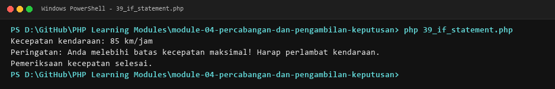

##### 40. If-Else Decision Branching

- **Source Code**: [`40_if_else.php`](./module-04-percabangan-dan-pengambilan-keputusan/40_if_else.php)
- **Key Concept**: Dual-branch alternative execution.
- **Mechanism**: Directs program execution between two distinct branches based on condition truthiness.
- **Execution Output**:

  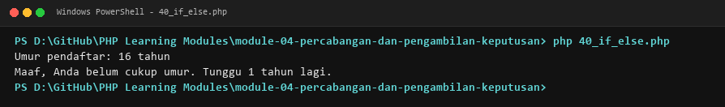

##### 41. Elseif Multi-Branch Decision Chains

- **Source Code**: [`41_elseif_statement.php`](./module-04-percabangan-dan-pengambilan-keputusan/41_elseif_statement.php)
- **Key Concept**: Multi-condition evaluation ladders.
- **Mechanism**: Evaluates mutually exclusive conditions sequentially using elseif statements.
- **Execution Output**:

  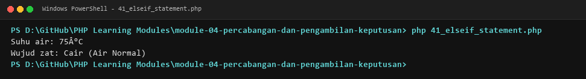

##### 42. Nested If Statements

- **Source Code**: [`42_nested_if.php`](./module-04-percabangan-dan-pengambilan-keputusan/42_nested_if.php)
- **Key Concept**: Hierarchical multi-level condition trees.
- **Mechanism**: Nests conditional blocks within outer branches to model complex decision structures.
- **Execution Output**:

  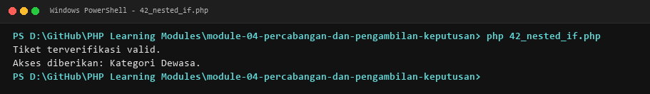

##### 43. Switch-Case Dispatching

- **Source Code**: [`43_switch_statement.php`](./module-04-percabangan-dan-pengambilan-keputusan/43_switch_statement.php)
- **Key Concept**: Multi-way equality dispatching.
- **Mechanism**: Matches an expression against multiple case values with break jump statements and default fallbacks.
- **Execution Output**:

  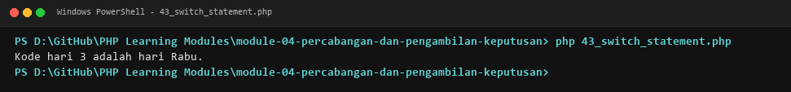

##### 44. Modern Match Expressions

- **Source Code**: [`44_match_expression.php`](./module-04-percabangan-dan-pengambilan-keputusan/44_match_expression.php)
- **Key Concept**: Strict, expression-based pattern dispatching in PHP 8+.
- **Mechanism**: Uses match() to return values based on strict type comparison without requiring break statements.
- **Execution Output**:

  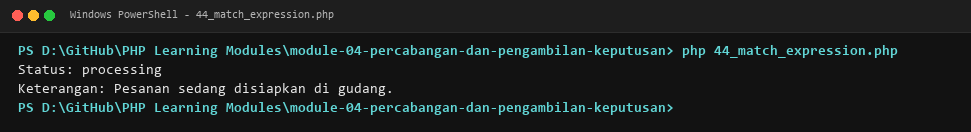

##### 45. Truthy and Falsy Value Evaluation

- **Source Code**: [`45_truthy_falsy.php`](./module-04-percabangan-dan-pengambilan-keputusan/45_truthy_falsy.php)
- **Key Concept**: Implicit boolean conversion rules.
- **Mechanism**: Demonstrates how values like 0, empty string, null, and empty arrays evaluate as false.
- **Execution Output**:

  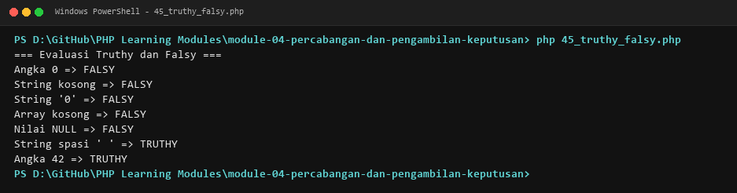

##### 46. Compound Multi-Condition Logic

- **Source Code**: [`46_multiple_conditions.php`](./module-04-percabangan-dan-pengambilan-keputusan/46_multiple_conditions.php)
- **Key Concept**: Complex boolean decision trees.
- **Mechanism**: Combines multiple relational checks using logical conjunctions (&&) and disjunctions (||).
- **Execution Output**:

  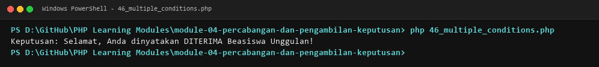

##### 47. Practical Algorithm: Student Grade Calculator

- **Source Code**: [`47_grade_calculator.php`](./module-04-percabangan-dan-pengambilan-keputusan/47_grade_calculator.php)
- **Key Concept**: Academic scoring and letter grade evaluation.
- **Mechanism**: Maps numerical scores to academic letter grades (A, B, C, D, E) and passing statuses.
- **Execution Output**:

  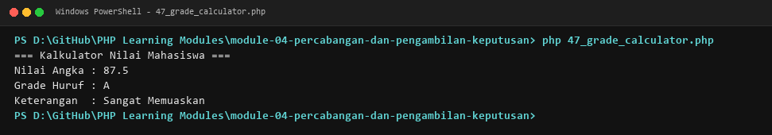

##### 48. Practical Algorithm: Parity Checker

- **Source Code**: [`48_even_odd.php`](./module-04-percabangan-dan-pengambilan-keputusan/48_even_odd.php)
- **Key Concept**: Even and odd integer classification.
- **Mechanism**: Applies the modulo operator (%) to determine whether an input integer is even or odd.
- **Execution Output**:

  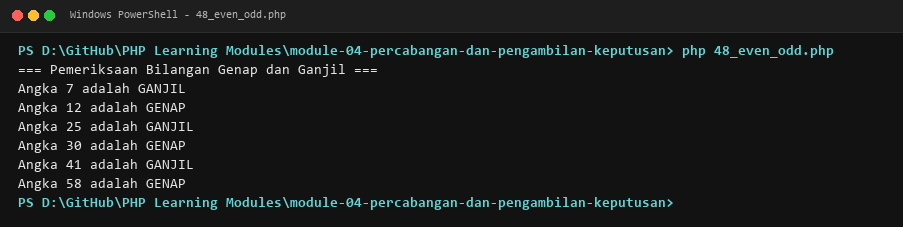

##### 49. Practical Algorithm: Leap Year Determination

- **Source Code**: [`49_leap_year.php`](./module-04-percabangan-dan-pengambilan-keputusan/49_leap_year.php)
- **Key Concept**: Calendar leap year mathematical validation.
- **Mechanism**: Implements calendar leap year rules (divisible by 4, not 100 unless divisible by 400).
- **Execution Output**:

  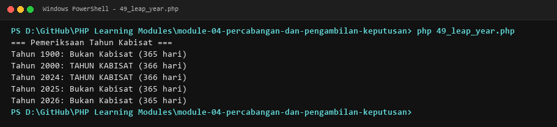

##### 50. Practical Algorithm: Tiered Discount Calculator

- **Source Code**: [`50_discount_calculator.php`](./module-04-percabangan-dan-pengambilan-keputusan/50_discount_calculator.php)
- **Key Concept**: Commercial checkout discount computation.
- **Mechanism**: Calculates tiered percentage discounts based on total customer shopping cart expenditure.
- **Execution Output**:

  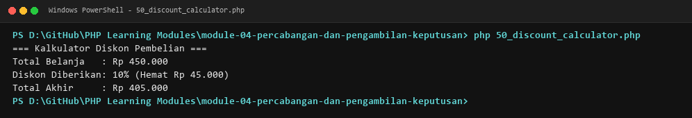

### Module 05: Loops and Iterations

**Curriculum Path**: [`module-05-perulangan`](./module-05-perulangan) | **Level**: `Fundamental` | **Scope**: 14 Programs (51–64)

#### Overview & Concepts Covered

Examines iterative control flow and algorithm execution: counted for loops, condition-controlled while loops, post-test do-while loops, collection traversal via foreach, nested coordinate iterations, jump statements (break, continue), alternative template syntax (endfor;, endif;), loop counters, series accumulators, factorial computation, multiplication tables, right-triangle number patterns, and a deterministic guessing game simulation.

#### Subtopics & Execution Captures

##### 51. For Loop Iteration

- **Source Code**: [`51_for_loop.php`](./module-05-perulangan/51_for_loop.php)
- **Key Concept**: Definite counted loops with initializers, conditions, and steppers.
- **Mechanism**: Executes iterative code blocks for a predetermined count using standard for ($i = 0; $i < n; $i++) syntax.
- **Execution Output**:

  

##### 52. While Loop Execution

- **Source Code**: [`52_while_loop.php`](./module-05-perulangan/52_while_loop.php)
- **Key Concept**: Indefinite condition-controlled loop execution.
- **Mechanism**: Tests a boolean predicate prior to entering the loop body and repeats execution while true.
- **Execution Output**:

  

##### 53. Do-While Loop Execution

- **Source Code**: [`53_do_while_loop.php`](./module-05-perulangan/53_do_while_loop.php)
- **Key Concept**: Post-test iteration with guaranteed initial execution.
- **Mechanism**: Executes the loop body at least once before validating the termination condition at the bottom.
- **Execution Output**:

  

##### 54. Foreach Loop Collection Traversal

- **Source Code**: [`54_foreach_loop.php`](./module-05-perulangan/54_foreach_loop.php)
- **Key Concept**: Direct iteration over indexed and associative arrays.
- **Mechanism**: Traverses array elements extracting individual values or key-value pairs without index tracking.
- **Execution Output**:

  

##### 55. Nested Loops and Multi-Dimensional Traversal

- **Source Code**: [`55_nested_loop.php`](./module-05-perulangan/55_nested_loop.php)
- **Key Concept**: Hierarchical iterative matrix processing.
- **Mechanism**: Executes inner loop structures inside outer loops to generate tabular grids and coordinate matrices.
- **Execution Output**:

  

##### 56. Break Statement for Loop Termination

- **Source Code**: [`56_break_statement.php`](./module-05-perulangan/56_break_statement.php)
- **Key Concept**: Early exit from iterative structures.
- **Mechanism**: Immediately terminates loop execution when an early target condition or sentinel value is encountered.
- **Execution Output**:

  

##### 57. Continue Statement for Iteration Skipping

- **Source Code**: [`57_continue_statement.php`](./module-05-perulangan/57_continue_statement.php)
- **Key Concept**: Skipping the remaining body of the current iteration.
- **Mechanism**: Bypasses subsequent instructions in the active iteration cycle and advances to the next step.
- **Execution Output**:

  

##### 58. Alternative Control Structure Syntax

- **Source Code**: [`58_alternative_syntax.php`](./module-05-perulangan/58_alternative_syntax.php)
- **Key Concept**: Template-friendly block syntax for view templates.
- **Mechanism**: Uses colon-based syntax (for:, endfor;, if:, endif;) ideal for embedding PHP within HTML markup.
- **Execution Output**:

  

##### 59. Loop Counter Variables

- **Source Code**: [`59_loop_counter.php`](./module-05-perulangan/59_loop_counter.php)
- **Key Concept**: Tracking event occurrences within iterative cycles.
- **Mechanism**: Maintains an integer counter inside a loop to calculate occurrence frequencies and filtered event counts.
- **Execution Output**:

  

##### 60. Practical Algorithm: Arithmetic Series Summation

- **Source Code**: [`60_sum_numbers.php`](./module-05-perulangan/60_sum_numbers.php)
- **Key Concept**: Iterative numerical accumulation.
- **Mechanism**: Computes the cumulative sum of numbers from 1 to N using an accumulator variable inside a loop.
- **Execution Output**:

  

##### 61. Practical Algorithm: Factorial Computation

- **Source Code**: [`61_factorial_loop.php`](./module-05-perulangan/61_factorial_loop.php)
- **Key Concept**: Iterative mathematical factorial calculation.
- **Mechanism**: Calculates n! = n * (n-1) * ... * 1 using an iterative multiplication accumulation loop.
- **Execution Output**:

  

##### 62. Practical Algorithm: Multiplication Table Generator

- **Source Code**: [`62_multiplication_table.php`](./module-05-perulangan/62_multiplication_table.php)
- **Key Concept**: Tabular formatted numerical matrix output.
- **Mechanism**: Generates a formatted mathematical multiplication table using nested for loops.
- **Execution Output**:

  

##### 63. Practical Algorithm: Right-Triangle Number Patterns

- **Source Code**: [`63_number_patterns.php`](./module-05-perulangan/63_number_patterns.php)
- **Key Concept**: Algorithmic string and numerical shape formatting.
- **Mechanism**: Constructs geometric right-triangle numerical patterns through nested loop coordinate printing.
- **Execution Output**:

  

##### 64. Practical Algorithm: Number Guessing Game Simulation

- **Source Code**: [`64_guessing_game.php`](./module-05-perulangan/64_guessing_game.php)
- **Key Concept**: Deterministic game loop and decision bounds.
- **Mechanism**: Simulates a binary search guessing game using a while loop with adaptive target comparisons.
- **Execution Output**:

  

### Module 06: Arrays and Data Collections

**Curriculum Path**: [`module-06-array-dan-manipulasi-data`](./module-06-array-dan-manipulasi-data) | **Level**: `Intermediate` | **Scope**: 20 Programs (65–84)

#### Overview & Concepts Covered

Comprehensive coverage of PHP array structures: zero-indexed lists, associative hash maps, multidimensional matrices, element mutations, iteration patterns, stack operations (array_push, array_pop), queue operations (array_shift, array_unshift), array merging, combining, key/value extraction, searching (in_array, array_search), functional filtering (array_filter), mapping (array_map), reduction (array_reduce), multi-criteria sorting (sort, asort, ksort, usort), slicing, in-place splicing, deduplication, and modern array destructuring.

#### Subtopics & Execution Captures

##### 65. Indexed Array Initialization and Traversal

- **Source Code**: [`65_indexed_array.php`](./module-06-array-dan-manipulasi-data/65_indexed_array.php)
- **Key Concept**: Zero-indexed sequential array structures.
- **Mechanism**: Initializes numerically indexed arrays and accesses elements using integer offset indices.
- **Execution Output**:

  

##### 66. Associative Array Key-Value Mapping

- **Source Code**: [`66_associative_array.php`](./module-06-array-dan-manipulasi-data/66_associative_array.php)
- **Key Concept**: String-keyed hash map data structures.
- **Mechanism**: Constructs associative arrays mapping descriptive string keys to varied data values.
- **Execution Output**:

  

##### 67. Multidimensional Array Matrices

- **Source Code**: [`67_multidimensional_array.php`](./module-06-array-dan-manipulasi-data/67_multidimensional_array.php)
- **Key Concept**: Nested array structures and nested data models.
- **Mechanism**: Represents complex hierarchical data and multi-column tables using arrays of associative arrays.
- **Execution Output**:

  

##### 68. Array Element Access, Mutation, and Appending

- **Source Code**: [`68_array_indexing.php`](./module-06-array-dan-manipulasi-data/68_array_indexing.php)
- **Key Concept**: Dynamic manipulation of array elements.
- **Mechanism**: Reads, modifies existing elements, and appends new elements using empty bracket syntax ($arr[] = ...).
- **Execution Output**:

  

##### 69. Array Iteration Strategies

- **Source Code**: [`69_array_iteration.php`](./module-06-array-dan-manipulasi-data/69_array_iteration.php)
- **Key Concept**: Iterating arrays via for, foreach, and array pointers.
- **Mechanism**: Compares counted for loops using count() against idiomatic foreach key-value iteration.
- **Execution Output**:

  

##### 70. Array Stack Operations with array_push and array_pop

- **Source Code**: [`70_array_push_pop.php`](./module-06-array-dan-manipulasi-data/70_array_push_pop.php)
- **Key Concept**: Last-In, First-Out (LIFO) stack data structures.
- **Mechanism**: Appends elements to the end of an array with array_push() and removes the last element with array_pop().
- **Execution Output**:

  

##### 71. Array Queue Operations with array_shift and array_unshift

- **Source Code**: [`71_array_shift_unshift.php`](./module-06-array-dan-manipulasi-data/71_array_shift_unshift.php)
- **Key Concept**: First-In, First-Out (FIFO) queue data structures.
- **Mechanism**: Prepends elements to the front with array_unshift() and dequeues the first element with array_shift().
- **Execution Output**:

  

##### 72. Array Merging with array_merge

- **Source Code**: [`72_array_merge.php`](./module-06-array-dan-manipulasi-data/72_array_merge.php)
- **Key Concept**: Combining multiple arrays into a unified collection.
- **Mechanism**: Merges multiple indexed and associative arrays, demonstrating numeric reindexing and key overwriting.
- **Execution Output**:

  

##### 73. Array Key-Value Pairing with array_combine

- **Source Code**: [`73_array_combine.php`](./module-06-array-dan-manipulasi-data/73_array_combine.php)
- **Key Concept**: Creating associative arrays from separate key and value lists.
- **Mechanism**: Constructs an associative array using one array for keys and another array for corresponding values.
- **Execution Output**:

  

##### 74. Extracting Keys and Values with array_keys and array_values

- **Source Code**: [`74_array_keys_values.php`](./module-06-array-dan-manipulasi-data/74_array_keys_values.php)
- **Key Concept**: Separating dictionary components into flat lists.
- **Mechanism**: Extracts all dictionary keys via array_keys() and reindexes values into a clean list via array_values().
- **Execution Output**:

  

##### 75. Array Searching with in_array and array_search

- **Source Code**: [`75_array_search.php`](./module-06-array-dan-manipulasi-data/75_array_search.php)
- **Key Concept**: Membership verification and index lookup in collections.
- **Mechanism**: Checks for element existence using in_array() and retrieves corresponding keys using array_search().
- **Execution Output**:

  

##### 76. Functional Filtering with array_filter

- **Source Code**: [`76_array_filter.php`](./module-06-array-dan-manipulasi-data/76_array_filter.php)
- **Key Concept**: Predicate-based element extraction.
- **Mechanism**: Filters array collections using anonymous callback functions to retain only elements meeting criteria.
- **Execution Output**:

  

##### 77. Functional Transformation with array_map

- **Source Code**: [`77_array_map.php`](./module-06-array-dan-manipulasi-data/77_array_map.php)
- **Key Concept**: Applying transformations across collection elements.
- **Mechanism**: Transforms all elements in an array by executing a callback function and returning a new collection.
- **Execution Output**:

  

##### 78. Array Accumulation with array_reduce

- **Source Code**: [`78_array_reduce.php`](./module-06-array-dan-manipulasi-data/78_array_reduce.php)
- **Key Concept**: Iterative collection reduction to a single scalar value.
- **Mechanism**: Iteratively reduces an array into a single summary value (e.g., total sum, composite string) via a reducer callback.
- **Execution Output**:

  

##### 79. Array Sorting Functions

- **Source Code**: [`79_array_sorting.php`](./module-06-array-dan-manipulasi-data/79_array_sorting.php)
- **Key Concept**: Ascending and descending ordering mechanisms.
- **Mechanism**: Applies sort(), rsort(), asort(), arsort(), ksort(), and krsort() across values and keys.
- **Execution Output**:

  

##### 80. Multidimensional Sorting with array_multisort

- **Source Code**: [`80_array_multisort.php`](./module-06-array-dan-manipulasi-data/80_array_multisort.php)
- **Key Concept**: Sorting complex tabular records by specific columns.
- **Mechanism**: Sorts arrays of records or multiple parallel arrays using array_multisort() with directional flags.
- **Execution Output**:

  

##### 81. Sub-Array Slicing with array_slice

- **Source Code**: [`81_array_slice.php`](./module-06-array-dan-manipulasi-data/81_array_slice.php)
- **Key Concept**: Extracting segments of arrays without modifying the original.
- **Mechanism**: Extracts contiguous sub-slices of array elements specifying offset indices and lengths.
- **Execution Output**:

  

##### 82. In-Place Array Splicing with array_splice

- **Source Code**: [`82_array_splice.php`](./module-06-array-dan-manipulasi-data/82_array_splice.php)
- **Key Concept**: Mutating arrays by removing and inserting elements.
- **Mechanism**: Removes elements from an array at a given offset and optionally replaces them with new elements in place.
- **Execution Output**:

  

##### 83. Removing Duplicates with array_unique

- **Source Code**: [`83_array_unique.php`](./module-06-array-dan-manipulasi-data/83_array_unique.php)
- **Key Concept**: Collection deduplication.
- **Mechanism**: Filters out duplicate values from an array, retaining only unique entries and their initial keys.
- **Execution Output**:

  

##### 84. Array Destructuring Syntax

- **Source Code**: [`84_array_destructuring.php`](./module-06-array-dan-manipulasi-data/84_array_destructuring.php)
- **Key Concept**: Unpacking array elements into individual variables.
- **Mechanism**: Unpacks indexed and associative array elements into distinct variables using list() and [$a, $b] syntax.
- **Execution Output**:

  

### Module 07: String Manipulation and Text Processing

**Curriculum Path**: [`module-07-string-dan-manipulasi-teks`](./module-07-string-dan-manipulasi-teks) | **Level**: `Intermediate` | **Scope**: 20 Programs (85–104)

#### Overview & Concepts Covered

Focuses on text processing and pattern matching: string primitives, concatenation, double-quoted interpolation, string byte length, case transformations, substring slicing (substr), modern PHP 8 text searching (str_contains, str_starts_with), replacement (str_replace), tokenization (explode), string joining (implode), whitespace trimming, character validation (ctype), formatted output (sprintf), multi-line Heredoc/Nowdoc blocks, UTF-8 multibyte processing (mbstring), string-to-array splitting, regular expression matching (preg_match), pattern validation, regex replacement, and URL slug generation.

#### Subtopics & Execution Captures

##### 85. String Basics and Character Access

- **Source Code**: [`85_string_basics.php`](./module-07-string-dan-manipulasi-teks/85_string_basics.php)
- **Key Concept**: Byte-level string representation and index offsets.
- **Mechanism**: Inspects ASCII characters, string literals, and retrieves individual characters via bracket indexing ($str[0]).
- **Execution Output**:

  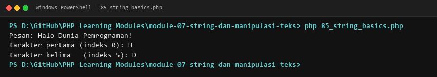

##### 86. String Concatenation Mechanics

- **Source Code**: [`86_string_concatenation.php`](./module-07-string-dan-manipulasi-teks/86_string_concatenation.php)
- **Key Concept**: Joining strings with concatenation operators.
- **Mechanism**: Combines multiple strings and variables using the dot operator (.) and concatenation assignment (.=).
- **Execution Output**:

  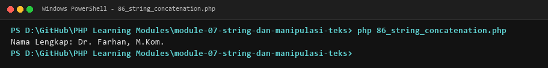

##### 87. String Interpolation and Variable Parsing

- **Source Code**: [`87_string_interpolation.php`](./module-07-string-dan-manipulasi-teks/87_string_interpolation.php)
- **Key Concept**: Embedding variables within double-quoted strings.
- **Mechanism**: Evaluates simple variables and complex bracketed expressions ({$user->name}) within double quotes.
- **Execution Output**:

  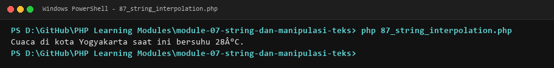

##### 88. String Length Calculation with strlen

- **Source Code**: [`88_string_length.php`](./module-07-string-dan-manipulasi-teks/88_string_length.php)
- **Key Concept**: Calculating raw byte length of strings.
- **Mechanism**: Determines string size in bytes using strlen(), noting differences between ASCII and multibyte text.
- **Execution Output**:

  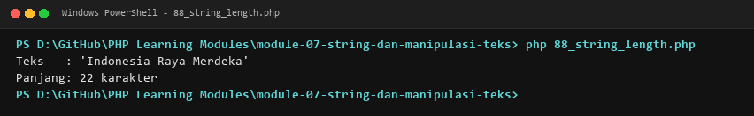

##### 89. Case Transformations with strtoupper and strtolower

- **Source Code**: [`89_string_case_conversion.php`](./module-07-string-dan-manipulasi-teks/89_string_case_conversion.php)
- **Key Concept**: Converting text casing across strings.
- **Mechanism**: Converts strings to uppercase (strtoupper), lowercase (strtolower), title case (ucwords), and capitalized (ucfirst).
- **Execution Output**:

  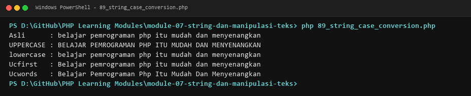

##### 90. Substring Extraction with substr

- **Source Code**: [`90_string_substring.php`](./module-07-string-dan-manipulasi-teks/90_string_substring.php)
- **Key Concept**: Extracting sub-strings based on character offsets.
- **Mechanism**: Extracts specific portions of a string using positive/negative start offsets and length parameters.
- **Execution Output**:

  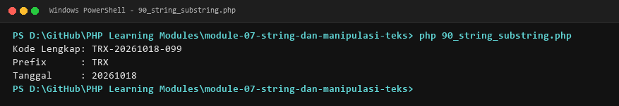

##### 91. Modern String Searching in PHP 8

- **Source Code**: [`91_string_search.php`](./module-07-string-dan-manipulasi-teks/91_string_search.php)
- **Key Concept**: Substring search and prefix/suffix verification.
- **Mechanism**: Uses str_contains(), str_starts_with(), str_ends_with(), and strpos() to locate text within strings.
- **Execution Output**:

  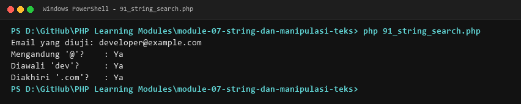

##### 92. Text Replacement with str_replace

- **Source Code**: [`92_string_replace.php`](./module-07-string-dan-manipulasi-teks/92_string_replace.php)
- **Key Concept**: Locating and replacing target substrings.
- **Mechanism**: Performs single and batch string substitutions using str_replace() and case-insensitive str_ireplace().
- **Execution Output**:

  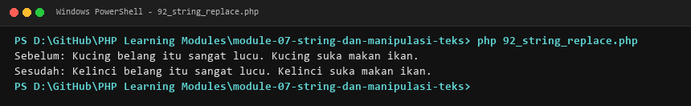

##### 93. String Splitting with explode

- **Source Code**: [`93_string_split.php`](./module-07-string-dan-manipulasi-teks/93_string_split.php)
- **Key Concept**: Tokenizing strings into array elements by delimiter.
- **Mechanism**: Splits delimited text strings (e.g., comma-separated, hyphenated) into indexed arrays using explode().
- **Execution Output**:

  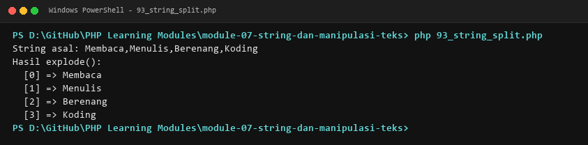

##### 94. Joining Arrays into Strings with implode

- **Source Code**: [`94_string_join.php`](./module-07-string-dan-manipulasi-teks/94_string_join.php)
- **Key Concept**: Combining collection elements into delimited text.
- **Mechanism**: Joins array elements into a unified string separated by specified glue delimiters using implode().
- **Execution Output**:

  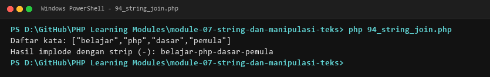

##### 95. Whitespace Trimming with trim, ltrim, and rtrim

- **Source Code**: [`95_string_trim.php`](./module-07-string-dan-manipulasi-teks/95_string_trim.php)
- **Key Concept**: Sanitizing leading and trailing whitespace characters.
- **Mechanism**: Strips whitespace, tabs, and newlines from the start, end, or both ends of a text string.
- **Execution Output**:

  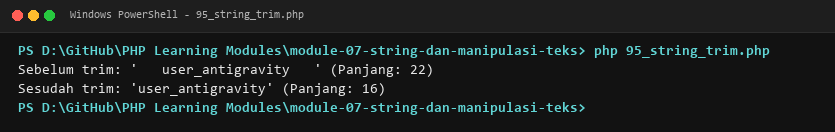

##### 96. String Content and Character Validation

- **Source Code**: [`96_string_validation.php`](./module-07-string-dan-manipulasi-teks/96_string_validation.php)
- **Key Concept**: Validating string characteristics.
- **Mechanism**: Validates string states using empty(), is_numeric(), and ctype functions (ctype_alpha, ctype_digit).
- **Execution Output**:

  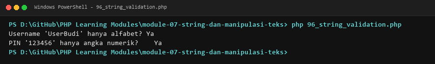

##### 97. Formatted String Output with sprintf

- **Source Code**: [`97_string_formatting.php`](./module-07-string-dan-manipulasi-teks/97_string_formatting.php)
- **Key Concept**: Composing formatted strings using conversion specifiers.
- **Mechanism**: Formats numbers, decimals, and padded strings using sprintf() and printf() with %s, %d, and %.2f specifiers.
- **Execution Output**:

  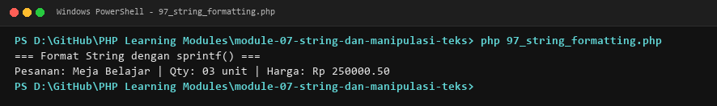

##### 98. Multi-Line Strings with Heredoc and Nowdoc

- **Source Code**: [`98_heredoc_nowdoc.php`](./module-07-string-dan-manipulasi-teks/98_heredoc_nowdoc.php)
- **Key Concept**: Preserving formatting in large text and template blocks.
- **Mechanism**: Composes multi-line text blocks using Heredoc (<<<EOD, interpolating) and Nowdoc (<<<'EOD', literal).
- **Execution Output**:

  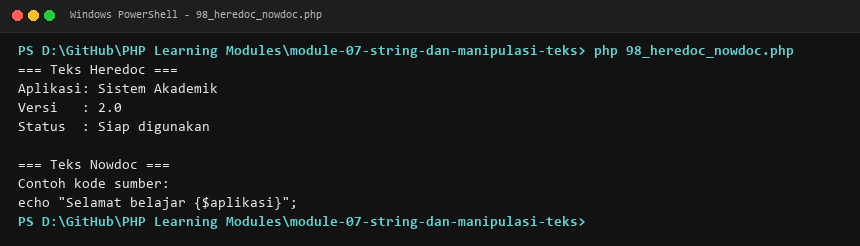

##### 99. Multibyte String Processing with mbstring

- **Source Code**: [`99_multibyte_strings.php`](./module-07-string-dan-manipulasi-teks/99_multibyte_strings.php)
- **Key Concept**: Handling UTF-8, accented characters, and Unicode text.
- **Mechanism**: Processes international characters and emojis accurately using mb_strlen(), mb_substr(), and mb_strpos().
- **Execution Output**:

  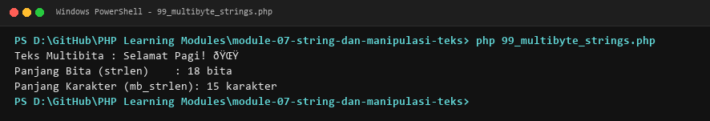

##### 100. String to Array Conversion with str_split

- **Source Code**: [`100_string_to_array.php`](./module-07-string-dan-manipulasi-teks/100_string_to_array.php)
- **Key Concept**: Splitting strings into character arrays.
- **Mechanism**: Deconstructs strings into single-character or multi-character chunks using str_split().
- **Execution Output**:

  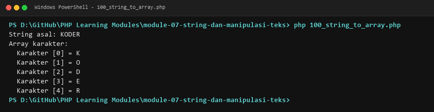

##### 101. Regular Expressions Fundamentals with preg_match

- **Source Code**: [`101_regex_basic.php`](./module-07-string-dan-manipulasi-teks/101_regex_basic.php)
- **Key Concept**: Pattern matching and regex syntax in PHP.
- **Mechanism**: Matches text against basic regular expressions using preg_match() to detect character patterns.
- **Execution Output**:

  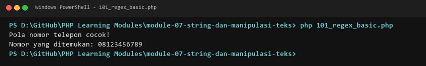

##### 102. Regex Input Validation for Email Formats

- **Source Code**: [`102_regex_validation.php`](./module-07-string-dan-manipulasi-teks/102_regex_validation.php)
- **Key Concept**: Validating structured string patterns.
- **Mechanism**: Applies complex regex patterns to validate the format of email addresses and phone numbers.
- **Execution Output**:

  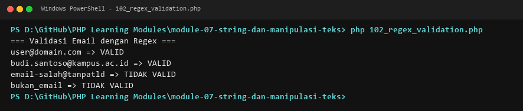

##### 103. Pattern Replacement with preg_replace

- **Source Code**: [`103_regex_replace.php`](./module-07-string-dan-manipulasi-teks/103_regex_replace.php)
- **Key Concept**: Search and replace using regular expressions.
- **Mechanism**: Replaces multiple spaces, special characters, or pattern occurrences using preg_replace().
- **Execution Output**:

  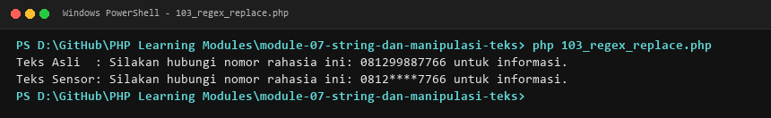

##### 104. Practical Algorithm: SEO-Friendly URL Slug Generator

- **Source Code**: [`104_slug_generator.php`](./module-07-string-dan-manipulasi-teks/104_slug_generator.php)
- **Key Concept**: Transforming text into clean URL slugs.
- **Mechanism**: Converts article titles to lowercase, replaces punctuation and spaces with hyphens for clean URLs.
- **Execution Output**:

  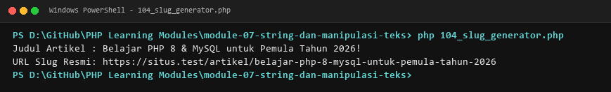

### Module 08: Functions and Modular Design

**Curriculum Path**: [`module-08-fungsi`](./module-08-fungsi) | **Level**: `Intermediate` | **Scope**: 20 Programs (105–124)

#### Overview & Concepts Covered

Covers procedural abstraction and functional programming in PHP: function definitions, parameterized arguments, return statements, void return types, default parameters, PHP 8 named arguments, variadic functions with the splat operator (...$args), argument unpacking, static type declarations, union types (int|float), intersection types, nullable types (?string), the never return type, variable scoping, global access, anonymous functions (lambdas), concise arrow functions (fn() => ...), closures with lexical state capture (use), recursive subroutines, and first-class callable syntax.

#### Subtopics & Execution Captures

##### 105. Function Declaration and Execution

- **Source Code**: [`105_function_basic.php`](./module-08-fungsi/105_function_basic.php)
- **Key Concept**: Modular subroutine definition and execution.
- **Mechanism**: Declares reusable functions using the function keyword and invokes them from various call sites.
- **Execution Output**:

  

##### 106. Function Parameters and Arguments

- **Source Code**: [`106_function_parameters.php`](./module-08-fungsi/106_function_parameters.php)
- **Key Concept**: Passing input values into modular subroutines.
- **Mechanism**: Defines multiple formal parameters and passes actual arguments to perform parameterized computations.
- **Execution Output**:

  

##### 107. Return Statements and Values

- **Source Code**: [`107_return_statement.php`](./module-08-fungsi/107_return_statement.php)
- **Key Concept**: Returning computational results from functions.
- **Mechanism**: Uses return statements to pass calculated values back to the caller and terminate function execution.
- **Execution Output**:

  

##### 108. Void Return Type Declarations

- **Source Code**: [`108_void_return_type.php`](./module-08-fungsi/108_void_return_type.php)
- **Key Concept**: Explicitly declaring non-returning procedures.
- **Mechanism**: Specifies a void return type indicating the function produces side effects without returning data.
- **Execution Output**:

  

##### 109. Default Parameter Values

- **Source Code**: [`109_default_parameters.php`](./module-08-fungsi/109_default_parameters.php)
- **Key Concept**: Authoring functions with optional arguments.
- **Mechanism**: Assigns default values to trailing parameters, allowing callers to omit optional inputs.
- **Execution Output**:

  

##### 110. Named Arguments in PHP 8

- **Source Code**: [`110_named_arguments.php`](./module-08-fungsi/110_named_arguments.php)
- **Key Concept**: Passing function arguments by parameter name.
- **Mechanism**: Invokes functions specifying argument names (param: $val), bypassing positional order constraints.
- **Execution Output**:

  

##### 111. Variadic Functions with the Splat Operator

- **Source Code**: [`111_variadic_functions.php`](./module-08-fungsi/111_variadic_functions.php)
- **Key Concept**: Accepting dynamic, variable-length argument lists.
- **Mechanism**: Uses the splat operator (...$values) to capture arbitrary numbers of arguments into an indexed array.
- **Execution Output**:

  

##### 112. Argument Unpacking

- **Source Code**: [`112_argument_unpacking.php`](./module-08-fungsi/112_argument_unpacking.php)
- **Key Concept**: Expanding arrays into individual function parameters.
- **Mechanism**: Expands an array into discrete positional arguments when calling functions using the ... operator.
- **Execution Output**:

  

##### 113. Static Type Declarations

- **Source Code**: [`113_type_declarations.php`](./module-08-fungsi/113_type_declarations.php)
- **Key Concept**: Enforcing parameter and return type contracts.
- **Mechanism**: Specifies explicit primitive types (int, string, bool, array) on parameters and return signatures.
- **Execution Output**:

  

##### 114. Union Types in PHP 8

- **Source Code**: [`114_union_types.php`](./module-08-fungsi/114_union_types.php)
- **Key Concept**: Accepting multiple distinct types in signatures.
- **Mechanism**: Declares union types (int|float, string|false) allowing flexible typed inputs and return values.
- **Execution Output**:

  

##### 115. Intersection Types in PHP 8.1+

- **Source Code**: [`115_intersection_types.php`](./module-08-fungsi/115_intersection_types.php)
- **Key Concept**: Requiring values to satisfy multiple interfaces.
- **Mechanism**: Declares intersection types (Countable&Iterator) requiring parameters to implement all combined types.
- **Execution Output**:

  

##### 116. Nullable Types

- **Source Code**: [`116_nullable_types.php`](./module-08-fungsi/116_nullable_types.php)
- **Key Concept**: Permitting null values alongside specified types.
- **Mechanism**: Prefixes type declarations with a question mark (?string) to explicitly allow null values.
- **Execution Output**:

  

##### 117. Never Return Type in PHP 8.1+

- **Source Code**: [`117_never_return_type.php`](./module-08-fungsi/117_never_return_type.php)
- **Key Concept**: Indicating functions that never return normally.
- **Mechanism**: Specifies the never return type for functions that always throw exceptions or terminate execution via exit().
- **Execution Output**:

  

##### 118. Variable Scope and Local Variables

- **Source Code**: [`118_function_scope.php`](./module-08-fungsi/118_function_scope.php)
- **Key Concept**: Local function isolation versus global scope.
- **Mechanism**: Demonstrates variable lifetime and isolation inside functions, preventing accidental outer mutation.
- **Execution Output**:

  

##### 119. Accessing Global Scope with global and $GLOBALS

- **Source Code**: [`119_global_keyword.php`](./module-08-fungsi/119_global_keyword.php)
- **Key Concept**: Referencing global variables from inner functions.
- **Mechanism**: Accesses and mutates outer global variables inside functions using the global keyword and $GLOBALS.
- **Execution Output**:

  

##### 120. Anonymous Functions and Lambdas

- **Source Code**: [`120_anonymous_functions.php`](./module-08-fungsi/120_anonymous_functions.php)
- **Key Concept**: First-class nameless functions assigned to variables.
- **Mechanism**: Defines anonymous function closures assigned to variables and passed directly into higher-order functions.
- **Execution Output**:

  

##### 121. Arrow Functions in PHP 7.4+

- **Source Code**: [`121_arrow_functions.php`](./module-08-fungsi/121_arrow_functions.php)
- **Key Concept**: Concise one-liner closures with automatic variable capture.
- **Mechanism**: Uses fn($x) => $x * 2 syntax with automatic by-value lexical scope capture from parent contexts.
- **Execution Output**:

  

##### 122. Closures and Lexical Scope Binding with use

- **Source Code**: [`122_closures.php`](./module-08-fungsi/122_closures.php)
- **Key Concept**: Binding external variables to anonymous functions.
- **Mechanism**: Captures variables from the parent lexical scope into anonymous functions using the use clause.
- **Execution Output**:

  

##### 123. Recursive Functions and Algorithmic Base Cases

- **Source Code**: [`123_recursive_functions.php`](./module-08-fungsi/123_recursive_functions.php)
- **Key Concept**: Self-referencing subroutines with termination guards.
- **Mechanism**: Implements recursive factorial and countdown algorithms terminating cleanly on predefined base cases.
- **Execution Output**:

  

##### 124. First-Class Callable Syntax in PHP 8.1+

- **Source Code**: [`124_first_class_callables.php`](./module-08-fungsi/124_first_class_callables.php)
- **Key Concept**: Referencing existing functions and methods as Closures.
- **Mechanism**: Uses the closure-from-callable syntax strlen(...) to obtain callable references concisely.
- **Execution Output**:

  

### Module 09: Object-Oriented Programming (OOP) Fundamentals

**Curriculum Path**: [`module-09-object-oriented-programming-oop-dasar`](./module-09-object-oriented-programming-oop-dasar) | **Level**: `Intermediate` | **Scope**: 20 Programs (125–144)

#### Overview & Concepts Covered

Establishes foundational object-oriented software engineering: class blueprints and object instantiation, properties, methods, constructors (__construct), destructors (__destruct), visibility access modifiers (public, protected, private), data encapsulation, getter/setter patterns, the $this reference, static members, class constants, object instantiation patterns, object cloning (__clone), identity comparison, anonymous classes, constructor property promotion, readonly properties, magic methods (__toString, __get, __set), and object byte serialization.

#### Subtopics & Execution Captures

##### 125. Class Definition and Object Instantiation

- **Source Code**: [`125_class_basic.php`](./module-09-object-oriented-programming-oop-dasar/125_class_basic.php)
- **Key Concept**: Object blueprints and memory instance creation.
- **Mechanism**: Defines classes with class and instantiates individual objects using the new keyword.
- **Execution Output**:

  

##### 126. Class Properties and State Management

- **Source Code**: [`126_class_properties.php`](./module-09-object-oriented-programming-oop-dasar/126_class_properties.php)
- **Key Concept**: Defining object attributes and default states.
- **Mechanism**: Declares typed public and protected properties to hold internal object state.
- **Execution Output**:

  

##### 127. Class Methods and Member Functions

- **Source Code**: [`127_class_methods.php`](./module-09-object-oriented-programming-oop-dasar/127_class_methods.php)
- **Key Concept**: Defining behavior and operational routines on objects.
- **Mechanism**: Declares member functions that manipulate object state and compute business operations.
- **Execution Output**:

  

##### 128. Class Constructors with __construct

- **Source Code**: [`128_constructor.php`](./module-09-object-oriented-programming-oop-dasar/128_constructor.php)
- **Key Concept**: Automated object initialization upon creation.
- **Mechanism**: Implements __construct() to receive setup parameters and configure initial object state.
- **Execution Output**:

  

##### 129. Class Destructors with __destruct

- **Source Code**: [`129_destructor.php`](./module-09-object-oriented-programming-oop-dasar/129_destructor.php)
- **Key Concept**: Lifecycle cleanup routines upon object destruction.
- **Mechanism**: Implements __destruct() to execute teardown and resource release when objects leave scope.
- **Execution Output**:

  

##### 130. Visibility Access Modifiers

- **Source Code**: [`130_access_modifiers.php`](./module-09-object-oriented-programming-oop-dasar/130_access_modifiers.php)
- **Key Concept**: Information hiding with public, protected, and private.
- **Mechanism**: Restricts property and method accessibility using public, protected, and private visibility keywords.
- **Execution Output**:

  

##### 131. Encapsulation and Data Protection

- **Source Code**: [`131_encapsulation.php`](./module-09-object-oriented-programming-oop-dasar/131_encapsulation.php)
- **Key Concept**: Bundling data with defensive mutation controls.
- **Mechanism**: Hides sensitive internal fields as private and exposes safe public accessors and mutators.
- **Execution Output**:

  

##### 132. Getter and Setter Accessor Patterns

- **Source Code**: [`132_getter_setter.php`](./module-09-object-oriented-programming-oop-dasar/132_getter_setter.php)
- **Key Concept**: Controlled property reading and validated writing.
- **Mechanism**: Implements get* and set* methods with validation logic to safeguard object invariants.
- **Execution Output**:

  

##### 133. The $this Pseudo-Variable

- **Source Code**: [`133_this_keyword.php`](./module-09-object-oriented-programming-oop-dasar/133_this_keyword.php)
- **Key Concept**: Referencing the current active object instance.
- **Mechanism**: Uses $this->property and $this->method() to access member properties from within class methods.
- **Execution Output**:

  

##### 134. Static Properties and Class-Level State

- **Source Code**: [`134_static_properties.php`](./module-09-object-oriented-programming-oop-dasar/134_static_properties.php)
- **Key Concept**: Shared state across all class instances.
- **Mechanism**: Declares static properties accessible via self::$prop that persist across individual object instances.
- **Execution Output**:

  

##### 135. Static Methods and Utility Routines

- **Source Code**: [`135_static_methods.php`](./module-09-object-oriented-programming-oop-dasar/135_static_methods.php)
- **Key Concept**: Calling methods without instantiating class objects.
- **Mechanism**: Defines static methods invoked directly from the class name using the scope resolution operator (::).
- **Execution Output**:

  

##### 136. Class Constants and Immutable Values

- **Source Code**: [`136_class_constants.php`](./module-09-object-oriented-programming-oop-dasar/136_class_constants.php)
- **Key Concept**: Defining immutable class-level constants.
- **Mechanism**: Defines constant values with const and accesses them via ClassName::CONSTANT and self::CONSTANT.
- **Execution Output**:

  

##### 137. Dynamic Object Instantiation Patterns

- **Source Code**: [`137_object_instantiation.php`](./module-09-object-oriented-programming-oop-dasar/137_object_instantiation.php)
- **Key Concept**: Factory patterns and variable class instantiation.
- **Mechanism**: Instantiates objects dynamically using variable class names and parameterized factory methods.
- **Execution Output**:

  

##### 138. Object Cloning and Deep Copying with __clone

- **Source Code**: [`138_object_cloning.php`](./module-09-object-oriented-programming-oop-dasar/138_object_cloning.php)
- **Key Concept**: Duplicating objects and handling nested references.
- **Mechanism**: Clones objects with clone and implements __clone() to ensure nested object instances are deeply duplicated.
- **Execution Output**:

  

##### 139. Object Comparison and Equality Semantics

- **Source Code**: [`139_object_comparison.php`](./module-09-object-oriented-programming-oop-dasar/139_object_comparison.php)
- **Key Concept**: Comparing object properties and instance identities.
- **Mechanism**: Compares objects using == (property equivalence) and === (exact memory instance identity).
- **Execution Output**:

  

##### 140. Anonymous Classes

- **Source Code**: [`140_anonymous_classes.php`](./module-09-object-oriented-programming-oop-dasar/140_anonymous_classes.php)
- **Key Concept**: On-the-fly ephemeral class definitions.
- **Mechanism**: Creates lightweight, disposable objects using new class { ... } without polluting the namespace.
- **Execution Output**:

  

##### 141. Constructor Property Promotion in PHP 8

- **Source Code**: [`141_constructor_promotion.php`](./module-09-object-oriented-programming-oop-dasar/141_constructor_promotion.php)
- **Key Concept**: Streamlining property declaration in constructor parameters.
- **Mechanism**: Declares and initializes class properties directly within constructor arguments (public string $name).
- **Execution Output**:

  

##### 142. Readonly Properties in PHP 8.1+

- **Source Code**: [`142_readonly_properties.php`](./module-09-object-oriented-programming-oop-dasar/142_readonly_properties.php)
- **Key Concept**: Enforcing immutability on initialized object properties.
- **Mechanism**: Marks properties as readonly, allowing initialization exactly once and forbidding subsequent mutation.
- **Execution Output**:

  

##### 143. Magic Methods: Intercepting Object Interactions

- **Source Code**: [`143_magic_methods.php`](./module-09-object-oriented-programming-oop-dasar/143_magic_methods.php)
- **Key Concept**: Customizing object behavior via magic methods.
- **Mechanism**: Implements __toString(), __get(), and __set() to handle string conversions and dynamic property access.
- **Execution Output**:

  

##### 144. Object Serialization and Deserialization

- **Source Code**: [`144_object_serialization.php`](./module-09-object-oriented-programming-oop-dasar/144_object_serialization.php)
- **Key Concept**: Converting objects into storable byte streams.
- **Mechanism**: Converts objects to strings using serialize() and restores full object instances using unserialize().
- **Execution Output**:

  

### Module 10: Advanced OOP and Architecture

**Curriculum Path**: [`module-10-oop-lanjutan`](./module-10-oop-lanjutan) | **Level**: `Intermediate to Advanced` | **Scope**: 20 Programs (145–164)

#### Overview & Concepts Covered

Dives into advanced object-oriented architectures: class inheritance (extends), method overriding, the parent keyword, final classes and methods, abstract classes and abstract method contracts, pure interfaces (implements), multiple interface implementation, horizontal code reuse with traits, trait collision resolution (insteadof, as), late static binding (static::), return type covariance and argument contravariance, composition and aggregation patterns, dependency injection fundamentals, pure enumerations (enum), backed enums, native PHP attributes (#[Attribute]), and runtime introspection with the Reflection API.

#### Subtopics & Execution Captures

##### 145. Class Inheritance with extends

- **Source Code**: [`145_inheritance.php`](./module-10-oop-lanjutan/145_inheritance.php)
- **Key Concept**: Code reuse and hierarchical specialization.
- **Mechanism**: Derives child classes from parent classes using extends, inheriting public and protected members.
- **Execution Output**:

  

##### 146. Method Overriding in Subclasses

- **Source Code**: [`146_method_overriding.php`](./module-10-oop-lanjutan/146_method_overriding.php)
- **Key Concept**: Specializing inherited behavior in derived classes.
- **Mechanism**: Reimplements inherited parent methods in child classes to tailor functionality for specialized subclasses.
- **Execution Output**:

  

##### 147. The parent Keyword and Base Invocation

- **Source Code**: [`147_parent_keyword.php`](./module-10-oop-lanjutan/147_parent_keyword.php)
- **Key Concept**: Calling overridden parent methods from subclasses.
- **Mechanism**: Uses parent::__construct() and parent::method() to invoke base class functionality within child overrides.
- **Execution Output**:

  

##### 148. Final Classes and Final Methods

- **Source Code**: [`148_final_classes_methods.php`](./module-10-oop-lanjutan/148_final_classes_methods.php)
- **Key Concept**: Preventing class inheritance and method overriding.
- **Mechanism**: Declares classes and methods with final to protect core implementations against unwanted modification.
- **Execution Output**:

  

##### 149. Abstract Classes as Architectural Blueprints

- **Source Code**: [`149_abstract_classes.php`](./module-10-oop-lanjutan/149_abstract_classes.php)
- **Key Concept**: Defining non-instantiable base architectural classes.
- **Mechanism**: Defines abstract class structures that enforce shared member signatures while preventing direct instantiation.
- **Execution Output**:

  

##### 150. Abstract Methods and Contract Enforcement

- **Source Code**: [`150_abstract_methods.php`](./module-10-oop-lanjutan/150_abstract_methods.php)
- **Key Concept**: Mandating method implementation in derived classes.
- **Mechanism**: Declares abstract method signatures without bodies, forcing all concrete subclasses to implement them.
- **Execution Output**:

  

##### 151. Interface Definitions as Pure Contracts

- **Source Code**: [`151_interfaces.php`](./module-10-oop-lanjutan/151_interfaces.php)
- **Key Concept**: Defining pure behavioral contracts for classes.
- **Mechanism**: Defines interface types with public method signatures and constants without implementation bodies.
- **Execution Output**:

  

##### 152. Interface Implementation with implements

- **Source Code**: [`152_interface_implementation.php`](./module-10-oop-lanjutan/152_interface_implementation.php)
- **Key Concept**: Fulfilling interface contracts in concrete classes.
- **Mechanism**: Implements interfaces on classes using implements, ensuring all mandated methods are provided.
- **Execution Output**:

  

##### 153. Multiple Interface Implementation

- **Source Code**: [`153_multiple_interfaces.php`](./module-10-oop-lanjutan/153_multiple_interfaces.php)
- **Key Concept**: Composing multiple behavioral contracts on a single class.
- **Mechanism**: Implements multiple interfaces simultaneously (implements InterfaceA, InterfaceB) for modular design.
- **Execution Output**:

  

##### 154. Horizontal Code Reuse with Traits

- **Source Code**: [`154_traits.php`](./module-10-oop-lanjutan/154_traits.php)
- **Key Concept**: Sharing methods across independent class hierarchies.
- **Mechanism**: Defines reusable traits with the trait keyword and includes them into classes using the use statement.
- **Execution Output**:

  

##### 155. Resolving Trait Collisions and Aliasing

- **Source Code**: [`155_trait_conflicts.php`](./module-10-oop-lanjutan/155_trait_conflicts.php)
- **Key Concept**: Handling identical method names across multiple traits.
- **Mechanism**: Resolves trait method naming collisions using insteadof and renames conflicting methods using as.
- **Execution Output**:

  

##### 156. Late Static Binding with static::

- **Source Code**: [`156_late_static_binding.php`](./module-10-oop-lanjutan/156_late_static_binding.php)
- **Key Concept**: Runtime class resolution in inherited static contexts.
- **Mechanism**: Uses static:: to refer to the runtime calling class rather than the compile-time defining class (self::).
- **Execution Output**:

  

##### 157. Covariance and Contravariance in Type Systems

- **Source Code**: [`157_covariance_contravariance.php`](./module-10-oop-lanjutan/157_covariance_contravariance.php)
- **Key Concept**: Refining return types and loosening parameter types.
- **Mechanism**: Demonstrates return type covariance (narrowing) and argument type contravariance (widening) in subclasses.
- **Execution Output**:

  

##### 158. Object Composition over Inheritance

- **Source Code**: [`158_composition.php`](./module-10-oop-lanjutan/158_composition.php)
- **Key Concept**: Modeling 'has-a' relationships through internal objects.
- **Mechanism**: Instantiates dependent component objects directly inside the composite class to build modular systems.
- **Execution Output**:

  

##### 159. Object Aggregation

- **Source Code**: [`159_aggregation.php`](./module-10-oop-lanjutan/159_aggregation.php)
- **Key Concept**: Modeling loose 'has-a' relationships via external references.
- **Mechanism**: Passes externally created component objects into a host object, allowing independent lifecycles.
- **Execution Output**:

  

##### 160. Dependency Injection Fundamentals

- **Source Code**: [`160_dependency_injection.php`](./module-10-oop-lanjutan/160_dependency_injection.php)
- **Key Concept**: Inverting control through constructor injection.
- **Mechanism**: Passes concrete dependencies into classes through constructor parameters, facilitating unit test mocking.
- **Execution Output**:

  

##### 161. Pure Enumerations in PHP 8.1+

- **Source Code**: [`161_enums.php`](./module-10-oop-lanjutan/161_enums.php)
- **Key Concept**: Type-safe constant collections.
- **Mechanism**: Declares pure enum types containing distinct, type-safe cases to eliminate raw magic strings and integers.
- **Execution Output**:

  

##### 162. Backed Enumerations with Scalar Values

- **Source Code**: [`162_backed_enums.php`](./module-10-oop-lanjutan/162_backed_enums.php)
- **Key Concept**: Associating enum cases with string or integer values.
- **Mechanism**: Declares backed enums (enum Status: string) and retrieves values or instances using ->value and ::from().
- **Execution Output**:

  

##### 163. Structured Metadata with PHP Attributes

- **Source Code**: [`163_attributes.php`](./module-10-oop-lanjutan/163_attributes.php)
- **Key Concept**: Native machine-readable annotations on code declarations.
- **Mechanism**: Defines and applies #[Attribute] metadata on classes and methods without relying on docblock parsing.
- **Execution Output**:

  

##### 164. Runtime Introspection with the Reflection API

- **Source Code**: [`164_reflection_api.php`](./module-10-oop-lanjutan/164_reflection_api.php)
- **Key Concept**: Inspecting class metadata, methods, and properties.
- **Mechanism**: Uses ReflectionClass and ReflectionMethod to inspect internal class structures and modifier flags at runtime.
- **Execution Output**:

  

### Module 11: Advanced Features and PHP Standard Library

**Curriculum Path**: [`module-11-fitur-lanjutan-dan-standard-library-php`](./module-11-fitur-lanjutan-dan-standard-library-php) | **Level**: `Advanced` | **Scope**: 20 Programs (165–184)

#### Overview & Concepts Covered

Explores advanced language capabilities and the Standard PHP Library (SPL): date and time manipulation (DateTime), immutable temporal operations (DateTimeImmutable), timezone handling (DateTimeZone), standard math utilities, pseudo-random generators, cryptographically secure randomness (random_int), JSON serialization and deserialization (json_encode, json_decode), SPL collection iterators, memory-efficient generators (yield, yield from), closure scope rebinding (bindTo), weak references (WeakReference), cooperative concurrency with Fibers, enum methods, metadata attributes inspection, readonly classes, and cutting-edge PHP 8.4 property hooks and asymmetric visibility paradigms.

#### Subtopics & Execution Captures

##### 165. Date and Time Management with DateTime

- **Source Code**: [`165_date_time.php`](./module-11-fitur-lanjutan-dan-standard-library-php/165_date_time.php)
- **Key Concept**: Working with temporal data and formatting.
- **Mechanism**: Creates DateTime instances, applies format(), and modifies dates using modify() and add().
- **Execution Output**:

  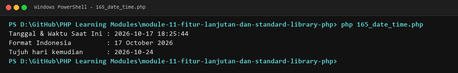

##### 166. Immutable Temporal Operations with DateTimeImmutable

- **Source Code**: [`166_date_time_immutable.php`](./module-11-fitur-lanjutan-dan-standard-library-php/166_date_time_immutable.php)
- **Key Concept**: Thread-safe and mutation-safe date calculations.
- **Mechanism**: Uses DateTimeImmutable to perform date arithmetic that returns new instances without mutating originals.
- **Execution Output**:

  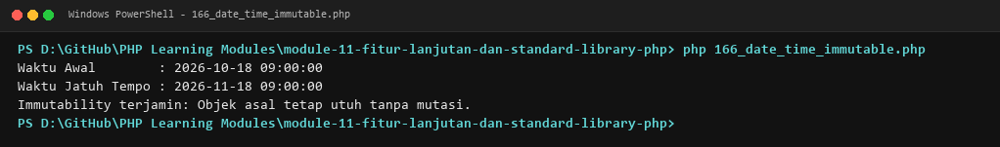

##### 167. Timezone Management with DateTimeZone

- **Source Code**: [`167_timezone_handling.php`](./module-11-fitur-lanjutan-dan-standard-library-php/167_timezone_handling.php)
- **Key Concept**: Handling international timezones and offset conversions.
- **Mechanism**: Sets and shifts timezones across regions (e.g., UTC to Asia/Jakarta) using DateTimeZone objects.
- **Execution Output**:

  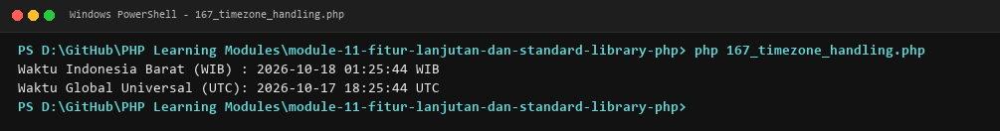

##### 168. Standard Mathematical Functions

- **Source Code**: [`168_math_functions.php`](./module-11-fitur-lanjutan-dan-standard-library-php/168_math_functions.php)
- **Key Concept**: Evaluating mathematical calculations and rounding.
- **Mechanism**: Applies abs(), round(), ceil(), floor(), sqrt(), and min()/max() to perform mathematical operations.
- **Execution Output**:

  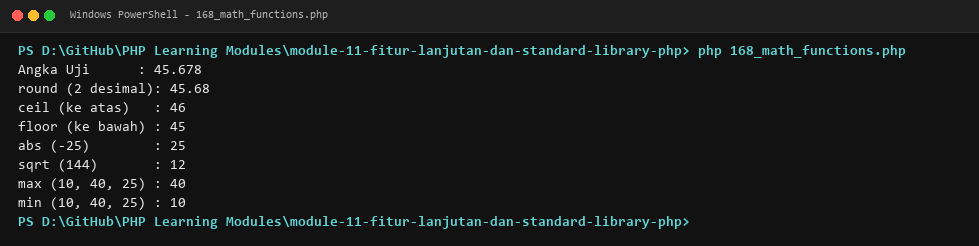

##### 169. Pseudo-Random Number Generation

- **Source Code**: [`169_random_numbers.php`](./module-11-fitur-lanjutan-dan-standard-library-php/169_random_numbers.php)
- **Key Concept**: Generating pseudo-random values for simulations.
- **Mechanism**: Generates numbers within defined integer intervals using rand() and mt_rand() (Mersenne Twister).
- **Execution Output**:

  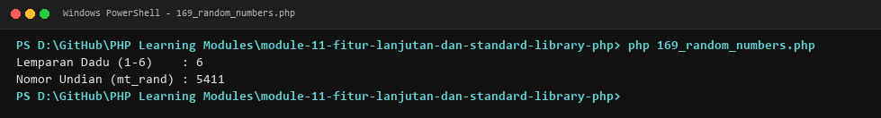

##### 170. Cryptographically Secure Random Generation (CSPRNG)

- **Source Code**: [`170_secure_random.php`](./module-11-fitur-lanjutan-dan-standard-library-php/170_secure_random.php)
- **Key Concept**: Generating secure random tokens and passwords.
- **Mechanism**: Uses random_int() and random_bytes() to generate secure tokens, OTPs, and cryptographic salts.
- **Execution Output**:

  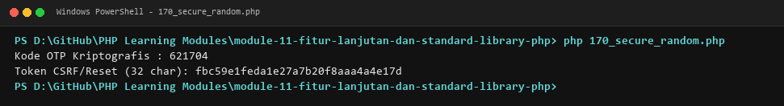

##### 171. JSON Serialization with json_encode

- **Source Code**: [`171_json_encode.php`](./module-11-fitur-lanjutan-dan-standard-library-php/171_json_encode.php)
- **Key Concept**: Converting PHP data structures into JSON strings.
- **Mechanism**: Encodes arrays and objects into JSON formatted text using json_encode() with formatting flags.
- **Execution Output**:

  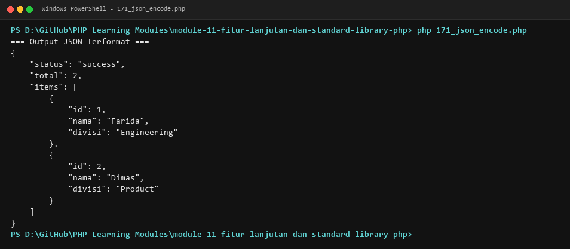

##### 172. JSON Deserialization with json_decode

- **Source Code**: [`172_json_decode.php`](./module-11-fitur-lanjutan-dan-standard-library-php/172_json_decode.php)
- **Key Concept**: Parsing JSON strings into PHP objects or arrays.
- **Mechanism**: Decodes JSON strings into associative arrays or stdClass objects, checking for parsing errors with json_last_error().
- **Execution Output**:

  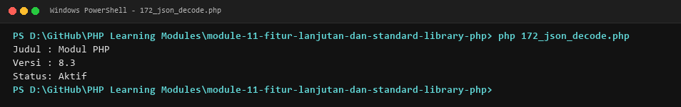

##### 173. Custom Collection Iteration with SPL Iterators

- **Source Code**: [`173_iterators.php`](./module-11-fitur-lanjutan-dan-standard-library-php/173_iterators.php)
- **Key Concept**: Implementing iterator protocols for foreach compatibility.
- **Mechanism**: Implements the Iterator or IteratorAggregate interfaces, allowing custom objects to be traversed via foreach.
- **Execution Output**:

  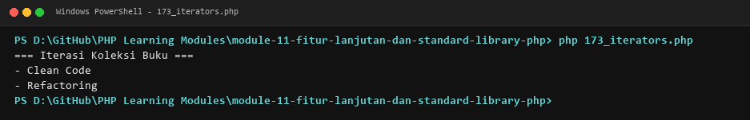

##### 174. Memory-Efficient Streaming with Generators

- **Source Code**: [`174_generators.php`](./module-11-fitur-lanjutan-dan-standard-library-php/174_generators.php)
- **Key Concept**: Generating large data streams on the fly without memory spikes.
- **Mechanism**: Defines generator functions utilizing yield to produce values sequentially with minimal memory footprint.
- **Execution Output**:

  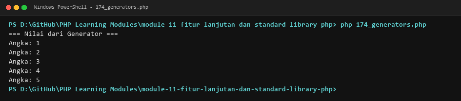

##### 175. Key-Value Generation with yield

- **Source Code**: [`175_yield_keyword.php`](./module-11-fitur-lanjutan-dan-standard-library-php/175_yield_keyword.php)
- **Key Concept**: Emitting paired keys and values in generator streams.
- **Mechanism**: Emits custom keys and values from generators using yield $key => $value syntax.
- **Execution Output**:

  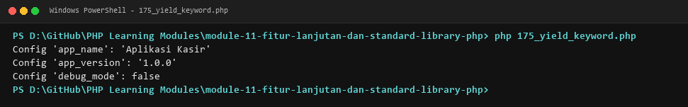

##### 176. Generator Delegation with yield from

- **Source Code**: [`176_generator_delegation.php`](./module-11-fitur-lanjutan-dan-standard-library-php/176_generator_delegation.php)
- **Key Concept**: Delegating iteration to sub-generators or arrays.
- **Mechanism**: Delegates execution to nested generator functions or iterable collections using the yield from construct.
- **Execution Output**:

  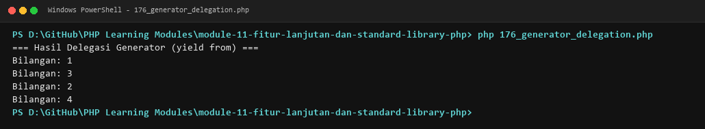

##### 177. Lexical Closure Binding and Context Manipulation

- **Source Code**: [`177_closure_capture.php`](./module-11-fitur-lanjutan-dan-standard-library-php/177_closure_capture.php)
- **Key Concept**: Rebinding closures to different object contexts.
- **Mechanism**: Uses Closure::bindTo() to rebind the internal $this scope and access private state in target objects.
- **Execution Output**:

  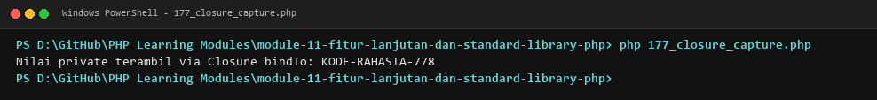

##### 178. Memory Management with Weak References

- **Source Code**: [`178_weak_references.php`](./module-11-fitur-lanjutan-dan-standard-library-php/178_weak_references.php)
- **Key Concept**: Referencing objects without preventing garbage collection.
- **Mechanism**: Uses WeakReference::create() to maintain object caches that automatically release when no strong references remain.
- **Execution Output**:

  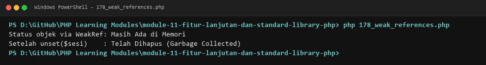

##### 179. Cooperative Multitasking with Fibers

- **Source Code**: [`179_fibers.php`](./module-11-fitur-lanjutan-dan-standard-library-php/179_fibers.php)
- **Key Concept**: Interruptible, resumable concurrent execution units.
- **Mechanism**: Creates Fibers to pause (Fiber::suspend) and resume (Fiber::resume) execution cooperatively.
- **Execution Output**:

  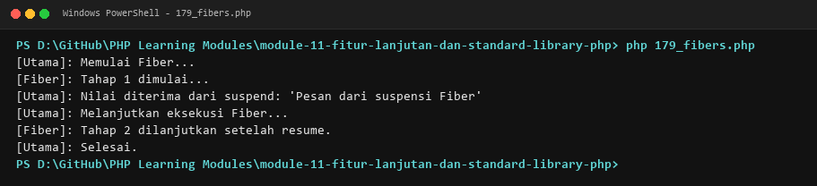

##### 180. Enum Methods and Interface Implementation

- **Source Code**: [`180_enum_methods.php`](./module-11-fitur-lanjutan-dan-standard-library-php/180_enum_methods.php)
- **Key Concept**: Attaching behavior and interfaces to enumerations.
- **Mechanism**: Implements custom methods, static helper methods, and interfaces directly within enum declarations.
- **Execution Output**:

  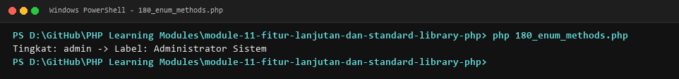

##### 181. Inspecting Attributes via Reflection

- **Source Code**: [`181_php_attributes.php`](./module-11-fitur-lanjutan-dan-standard-library-php/181_php_attributes.php)
- **Key Concept**: Reading runtime metadata attributes programmatically.
- **Mechanism**: Retrieves attached #[Attribute] metadata from classes and methods using ReflectionClass::getAttributes().
- **Execution Output**:

  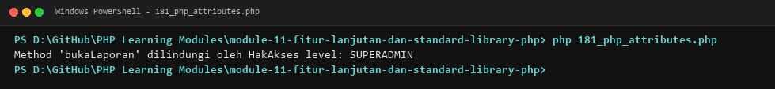

##### 182. Readonly Classes in PHP 8.2+

- **Source Code**: [`182_readonly_classes.php`](./module-11-fitur-lanjutan-dan-standard-library-php/182_readonly_classes.php)
- **Key Concept**: Enforcing class-wide immutability.
- **Mechanism**: Marks entire classes with readonly, preventing dynamic property additions and ensuring all fields are immutable.
- **Execution Output**:

  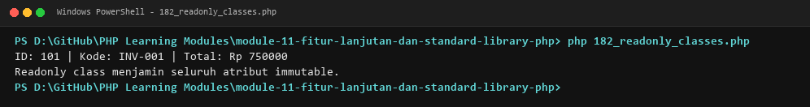

##### 183. Modern Property Hooks Paradigm in PHP 8.4+

- **Source Code**: [`183_property_hooks.php`](./module-11-fitur-lanjutan-dan-standard-library-php/183_property_hooks.php)
- **Key Concept**: Defining custom getter and setter hooks on properties.
- **Mechanism**: Demonstrates property hooks syntax paradigms that encapsulate read and write operations directly on property declarations.
- **Execution Output**:

  

##### 184. Asymmetric Property Visibility Paradigm in PHP 8.4+

- **Source Code**: [`184_asymmetric_visibility.php`](./module-11-fitur-lanjutan-dan-standard-library-php/184_asymmetric_visibility.php)
- **Key Concept**: Decoupling read access from write access.
- **Mechanism**: Demonstrates asymmetric visibility paradigms where properties are publicly readable but privately writable.
- **Execution Output**:

  

### Module 12: Error Handling, Debugging, and Input Validation

**Curriculum Path**: [`module-12-error-handling-debugging-dan-validasi`](./module-12-error-handling-debugging-dan-validasi) | **Level**: `Intermediate to Advanced` | **Scope**: 14 Programs (185–198)

#### Overview & Concepts Covered

Covers application resilience and diagnostic tools: error reporting configuration (error_reporting()), core PHP error classifications (Notices, Warnings, Fatal Errors), exception handling with try-catch, the finally cleanup block, throwing exceptions, building custom domain exception hierarchies, exception chaining ($previous), the root Throwable interface, development assertions (assert), variable dumping (var_dump), call stack inspection (debug_backtrace), defensive input validation, standard sanitization filters (filter_var), and automated error logging (error_log).

#### Subtopics & Execution Captures

##### 185. Configuring Error Reporting and Display Settings

- **Source Code**: [`185_error_reporting.php`](./module-12-error-handling-debugging-dan-validasi/185_error_reporting.php)
- **Key Concept**: Managing error levels across development and production.
- **Mechanism**: Configures error_reporting() and ini_set('display_errors', ...) to balance debugging with security.
- **Execution Output**:

  

##### 186. PHP Error Types and Severity Levels

- **Source Code**: [`186_error_types.php`](./module-12-error-handling-debugging-dan-validasi/186_error_types.php)
- **Key Concept**: Distinguishing Notices, Warnings, and Fatal Errors.
- **Mechanism**: Inspects different error severities (E_NOTICE, E_WARNING, E_ERROR) and observes their runtime impact.
- **Execution Output**:

  

##### 187. Runtime Exception Handling with Try-Catch

- **Source Code**: [`187_try_catch.php`](./module-12-error-handling-debugging-dan-validasi/187_try_catch.php)
- **Key Concept**: Gracefully capturing runtime exceptions.
- **Mechanism**: Wraps risky operations in try-catch blocks to handle thrown Exception objects without crashing the process.
- **Execution Output**:

  

##### 188. Cleanup Routines with Finally Blocks

- **Source Code**: [`188_finally_block.php`](./module-12-error-handling-debugging-dan-validasi/188_finally_block.php)
- **Key Concept**: Guaranteed execution of cleanup logic.
- **Mechanism**: Implements finally blocks that execute regardless of whether exceptions were caught or uncaught.
- **Execution Output**:

  

##### 189. Throwing Custom Exceptions

- **Source Code**: [`189_throw_exception.php`](./module-12-error-handling-debugging-dan-validasi/189_throw_exception.php)
- **Key Concept**: Signaling exceptional business errors with throw.
- **Mechanism**: Validates business constraints and raises Exception instances using the throw keyword.
- **Execution Output**:

  

##### 190. Authoring Custom Exception Hierarchies

- **Source Code**: [`190_custom_exceptions.php`](./module-12-error-handling-debugging-dan-validasi/190_custom_exceptions.php)
- **Key Concept**: Creating domain-specific application exceptions.
- **Mechanism**: Extends the base Exception class to create custom exceptions like ValidationException and NotFoundException.
- **Execution Output**:

  

##### 191. Exception Chaining and Root Cause Tracking

- **Source Code**: [`191_exception_chaining.php`](./module-12-error-handling-debugging-dan-validasi/191_exception_chaining.php)
- **Key Concept**: Preserving low-level exception contexts.
- **Mechanism**: Passes a caught exception as the $previous argument when throwing a high-level domain exception.
- **Execution Output**:

  

##### 192. The Throwable Root Interface

- **Source Code**: [`192_throwable_interface.php`](./module-12-error-handling-debugging-dan-validasi/192_throwable_interface.php)
- **Key Concept**: Unified catching of both Errors and Exceptions.
- **Mechanism**: Catches Throwable to intercept both system-level Error instances and application-level Exception objects.
- **Execution Output**:

  

##### 193. Runtime Assertions with assert

- **Source Code**: [`193_assertions.php`](./module-12-error-handling-debugging-dan-validasi/193_assertions.php)
- **Key Concept**: Testing invariant assumptions during development.
- **Mechanism**: Uses assert() expressions to enforce internal invariants and verify expected logic states.
- **Execution Output**:

  

##### 194. Debugging Output with var_dump and print_r

- **Source Code**: [`194_var_dump_debugging.php`](./module-12-error-handling-debugging-dan-validasi/194_var_dump_debugging.php)
- **Key Concept**: Inspecting complex data structures in terminal stdout.
- **Mechanism**: Outputs structured type, length, and value information for nested arrays and objects for diagnostic analysis.
- **Execution Output**:

  

##### 195. Call Stack Inspection with debug_backtrace

- **Source Code**: [`195_debug_backtrace.php`](./module-12-error-handling-debugging-dan-validasi/195_debug_backtrace.php)
- **Key Concept**: Tracing function execution chains across stack frames.
- **Mechanism**: Inspects the active call stack using debug_backtrace() to report caller files, line numbers, and functions.
- **Execution Output**:

  

##### 196. Defensive Input Validation Strategies

- **Source Code**: [`196_input_validation.php`](./module-12-error-handling-debugging-dan-validasi/196_input_validation.php)
- **Key Concept**: Sanitizing and validating untrusted user inputs.
- **Mechanism**: Applies manual boundary and format checks across incoming user datasets before business processing.
- **Execution Output**:

  

##### 197. Input Validation and Filtering with filter_var

- **Source Code**: [`197_filter_var.php`](./module-12-error-handling-debugging-dan-validasi/197_filter_var.php)
- **Key Concept**: Standard library sanitization and validation filters.
- **Mechanism**: Validates email addresses, URLs, integers, and IPs using filter_var() with FILTER_VALIDATE_* flags.
- **Execution Output**:

  

##### 198. Automated Error Logging with error_log

- **Source Code**: [`198_error_logging.php`](./module-12-error-handling-debugging-dan-validasi/198_error_logging.php)
- **Key Concept**: Writing diagnostic records to disk and system logs.
- **Mechanism**: Records error messages and system anomalies to dedicated log files using error_log().
- **Execution Output**:

  

### Module 13: File Handling and Data Persistence

**Curriculum Path**: [`module-13-file-handling-dan-pengelolaan-data`](./module-13-file-handling-dan-pengelolaan-data) | **Level**: `Intermediate` | **Scope**: 16 Programs (199–214)

#### Overview & Concepts Covered

Focuses on local filesystem persistence and stream I/O: low-level stream reading (fopen, fgets, fclose), overwrite writing (mode 'w'), file appending (mode 'a'), high-level file utilities (file_get_contents, file_put_contents), path and type verification (file_exists, is_file, is_dir), directory creation and removal (mkdir, rmdir), directory iteration (scandir), permission checks (is_readable, is_writable), temporary files (tmpfile), tabular CSV parsing (fgetcsv) and generation (fputcsv), JSON file storage, file upload storage simulation, PHP streams (php://memory), and filesystem path utilities.

#### Subtopics & Execution Captures

##### 199. File Reading with fopen, fgets, and fclose

- **Source Code**: [`199_file_reading.php`](./module-13-file-handling-dan-pengelolaan-data/199_file_reading.php)
- **Key Concept**: Line-by-line low-level file stream processing.
- **Mechanism**: Opens file handles in read mode ('r'), reads content line-by-line using fgets(), and closes streams cleanly.
- **Execution Output**:

  

##### 200. File Writing in Overwrite Mode

- **Source Code**: [`200_file_writing.php`](./module-13-file-handling-dan-pengelolaan-data/200_file_writing.php)
- **Key Concept**: Writing text content to disk using mode 'w'.
- **Mechanism**: Opens files in write mode ('w'), writes content with fwrite(), and overwrites pre-existing data.
- **Execution Output**:

  

##### 201. File Appending in Append Mode

- **Source Code**: [`201_file_append.php`](./module-13-file-handling-dan-pengelolaan-data/201_file_append.php)
- **Key Concept**: Adding content to files without overwriting existing data.
- **Mechanism**: Opens files in append mode ('a') with fopen() and adds log entries to the end of the file.
- **Execution Output**:

  

##### 202. Reading Complete Files with file_get_contents

- **Source Code**: [`202_file_get_contents.php`](./module-13-file-handling-dan-pengelolaan-data/202_file_get_contents.php)
- **Key Concept**: Loading entire file streams into memory strings.
- **Mechanism**: Reads complete file contents into a single string variable using file_get_contents().
- **Execution Output**:

  

##### 203. Fast File Writing with file_put_contents

- **Source Code**: [`203_file_put_contents.php`](./module-13-file-handling-dan-pengelolaan-data/203_file_put_contents.php)
- **Key Concept**: Atomic writing and appending without manual file handles.
- **Mechanism**: Writes text strings directly to disk in one call, supporting atomic writing and FILE_APPEND flags.
- **Execution Output**:

  

##### 204. Filesystem Existence and Type Verification

- **Source Code**: [`204_file_exists.php`](./module-13-file-handling-dan-pengelolaan-data/204_file_exists.php)
- **Key Concept**: Verifying the existence of files and directories.
- **Mechanism**: Uses file_exists(), is_file(), and is_dir() to verify path existence and file type safety.
- **Execution Output**:

  

##### 205. Directory Creation and Deletion Operations

- **Source Code**: [`205_directory_operations.php`](./module-13-file-handling-dan-pengelolaan-data/205_directory_operations.php)
- **Key Concept**: Managing folders programmatically on disk.
- **Mechanism**: Creates nested directories with mkdir() recursive flags and removes empty directories with rmdir().
- **Execution Output**:

  

##### 206. Directory Iteration with scandir

- **Source Code**: [`206_directory_iteration.php`](./module-13-file-handling-dan-pengelolaan-data/206_directory_iteration.php)
- **Key Concept**: Enumerating directory entries and files.
- **Mechanism**: Lists all files and subdirectories within a folder using scandir() and filters out navigation dots (. and ..).
- **Execution Output**:

  

##### 207. File Permission Inspection

- **Source Code**: [`207_file_permissions.php`](./module-13-file-handling-dan-pengelolaan-data/207_file_permissions.php)
- **Key Concept**: Checking read and write permissions on files.
- **Mechanism**: Determines filesystem accessibility using is_readable() and is_writable() prior to performing I/O.
- **Execution Output**:

  

##### 208. Temporary Files Management with tmpfile

- **Source Code**: [`208_temporary_files.php`](./module-13-file-handling-dan-pengelolaan-data/208_temporary_files.php)
- **Key Concept**: Managing self-cleaning temporary files.
- **Mechanism**: Creates temporary file streams with tmpfile() that automatically delete upon closing or script termination.
- **Execution Output**:

  

##### 209. Tabular CSV File Reading with fgetcsv

- **Source Code**: [`209_csv_read.php`](./module-13-file-handling-dan-pengelolaan-data/209_csv_read.php)
- **Key Concept**: Parsing comma-separated values into array records.
- **Mechanism**: Parses CSV files line by line using fgetcsv(), extracting structured fields into indexed arrays.
- **Execution Output**:

  

##### 210. Tabular CSV File Writing with fputcsv

- **Source Code**: [`210_csv_write.php`](./module-13-file-handling-dan-pengelolaan-data/210_csv_write.php)
- **Key Concept**: Formatting array collections into CSV file rows.
- **Mechanism**: Writes array data into CSV format using fputcsv(), handling delimiter formatting and quoting automatically.
- **Execution Output**:

  

##### 211. JSON File Storage Persistence

- **Source Code**: [`211_json_file_storage.php`](./module-13-file-handling-dan-pengelolaan-data/211_json_file_storage.php)
- **Key Concept**: Persisting application datasets as JSON on disk.
- **Mechanism**: Reads, parses, mutates, and re-saves structured application records into formatted JSON files.
- **Execution Output**:

  

##### 212. Simulated File Upload Storage

- **Source Code**: [`212_file_upload_storage.php`](./module-13-file-handling-dan-pengelolaan-data/212_file_upload_storage.php)
- **Key Concept**: Validating file types and saving uploads.
- **Mechanism**: Simulates file upload validation, checking file size limits, MIME types, and generating unique destination names.
- **Execution Output**:

  

##### 213. PHP Streams and Memory Wrappers

- **Source Code**: [`213_streams.php`](./module-13-file-handling-dan-pengelolaan-data/213_streams.php)
- **Key Concept**: Working with streams, memory buffers, and filters.
- **Mechanism**: Opens in-memory I/O streams using php://memory and php://temp for fast stream data manipulation.
- **Execution Output**:

  

##### 214. Filesystem Path Resolution and Utilities

- **Source Code**: [`214_filesystem_paths.php`](./module-13-file-handling-dan-pengelolaan-data/214_filesystem_paths.php)
- **Key Concept**: Resolving absolute and relative file paths.
- **Mechanism**: Parses and resolves paths using realpath(), dirname(), basename(), and pathinfo().
- **Execution Output**:

  

### Module 14: PHP for Web and HTTP Architecture

**Curriculum Path**: [`module-14-php-untuk-web-dan-http`](./module-14-php-untuk-web-dan-http) | **Level**: `Intermediate to Advanced` | **Scope**: 20 Programs (215–234)

#### Overview & Concepts Covered

Covers server-side web engineering and HTTP protocol handling: PHP and HTML template integration, dynamic data rendering, PHP superglobals ($_GET, $_POST, $_SERVER, $_COOKIE, $_SESSION, $_FILES), query string retrieval, form POST processing, HTTP request method branching (GET, POST), form validation, input sanitization, Cross-Site Scripting (XSS) mitigation via htmlspecialchars, file upload handling, cookie lifecycle management, session authentication workflows, custom HTTP response headers (header()), status codes (http_response_code()), URL redirects, MIME content type configuration, server metadata inspection, and a lightweight web front-controller router.

#### Subtopics & Execution Captures

##### 215. PHP and HTML Integration Fundamentals

- **Source Code**: [`215_php_html_integration.php`](./module-14-php-untuk-web-dan-http/215_php_html_integration.php)
- **Key Concept**: Embedding dynamic server-side logic in HTML.
- **Mechanism**: Integrates PHP tags within HTML markup to interleave dynamic server-rendered text with static HTML.
- **Execution Output**:

  

##### 216. Dynamic HTML Template Output

- **Source Code**: [`216_php_template_output.php`](./module-14-php-untuk-web-dan-http/216_php_template_output.php)
- **Key Concept**: Rendering data collections into HTML tables and lists.
- **Mechanism**: Iterates over arrays within HTML templates using alternative syntax (foreach: / endforeach;).
- **Execution Output**:

  

##### 217. Superglobal Variables Overview

- **Source Code**: [`217_superglobal_variables.php`](./module-14-php-untuk-web-dan-http/217_superglobal_variables.php)
- **Key Concept**: Global access to HTTP and environment states.
- **Mechanism**: Inspects PHP's built-in superglobals ($_GET, $_POST, $_SERVER, $_SESSION, $_COOKIE) available across all scopes.
- **Execution Output**:

  

##### 218. HTTP GET Query Parameter Processing

- **Source Code**: [`218_get_parameters.php`](./module-14-php-untuk-web-dan-http/218_get_parameters.php)
- **Key Concept**: Retrieving query string values from request URLs.
- **Mechanism**: Extracts and sanitizes parameters passed in the URL query string using the $_GET superglobal array.
- **Execution Output**:

  

##### 219. HTTP POST Request Body Processing

- **Source Code**: [`219_post_parameters.php`](./module-14-php-untuk-web-dan-http/219_post_parameters.php)
- **Key Concept**: Receiving submitted form data from POST requests.
- **Mechanism**: Retrieves data submitted via HTTP POST requests using $_POST, keeping payloads hidden from URL strings.
- **Execution Output**:

  

##### 220. HTTP Request Method Inspection

- **Source Code**: [`220_request_method.php`](./module-14-php-untuk-web-dan-http/220_request_method.php)
- **Key Concept**: Detecting client HTTP verbs (GET, POST, PUT, DELETE).
- **Mechanism**: Inspects $_SERVER['REQUEST_METHOD'] to branch logic based on incoming HTTP request types.
- **Execution Output**:

  

##### 221. Web Form Submission Lifecycle

- **Source Code**: [`221_form_submission.php`](./module-14-php-untuk-web-dan-http/221_form_submission.php)
- **Key Concept**: Handling form submissions and user feedback.
- **Mechanism**: Processes form data, performs sanity checks, and renders success messages or feedback errors.
- **Execution Output**:

  

##### 222. Server-Side Web Form Validation

- **Source Code**: [`222_form_validation.php`](./module-14-php-untuk-web-dan-http/222_form_validation.php)
- **Key Concept**: Validating required fields and data constraints.
- **Mechanism**: Validates form submissions for required inputs, minimum string lengths, and numeric boundaries.
- **Execution Output**:

  

##### 223. Contextual Form Input Sanitization

- **Source Code**: [`223_form_sanitization.php`](./module-14-php-untuk-web-dan-http/223_form_sanitization.php)
- **Key Concept**: Cleaning untrusted input to remove malicious markup.
- **Mechanism**: Sanitizes user input strings using filter_var() and string trimming to strip dangerous characters.
- **Execution Output**:

  

##### 224. XSS Prevention with htmlspecialchars

- **Source Code**: [`224_html_escaping.php`](./module-14-php-untuk-web-dan-http/224_html_escaping.php)
- **Key Concept**: Escaping special characters to prevent Cross-Site Scripting.
- **Mechanism**: Encodes HTML special characters (&, <, >, ", ') using htmlspecialchars(..., ENT_QUOTES, 'UTF-8').
- **Execution Output**:

  

##### 225. File Upload Processing with $_FILES

- **Source Code**: [`225_file_upload.php`](./module-14-php-untuk-web-dan-http/225_file_upload.php)
- **Key Concept**: Validating and handling uploaded multipart files.
- **Mechanism**: Inspects $_FILES metadata (tmp_name, size, error) and validates upload conditions.
- **Execution Output**:

  

##### 226. HTTP Cookie Lifecycle Management

- **Source Code**: [`226_cookie_management.php`](./module-14-php-untuk-web-dan-http/226_cookie_management.php)
- **Key Concept**: Setting, reading, and expiring cookies in client browsers.
- **Mechanism**: Sets client cookies using setcookie() with security flags (HttpOnly, Secure, SameSite) and reads $_COOKIE.
- **Execution Output**:

  

##### 227. Server-Side Session Management with session_start

- **Source Code**: [`227_session_basic.php`](./module-14-php-untuk-web-dan-http/227_session_basic.php)
- **Key Concept**: Preserving user state across multiple HTTP requests.
- **Mechanism**: Initializes server sessions via session_start(), storing and retrieving user data in $_SESSION.
- **Execution Output**:

  

##### 228. Session-Based User Authentication

- **Source Code**: [`228_session_login.php`](./module-14-php-untuk-web-dan-http/228_session_login.php)
- **Key Concept**: Managing login states and access gates.
- **Mechanism**: Implements login and logout workflows, saving authenticated user IDs in session memory.
- **Execution Output**:

  

##### 229. Custom HTTP Response Headers with header()

- **Source Code**: [`229_http_headers.php`](./module-14-php-untuk-web-dan-http/229_http_headers.php)
- **Key Concept**: Sending raw HTTP headers to client browsers.
- **Mechanism**: Sends custom HTTP headers (e.g., Cache-Control, Custom-Header) prior to emitting response content.
- **Execution Output**:

  

##### 230. HTTP Status Code Management with http_response_code

- **Source Code**: [`230_http_status_codes.php`](./module-14-php-untuk-web-dan-http/230_http_status_codes.php)
- **Key Concept**: Setting standard HTTP response status codes.
- **Mechanism**: Configures response status codes (200 OK, 400 Bad Request, 404 Not Found, 500 Error) using http_response_code().
- **Execution Output**:

  

##### 231. HTTP URL Redirects and Location Headers

- **Source Code**: [`231_redirect_handling.php`](./module-14-php-untuk-web-dan-http/231_redirect_handling.php)
- **Key Concept**: Redirecting user agents to alternative URLs.
- **Mechanism**: Issues HTTP 302/301 redirects using header('Location: ...') followed by an exit terminator.
- **Execution Output**:

  

##### 232. Response Content-Type Header Configuration

- **Source Code**: [`232_response_content_type.php`](./module-14-php-untuk-web-dan-http/232_response_content_type.php)
- **Key Concept**: Serving JSON, plain text, and HTML documents.
- **Mechanism**: Sets appropriate MIME types (application/json, text/plain) using header('Content-Type: ...').
- **Execution Output**:

  

##### 233. Inspecting Request Metadata with $_SERVER

- **Source Code**: [`233_server_variables.php`](./module-14-php-untuk-web-dan-http/233_server_variables.php)
- **Key Concept**: Reading server, host, and client connection details.
- **Mechanism**: Extracts server hostnames, IP addresses, user agent strings, and request URIs from $_SERVER.
- **Execution Output**:

  

##### 234. Basic Front-Controller Web Router

- **Source Code**: [`234_php_router_basic.php`](./module-14-php-untuk-web-dan-http/234_php_router_basic.php)
- **Key Concept**: Mapping request URI paths to handler subroutines.
- **Mechanism**: Parses request URIs and dispatches requests to matching closure handlers or 404 error routes.
- **Execution Output**:

  

### Module 15: Database and SQL with PDO

**Curriculum Path**: [`module-15-database-dan-sql-dengan-php`](./module-15-database-dan-sql-dengan-php) | **Level**: `Intermediate to Advanced` | **Scope**: 16 Programs (235–250)

#### Overview & Concepts Covered

Explores relational database integration with PHP Data Objects (PDO): establishing robust database connections, executing direct queries (query, exec), prepared statements for SQL injection prevention, parameter binding (bindParam, bindValue), transactional CRUD operations, ACID transactions (beginTransaction, commit, rollBack), PDO exception error modes (PDO::ERRMODE_EXCEPTION), server-side pagination with LIMIT and OFFSET, wildcard search querying (LIKE), relational INNER JOIN table queries, implementing the Database Repository Pattern, embedded SQLite database connectivity, and structured database schema migrations (up/down).

#### Subtopics & Execution Captures

##### 235. Database Connection via PHP Data Objects (PDO)

- **Source Code**: [`235_pdo_connection.php`](./module-15-database-dan-sql-dengan-php/235_pdo_connection.php)
- **Key Concept**: Establishing secure database connections.
- **Mechanism**: Connects to relational database engines using PDO with DSN connection strings, usernames, and passwords.
- **Execution Output**:

  

##### 236. Executing SQL Queries with query() and exec()

- **Source Code**: [`236_pdo_query.php`](./module-15-database-dan-sql-dengan-php/236_pdo_query.php)
- **Key Concept**: Running direct DDL and DML statements.
- **Mechanism**: Executes schema creation with exec() and runs simple SELECT queries with query().
- **Execution Output**:

  

##### 237. Prepared Statements for SQL Injection Prevention

- **Source Code**: [`237_pdo_prepared_statements.php`](./module-15-database-dan-sql-dengan-php/237_pdo_prepared_statements.php)
- **Key Concept**: Separating SQL code from variable parameters.
- **Mechanism**: Prepares SQL statements with prepare() and executes them with execute(), neutralizing SQL injection attacks.
- **Execution Output**:

  

##### 238. Parameter Binding with bindParam and bindValue

- **Source Code**: [`238_pdo_parameter_binding.php`](./module-15-database-dan-sql-dengan-php/238_pdo_parameter_binding.php)
- **Key Concept**: Binding variables and literals to SQL placeholders.
- **Mechanism**: Binds typed parameters to named SQL placeholders (:id, :name) using bindParam() and bindValue().
- **Execution Output**:

  

##### 239. Inserting Database Records with PDO

- **Source Code**: [`239_pdo_insert.php`](./module-15-database-dan-sql-dengan-php/239_pdo_insert.php)
- **Key Concept**: Adding new rows and retrieving auto-increment IDs.
- **Mechanism**: Executes INSERT statements with prepared statements and retrieves generated keys with lastInsertId().
- **Execution Output**:

  

##### 240. Selecting and Fetching Database Records

- **Source Code**: [`240_pdo_select.php`](./module-15-database-dan-sql-dengan-php/240_pdo_select.php)
- **Key Concept**: Fetching single rows and complete result sets.
- **Mechanism**: Fetches query rows using fetch(PDO::FETCH_ASSOC) and full result sets with fetchAll(PDO::FETCH_ASSOC).
- **Execution Output**:

  

##### 241. Updating Database Records and Affected Row Counts

- **Source Code**: [`241_pdo_update.php`](./module-15-database-dan-sql-dengan-php/241_pdo_update.php)
- **Key Concept**: Modifying existing rows with UPDATE statements.
- **Mechanism**: Executes UPDATE statements with parameter binding and reports affected records with rowCount().
- **Execution Output**:

  

##### 242. Deleting Database Records with PDO

- **Source Code**: [`242_pdo_delete.php`](./module-15-database-dan-sql-dengan-php/242_pdo_delete.php)
- **Key Concept**: Removing specific records safely using parameterized SQL.
- **Mechanism**: Executes parameterized DELETE statements targeting primary keys to safely purge records.
- **Execution Output**:

  

##### 243. ACID Database Transactions with PDO

- **Source Code**: [`243_pdo_transactions.php`](./module-15-database-dan-sql-dengan-php/243_pdo_transactions.php)
- **Key Concept**: Guaranteeing atomicity with commit and rollBack.
- **Mechanism**: Executes multiple dependent queries inside a transaction block, committing on success or rolling back on error.
- **Execution Output**:

  

##### 244. Configuring PDO Exception Error Modes

- **Source Code**: [`244_pdo_error_handling.php`](./module-15-database-dan-sql-dengan-php/244_pdo_error_handling.php)
- **Key Concept**: Enabling robust error handling with PDO::ERRMODE_EXCEPTION.
- **Mechanism**: Sets the error reporting mode to ERRMODE_EXCEPTION to convert database errors into catchable PDOException objects.
- **Execution Output**:

  

##### 245. Server-Side Pagination Query Logic

- **Source Code**: [`245_pagination.php`](./module-15-database-dan-sql-dengan-php/245_pagination.php)
- **Key Concept**: Paginating large query result sets with LIMIT and OFFSET.
- **Mechanism**: Calculates pagination offsets (page, perPage) and applies SQL LIMIT and OFFSET clauses.
- **Execution Output**:

  

##### 246. Database Search Filtering with LIKE Operators

- **Source Code**: [`246_search_database.php`](./module-15-database-dan-sql-dengan-php/246_search_database.php)
- **Key Concept**: Performing parameterized text searches across tables.
- **Mechanism**: Constructs search queries using SQL LIKE operators with safely bound wildcard parameters (%keyword%).
- **Execution Output**:

  

##### 247. Relational Database Queries with Foreign Keys and JOINs

- **Source Code**: [`247_mysql_relationships.php`](./module-15-database-dan-sql-dengan-php/247_mysql_relationships.php)
- **Key Concept**: Querying related tables using SQL INNER JOIN.
- **Mechanism**: Models one-to-many relationships and joins related records across tables using foreign key constraints.
- **Execution Output**:

  

##### 248. Implementing the Database Repository Pattern

- **Source Code**: [`248_database_repository.php`](./module-15-database-dan-sql-dengan-php/248_database_repository.php)
- **Key Concept**: Decoupling data access logic from business logic.
- **Mechanism**: Implements a dedicated repository class encapsulating all PDO queries behind domain methods.
- **Execution Output**:

  

##### 249. Embedded SQLite Database Integration with PDO

- **Source Code**: [`249_sqlite_database.php`](./module-15-database-dan-sql-dengan-php/249_sqlite_database.php)
- **Key Concept**: Operating local file-based and in-memory SQLite databases.
- **Mechanism**: Connects to lightweight SQLite databases (sqlite::memory: or file) without requiring external database servers.
- **Execution Output**:

  

##### 250. Database Schema Migrations Architecture

- **Source Code**: [`250_database_migrations_basic.php`](./module-15-database-dan-sql-dengan-php/250_database_migrations_basic.php)
- **Key Concept**: Managing database schema versioning with up and down methods.
- **Mechanism**: Implements an architectural migration class defining up() for schema creation and down() for rollback.
- **Execution Output**:

  

### Module 16: Composer, Namespaces, and Project Architecture

**Curriculum Path**: [`module-16-composer-namespace-dan-arsitektur-proyek`](./module-16-composer-namespace-dan-arsitektur-proyek) | **Level**: `Advanced` | **Scope**: 16 Programs (251–266)

#### Overview & Concepts Covered

Examines enterprise PHP architecture and package management: namespace declarations, importing classes with use, namespace aliasing (as), class autoloading (spl_autoload_register), Composer configuration schema (composer.json), Composer autoloader mechanics, PSR-4 directory mapping standards, production vs. development dependency management, Composer automation scripts, environment variable reading (getenv, $_ENV), custom .env file parsing, centralized configuration repositories, PHP-FIG standards (PSR-1, PSR-4, PSR-12), Model-View-Controller (MVC) architectural separation, Service Layer encapsulation, and decoupled Repository Patterns.

#### Subtopics & Execution Captures

##### 251. Namespace Declarations and Name Isolation

- **Source Code**: [`251_namespace_basic.php`](./module-16-composer-namespace-dan-arsitektur-proyek/251_namespace_basic.php)
- **Key Concept**: Organizing code and preventing class name collisions.
- **Mechanism**: Declares logical namespaces using the namespace keyword to isolate identical class identifiers.
- **Execution Output**:

  

##### 252. Importing Namespaces with the use Keyword

- **Source Code**: [`252_namespace_import.php`](./module-16-composer-namespace-dan-arsitektur-proyek/252_namespace_import.php)
- **Key Concept**: Importing external classes into the current file scope.
- **Mechanism**: Imports namespaced classes and interfaces using use statements, simplifying call sites.
- **Execution Output**:

  

##### 253. Namespace Aliasing with the as Keyword

- **Source Code**: [`253_namespace_alias.php`](./module-16-composer-namespace-dan-arsitektur-proyek/253_namespace_alias.php)
- **Key Concept**: Renaming imported classes to avoid collisions.
- **Mechanism**: Aliases imported class names with the as keyword to resolve local identifier conflicts.
- **Execution Output**:

  

##### 254. Class Autoloading with spl_autoload_register

- **Source Code**: [`254_autoload_basic.php`](./module-16-composer-namespace-dan-arsitektur-proyek/254_autoload_basic.php)
- **Key Concept**: Dynamic class loading on demand.
- **Mechanism**: Registers a custom autoloader callback that maps class names to file paths and includes files automatically.
- **Execution Output**:

  

##### 255. Composer Configuration with composer.json

- **Source Code**: [`255_composer_setup.php`](./module-16-composer-namespace-dan-arsitektur-proyek/255_composer_setup.php)
- **Key Concept**: Managing PHP dependencies and metadata with Composer.
- **Mechanism**: Defines a complete composer.json schema including package dependencies, PSR-4 autoload rules, and scripts.
- **Execution Output**:

  

##### 256. Composer Class Autoloading Architecture

- **Source Code**: [`256_composer_autoload.php`](./module-16-composer-namespace-dan-arsitektur-proyek/256_composer_autoload.php)
- **Key Concept**: Understanding vendor/autoload.php loading mechanics.
- **Mechanism**: Demonstrates how Composer's generated autoloader resolves classes and namespaces seamlessly.
- **Execution Output**:

  

##### 257. PSR-4 Autoloading Standards

- **Source Code**: [`257_psr4_autoloading.php`](./module-16-composer-namespace-dan-arsitektur-proyek/257_psr4_autoloading.php)
- **Key Concept**: Mapping namespace prefixes directly to directory structures.
- **Mechanism**: Implements the PSR-4 recommendation mapping namespace roots to corresponding physical source directories.
- **Execution Output**:

  

##### 258. Composer Dependency Management: require vs. require-dev

- **Source Code**: [`258_composer_dependencies.php`](./module-16-composer-namespace-dan-arsitektur-proyek/258_composer_dependencies.php)
- **Key Concept**: Managing production versus development dependencies.
- **Mechanism**: Configures runtime and development dependency sections in Composer using semantic version constraints.
- **Execution Output**:

  

##### 259. Automating Tasks with Composer Scripts

- **Source Code**: [`259_composer_scripts.php`](./module-16-composer-namespace-dan-arsitektur-proyek/259_composer_scripts.php)
- **Key Concept**: Running custom CLI automation scripts via Composer.
- **Mechanism**: Defines custom Composer script commands (test, lint, migrate) to streamline developer workflows.
- **Execution Output**:

  

##### 260. Environment Variables with getenv and $_ENV

- **Source Code**: [`260_environment_configuration.php`](./module-16-composer-namespace-dan-arsitektur-proyek/260_environment_configuration.php)
- **Key Concept**: Reading configuration from environment variables.
- **Mechanism**: Reads runtime configuration settings from environment variables using getenv() and $_ENV.
- **Execution Output**:

  

##### 261. Parsing Environment Files with .env Loaders

- **Source Code**: [`261_dotenv_configuration.php`](./module-16-composer-namespace-dan-arsitektur-proyek/261_dotenv_configuration.php)
- **Key Concept**: Loading configuration from local .env files.
- **Mechanism**: Implements a lightweight .env parser to populate environment variables without hardcoding secrets.
- **Execution Output**:

  

##### 262. Centralized Application Configuration Management

- **Source Code**: [`262_config_management.php`](./module-16-composer-namespace-dan-arsitektur-proyek/262_config_management.php)
- **Key Concept**: Structured immutable application configuration classes.
- **Mechanism**: Implements a centralized Config repository class to provide cached, type-safe access to application settings.
- **Execution Output**:

  

##### 263. PHP-FIG Standards: PSR-1, PSR-4, and PSR-12

- **Source Code**: [`263_psr_standards.php`](./module-16-composer-namespace-dan-arsitektur-proyek/263_psr_standards.php)
- **Key Concept**: Adopting industry coding standards and recommendations.
- **Mechanism**: Examines PSR standards for basic coding conventions (PSR-1), autoloading (PSR-4), and styling (PSR-12).
- **Execution Output**:

  

##### 264. Model-View-Controller (MVC) Architecture

- **Source Code**: [`264_mvc_architecture.php`](./module-16-composer-namespace-dan-arsitektur-proyek/264_mvc_architecture.php)
- **Key Concept**: Separating data, presentation, and control logic.
- **Mechanism**: Architects a clean MVC pattern with dedicated Model, View, and Controller components working harmoniously.
- **Execution Output**:

  

##### 265. Service Layer for Business Logic Encapsulation

- **Source Code**: [`265_service_layer.php`](./module-16-composer-namespace-dan-arsitektur-proyek/265_service_layer.php)
- **Key Concept**: Isolating business rules from controllers and database layers.
- **Mechanism**: Implements a dedicated Service class that coordinates domain logic and validation independently from HTTP.
- **Execution Output**:

  

##### 266. Decoupled Data Architecture with the Repository Pattern

- **Source Code**: [`266_repository_pattern.php`](./module-16-composer-namespace-dan-arsitektur-proyek/266_repository_pattern.php)
- **Key Concept**: Abstracting data access behind interface contracts.
- **Mechanism**: Defines a UserRepositoryInterface implemented by a ConcreteRepository to completely decouple persistence logic.
- **Execution Output**:

  

### Module 17: Security, Testing, REST API, and Backend Architecture

**Curriculum Path**: [`module-17-keamanan-testing-api-dan-backend`](./module-17-keamanan-testing-api-dan-backend) | **Level**: `Advanced` | **Scope**: 22 Programs (267–288)

#### Overview & Concepts Covered

Implements production-grade backend security, automated test suites, and RESTful web services: cryptographic password hashing (password_hash with BCRYPT), password verification (password_verify), session hardening (regeneration, HttpOnly, SameSite), CSRF token generation and validation, contextual XSS defense, SQL injection prevention via prepared statements, secure file upload validation, authentication flows, Role-Based Access Control (RBAC), standardized JSON API responses, REST API routing, RESTful CRUD workflows, request body validation, standard API error responses (RFC 7807), pagination metadata, Bearer Token authentication, PHPUnit-style assertion test runners, mock object test doubles, parameterized data providers, database integration testing with SQLite, and end-to-end API tests.

#### Subtopics & Execution Captures

##### 267. Cryptographic Password Hashing with password_hash

- **Source Code**: [`267_password_hashing.php`](./module-17-keamanan-testing-api-dan-backend/267_password_hashing.php)
- **Key Concept**: One-way secure password hashing with BCRYPT.
- **Mechanism**: Hashes user passwords with password_hash() using BCRYPT algorithms and automatic secure salting.
- **Execution Output**:

  

##### 268. Verifying Passwords with password_verify

- **Source Code**: [`268_password_verification.php`](./module-17-keamanan-testing-api-dan-backend/268_password_verification.php)
- **Key Concept**: Validating plain passwords against hashed digests.
- **Mechanism**: Verifies user login credentials using password_verify(), preventing timing attack vulnerabilities.
- **Execution Output**:

  

##### 269. Hardening Session Security

- **Source Code**: [`269_secure_session.php`](./module-17-keamanan-testing-api-dan-backend/269_secure_session.php)
- **Key Concept**: Preventing session fixation and session hijacking.
- **Mechanism**: Hardens session security by regenerating session IDs with session_regenerate_id() and setting HttpOnly/Secure flags.
- **Execution Output**:

  

##### 270. Cross-Site Request Forgery (CSRF) Protection

- **Source Code**: [`270_csrf_protection.php`](./module-17-keamanan-testing-api-dan-backend/270_csrf_protection.php)
- **Key Concept**: Defending forms with cryptographic CSRF tokens.
- **Mechanism**: Generates cryptographically random CSRF tokens, embeds them in forms, and validates them using hash_equals().
- **Execution Output**:

  

##### 271. Contextual Cross-Site Scripting (XSS) Prevention

- **Source Code**: [`271_xss_prevention.php`](./module-17-keamanan-testing-api-dan-backend/271_xss_prevention.php)
- **Key Concept**: Sanitizing dynamic user content rendered in HTML.
- **Mechanism**: Sanitizes user input using contextual escaping (htmlspecialchars) to neutralize stored and reflected XSS attacks.
- **Execution Output**:

  

##### 272. SQL Injection Prevention: Prepared Statements vs. Vulnerable Queries

- **Source Code**: [`272_sql_injection_prevention.php`](./module-17-keamanan-testing-api-dan-backend/272_sql_injection_prevention.php)
- **Key Concept**: Neutralizing SQL injection vulnerabilities with PDO.
- **Mechanism**: Contrasts a vulnerable raw SQL concatenation query against a secure parameterized prepared statement.
- **Execution Output**:

  

##### 273. Secure File Upload Validation

- **Source Code**: [`273_file_upload_security.php`](./module-17-keamanan-testing-api-dan-backend/273_file_upload_security.php)
- **Key Concept**: Protecting against malicious executable file uploads.
- **Mechanism**: Validates upload file extensions, MIME types, maximum byte limits, and stores files outside public web roots.
- **Execution Output**:

  

##### 274. User Authentication System

- **Source Code**: [`274_authentication_basic.php`](./module-17-keamanan-testing-api-dan-backend/274_authentication_basic.php)
- **Key Concept**: Credential verification and login flow mechanics.
- **Mechanism**: Implements an authentication service that verifies user identity against stored credentials and sets auth status.
- **Execution Output**:

  

##### 275. Role-Based Access Control (RBAC)

- **Source Code**: [`275_authorization_roles.php`](./module-17-keamanan-testing-api-dan-backend/275_authorization_roles.php)
- **Key Concept**: Restricting resource access based on user roles.
- **Mechanism**: Enforces role-based permissions (admin, editor, user) to restrict access to protected system actions.
- **Execution Output**:

  

##### 276. Standardized JSON REST API Responses

- **Source Code**: [`276_api_json_response.php`](./module-17-keamanan-testing-api-dan-backend/276_api_json_response.php)
- **Key Concept**: Formatting consistent JSON responses for client applications.
- **Mechanism**: Constructs structured JSON responses containing status codes, messages, payloads, and timestamps.
- **Execution Output**:

  

##### 277. REST API Router with HTTP Method Dispatching

- **Source Code**: [`277_rest_api_routing.php`](./module-17-keamanan-testing-api-dan-backend/277_rest_api_routing.php)
- **Key Concept**: Dispatching API routes by HTTP method and URI path.
- **Mechanism**: Implements a lightweight REST API router mapping GET, POST, PUT, and DELETE methods to specific controllers.
- **Execution Output**:

  

##### 278. RESTful CRUD API Operations

- **Source Code**: [`278_rest_api_crud.php`](./module-17-keamanan-testing-api-dan-backend/278_rest_api_crud.php)
- **Key Concept**: Full Create, Read, Update, and Delete API workflow.
- **Mechanism**: Simulates a complete RESTful API supporting CRUD operations on resource collections with JSON responses.
- **Execution Output**:

  

##### 279. API Request Body Validation

- **Source Code**: [`279_api_request_validation.php`](./module-17-keamanan-testing-api-dan-backend/279_api_request_validation.php)
- **Key Concept**: Validating incoming JSON payloads before processing.
- **Mechanism**: Parses php://input, decodes JSON payloads, and validates required data fields and type constraints.
- **Execution Output**:

  

##### 280. Standardized API Error Responses (RFC 7807)

- **Source Code**: [`280_api_error_responses.php`](./module-17-keamanan-testing-api-dan-backend/280_api_error_responses.php)
- **Key Concept**: Structuring consistent problem details for API errors.
- **Mechanism**: Implements error formatting adhering to RFC 7807 Problem Details for HTTP APIs (title, status, detail, type).
- **Execution Output**:

  

##### 281. REST API Pagination Metadata

- **Source Code**: [`281_api_pagination.php`](./module-17-keamanan-testing-api-dan-backend/281_api_pagination.php)
- **Key Concept**: Providing cursor and offset metadata in API collections.
- **Mechanism**: Formats paginated API responses with metadata including total items, current page, perPage, and next/prev links.
- **Execution Output**:

  

##### 282. API Authentication via Bearer Tokens

- **Source Code**: [`282_api_authentication.php`](./module-17-keamanan-testing-api-dan-backend/282_api_authentication.php)
- **Key Concept**: Securing API endpoints with HTTP Authorization headers.
- **Mechanism**: Extracts and validates Bearer tokens from the HTTP Authorization header to authenticate API requests.
- **Execution Output**:

  

##### 283. Unit Testing Fundamentals: PHPUnit Assertion Runner

- **Source Code**: [`283_phpunit_basic.php`](./module-17-keamanan-testing-api-dan-backend/283_phpunit_basic.php)
- **Key Concept**: Authoring automated test assertions from scratch.
- **Mechanism**: Implements a lightweight test runner with assert-style verification to test calculator class methods.
- **Execution Output**:

  

##### 284. Comprehensive Test Assertions Suite

- **Source Code**: [`284_phpunit_assertions.php`](./module-17-keamanan-testing-api-dan-backend/284_phpunit_assertions.php)
- **Key Concept**: Verifying equality, boolean conditions, and array counts.
- **Mechanism**: Tests business logic using assertEquals, assertTrue, assertFalse, and assertCount assertion patterns.
- **Execution Output**:

  

##### 285. Test Doubles and Mocking Dependencies

- **Source Code**: [`285_phpunit_mocking.php`](./module-17-keamanan-testing-api-dan-backend/285_phpunit_mocking.php)
- **Key Concept**: Isolating unit tests from external services using mocks.
- **Mechanism**: Creates mock objects to simulate third-party API dependencies and external email services during tests.
- **Execution Output**:

  

##### 286. Parameterized Testing with Data Providers

- **Source Code**: [`286_phpunit_data_providers.php`](./module-17-keamanan-testing-api-dan-backend/286_phpunit_data_providers.php)
- **Key Concept**: Executing single test methods with varied datasets.
- **Mechanism**: Implements data provider methods yielding multiple test fixture datasets to test boundary conditions efficiently.
- **Execution Output**:

  

##### 287. Integration Testing with In-Memory Databases

- **Source Code**: [`287_integration_testing.php`](./module-17-keamanan-testing-api-dan-backend/287_integration_testing.php)
- **Key Concept**: Testing real database interactions with SQLite.
- **Mechanism**: Runs integration tests against a real in-memory SQLite database to verify data persistence workflows.
- **Execution Output**:

  

##### 288. End-to-End API Endpoint Testing

- **Source Code**: [`288_api_testing.php`](./module-17-keamanan-testing-api-dan-backend/288_api_testing.php)
- **Key Concept**: Verifying HTTP status codes, JSON headers, and payloads.
- **Mechanism**: Simulates end-to-end API calls, asserting HTTP response status codes, header types, and JSON schema structures.
- **Execution Output**:

  

### Module 18: Framework Foundations and Practical Capstone Projects

**Curriculum Path**: [`module-18-framework-dan-proyek-praktik-php`](./module-18-framework-dan-proyek-praktik-php) | **Level**: `Capstone / Practical` | **Scope**: 12 Programs (289–300)

#### Overview & Concepts Covered

Bridges core PHP knowledge to modern framework architectures and consolidates learning into 6 comprehensive capstone applications: Laravel framework patterns (routing with Route::get/post, resource controllers, Eloquent ORM active records, database schema migrations, form request validation, and authentication guards), followed by 6 complete practical capstone projects: (1) Object-Oriented Calculator Engine, (2) Student Management System with In-Memory SQLite CRUD, (3) Warehouse Inventory Management System with Restock Warning Thresholds, (4) Point-of-Sale (POS) Cashier System with Shopping Cart and Thermal Receipt Formatting, (5) Library Book Management System with Overdue Fine Calculations, and (6) Comprehensive REST API Microservice with Bearer Token Security and SQLite Database Persistence.

#### Subtopics & Execution Captures

##### 289. Laravel Routing Patterns Simulation

- **Source Code**: [`289_laravel_routes.php`](./module-18-framework-dan-proyek-praktik-php/289_laravel_routes.php)
- **Key Concept**: Declarative HTTP route registration with Route facade syntax.
- **Mechanism**: Simulates Laravel-style Route::get() and Route::post() registration and URI parameter resolution.
- **Execution Output**:

  

##### 290. Laravel Resource Controller Architecture

- **Source Code**: [`290_laravel_controllers.php`](./module-18-framework-dan-proyek-praktik-php/290_laravel_controllers.php)
- **Key Concept**: Organizing RESTful controller methods into resource classes.
- **Mechanism**: Simulates Laravel controller conventions with index(), show(), store(), update(), and destroy() action handlers.
- **Execution Output**:

  

##### 291. Eloquent Active Record ORM Simulation

- **Source Code**: [`291_laravel_models.php`](./module-18-framework-dan-proyek-praktik-php/291_laravel_models.php)
- **Key Concept**: Object-relational mapping and fluent database queries.
- **Mechanism**: Simulates Laravel Eloquent Model methods (Model::find, Model::where, Model::create) with active record semantics.
- **Execution Output**:

  

##### 292. Laravel Database Migrations and Schema Blueprint

- **Source Code**: [`292_laravel_migrations.php`](./module-18-framework-dan-proyek-praktik-php/292_laravel_migrations.php)
- **Key Concept**: Declarative table schema definition with Schema::create.
- **Mechanism**: Simulates Laravel migration syntax defining table columns, primary keys, and timestamps using Blueprint objects.
- **Execution Output**:

  

##### 293. Laravel Form Request Validation Simulation

- **Source Code**: [`293_laravel_validation.php`](./module-18-framework-dan-proyek-praktik-php/293_laravel_validation.php)
- **Key Concept**: Declarative validation rules with Validator::make.
- **Mechanism**: Simulates Laravel validation rule arrays (required, email, min:6) and formats validation error feedback.
- **Execution Output**:

  

##### 294. Laravel Authentication Guard Simulation

- **Source Code**: [`294_laravel_authentication.php`](./module-18-framework-dan-proyek-praktik-php/294_laravel_authentication.php)
- **Key Concept**: Simulating Auth::attempt and user session guards.
- **Mechanism**: Simulates Laravel authentication facade logic, validating credentials and storing authenticated state.
- **Execution Output**:

  

##### 295. Practical Capstone 1: Object-Oriented Calculator Engine

- **Source Code**: [`295_calculator_project.php`](./module-18-framework-dan-proyek-praktik-php/295_calculator_project.php)
- **Key Concept**: Consolidated object-oriented arithmetic application.
- **Mechanism**: Constructs a comprehensive OOP calculator supporting addition, subtraction, multiplication, division, and history tracking.
- **Execution Output**:

  

##### 296. Practical Capstone 2: Student Management System

- **Source Code**: [`296_student_management_project.php`](./module-18-framework-dan-proyek-praktik-php/296_student_management_project.php)
- **Key Concept**: Complete CRUD application with in-memory SQLite database.
- **Mechanism**: Implements a robust student information system with database table creation, student registration, querying, and updating.
- **Execution Output**:

  

##### 297. Practical Capstone 3: Warehouse Inventory Management System

- **Source Code**: [`297_inventory_management_project.php`](./module-18-framework-dan-proyek-praktik-php/297_inventory_management_project.php)
- **Key Concept**: Stock tracking system with automated restock warnings.
- **Mechanism**: Builds an inventory tracking application managing item quantities, stock valuations, and automated low-stock warnings.
- **Execution Output**:

  

##### 298. Practical Capstone 4: Point-of-Sale (POS) Cashier System

- **Source Code**: [`298_cashier_system_project.php`](./module-18-framework-dan-proyek-praktik-php/298_cashier_system_project.php)
- **Key Concept**: Retail checkout terminal with shopping cart and receipt generation.
- **Mechanism**: Simulates a retail checkout system with item scanning, subtotal/tax computation, change calculation, and receipt formatting.
- **Execution Output**:

  

##### 299. Practical Capstone 5: Library Book Management System

- **Source Code**: [`299_library_management_project.php`](./module-18-framework-dan-proyek-praktik-php/299_library_management_project.php)
- **Key Concept**: Borrowing tracking and overdue fine calculation engine.
- **Mechanism**: Manages library book catalogs, tracks borrower records, checks return deadlines, and computes overdue late fines.
- **Execution Output**:

  

##### 300. Practical Capstone 6: Enterprise REST API Microservice

- **Source Code**: [`300_rest_api_project.php`](./module-18-framework-dan-proyek-praktik-php/300_rest_api_project.php)
- **Key Concept**: Full-featured production API with authentication and database.
- **Mechanism**: Builds a production-grade REST API microservice featuring token security, routing, in-memory SQLite storage, and JSON output.
- **Execution Output**:

  

## Exercises & Practice

The curriculum integrates practical algorithmic challenges, defensive security problems, and capstone architectural systems distributed across the modules to test problem-solving ability:

| Challenge / Exercise | Module | Key Skills Tested | Solution Link |
| :--- | :---: | :--- | :--- |
| **Student Grade Calculator** | Module 04 | Conditional thresholds, range mapping, and academic performance evaluation | [`47_grade_calculator.php`](./module-04-percabangan-dan-pengambilan-keputusan/47_grade_calculator.php) |
| **Even and Odd Parity Checker** | Module 04 | Modulo arithmetic, numerical classification, and boolean logic | [`48_even_odd.php`](./module-04-percabangan-dan-pengambilan-keputusan/48_even_odd.php) |
| **Leap Year Mathematical Validator** | Module 04 | Calendar astronomical rules, compound boolean operations (`&&`, `||`) | [`49_leap_year.php`](./module-04-percabangan-dan-pengambilan-keputusan/49_leap_year.php) |
| **Tiered Commercial Discount Calculator** | Module 04 | Progressive discount structures, floating-point arithmetic, and retail logic | [`50_discount_calculator.php`](./module-04-percabangan-dan-pengambilan-keputusan/50_discount_calculator.php) |
| **Arithmetic Series Summation** | Module 05 | Loop accumulators, series mathematics, and iteration bounds | [`60_sum_numbers.php`](./module-05-perulangan/60_sum_numbers.php) |
| **Iterative Factorial Computation** | Module 05 | Multiplicative accumulation loops and edge-case validation | [`61_factorial_loop.php`](./module-05-perulangan/61_factorial_loop.php) |
| **Tabular Multiplication Table** | Module 05 | Nested coordinate loops and aligned terminal string formatting | [`62_multiplication_table.php`](./module-05-perulangan/62_multiplication_table.php) |
| **Geometric Number Pattern Generator** | Module 05 | Two-dimensional coordinate printing and triangular grid algorithms | [`63_number_patterns.php`](./module-05-perulangan/63_number_patterns.php) |
| **Binary Guessing Game Simulation** | Module 05 | While loops, adaptive search bounds, and state machine decisions | [`64_guessing_game.php`](./module-05-perulangan/64_guessing_game.php) |
| **SEO-Friendly URL Slug Generator** | Module 07 | String sanitization, regular expression replacements, and URL normalization | [`104_slug_generator.php`](./module-07-string-dan-manipulasi-teks/104_slug_generator.php) |
| **Regex Input Pattern Validation** | Module 07 | Pattern matching for email addresses and phone formats with `preg_match` | [`102_regex_validation.php`](./module-07-string-dan-manipulasi-teks/102_regex_validation.php) |
| **Recursive Algorithms (Factorial & Fibonacci)** | Module 08 | Recursion trees, call stack management, and termination base cases | [`123_recursive_functions.php`](./module-08-fungsi/123_recursive_functions.php) |
| **Custom Domain Exception Hierarchy** | Module 12 | Class inheritance, exception specialization, and message propagation | [`190_custom_exceptions.php`](./module-12-error-handling-debugging-dan-validasi/190_custom_exceptions.php) |
| **Tabular CSV File Parser & Exporter** | Module 13 | Filesystem stream I/O, delimiter parsing (`fgetcsv`), and formatting (`fputcsv`) | [`209_csv_read.php`](./module-13-file-handling-dan-pengelolaan-data/209_csv_read.php) |
| **JSON Persistent Data Store Engine** | Module 13 | Local data persistence, JSON serialization, and disk state mutation | [`211_json_file_storage.php`](./module-13-file-handling-dan-pengelolaan-data/211_json_file_storage.php) |
| **Web Form Validation & XSS Defense** | Module 14 | Form parsing, boundary checks, and contextual escaping (`htmlspecialchars`) | [`222_form_validation.php`](./module-14-php-untuk-web-dan-http/222_form_validation.php) |
| **Front-Controller Web Router** | Module 14 | URI parsing, route registration, and controller callback dispatching | [`234_php_router_basic.php`](./module-14-php-untuk-web-dan-http/234_php_router_basic.php) |
| **Paginated Database Record Fetching** | Module 15 | SQL `LIMIT`/`OFFSET` calculations, total page counting, and pagination logic | [`245_pagination.php`](./module-15-database-dan-sql-dengan-php/245_pagination.php) |
| **Database Schema Migration Engine** | Module 15 | Programmatic DDL execution, schema version tracking, and `up`/`down` methods | [`250_database_migrations_basic.php`](./module-15-database-dan-sql-dengan-php/250_database_migrations_basic.php) |
| **PSR-4 Compatible Class Autoloader** | Module 16 | Dynamic namespace prefix mapping and filesystem path resolution | [`254_autoload_basic.php`](./module-16-composer-namespace-dan-arsitektur-proyek/254_autoload_basic.php) |
| **Lightweight .env Environment File Parser** | Module 16 | File stream reading, key-value extraction, and environment variable injection | [`261_dotenv_configuration.php`](./module-16-composer-namespace-dan-arsitektur-proyek/261_dotenv_configuration.php) |
| **Model-View-Controller (MVC) Engine** | Module 16 | Multi-tier architectural separation of models, presentation views, and controllers | [`264_mvc_architecture.php`](./module-16-composer-namespace-dan-arsitektur-proyek/264_mvc_architecture.php) |
| **CSRF Defense with Cryptographic Tokens** | Module 17 | Token generation via CSPRNG, session persistence, and timing-safe `hash_equals` | [`270_csrf_protection.php`](./module-17-keamanan-testing-api-dan-backend/270_csrf_protection.php) |
| **Role-Based Access Control (RBAC) Gate** | Module 17 | User roles (admin, editor, user), permission matrix mapping, and authorization | [`275_authorization_roles.php`](./module-17-keamanan-testing-api-dan-backend/275_authorization_roles.php) |
| **RESTful CRUD API Controller with RFC 7807** | Module 17 | HTTP method dispatching, JSON payload parsing, and standard error responses | [`278_rest_api_crud.php`](./module-17-keamanan-testing-api-dan-backend/278_rest_api_crud.php) |
| **PHPUnit-Style Test Runner with Mocks & Providers** | Module 17 | Automated assertion runners, test doubles (mocking), and parameterized datasets | [`283_phpunit_basic.php`](./module-17-keamanan-testing-api-dan-backend/283_phpunit_basic.php) |
| **Capstone 1: OOP Calculator Engine** | Module 18 | Object-oriented arithmetic calculation, history tracking, and error handling | [`295_calculator_project.php`](./module-18-framework-dan-proyek-praktik-php/295_calculator_project.php) |
| **Capstone 2: Student Management System** | Module 18 | Full CRUD application backed by an in-memory SQLite relational database | [`296_student_management_project.php`](./module-18-framework-dan-proyek-praktik-php/296_student_management_project.php) |
| **Capstone 3: Warehouse Inventory Management** | Module 18 | Stock level tracking, item valuation, and automated low-stock restock alerts | [`297_inventory_management_project.php`](./module-18-framework-dan-proyek-praktik-php/297_inventory_management_project.php) |
| **Capstone 4: POS Retail Cashier System** | Module 18 | Shopping cart operations, tax computation, change calculations, and receipts | [`298_cashier_system_project.php`](./module-18-framework-dan-proyek-praktik-php/298_cashier_system_project.php) |
| **Capstone 5: Library Book Management System** | Module 18 | Book catalog management, member borrowing records, and overdue late fine rules | [`299_library_management_project.php`](./module-18-framework-dan-proyek-praktik-php/299_library_management_project.php) |
| **Capstone 6: Enterprise REST API Microservice** | Module 18 | Bearer token security, HTTP routing, in-memory SQLite storage, and JSON responses | [`300_rest_api_project.php`](./module-18-framework-dan-proyek-praktik-php/300_rest_api_project.php) |

## Code Execution & Expected Output

All 300 lessons in this repository are designed to be executed directly using the standard PHP Command Line Interface (CLI) without requiring external web servers or database daemons.

### Standard CLI Invocation

To execute any lesson, run the PHP binary targeting the file from the repository root:

```bash
php <module-folder>/<script-name>.php
```

Examples:
- **Module 01 (Syntax & Output)**:
  ```bash
  php module-01-pengenalan-php-dan-struktur-program/01_hello_world.php
  ```
- **Module 06 (Array Operations)**:
  ```bash
  php module-06-array-dan-manipulasi-data/76_array_filter.php
  ```
- **Module 15 (Database PDO & SQLite)**:
  ```bash
  php module-15-database-dan-sql-dengan-php/237_pdo_prepared_statements.php
  ```
- **Module 18 (Capstone REST API Microservice)**:
  ```bash
  php module-18-framework-dan-proyek-praktik-php/300_rest_api_project.php
  ```

### CLI Arguments Demonstration (Module 01)

For scripts demonstrating command-line argument processing (such as `09_php_cli.php`), pass custom arguments after the script name:

```bash
php module-01-pengenalan-php-dan-struktur-program/09_php_cli.php argumen1 argumen2 argumen3
```

### Web and HTTP Scripts (Module 14)

Scripts in Module 14 demonstrate HTTP request methods, forms, headers, cookies, and session states. While they can be executed via CLI to inspect generated HTML output, running them in a web browser provides the full interactive experience:

```bash
php -S localhost:8000 -t module-14-php-untuk-web-dan-http
```

Access specific web lessons via `http://localhost:8000/<script_name>.php` (e.g., `http://localhost:8000/221_form_submission.php`).

### Output Verification

Each lesson subtopic in this repository is paired with a verified screenshot in its `output/` subfolder. When running the scripts locally, your terminal text should match the output shown in the capture, confirming that your PHP runtime and extension configurations behave identically to standard production environments.

## Learning Resources & References

To supplement the lessons in this curriculum, consult the following authoritative documentation, official standards, and community resources:

- [PHP Official Documentation (php.net)](https://www.php.net/docs.php) — Comprehensive reference manual covering core syntax, built-in functions, SPL, and language features.
- [PHP: The Right Way](https://phptherightway.com/) — Community-driven quick reference for PHP best practices, accepted coding standards, and modern development patterns.
- [PHP-FIG (PHP Framework Interop Group)](https://www.php-fig.org/) — Authoritative specifications including PSR-1 (Basic Coding Standard), PSR-4 (Autoloader), and PSR-12 (Extended Coding Style Guide).
- [Composer Official Documentation](https://getcomposer.org/doc/) — Dependency management reference for package installation, semantic versioning, and autoloader generation.
- [PHPUnit Testing Documentation](https://phpunit.de/documentation.html) — Comprehensive guide to automated unit testing, mock objects, and test assertions in PHP.
- [Laravel Official Documentation](https://laravel.com/docs) — Official guide to the modern Laravel web application framework, architectural concepts, and Eloquent ORM.

## Troubleshooting

Below are diagnostic solutions for common PHP runtime errors and environment configuration issues:

| Issue / Error Message | Probable Cause | Actionable Solution |
| :--- | :--- | :--- |
| `Parse error: syntax error, unexpected token ...` | Missing semicolon (`;`), unclosed parenthesis, or trailing comma syntax incompatible with older PHP runtimes | Verify that all statements terminate with semicolons and that parentheses/braces are balanced. Ensure you are running PHP 8.2 or higher. |
| `Fatal error: Uncaught TypeError: Argument 1 must be of type ...` | Strict types violation triggered by `declare(strict_types=1)` where passed argument types do not match signatures | Review caller arguments to ensure provided data matches the type declaration, or apply explicit type casting before invocation. |
| `Fatal error: Class "PDO" not found` or `Driver not found` | The `pdo` or `pdo_sqlite` extensions are disabled in `php.ini` | Open your active `php.ini` file, uncomment `extension=pdo` and `extension=pdo_sqlite`, and restart your terminal or web server. |
| `Warning: Cannot modify header information - headers already sent by ...` | Output (such as whitespace, echo, or UTF-8 BOM) was sent before calling `header()`, `setcookie()`, or `session_start()` | Ensure no whitespace precedes the opening `<?php` tag, omit closing `?>` tags in pure PHP files, and call header functions before any output. |
| `Fatal error: Cannot declare class ... because the name is already in use` | Class name collision caused by missing namespaces or defining identical class names in the global namespace | Wrap classes in logical namespaces (`namespace App\...;`) or use unique class names to prevent collisions. |
| `Notice: Undefined array key ...` or `Undefined variable` | Accessing associative array keys or variables that have not been initialized | Use the null coalescing operator (`$value = $arr['key'] ?? 'default'`) or check existence using `isset($arr['key'])` prior to reading. |
| `Call to undefined function mb_strlen()` | The `mbstring` extension is disabled in the PHP runtime | Uncomment `extension=mbstring` in your `php.ini` configuration to enable multibyte Unicode character processing. |

## License

Please see the [LICENSE](./LICENSE) file for the terms and conditions governing the use, modification, and distribution of this project.

## Author & Contact

**Yohanes Dimas Pratama**

- GitHub: [github.com/weztcy](https://github.com/weztcy)
- Portfolio: [dimaspratama.vercel.app](https://dimaspratama.vercel.app)
- LinkedIn: [linkedin.com/in/yohanes-dimas](https://www.linkedin.com/in/yohanes-dimas)
