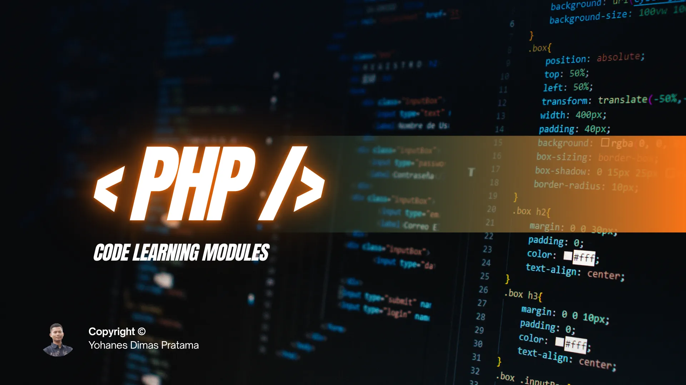

# PHP Learning Modules




## Project Overview

PHP Learning Modules is a structured programming curriculum comprising 18 progressive modules and 300 isolated, executable PHP scripts (`01_hello_world.php` through `300_rest_api_project.php`). Its primary educational purpose is to guide learners from fundamental PHP syntax, control flow, and data structures through object-oriented architecture, modern PHP standard library features, database persistence, security, automated testing patterns, and practical backend applications. Each module lives in its own directory containing a dedicated Indonesian-language module guide (`README.md`), numbered single-topic PHP source files with inline educational comments, and captured CLI execution screenshots stored in each module's `output/` directory.

## Learning Objectives

The curriculum is structured to build progressive technical competence across core PHP programming, software design, and backend engineering. Upon working through the modules, learners are exposed to the following practical skills and concepts:

- Write valid PHP CLI scripts using proper syntax, scalar and compound data types, strict typing, operators, conditional logic, and iterative loops.
- Manipulate indexed, associative, and multidimensional arrays, multibyte strings, and regular expressions using built-in PHP standard library functions.
- Design modular functions and object-oriented architectures applying encapsulation, inheritance, interfaces, traits, dependency injection, enums, attributes, and reflection.
- Utilize modern PHP features including `match` expressions, nullsafe operators, generators, Fibers, `DateTimeImmutable`, readonly classes, and PHP 8.4 concepts such as property hooks and asymmetric visibility.
- Implement structured error handling with `try-catch-finally`, custom `Throwable` exceptions, input validation, and file/stream persistence across TXT, CSV, JSON, and SQLite databases via PDO.
- Apply backend engineering patterns including PSR-4 autoloading concepts, MVC, Service Layer, Repository Pattern, security defenses (password hashing, CSRF, XSS, SQL injection prevention), REST API design, unit testing patterns, and six standalone capstone applications.

## Learning Level & Approach

The repository follows a self-contained, module-based progression spanning from introductory syntax to advanced backend architecture and standalone capstone implementations. Every lesson script runs directly from the command line without requiring external package installations or remote database servers, using in-memory SQLite (`sqlite::memory:`) and standalone pattern simulations for framework, testing, and autoloading topics.

| Attribute | Description |
| --- | --- |
| Learning Level | Beginner to Advanced |
| Learning Approach | Module-Based and Practice-Based (300 isolated CLI lessons + 6 capstone projects) |
| Learning Format | Theory Guides (`README.md` per module) + Executable PHP Scripts + CLI Output Captures |
| Programming Focus | Core PHP, Object-Oriented Programming, Standard Library, PDO/SQL, and Backend Architecture |
| Lesson Language | Indonesian (inline comments and module guides) |

## Learning Path & Curriculum

The curriculum is sequenced across 18 ordered modules grouped into four progressive stages:

1. **Foundations & Core Syntax (Modules 01–05):** Program structure, variables and strict types, operators, decision branching, and loop algorithms.
2. **Data Structures, Functions & OOP (Modules 06–11):** Arrays, strings and regex, functions and closures, basic and advanced OOP, and modern PHP standard library features.
3. **Reliability, Persistence & Web Integration (Modules 12–15):** Error handling and validation, local file and stream I/O, HTTP/web superglobals, and PDO relational database operations.
4. **Architecture, Security & Capstone Projects (Modules 16–18):** Namespaces, Composer/PSR concepts, MVC/Repository patterns, security, REST APIs, testing patterns, Laravel architecture concepts, and six practical projects.

| Order | Module | Main Topics | Materials |
| --- | --- | --- | --- |
| 01 | [Module 01 — Introduction to PHP & Program Structure](module-01-pengenalan-php-dan-struktur-program/README.md) | Syntax, PHP tags, `echo`/`print`, comments, CLI execution | 10 scripts (`01`–`10`), guide, outputs |
| 02 | [Module 02 — Variables & Data Types](module-02-variabel-dan-tipe-data/README.md) | Scalar types, null, arrays, objects, casting, strict typing | 14 scripts (`11`–`24`), guide, outputs |
| 03 | [Module 03 — Operators & Expressions](module-03-operator-dan-ekspresi/README.md) | Arithmetic, strict comparison, logical, ternary, null coalescing, nullsafe, bitwise | 14 scripts (`25`–`38`), guide, outputs |
| 04 | [Module 04 — Branching & Decision Making](module-04-percabangan-dan-pengambilan-keputusan/README.md) | `if`/`elseif`/`else`, `switch`, `match`, truthy/falsy, decision algorithms | 12 scripts (`39`–`50`), guide, outputs |
| 05 | [Module 05 — Loops & Iteration](module-05-perulangan/README.md) | `for`, `while`, `do-while`, `foreach`, `break`/`continue`, loop algorithms | 14 scripts (`51`–`64`), guide, outputs |
| 06 | [Module 06 — Arrays & Data Manipulation](module-06-array-dan-manipulasi-data/README.md) | Indexed/associative/multidimensional arrays, `map`/`filter`/`reduce`, sorting, destructuring | 20 scripts (`65`–`84`), guide, outputs |
| 07 | [Module 07 — Strings & Text Manipulation](module-07-string-dan-manipulasi-teks/README.md) | String operations, `sprintf`, heredoc/nowdoc, `mbstring`, regex, slug generator | 20 scripts (`85`–`104`), guide, outputs |
| 08 | [Module 08 — Functions](module-08-fungsi/README.md) | Parameters, named arguments, variadics, union/intersection/`never` types, closures, recursion | 20 scripts (`105`–`124`), guide, outputs |
| 09 | [Module 09 — Basic Object-Oriented Programming](module-09-object-oriented-programming-oop-dasar/README.md) | Classes, properties, constructors, visibility, static members, cloning, promotion, readonly | 20 scripts (`125`–`144`), guide, outputs |
| 10 | [Module 10 — Advanced Object-Oriented Programming](module-10-oop-lanjutan/README.md) | Inheritance, abstract classes, interfaces, traits, LSB, DI, enums, attributes, reflection | 20 scripts (`145`–`164`), guide, outputs |
| 11 | [Module 11 — Advanced Features & Standard Library](module-11-fitur-lanjutan-dan-standard-library-php/README.md) | `DateTimeImmutable`, CSPRNG, JSON, SPL Iterators, Generators, Fibers, PHP 8.4 concepts | 20 scripts (`165`–`184`), guide, outputs |
| 12 | [Module 12 — Error Handling, Debugging & Validation](module-12-error-handling-debugging-dan-validasi/README.md) | Error reporting, `try-catch-finally`, custom exceptions, assertions, `filter_var`, logging | 14 scripts (`185`–`198`), guide, outputs |
| 13 | [Module 13 — File Handling & Data Management](module-13-file-handling-dan-pengelolaan-data/README.md) | File/directory I/O, permissions, temp files, CSV, JSON storage, streams, paths | 16 scripts (`199`–`214`), guide, outputs |
| 14 | [Module 14 — PHP for Web & HTTP](module-14-php-untuk-web-dan-http/README.md) | HTML templating, superglobals, form validation, XSS escaping, cookies, sessions, routing | 20 scripts (`215`–`234`), guide, outputs |
| 15 | [Module 15 — Database & SQL with PHP](module-15-database-dan-sql-dengan-php/README.md) | PDO connections, prepared statements, CRUD, transactions, joins, repository, migrations | 16 scripts (`235`–`250`), guide, outputs |
| 16 | [Module 16 — Composer, Namespaces & Architecture](module-16-composer-namespace-dan-arsitektur-proyek/README.md) | Namespaces, PSR-4 autoloading, Composer concepts, `.env` config, PSR, MVC, Service/Repository | 16 scripts (`251`–`266`), guide, outputs |
| 17 | [Module 17 — Security, Testing, API & Backend](module-17-keamanan-testing-api-dan-backend/README.md) | Password hashing, CSRF/XSS/SQLi defense, RBAC, REST API, PHPUnit patterns | 22 scripts (`267`–`288`), guide, outputs |
| 18 | [Module 18 — Framework Concepts & Practical Projects](module-18-framework-dan-proyek-praktik-php/README.md) | Laravel architectural patterns (routes, controllers, models, migrations) & 6 capstone apps | 12 scripts (`289`–`300`), guide, outputs |

## Learning Modules & Contents

Each module directory contains a detailed `README.md` index covering every submodule, isolated `.php` lesson scripts, and an `output/` directory with execution captures.

### Module 01 — Introduction to PHP and Program Structure

- Learning Material: [Module 01 Guide](module-01-pengenalan-php-dan-struktur-program/README.md)
- Source Code Examples: [01_hello_world.php](module-01-pengenalan-php-dan-struktur-program/01_hello_world.php) to [10_phpinfo.php](module-01-pengenalan-php-dan-struktur-program/10_phpinfo.php) (syntax, tags, `echo`, `print`, comments, indentation, semicolons, CLI)
- Execution Output: [Module 01 Output Captures](module-01-pengenalan-php-dan-struktur-program/output/)

### Module 02 — Variables and Data Types

- Learning Material: [Module 02 Guide](module-02-variabel-dan-tipe-data/README.md)
- Source Code Examples: [11_variables.php](module-02-variabel-dan-tipe-data/11_variables.php) to [24_strict_types.php](module-02-variabel-dan-tipe-data/24_strict_types.php) (scalar types, `null`, arrays, objects, type checking, casting, juggling, `strict_types`)
- Execution Output: [Module 02 Output Captures](module-02-variabel-dan-tipe-data/output/)

### Module 03 — Operators and Expressions

- Learning Material: [Module 03 Guide](module-03-operator-dan-ekspresi/README.md)
- Source Code Examples: [25_arithmetic_operators.php](module-03-operator-dan-ekspresi/25_arithmetic_operators.php) to [38_expression_evaluation.php](module-03-operator-dan-ekspresi/38_expression_evaluation.php) (arithmetic, strict comparison `===`, logical, ternary, `??`, `?->`, bitwise, precedence)
- Execution Output: [Module 03 Output Captures](module-03-operator-dan-ekspresi/output/)

### Module 04 — Branching and Decision Making

- Learning Material: [Module 04 Guide](module-04-percabangan-dan-pengambilan-keputusan/README.md)
- Source Code Examples: [39_if_statement.php](module-04-percabangan-dan-pengambilan-keputusan/39_if_statement.php) to [50_discount_calculator.php](module-04-percabangan-dan-pengambilan-keputusan/50_discount_calculator.php) (`if`/`else`/`elseif`, `switch`, `match`, truthy/falsy, grade, leap year, and discount calculators)
- Execution Output: [Module 04 Output Captures](module-04-percabangan-dan-pengambilan-keputusan/output/)

### Module 05 — Loops and Iteration

- Learning Material: [Module 05 Guide](module-05-perulangan/README.md)
- Source Code Examples: [51_for_loop.php](module-05-perulangan/51_for_loop.php) to [64_guessing_game.php](module-05-perulangan/64_guessing_game.php) (`for`, `while`, `do-while`, `foreach`, nested loops, `break`/`continue`, factorial, number patterns)
- Execution Output: [Module 05 Output Captures](module-05-perulangan/output/)

### Module 06 — Arrays and Data Manipulation

- Learning Material: [Module 06 Guide](module-06-array-dan-manipulasi-data/README.md)
- Source Code Examples: [65_indexed_array.php](module-06-array-dan-manipulasi-data/65_indexed_array.php) to [84_array_destructuring.php](module-06-array-dan-manipulasi-data/84_array_destructuring.php) (indexed/associative/multidimensional arrays, stack/queue helpers, `array_filter`, `array_map`, `array_reduce`, sorting, destructuring)
- Execution Output: [Module 06 Output Captures](module-06-array-dan-manipulasi-data/output/)

### Module 07 — Strings and Text Manipulation

- Learning Material: [Module 07 Guide](module-07-string-dan-manipulasi-teks/README.md)
- Source Code Examples: [85_string_basics.php](module-07-string-dan-manipulasi-teks/85_string_basics.php) to [104_slug_generator.php](module-07-string-dan-manipulasi-teks/104_slug_generator.php) (concatenation, interpolation, formatting, heredoc/nowdoc, `mbstring`, regex validation/replacement, slug generation)
- Execution Output: [Module 07 Output Captures](module-07-string-dan-manipulasi-teks/output/)

### Module 08 — Functions

- Learning Material: [Module 08 Guide](module-08-fungsi/README.md)
- Source Code Examples: [105_function_basic.php](module-08-fungsi/105_function_basic.php) to [124_first_class_callables.php](module-08-fungsi/124_first_class_callables.php) (parameters, named arguments, variadics, union/intersection/nullable/`never` types, arrow functions, closures, recursion, first-class callables)
- Execution Output: [Module 08 Output Captures](module-08-fungsi/output/)

### Module 09 — Basic Object-Oriented Programming

- Learning Material: [Module 09 Guide](module-09-object-oriented-programming-oop-dasar/README.md)
- Source Code Examples: [125_class_basic.php](module-09-object-oriented-programming-oop-dasar/125_class_basic.php) to [144_object_serialization.php](module-09-object-oriented-programming-oop-dasar/144_object_serialization.php) (classes, constructors/destructors, visibility, encapsulation, static members, cloning, anonymous classes, constructor promotion, `readonly`, magic methods)
- Execution Output: [Module 09 Output Captures](module-09-object-oriented-programming-oop-dasar/output/)

### Module 10 — Advanced Object-Oriented Programming

- Learning Material: [Module 10 Guide](module-10-oop-lanjutan/README.md)
- Source Code Examples: [145_inheritance.php](module-10-oop-lanjutan/145_inheritance.php) to [164_reflection_api.php](module-10-oop-lanjutan/164_reflection_api.php) (inheritance, `final`, abstract classes, interfaces, traits & conflict resolution, late static binding, covariance, DI, enums, attributes, Reflection API)
- Execution Output: [Module 10 Output Captures](module-10-oop-lanjutan/output/)

### Module 11 — Advanced Features and PHP Standard Library

- Learning Material: [Module 11 Guide](module-11-fitur-lanjutan-dan-standard-library-php/README.md)
- Source Code Examples: [165_date_time.php](module-11-fitur-lanjutan-dan-standard-library-php/165_date_time.php) to [184_asymmetric_visibility.php](module-11-fitur-lanjutan-dan-standard-library-php/184_asymmetric_visibility.php) (`DateTimeImmutable`, timezones, CSPRNG, JSON, SPL Iterators, Generators/`yield`, `WeakReference`, Fibers, readonly classes, PHP 8.4 property hooks & asymmetric visibility)
- Execution Output: [Module 11 Output Captures](module-11-fitur-lanjutan-dan-standard-library-php/output/)

### Module 12 — Error Handling, Debugging, and Validation

- Learning Material: [Module 12 Guide](module-12-error-handling-debugging-dan-validasi/README.md)
- Source Code Examples: [185_error_reporting.php](module-12-error-handling-debugging-dan-validasi/185_error_reporting.php) to [198_error_logging.php](module-12-error-handling-debugging-dan-validasi/198_error_logging.php) (error levels, `try-catch-finally`, custom exceptions, chaining, `Throwable`, assertions, `debug_backtrace`, `filter_var`, error log output)
- Execution Output: [Module 12 Output Captures & Error Log](module-12-error-handling-debugging-dan-validasi/output/)

### Module 13 — File Handling and Data Management

- Learning Material: [Module 13 Guide](module-13-file-handling-dan-pengelolaan-data/README.md)
- Source Code Examples: [199_file_reading.php](module-13-file-handling-dan-pengelolaan-data/199_file_reading.php) to [214_filesystem_paths.php](module-13-file-handling-dan-pengelolaan-data/214_filesystem_paths.php) (file read/write/append, directory iteration, permissions, temporary files, CSV & JSON persistence, streams, filesystem paths)
- Execution Output: [Module 13 Output Captures](module-13-file-handling-dan-pengelolaan-data/output/)

### Module 14 — PHP for Web and HTTP

- Learning Material: [Module 14 Guide](module-14-php-untuk-web-dan-http/README.md)
- Source Code Examples: [215_php_html_integration.php](module-14-php-untuk-web-dan-http/215_php_html_integration.php) to [234_php_router_basic.php](module-14-php-untuk-web-dan-http/234_php_router_basic.php) (PHP/HTML templates, superglobals, GET/POST handling, validation/sanitization, HTML escaping, cookies, sessions, HTTP headers/status codes, basic web router)
- Execution Output: [Module 14 Output Captures](module-14-php-untuk-web-dan-http/output/)

### Module 15 — Database and SQL with PHP

- Learning Material: [Module 15 Guide](module-15-database-dan-sql-dengan-php/README.md)
- Source Code Examples: [235_pdo_connection.php](module-15-database-dan-sql-dengan-php/235_pdo_connection.php) to [250_database_migrations_basic.php](module-15-database-dan-sql-dengan-php/250_database_migrations_basic.php) (PDO connections, prepared statements, parameter binding, CRUD, ACID transactions, pagination, search, joins, repository pattern, SQLite, migrations)
- Execution Output: [Module 15 Output Captures & SQLite Artifact](module-15-database-dan-sql-dengan-php/output/)

### Module 16 — Composer, Namespaces, and Project Architecture

- Learning Material: [Module 16 Guide](module-16-composer-namespace-dan-arsitektur-proyek/README.md)
- Source Code Examples: [251_namespace_basic.php](module-16-composer-namespace-dan-arsitektur-proyek/251_namespace_basic.php) to [266_repository_pattern.php](module-16-composer-namespace-dan-arsitektur-proyek/266_repository_pattern.php) (namespaces, aliasing, PSR-4 autoloading simulation, Composer setup/scripts/dependency concepts, `.env` & config management, PSR standards, MVC, Service Layer, Repository Pattern)
- Execution Output: [Module 16 Output Captures](module-16-composer-namespace-dan-arsitektur-proyek/output/)

### Module 17 — Security, Testing, API, and Backend

- Learning Material: [Module 17 Guide](module-17-keamanan-testing-api-dan-backend/README.md)
- Source Code Examples: [267_password_hashing.php](module-17-keamanan-testing-api-dan-backend/267_password_hashing.php) to [288_api_testing.php](module-17-keamanan-testing-api-dan-backend/288_api_testing.php) (password hashing/verification, session security, CSRF/XSS/SQLi prevention, file upload security, RBAC, REST API JSON/routing/CRUD/validation/pagination/Bearer auth, PHPUnit assertion/mocking/data provider patterns)
- Execution Output: [Module 17 Output Captures](module-17-keamanan-testing-api-dan-backend/output/)

### Module 18 — Framework Concepts and Practical PHP Projects

- Learning Material: [Module 18 Guide](module-18-framework-dan-proyek-praktik-php/README.md)
- Source Code Examples: [289_laravel_routes.php](module-18-framework-dan-proyek-praktik-php/289_laravel_routes.php) to [300_rest_api_project.php](module-18-framework-dan-proyek-praktik-php/300_rest_api_project.php) (Laravel-style routing, controllers, Eloquent models, migrations, validation, authentication concepts, plus 6 standalone practical projects)
- Execution Output: [Module 18 Output Captures](module-18-framework-dan-proyek-praktik-php/output/)

## Projects & Coding Challenges

Module 18 culminates in six standalone, object-oriented practical applications located in `module-18-framework-dan-proyek-praktik-php/`. Each project integrates core language mechanics, error handling, and data persistence patterns into an executable CLI program.

| Project Name | Learning Focus | Source File |
| --- | --- | --- |
| Object-Oriented Calculator | `match` expression dispatch, exception throwing, calculation history tracking | [295_calculator_project.php](module-18-framework-dan-proyek-praktik-php/295_calculator_project.php) |
| Student Management System | In-memory SQLite PDO schema creation, prepared inserts, ordered queries | [296_student_management_project.php](module-18-framework-dan-proyek-praktik-php/296_student_management_project.php) |
| Warehouse Inventory System | Associative stock tracking, outbound stock mutation, restock threshold alerts | [297_inventory_management_project.php](module-18-framework-dan-proyek-praktik-php/297_inventory_management_project.php) |
| Point-of-Sale Cashier System | Line-item cart aggregation, `sprintf` receipt formatting, number localization | [298_cashier_system_project.php](module-18-framework-dan-proyek-praktik-php/298_cashier_system_project.php) |
| Library Management System | Book catalog state transitions, borrowing workflow, late-fee calculation | [299_library_management_project.php](module-18-framework-dan-proyek-praktik-php/299_library_management_project.php) |
| Complete REST API Service | Token verification, endpoint routing, SQLite PDO persistence, JSON responses | [300_rest_api_project.php](module-18-framework-dan-proyek-praktik-php/300_rest_api_project.php) |

## Programming Languages & Tech Stack

| Category | Technology | Purpose |
| --- | --- | --- |
| Primary Language | PHP (8.3+ CLI) | Core language taught and executed across all 300 lesson scripts |
| Database Engine | SQLite (via PHP PDO `sqlite::memory:` & file) | Portable relational database execution in Module 15 and Module 18 |
| Standard Extensions | SPL, PDO, `mbstring`, PCRE, JSON, Fileinfo | Standard library capabilities demonstrated across data, text, I/O, and security modules |
| Markup | HTML | Server-side dynamic template integration in Module 14 |
| Architectural & Tooling Concepts | Composer, PSR-4, PHPUnit, Laravel Patterns | Taught through self-contained PHP simulations without external package installs |
| Documentation | Markdown & PNG Captures | Per-module lesson guides (`README.md`) and CLI execution screenshots (`output/`) |

## Prerequisites & Setup

Every script in this repository is designed to run standalone using the PHP CLI without external Composer packages or a separate database server.

- **Required:** PHP 8.2 or newer (PHP 8.3+ recommended; PHP 8.4 concepts in Module 11 include compatible PHP 8.3 demonstrations) with CLI support.
- **Required Extensions:** `pdo_sqlite` (for Module 15 and Module 18 database scripts) and `mbstring` (for Module 07 multibyte string scripts), which are standard in most PHP installations.
- **Optional:** A code editor such as VS Code or PhpStorm for inspecting lesson comments and output screenshots.

Verify your local PHP CLI installation and clone the repository:

```bash
php -v
git clone https://github.com/weztcy/PHP-Learning-Modules.git
cd PHP-Learning-Modules
```

## Code Execution & Usage

All 300 lesson scripts can be executed directly from the terminal using the `php` command. Scripts that read or write relative sample data files (such as Module 13 file handling lessons) should be run from inside their module directory.

1. Navigate into a target module directory:

```bash
cd module-01-pengenalan-php-dan-struktur-program
```

2. Execute any lesson script with the PHP CLI:

```bash
php 01_hello_world.php
```

3. Run database or capstone scripts in the same way (SQLite in-memory databases initialize automatically):

```bash
cd ../module-18-framework-dan-proyek-praktik-php
php 300_rest_api_project.php
```

4. Optionally run a quick syntax check across all PHP files in a module before executing:

```bash
for f in *.php; do php -l "$f"; done
```

## Contributing

Contributions that improve clarity, fix typos, or expand educational examples are welcome. Follow the workflow below when proposing updates:

1. Fork the repository.
2. Create a branch for the change.
3. Add or improve learning materials, source code, exercises, or documentation.
4. Verify code examples and links where practical.
5. Commit and push the branch.
6. Open a pull request with a clear explanation.

## License

This project is licensed under the MIT License.
See the [LICENSE](LICENSE) file for details.

## Author & Contact

**Yohanes Dimas Pratama**

- GitHub: [github.com/weztcy](https://github.com/weztcy)
- Portfolio: [yohanesdimas.com](https://yohanesdimas.com)
- LinkedIn: [linkedin.com/in/yohanes-dimas](https://www.linkedin.com/in/yohanes-dimas)
