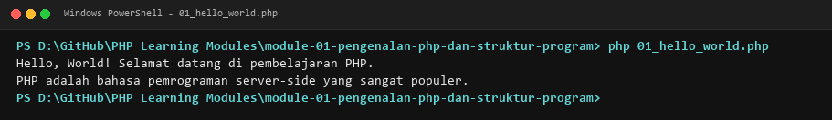
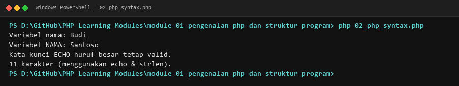
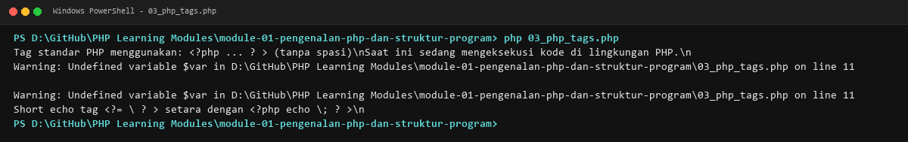
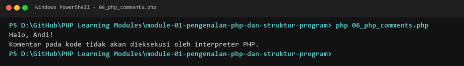
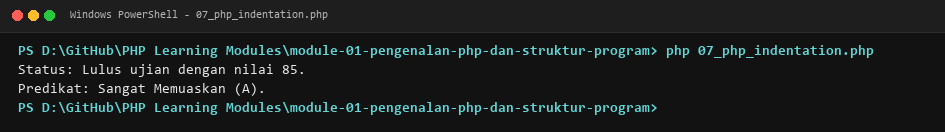
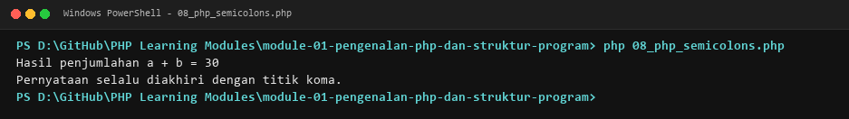
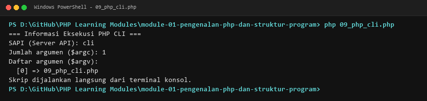
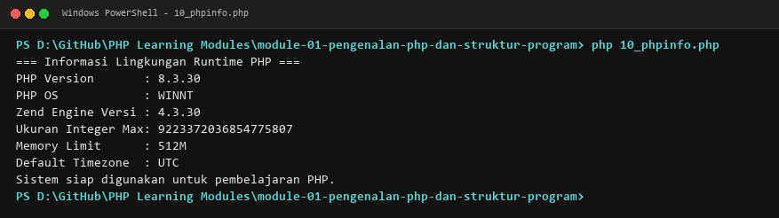

# MODUL 1: Pengenalan PHP dan Struktur Program

## Ringkasan Ruang Lingkup Materi
Dasar sintaksis, penanda tag, pernyataan output dasar, standar komentar, indentasi, dan eksekusi PHP melalui CLI.

## Tujuan Pembelajaran
Memahami fondasi cara kerja PHP, cara menulis sintaks yang valid, serta memahami lingkungan eksekusi CLI.

---

## Daftar Submodul Pembelajaran

- [01_hello_world.php](01_hello_world.php) : Program pertama PHP
- [02_php_syntax.php](02_php_syntax.php) : Sintaks dasar PHP
- [03_php_tags.php](03_php_tags.php) : PHP opening dan closing tags
- [04_echo_statement.php](04_echo_statement.php) : Output menggunakan `echo`
- [05_print_statement.php](05_print_statement.php) : Output menggunakan `print`
- [06_php_comments.php](06_php_comments.php) : Single-line dan multi-line comments
- [07_php_indentation.php](07_php_indentation.php) : Indentasi kode PHP
- [08_php_semicolons.php](08_php_semicolons.php) : Penggunaan titik koma
- [09_php_cli.php](09_php_cli.php) : Menjalankan PHP melalui terminal
- [10_phpinfo.php](10_phpinfo.php) : Informasi konfigurasi PHP

---

## Penjelasan Setiap Submodul

### 1. Program pertama PHP

**Tujuan Pembelajaran:**
Memahami dan menguasai konsep `Program pertama PHP` dalam bahasa pemrograman PHP serta mampu menerapkannya dalam kode program mandiri.

**Konsep Utama:**
Konsep dasar `Program pertama PHP` mencakup mekanisme kerja, sintaks resmi bahasa PHP, serta peran edukatifnya dalam pengembangan perangkat lunak.

**Penjelasan Source Code:**
Berkas `01_hello_world.php` mendemonstrasikan implementasi terisolasi dari `Program pertama PHP` dengan komentar penjelasan edukatif berbahasa Indonesia pada setiap bagian kode penting, tanpa overengineering.

**Cara Menjalankan:**
```bash
php 01_hello_world.php
```

**Hasil yang Diharapkan:**
Program menampilkan demonstrasi komputasi dan output teks yang valid sesuai topik `Program pertama PHP`.

**Screenshot Hasil Eksekusi:**


**Lokasi Source Code:** [01_hello_world.php](01_hello_world.php)

---

### 2. Sintaks dasar PHP

**Tujuan Pembelajaran:**
Memahami dan menguasai konsep `Sintaks dasar PHP` dalam bahasa pemrograman PHP serta mampu menerapkannya dalam kode program mandiri.

**Konsep Utama:**
Konsep dasar `Sintaks dasar PHP` mencakup mekanisme kerja, sintaks resmi bahasa PHP, serta peran edukatifnya dalam pengembangan perangkat lunak.

**Penjelasan Source Code:**
Berkas `02_php_syntax.php` mendemonstrasikan implementasi terisolasi dari `Sintaks dasar PHP` dengan komentar penjelasan edukatif berbahasa Indonesia pada setiap bagian kode penting, tanpa overengineering.

**Cara Menjalankan:**
```bash
php 02_php_syntax.php
```

**Hasil yang Diharapkan:**
Program menampilkan demonstrasi komputasi dan output teks yang valid sesuai topik `Sintaks dasar PHP`.

**Screenshot Hasil Eksekusi:**


**Lokasi Source Code:** [02_php_syntax.php](02_php_syntax.php)

---

### 3. PHP opening dan closing tags

**Tujuan Pembelajaran:**
Memahami dan menguasai konsep `PHP opening dan closing tags` dalam bahasa pemrograman PHP serta mampu menerapkannya dalam kode program mandiri.

**Konsep Utama:**
Konsep dasar `PHP opening dan closing tags` mencakup mekanisme kerja, sintaks resmi bahasa PHP, serta peran edukatifnya dalam pengembangan perangkat lunak.

**Penjelasan Source Code:**
Berkas `03_php_tags.php` mendemonstrasikan implementasi terisolasi dari `PHP opening dan closing tags` dengan komentar penjelasan edukatif berbahasa Indonesia pada setiap bagian kode penting, tanpa overengineering.

**Cara Menjalankan:**
```bash
php 03_php_tags.php
```

**Hasil yang Diharapkan:**
Program menampilkan demonstrasi komputasi dan output teks yang valid sesuai topik `PHP opening dan closing tags`.

**Screenshot Hasil Eksekusi:**


**Lokasi Source Code:** [03_php_tags.php](03_php_tags.php)

---

### 4. Output menggunakan `echo`

**Tujuan Pembelajaran:**
Memahami dan menguasai konsep `Output menggunakan `echo`` dalam bahasa pemrograman PHP serta mampu menerapkannya dalam kode program mandiri.

**Konsep Utama:**
Konsep dasar `Output menggunakan `echo`` mencakup mekanisme kerja, sintaks resmi bahasa PHP, serta peran edukatifnya dalam pengembangan perangkat lunak.

**Penjelasan Source Code:**
Berkas `04_echo_statement.php` mendemonstrasikan implementasi terisolasi dari `Output menggunakan `echo`` dengan komentar penjelasan edukatif berbahasa Indonesia pada setiap bagian kode penting, tanpa overengineering.

**Cara Menjalankan:**
```bash
php 04_echo_statement.php
```

**Hasil yang Diharapkan:**
Program menampilkan demonstrasi komputasi dan output teks yang valid sesuai topik `Output menggunakan `echo``.

**Screenshot Hasil Eksekusi:**


**Lokasi Source Code:** [04_echo_statement.php](04_echo_statement.php)

---

### 5. Output menggunakan `print`

**Tujuan Pembelajaran:**
Memahami dan menguasai konsep `Output menggunakan `print`` dalam bahasa pemrograman PHP serta mampu menerapkannya dalam kode program mandiri.

**Konsep Utama:**
Konsep dasar `Output menggunakan `print`` mencakup mekanisme kerja, sintaks resmi bahasa PHP, serta peran edukatifnya dalam pengembangan perangkat lunak.

**Penjelasan Source Code:**
Berkas `05_print_statement.php` mendemonstrasikan implementasi terisolasi dari `Output menggunakan `print`` dengan komentar penjelasan edukatif berbahasa Indonesia pada setiap bagian kode penting, tanpa overengineering.

**Cara Menjalankan:**
```bash
php 05_print_statement.php
```

**Hasil yang Diharapkan:**
Program menampilkan demonstrasi komputasi dan output teks yang valid sesuai topik `Output menggunakan `print``.

**Screenshot Hasil Eksekusi:**


**Lokasi Source Code:** [05_print_statement.php](05_print_statement.php)

---

### 6. Single-line dan multi-line comments

**Tujuan Pembelajaran:**
Memahami dan menguasai konsep `Single-line dan multi-line comments` dalam bahasa pemrograman PHP serta mampu menerapkannya dalam kode program mandiri.

**Konsep Utama:**
Konsep dasar `Single-line dan multi-line comments` mencakup mekanisme kerja, sintaks resmi bahasa PHP, serta peran edukatifnya dalam pengembangan perangkat lunak.

**Penjelasan Source Code:**
Berkas `06_php_comments.php` mendemonstrasikan implementasi terisolasi dari `Single-line dan multi-line comments` dengan komentar penjelasan edukatif berbahasa Indonesia pada setiap bagian kode penting, tanpa overengineering.

**Cara Menjalankan:**
```bash
php 06_php_comments.php
```

**Hasil yang Diharapkan:**
Program menampilkan demonstrasi komputasi dan output teks yang valid sesuai topik `Single-line dan multi-line comments`.

**Screenshot Hasil Eksekusi:**


**Lokasi Source Code:** [06_php_comments.php](06_php_comments.php)

---

### 7. Indentasi kode PHP

**Tujuan Pembelajaran:**
Memahami dan menguasai konsep `Indentasi kode PHP` dalam bahasa pemrograman PHP serta mampu menerapkannya dalam kode program mandiri.

**Konsep Utama:**
Konsep dasar `Indentasi kode PHP` mencakup mekanisme kerja, sintaks resmi bahasa PHP, serta peran edukatifnya dalam pengembangan perangkat lunak.

**Penjelasan Source Code:**
Berkas `07_php_indentation.php` mendemonstrasikan implementasi terisolasi dari `Indentasi kode PHP` dengan komentar penjelasan edukatif berbahasa Indonesia pada setiap bagian kode penting, tanpa overengineering.

**Cara Menjalankan:**
```bash
php 07_php_indentation.php
```

**Hasil yang Diharapkan:**
Program menampilkan demonstrasi komputasi dan output teks yang valid sesuai topik `Indentasi kode PHP`.

**Screenshot Hasil Eksekusi:**


**Lokasi Source Code:** [07_php_indentation.php](07_php_indentation.php)

---

### 8. Penggunaan titik koma

**Tujuan Pembelajaran:**
Memahami dan menguasai konsep `Penggunaan titik koma` dalam bahasa pemrograman PHP serta mampu menerapkannya dalam kode program mandiri.

**Konsep Utama:**
Konsep dasar `Penggunaan titik koma` mencakup mekanisme kerja, sintaks resmi bahasa PHP, serta peran edukatifnya dalam pengembangan perangkat lunak.

**Penjelasan Source Code:**
Berkas `08_php_semicolons.php` mendemonstrasikan implementasi terisolasi dari `Penggunaan titik koma` dengan komentar penjelasan edukatif berbahasa Indonesia pada setiap bagian kode penting, tanpa overengineering.

**Cara Menjalankan:**
```bash
php 08_php_semicolons.php
```

**Hasil yang Diharapkan:**
Program menampilkan demonstrasi komputasi dan output teks yang valid sesuai topik `Penggunaan titik koma`.

**Screenshot Hasil Eksekusi:**


**Lokasi Source Code:** [08_php_semicolons.php](08_php_semicolons.php)

---

### 9. Menjalankan PHP melalui terminal

**Tujuan Pembelajaran:**
Memahami dan menguasai konsep `Menjalankan PHP melalui terminal` dalam bahasa pemrograman PHP serta mampu menerapkannya dalam kode program mandiri.

**Konsep Utama:**
Konsep dasar `Menjalankan PHP melalui terminal` mencakup mekanisme kerja, sintaks resmi bahasa PHP, serta peran edukatifnya dalam pengembangan perangkat lunak.

**Penjelasan Source Code:**
Berkas `09_php_cli.php` mendemonstrasikan implementasi terisolasi dari `Menjalankan PHP melalui terminal` dengan komentar penjelasan edukatif berbahasa Indonesia pada setiap bagian kode penting, tanpa overengineering.

**Cara Menjalankan:**
```bash
php 09_php_cli.php
```

**Hasil yang Diharapkan:**
Program menampilkan demonstrasi komputasi dan output teks yang valid sesuai topik `Menjalankan PHP melalui terminal`.

**Screenshot Hasil Eksekusi:**


**Lokasi Source Code:** [09_php_cli.php](09_php_cli.php)

---

### 10. Informasi konfigurasi PHP

**Tujuan Pembelajaran:**
Memahami dan menguasai konsep `Informasi konfigurasi PHP` dalam bahasa pemrograman PHP serta mampu menerapkannya dalam kode program mandiri.

**Konsep Utama:**
Konsep dasar `Informasi konfigurasi PHP` mencakup mekanisme kerja, sintaks resmi bahasa PHP, serta peran edukatifnya dalam pengembangan perangkat lunak.

**Penjelasan Source Code:**
Berkas `10_phpinfo.php` mendemonstrasikan implementasi terisolasi dari `Informasi konfigurasi PHP` dengan komentar penjelasan edukatif berbahasa Indonesia pada setiap bagian kode penting, tanpa overengineering.

**Cara Menjalankan:**
```bash
php 10_phpinfo.php
```

**Hasil yang Diharapkan:**
Program menampilkan demonstrasi komputasi dan output teks yang valid sesuai topik `Informasi konfigurasi PHP`.

**Screenshot Hasil Eksekusi:**


**Lokasi Source Code:** [10_phpinfo.php](10_phpinfo.php)

---

## Ringkasan Modul
Modul 1 (Pengenalan PHP dan Struktur Program) memberikan pemahaman menyeluruh mengenai dasar sintaksis, penanda tag, pernyataan output dasar, standar komentar, indentasi, dan eksekusi php melalui cli. Seluruh 10 submodul dirancang terpisah dan mandiri sehingga mudah dipelajari langkah demi langkah.
