# MODUL 2: Variabel dan Tipe Data

## Ringkasan Ruang Lingkup Materi
Deklarasi variabel, aturan penamaan variabel, tipe data skalar (int, float, string, bool), null, array, object, type checking, casting, juggling, dan strict typing.

## Tujuan Pembelajaran
Menguasai penanganan data dinamis di PHP dan memastikan tipe data dikelola dengan aman dan akurat.

---

## Daftar Submodul Pembelajaran

- [11_variables.php](11_variables.php) : Deklarasi variabel
- [12_variable_naming.php](12_variable_naming.php) : Aturan penamaan variabel
- [13_variable_assignment.php](13_variable_assignment.php) : Assignment variabel
- [14_integer_type.php](14_integer_type.php) : Tipe data integer
- [15_float_type.php](15_float_type.php) : Tipe data float
- [16_string_type.php](16_string_type.php) : Tipe data string
- [17_boolean_type.php](17_boolean_type.php) : Tipe data boolean
- [18_null_type.php](18_null_type.php) : Nilai `null`
- [19_array_type.php](19_array_type.php) : Tipe data array
- [20_object_type.php](20_object_type.php) : Tipe data object
- [21_type_checking.php](21_type_checking.php) : Pemeriksaan tipe data
- [22_type_casting.php](22_type_casting.php) : Konversi tipe data
- [23_type_juggling.php](23_type_juggling.php) : Type juggling
- [24_strict_types.php](24_strict_types.php) : Strict typing menggunakan `declare(strict_types=1)`

---

## Penjelasan Setiap Submodul

### 11. Deklarasi variabel

**Tujuan Pembelajaran:**
Memahami dan menguasai konsep `Deklarasi variabel` dalam bahasa pemrograman PHP serta mampu menerapkannya dalam kode program mandiri.

**Konsep Utama:**
Konsep dasar `Deklarasi variabel` mencakup mekanisme kerja, sintaks resmi bahasa PHP, serta peran edukatifnya dalam pengembangan perangkat lunak.

**Penjelasan Source Code:**
Berkas `11_variables.php` mendemonstrasikan implementasi terisolasi dari `Deklarasi variabel` dengan komentar penjelasan edukatif berbahasa Indonesia pada setiap bagian kode penting, tanpa overengineering.

**Cara Menjalankan:**
```bash
php 11_variables.php
```

**Hasil yang Diharapkan:**
Program menampilkan demonstrasi komputasi dan output teks yang valid sesuai topik `Deklarasi variabel`.

**Screenshot Hasil Eksekusi:**
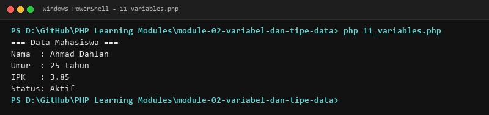

**Lokasi Source Code:** [11_variables.php](11_variables.php)

---

### 12. Aturan penamaan variabel

**Tujuan Pembelajaran:**
Memahami dan menguasai konsep `Aturan penamaan variabel` dalam bahasa pemrograman PHP serta mampu menerapkannya dalam kode program mandiri.

**Konsep Utama:**
Konsep dasar `Aturan penamaan variabel` mencakup mekanisme kerja, sintaks resmi bahasa PHP, serta peran edukatifnya dalam pengembangan perangkat lunak.

**Penjelasan Source Code:**
Berkas `12_variable_naming.php` mendemonstrasikan implementasi terisolasi dari `Aturan penamaan variabel` dengan komentar penjelasan edukatif berbahasa Indonesia pada setiap bagian kode penting, tanpa overengineering.

**Cara Menjalankan:**
```bash
php 12_variable_naming.php
```

**Hasil yang Diharapkan:**
Program menampilkan demonstrasi komputasi dan output teks yang valid sesuai topik `Aturan penamaan variabel`.

**Screenshot Hasil Eksekusi:**
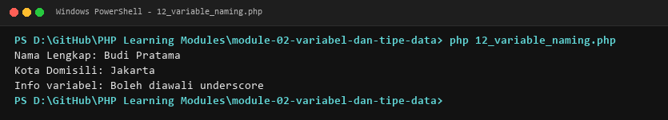

**Lokasi Source Code:** [12_variable_naming.php](12_variable_naming.php)

---

### 13. Assignment variabel

**Tujuan Pembelajaran:**
Memahami dan menguasai konsep `Assignment variabel` dalam bahasa pemrograman PHP serta mampu menerapkannya dalam kode program mandiri.

**Konsep Utama:**
Konsep dasar `Assignment variabel` mencakup mekanisme kerja, sintaks resmi bahasa PHP, serta peran edukatifnya dalam pengembangan perangkat lunak.

**Penjelasan Source Code:**
Berkas `13_variable_assignment.php` mendemonstrasikan implementasi terisolasi dari `Assignment variabel` dengan komentar penjelasan edukatif berbahasa Indonesia pada setiap bagian kode penting, tanpa overengineering.

**Cara Menjalankan:**
```bash
php 13_variable_assignment.php
```

**Hasil yang Diharapkan:**
Program menampilkan demonstrasi komputasi dan output teks yang valid sesuai topik `Assignment variabel`.

**Screenshot Hasil Eksekusi:**
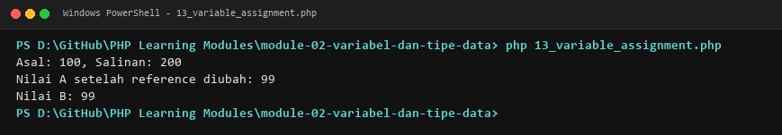

**Lokasi Source Code:** [13_variable_assignment.php](13_variable_assignment.php)

---

### 14. Tipe data integer

**Tujuan Pembelajaran:**
Memahami dan menguasai konsep `Tipe data integer` dalam bahasa pemrograman PHP serta mampu menerapkannya dalam kode program mandiri.

**Konsep Utama:**
Konsep dasar `Tipe data integer` mencakup mekanisme kerja, sintaks resmi bahasa PHP, serta peran edukatifnya dalam pengembangan perangkat lunak.

**Penjelasan Source Code:**
Berkas `14_integer_type.php` mendemonstrasikan implementasi terisolasi dari `Tipe data integer` dengan komentar penjelasan edukatif berbahasa Indonesia pada setiap bagian kode penting, tanpa overengineering.

**Cara Menjalankan:**
```bash
php 14_integer_type.php
```

**Hasil yang Diharapkan:**
Program menampilkan demonstrasi komputasi dan output teks yang valid sesuai topik `Tipe data integer`.

**Screenshot Hasil Eksekusi:**
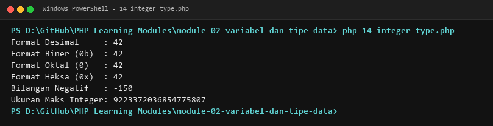

**Lokasi Source Code:** [14_integer_type.php](14_integer_type.php)

---

### 15. Tipe data float

**Tujuan Pembelajaran:**
Memahami dan menguasai konsep `Tipe data float` dalam bahasa pemrograman PHP serta mampu menerapkannya dalam kode program mandiri.

**Konsep Utama:**
Konsep dasar `Tipe data float` mencakup mekanisme kerja, sintaks resmi bahasa PHP, serta peran edukatifnya dalam pengembangan perangkat lunak.

**Penjelasan Source Code:**
Berkas `15_float_type.php` mendemonstrasikan implementasi terisolasi dari `Tipe data float` dengan komentar penjelasan edukatif berbahasa Indonesia pada setiap bagian kode penting, tanpa overengineering.

**Cara Menjalankan:**
```bash
php 15_float_type.php
```

**Hasil yang Diharapkan:**
Program menampilkan demonstrasi komputasi dan output teks yang valid sesuai topik `Tipe data float`.

**Screenshot Hasil Eksekusi:**
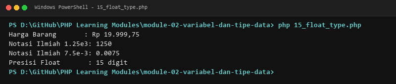

**Lokasi Source Code:** [15_float_type.php](15_float_type.php)

---

### 16. Tipe data string

**Tujuan Pembelajaran:**
Memahami dan menguasai konsep `Tipe data string` dalam bahasa pemrograman PHP serta mampu menerapkannya dalam kode program mandiri.

**Konsep Utama:**
Konsep dasar `Tipe data string` mencakup mekanisme kerja, sintaks resmi bahasa PHP, serta peran edukatifnya dalam pengembangan perangkat lunak.

**Penjelasan Source Code:**
Berkas `16_string_type.php` mendemonstrasikan implementasi terisolasi dari `Tipe data string` dengan komentar penjelasan edukatif berbahasa Indonesia pada setiap bagian kode penting, tanpa overengineering.

**Cara Menjalankan:**
```bash
php 16_string_type.php
```

**Hasil yang Diharapkan:**
Program menampilkan demonstrasi komputasi dan output teks yang valid sesuai topik `Tipe data string`.

**Screenshot Hasil Eksekusi:**
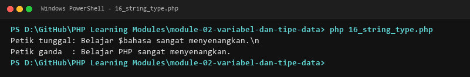

**Lokasi Source Code:** [16_string_type.php](16_string_type.php)

---

### 17. Tipe data boolean

**Tujuan Pembelajaran:**
Memahami dan menguasai konsep `Tipe data boolean` dalam bahasa pemrograman PHP serta mampu menerapkannya dalam kode program mandiri.

**Konsep Utama:**
Konsep dasar `Tipe data boolean` mencakup mekanisme kerja, sintaks resmi bahasa PHP, serta peran edukatifnya dalam pengembangan perangkat lunak.

**Penjelasan Source Code:**
Berkas `17_boolean_type.php` mendemonstrasikan implementasi terisolasi dari `Tipe data boolean` dengan komentar penjelasan edukatif berbahasa Indonesia pada setiap bagian kode penting, tanpa overengineering.

**Cara Menjalankan:**
```bash
php 17_boolean_type.php
```

**Hasil yang Diharapkan:**
Program menampilkan demonstrasi komputasi dan output teks yang valid sesuai topik `Tipe data boolean`.

**Screenshot Hasil Eksekusi:**
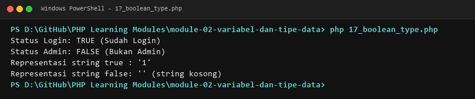

**Lokasi Source Code:** [17_boolean_type.php](17_boolean_type.php)

---

### 18. Nilai `null`

**Tujuan Pembelajaran:**
Memahami dan menguasai konsep `Nilai `null`` dalam bahasa pemrograman PHP serta mampu menerapkannya dalam kode program mandiri.

**Konsep Utama:**
Konsep dasar `Nilai `null`` mencakup mekanisme kerja, sintaks resmi bahasa PHP, serta peran edukatifnya dalam pengembangan perangkat lunak.

**Penjelasan Source Code:**
Berkas `18_null_type.php` mendemonstrasikan implementasi terisolasi dari `Nilai `null`` dengan komentar penjelasan edukatif berbahasa Indonesia pada setiap bagian kode penting, tanpa overengineering.

**Cara Menjalankan:**
```bash
php 18_null_type.php
```

**Hasil yang Diharapkan:**
Program menampilkan demonstrasi komputasi dan output teks yang valid sesuai topik `Nilai `null``.

**Screenshot Hasil Eksekusi:**


**Lokasi Source Code:** [18_null_type.php](18_null_type.php)

---

### 19. Tipe data array

**Tujuan Pembelajaran:**
Memahami dan menguasai konsep `Tipe data array` dalam bahasa pemrograman PHP serta mampu menerapkannya dalam kode program mandiri.

**Konsep Utama:**
Konsep dasar `Tipe data array` mencakup mekanisme kerja, sintaks resmi bahasa PHP, serta peran edukatifnya dalam pengembangan perangkat lunak.

**Penjelasan Source Code:**
Berkas `19_array_type.php` mendemonstrasikan implementasi terisolasi dari `Tipe data array` dengan komentar penjelasan edukatif berbahasa Indonesia pada setiap bagian kode penting, tanpa overengineering.

**Cara Menjalankan:**
```bash
php 19_array_type.php
```

**Hasil yang Diharapkan:**
Program menampilkan demonstrasi komputasi dan output teks yang valid sesuai topik `Tipe data array`.

**Screenshot Hasil Eksekusi:**
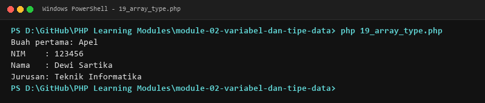

**Lokasi Source Code:** [19_array_type.php](19_array_type.php)

---

### 20. Tipe data object

**Tujuan Pembelajaran:**
Memahami dan menguasai konsep `Tipe data object` dalam bahasa pemrograman PHP serta mampu menerapkannya dalam kode program mandiri.

**Konsep Utama:**
Konsep dasar `Tipe data object` mencakup mekanisme kerja, sintaks resmi bahasa PHP, serta peran edukatifnya dalam pengembangan perangkat lunak.

**Penjelasan Source Code:**
Berkas `20_object_type.php` mendemonstrasikan implementasi terisolasi dari `Tipe data object` dengan komentar penjelasan edukatif berbahasa Indonesia pada setiap bagian kode penting, tanpa overengineering.

**Cara Menjalankan:**
```bash
php 20_object_type.php
```

**Hasil yang Diharapkan:**
Program menampilkan demonstrasi komputasi dan output teks yang valid sesuai topik `Tipe data object`.

**Screenshot Hasil Eksekusi:**
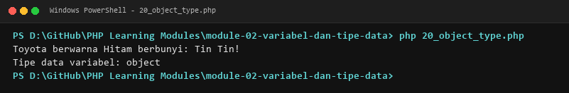

**Lokasi Source Code:** [20_object_type.php](20_object_type.php)

---

### 21. Pemeriksaan tipe data

**Tujuan Pembelajaran:**
Memahami dan menguasai konsep `Pemeriksaan tipe data` dalam bahasa pemrograman PHP serta mampu menerapkannya dalam kode program mandiri.

**Konsep Utama:**
Konsep dasar `Pemeriksaan tipe data` mencakup mekanisme kerja, sintaks resmi bahasa PHP, serta peran edukatifnya dalam pengembangan perangkat lunak.

**Penjelasan Source Code:**
Berkas `21_type_checking.php` mendemonstrasikan implementasi terisolasi dari `Pemeriksaan tipe data` dengan komentar penjelasan edukatif berbahasa Indonesia pada setiap bagian kode penting, tanpa overengineering.

**Cara Menjalankan:**
```bash
php 21_type_checking.php
```

**Hasil yang Diharapkan:**
Program menampilkan demonstrasi komputasi dan output teks yang valid sesuai topik `Pemeriksaan tipe data`.

**Screenshot Hasil Eksekusi:**
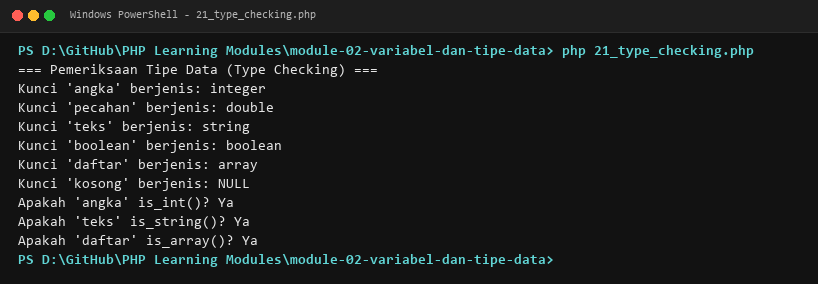

**Lokasi Source Code:** [21_type_checking.php](21_type_checking.php)

---

### 22. Konversi tipe data

**Tujuan Pembelajaran:**
Memahami dan menguasai konsep `Konversi tipe data` dalam bahasa pemrograman PHP serta mampu menerapkannya dalam kode program mandiri.

**Konsep Utama:**
Konsep dasar `Konversi tipe data` mencakup mekanisme kerja, sintaks resmi bahasa PHP, serta peran edukatifnya dalam pengembangan perangkat lunak.

**Penjelasan Source Code:**
Berkas `22_type_casting.php` mendemonstrasikan implementasi terisolasi dari `Konversi tipe data` dengan komentar penjelasan edukatif berbahasa Indonesia pada setiap bagian kode penting, tanpa overengineering.

**Cara Menjalankan:**
```bash
php 22_type_casting.php
```

**Hasil yang Diharapkan:**
Program menampilkan demonstrasi komputasi dan output teks yang valid sesuai topik `Konversi tipe data`.

**Screenshot Hasil Eksekusi:**
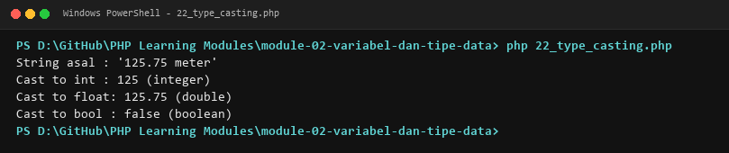

**Lokasi Source Code:** [22_type_casting.php](22_type_casting.php)

---

### 23. Type juggling

**Tujuan Pembelajaran:**
Memahami dan menguasai konsep `Type juggling` dalam bahasa pemrograman PHP serta mampu menerapkannya dalam kode program mandiri.

**Konsep Utama:**
Konsep dasar `Type juggling` mencakup mekanisme kerja, sintaks resmi bahasa PHP, serta peran edukatifnya dalam pengembangan perangkat lunak.

**Penjelasan Source Code:**
Berkas `23_type_juggling.php` mendemonstrasikan implementasi terisolasi dari `Type juggling` dengan komentar penjelasan edukatif berbahasa Indonesia pada setiap bagian kode penting, tanpa overengineering.

**Cara Menjalankan:**
```bash
php 23_type_juggling.php
```

**Hasil yang Diharapkan:**
Program menampilkan demonstrasi komputasi dan output teks yang valid sesuai topik `Type juggling`.

**Screenshot Hasil Eksekusi:**
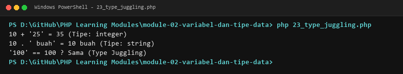

**Lokasi Source Code:** [23_type_juggling.php](23_type_juggling.php)

---

### 24. Strict typing menggunakan `declare(strict_types=1)`

**Tujuan Pembelajaran:**
Memahami dan menguasai konsep `Strict typing menggunakan `declare(strict_types=1)`` dalam bahasa pemrograman PHP serta mampu menerapkannya dalam kode program mandiri.

**Konsep Utama:**
Konsep dasar `Strict typing menggunakan `declare(strict_types=1)`` mencakup mekanisme kerja, sintaks resmi bahasa PHP, serta peran edukatifnya dalam pengembangan perangkat lunak.

**Penjelasan Source Code:**
Berkas `24_strict_types.php` mendemonstrasikan implementasi terisolasi dari `Strict typing menggunakan `declare(strict_types=1)`` dengan komentar penjelasan edukatif berbahasa Indonesia pada setiap bagian kode penting, tanpa overengineering.

**Cara Menjalankan:**
```bash
php 24_strict_types.php
```

**Hasil yang Diharapkan:**
Program menampilkan demonstrasi komputasi dan output teks yang valid sesuai topik `Strict typing menggunakan `declare(strict_types=1)``.

**Screenshot Hasil Eksekusi:**


**Lokasi Source Code:** [24_strict_types.php](24_strict_types.php)

---

## Ringkasan Modul
Modul 2 (Variabel dan Tipe Data) memberikan pemahaman menyeluruh mengenai deklarasi variabel, aturan penamaan variabel, tipe data skalar (int, float, string, bool), null, array, object, type checking, casting, juggling, dan strict typing. Seluruh 14 submodul dirancang terpisah dan mandiri sehingga mudah dipelajari langkah demi langkah.
