# MODUL 3: Operator dan Ekspresi

## Ringkasan Ruang Lingkup Materi
Operator aritmetika, assignment, perbandingan longgar dan ketat, logika, string, array, ternary, null coalescing, nullsafe, bitwise, dan presedensi ekspresi.

## Tujuan Pembelajaran
Mampu memanipulasi ekspresi matematika dan kondisional secara efektif dalam alur komputasi.

---

## Daftar Submodul Pembelajaran

- [25_arithmetic_operators.php](25_arithmetic_operators.php) : Operator aritmetika
- [26_assignment_operators.php](26_assignment_operators.php) : Operator penugasan
- [27_comparison_operators.php](27_comparison_operators.php) : Operator perbandingan
- [28_strict_comparison.php](28_strict_comparison.php) : Perbandingan identik dengan `===`
- [29_logical_operators.php](29_logical_operators.php) : Operator logika
- [30_increment_decrement.php](30_increment_decrement.php) : Increment dan decrement
- [31_string_operators.php](31_string_operators.php) : Operator string
- [32_array_operators.php](32_array_operators.php) : Operator array
- [33_ternary_operator.php](33_ternary_operator.php) : Operator ternary
- [34_null_coalescing.php](34_null_coalescing.php) : Null coalescing operator
- [35_nullsafe_operator.php](35_nullsafe_operator.php) : Nullsafe operator
- [36_bitwise_operators.php](36_bitwise_operators.php) : Operator bitwise
- [37_operator_precedence.php](37_operator_precedence.php) : Prioritas operator
- [38_expression_evaluation.php](38_expression_evaluation.php) : Evaluasi ekspresi

---

## Penjelasan Setiap Submodul

### 25. Operator aritmetika

**Tujuan Pembelajaran:**
Memahami dan menguasai konsep `Operator aritmetika` dalam bahasa pemrograman PHP serta mampu menerapkannya dalam kode program mandiri.

**Konsep Utama:**
Konsep dasar `Operator aritmetika` mencakup mekanisme kerja, sintaks resmi bahasa PHP, serta peran edukatifnya dalam pengembangan perangkat lunak.

**Penjelasan Source Code:**
Berkas `25_arithmetic_operators.php` mendemonstrasikan implementasi terisolasi dari `Operator aritmetika` dengan komentar penjelasan edukatif berbahasa Indonesia pada setiap bagian kode penting, tanpa overengineering.

**Cara Menjalankan:**
```bash
php 25_arithmetic_operators.php
```

**Hasil yang Diharapkan:**
Program menampilkan demonstrasi komputasi dan output teks yang valid sesuai topik `Operator aritmetika`.

**Screenshot Hasil Eksekusi:**
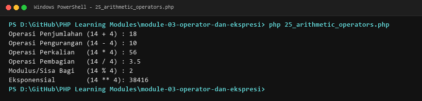

**Lokasi Source Code:** [25_arithmetic_operators.php](25_arithmetic_operators.php)

---

### 26. Operator penugasan

**Tujuan Pembelajaran:**
Memahami dan menguasai konsep `Operator penugasan` dalam bahasa pemrograman PHP serta mampu menerapkannya dalam kode program mandiri.

**Konsep Utama:**
Konsep dasar `Operator penugasan` mencakup mekanisme kerja, sintaks resmi bahasa PHP, serta peran edukatifnya dalam pengembangan perangkat lunak.

**Penjelasan Source Code:**
Berkas `26_assignment_operators.php` mendemonstrasikan implementasi terisolasi dari `Operator penugasan` dengan komentar penjelasan edukatif berbahasa Indonesia pada setiap bagian kode penting, tanpa overengineering.

**Cara Menjalankan:**
```bash
php 26_assignment_operators.php
```

**Hasil yang Diharapkan:**
Program menampilkan demonstrasi komputasi dan output teks yang valid sesuai topik `Operator penugasan`.

**Screenshot Hasil Eksekusi:**
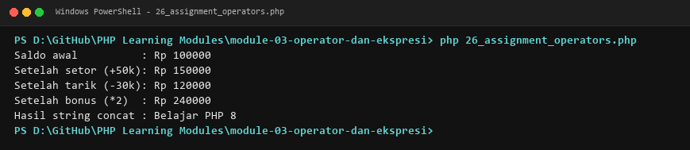

**Lokasi Source Code:** [26_assignment_operators.php](26_assignment_operators.php)

---

### 27. Operator perbandingan

**Tujuan Pembelajaran:**
Memahami dan menguasai konsep `Operator perbandingan` dalam bahasa pemrograman PHP serta mampu menerapkannya dalam kode program mandiri.

**Konsep Utama:**
Konsep dasar `Operator perbandingan` mencakup mekanisme kerja, sintaks resmi bahasa PHP, serta peran edukatifnya dalam pengembangan perangkat lunak.

**Penjelasan Source Code:**
Berkas `27_comparison_operators.php` mendemonstrasikan implementasi terisolasi dari `Operator perbandingan` dengan komentar penjelasan edukatif berbahasa Indonesia pada setiap bagian kode penting, tanpa overengineering.

**Cara Menjalankan:**
```bash
php 27_comparison_operators.php
```

**Hasil yang Diharapkan:**
Program menampilkan demonstrasi komputasi dan output teks yang valid sesuai topik `Operator perbandingan`.

**Screenshot Hasil Eksekusi:**
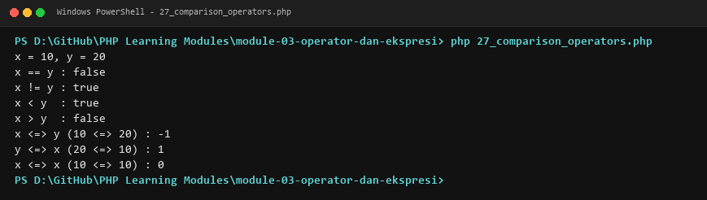

**Lokasi Source Code:** [27_comparison_operators.php](27_comparison_operators.php)

---

### 28. Perbandingan identik dengan `===`

**Tujuan Pembelajaran:**
Memahami dan menguasai konsep `Perbandingan identik dengan `===`` dalam bahasa pemrograman PHP serta mampu menerapkannya dalam kode program mandiri.

**Konsep Utama:**
Konsep dasar `Perbandingan identik dengan `===`` mencakup mekanisme kerja, sintaks resmi bahasa PHP, serta peran edukatifnya dalam pengembangan perangkat lunak.

**Penjelasan Source Code:**
Berkas `28_strict_comparison.php` mendemonstrasikan implementasi terisolasi dari `Perbandingan identik dengan `===`` dengan komentar penjelasan edukatif berbahasa Indonesia pada setiap bagian kode penting, tanpa overengineering.

**Cara Menjalankan:**
```bash
php 28_strict_comparison.php
```

**Hasil yang Diharapkan:**
Program menampilkan demonstrasi komputasi dan output teks yang valid sesuai topik `Perbandingan identik dengan `===``.

**Screenshot Hasil Eksekusi:**


**Lokasi Source Code:** [28_strict_comparison.php](28_strict_comparison.php)

---

### 29. Operator logika

**Tujuan Pembelajaran:**
Memahami dan menguasai konsep `Operator logika` dalam bahasa pemrograman PHP serta mampu menerapkannya dalam kode program mandiri.

**Konsep Utama:**
Konsep dasar `Operator logika` mencakup mekanisme kerja, sintaks resmi bahasa PHP, serta peran edukatifnya dalam pengembangan perangkat lunak.

**Penjelasan Source Code:**
Berkas `29_logical_operators.php` mendemonstrasikan implementasi terisolasi dari `Operator logika` dengan komentar penjelasan edukatif berbahasa Indonesia pada setiap bagian kode penting, tanpa overengineering.

**Cara Menjalankan:**
```bash
php 29_logical_operators.php
```

**Hasil yang Diharapkan:**
Program menampilkan demonstrasi komputasi dan output teks yang valid sesuai topik `Operator logika`.

**Screenshot Hasil Eksekusi:**
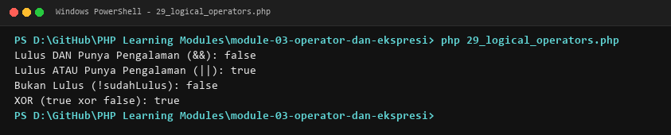

**Lokasi Source Code:** [29_logical_operators.php](29_logical_operators.php)

---

### 30. Increment dan decrement

**Tujuan Pembelajaran:**
Memahami dan menguasai konsep `Increment dan decrement` dalam bahasa pemrograman PHP serta mampu menerapkannya dalam kode program mandiri.

**Konsep Utama:**
Konsep dasar `Increment dan decrement` mencakup mekanisme kerja, sintaks resmi bahasa PHP, serta peran edukatifnya dalam pengembangan perangkat lunak.

**Penjelasan Source Code:**
Berkas `30_increment_decrement.php` mendemonstrasikan implementasi terisolasi dari `Increment dan decrement` dengan komentar penjelasan edukatif berbahasa Indonesia pada setiap bagian kode penting, tanpa overengineering.

**Cara Menjalankan:**
```bash
php 30_increment_decrement.php
```

**Hasil yang Diharapkan:**
Program menampilkan demonstrasi komputasi dan output teks yang valid sesuai topik `Increment dan decrement`.

**Screenshot Hasil Eksekusi:**
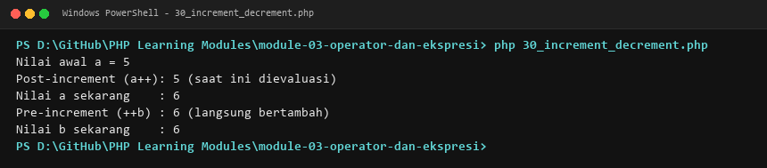

**Lokasi Source Code:** [30_increment_decrement.php](30_increment_decrement.php)

---

### 31. Operator string

**Tujuan Pembelajaran:**
Memahami dan menguasai konsep `Operator string` dalam bahasa pemrograman PHP serta mampu menerapkannya dalam kode program mandiri.

**Konsep Utama:**
Konsep dasar `Operator string` mencakup mekanisme kerja, sintaks resmi bahasa PHP, serta peran edukatifnya dalam pengembangan perangkat lunak.

**Penjelasan Source Code:**
Berkas `31_string_operators.php` mendemonstrasikan implementasi terisolasi dari `Operator string` dengan komentar penjelasan edukatif berbahasa Indonesia pada setiap bagian kode penting, tanpa overengineering.

**Cara Menjalankan:**
```bash
php 31_string_operators.php
```

**Hasil yang Diharapkan:**
Program menampilkan demonstrasi komputasi dan output teks yang valid sesuai topik `Operator string`.

**Screenshot Hasil Eksekusi:**
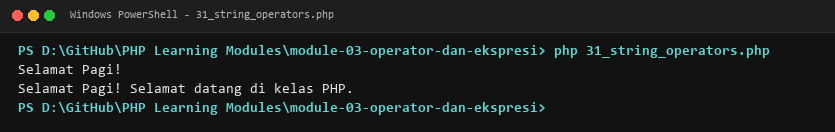

**Lokasi Source Code:** [31_string_operators.php](31_string_operators.php)

---

### 32. Operator array

**Tujuan Pembelajaran:**
Memahami dan menguasai konsep `Operator array` dalam bahasa pemrograman PHP serta mampu menerapkannya dalam kode program mandiri.

**Konsep Utama:**
Konsep dasar `Operator array` mencakup mekanisme kerja, sintaks resmi bahasa PHP, serta peran edukatifnya dalam pengembangan perangkat lunak.

**Penjelasan Source Code:**
Berkas `32_array_operators.php` mendemonstrasikan implementasi terisolasi dari `Operator array` dengan komentar penjelasan edukatif berbahasa Indonesia pada setiap bagian kode penting, tanpa overengineering.

**Cara Menjalankan:**
```bash
php 32_array_operators.php
```

**Hasil yang Diharapkan:**
Program menampilkan demonstrasi komputasi dan output teks yang valid sesuai topik `Operator array`.

**Screenshot Hasil Eksekusi:**
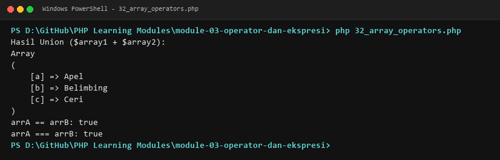

**Lokasi Source Code:** [32_array_operators.php](32_array_operators.php)

---

### 33. Operator ternary

**Tujuan Pembelajaran:**
Memahami dan menguasai konsep `Operator ternary` dalam bahasa pemrograman PHP serta mampu menerapkannya dalam kode program mandiri.

**Konsep Utama:**
Konsep dasar `Operator ternary` mencakup mekanisme kerja, sintaks resmi bahasa PHP, serta peran edukatifnya dalam pengembangan perangkat lunak.

**Penjelasan Source Code:**
Berkas `33_ternary_operator.php` mendemonstrasikan implementasi terisolasi dari `Operator ternary` dengan komentar penjelasan edukatif berbahasa Indonesia pada setiap bagian kode penting, tanpa overengineering.

**Cara Menjalankan:**
```bash
php 33_ternary_operator.php
```

**Hasil yang Diharapkan:**
Program menampilkan demonstrasi komputasi dan output teks yang valid sesuai topik `Operator ternary`.

**Screenshot Hasil Eksekusi:**
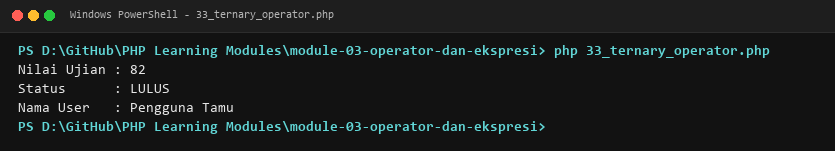

**Lokasi Source Code:** [33_ternary_operator.php](33_ternary_operator.php)

---

### 34. Null coalescing operator

**Tujuan Pembelajaran:**
Memahami dan menguasai konsep `Null coalescing operator` dalam bahasa pemrograman PHP serta mampu menerapkannya dalam kode program mandiri.

**Konsep Utama:**
Konsep dasar `Null coalescing operator` mencakup mekanisme kerja, sintaks resmi bahasa PHP, serta peran edukatifnya dalam pengembangan perangkat lunak.

**Penjelasan Source Code:**
Berkas `34_null_coalescing.php` mendemonstrasikan implementasi terisolasi dari `Null coalescing operator` dengan komentar penjelasan edukatif berbahasa Indonesia pada setiap bagian kode penting, tanpa overengineering.

**Cara Menjalankan:**
```bash
php 34_null_coalescing.php
```

**Hasil yang Diharapkan:**
Program menampilkan demonstrasi komputasi dan output teks yang valid sesuai topik `Null coalescing operator`.

**Screenshot Hasil Eksekusi:**
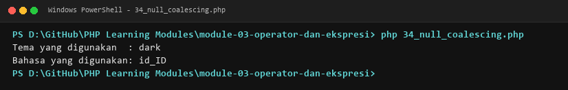

**Lokasi Source Code:** [34_null_coalescing.php](34_null_coalescing.php)

---

### 35. Nullsafe operator

**Tujuan Pembelajaran:**
Memahami dan menguasai konsep `Nullsafe operator` dalam bahasa pemrograman PHP serta mampu menerapkannya dalam kode program mandiri.

**Konsep Utama:**
Konsep dasar `Nullsafe operator` mencakup mekanisme kerja, sintaks resmi bahasa PHP, serta peran edukatifnya dalam pengembangan perangkat lunak.

**Penjelasan Source Code:**
Berkas `35_nullsafe_operator.php` mendemonstrasikan implementasi terisolasi dari `Nullsafe operator` dengan komentar penjelasan edukatif berbahasa Indonesia pada setiap bagian kode penting, tanpa overengineering.

**Cara Menjalankan:**
```bash
php 35_nullsafe_operator.php
```

**Hasil yang Diharapkan:**
Program menampilkan demonstrasi komputasi dan output teks yang valid sesuai topik `Nullsafe operator`.

**Screenshot Hasil Eksekusi:**
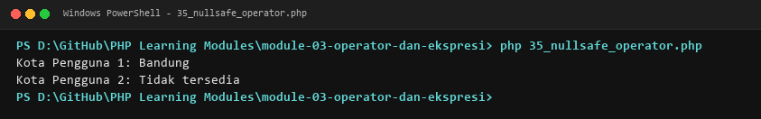

**Lokasi Source Code:** [35_nullsafe_operator.php](35_nullsafe_operator.php)

---

### 36. Operator bitwise

**Tujuan Pembelajaran:**
Memahami dan menguasai konsep `Operator bitwise` dalam bahasa pemrograman PHP serta mampu menerapkannya dalam kode program mandiri.

**Konsep Utama:**
Konsep dasar `Operator bitwise` mencakup mekanisme kerja, sintaks resmi bahasa PHP, serta peran edukatifnya dalam pengembangan perangkat lunak.

**Penjelasan Source Code:**
Berkas `36_bitwise_operators.php` mendemonstrasikan implementasi terisolasi dari `Operator bitwise` dengan komentar penjelasan edukatif berbahasa Indonesia pada setiap bagian kode penting, tanpa overengineering.

**Cara Menjalankan:**
```bash
php 36_bitwise_operators.php
```

**Hasil yang Diharapkan:**
Program menampilkan demonstrasi komputasi dan output teks yang valid sesuai topik `Operator bitwise`.

**Screenshot Hasil Eksekusi:**
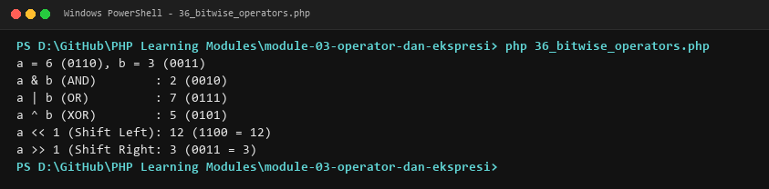

**Lokasi Source Code:** [36_bitwise_operators.php](36_bitwise_operators.php)

---

### 37. Prioritas operator

**Tujuan Pembelajaran:**
Memahami dan menguasai konsep `Prioritas operator` dalam bahasa pemrograman PHP serta mampu menerapkannya dalam kode program mandiri.

**Konsep Utama:**
Konsep dasar `Prioritas operator` mencakup mekanisme kerja, sintaks resmi bahasa PHP, serta peran edukatifnya dalam pengembangan perangkat lunak.

**Penjelasan Source Code:**
Berkas `37_operator_precedence.php` mendemonstrasikan implementasi terisolasi dari `Prioritas operator` dengan komentar penjelasan edukatif berbahasa Indonesia pada setiap bagian kode penting, tanpa overengineering.

**Cara Menjalankan:**
```bash
php 37_operator_precedence.php
```

**Hasil yang Diharapkan:**
Program menampilkan demonstrasi komputasi dan output teks yang valid sesuai topik `Prioritas operator`.

**Screenshot Hasil Eksekusi:**
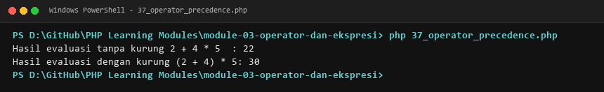

**Lokasi Source Code:** [37_operator_precedence.php](37_operator_precedence.php)

---

### 38. Evaluasi ekspresi

**Tujuan Pembelajaran:**
Memahami dan menguasai konsep `Evaluasi ekspresi` dalam bahasa pemrograman PHP serta mampu menerapkannya dalam kode program mandiri.

**Konsep Utama:**
Konsep dasar `Evaluasi ekspresi` mencakup mekanisme kerja, sintaks resmi bahasa PHP, serta peran edukatifnya dalam pengembangan perangkat lunak.

**Penjelasan Source Code:**
Berkas `38_expression_evaluation.php` mendemonstrasikan implementasi terisolasi dari `Evaluasi ekspresi` dengan komentar penjelasan edukatif berbahasa Indonesia pada setiap bagian kode penting, tanpa overengineering.

**Cara Menjalankan:**
```bash
php 38_expression_evaluation.php
```

**Hasil yang Diharapkan:**
Program menampilkan demonstrasi komputasi dan output teks yang valid sesuai topik `Evaluasi ekspresi`.

**Screenshot Hasil Eksekusi:**
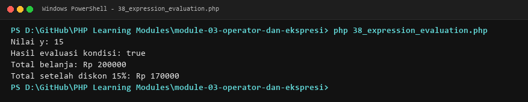

**Lokasi Source Code:** [38_expression_evaluation.php](38_expression_evaluation.php)

---

## Ringkasan Modul
Modul 3 (Operator dan Ekspresi) memberikan pemahaman menyeluruh mengenai operator aritmetika, assignment, perbandingan longgar dan ketat, logika, string, array, ternary, null coalescing, nullsafe, bitwise, dan presedensi ekspresi. Seluruh 14 submodul dirancang terpisah dan mandiri sehingga mudah dipelajari langkah demi langkah.
