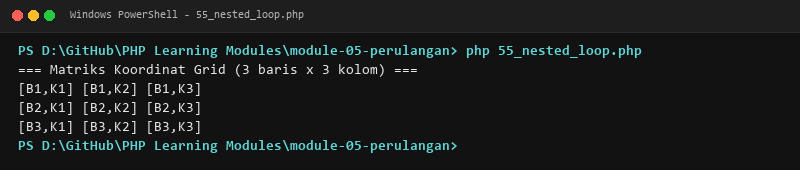
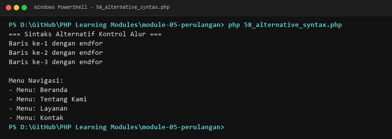
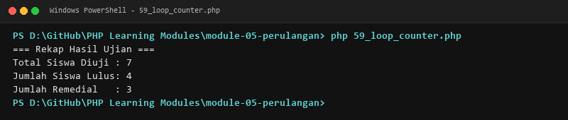
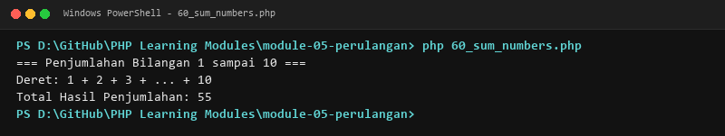
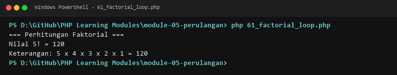
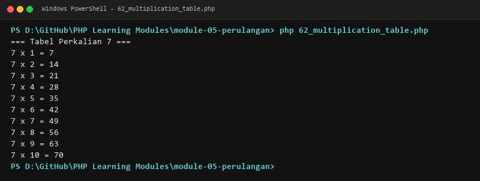
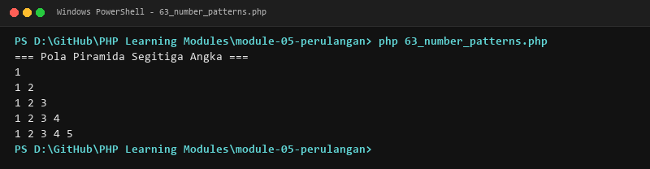
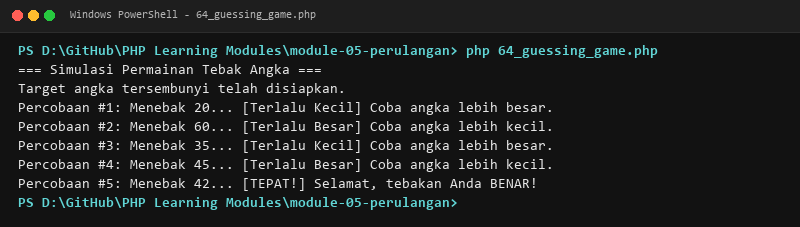

# MODUL 5: Perulangan

## Ringkasan Ruang Lingkup Materi
Perulangan for, while, do-while, foreach (indexed dan associative), nested loop, kontrol break/continue, sintaks alternatif, dan implementasi algoritma perulangan.

## Tujuan Pembelajaran
Menguasai teknik iterasi data, otomasi perulangan tugas komputasi, dan kontrol alur perulangan.

---

## Daftar Submodul Pembelajaran

- [51_for_loop.php](51_for_loop.php) : Perulangan `for`
- [52_while_loop.php](52_while_loop.php) : Perulangan `while`
- [53_do_while_loop.php](53_do_while_loop.php) : Perulangan `do-while`
- [54_foreach_loop.php](54_foreach_loop.php) : Perulangan `foreach`
- [55_nested_loop.php](55_nested_loop.php) : Nested loop
- [56_break_statement.php](56_break_statement.php) : Pernyataan `break`
- [57_continue_statement.php](57_continue_statement.php) : Pernyataan `continue`
- [58_alternative_syntax.php](58_alternative_syntax.php) : Sintaks alternatif PHP untuk kontrol alur
- [59_loop_counter.php](59_loop_counter.php) : Penghitung perulangan
- [60_sum_numbers.php](60_sum_numbers.php) : Penjumlahan bilangan
- [61_factorial_loop.php](61_factorial_loop.php) : Faktorial menggunakan loop
- [62_multiplication_table.php](62_multiplication_table.php) : Tabel perkalian
- [63_number_patterns.php](63_number_patterns.php) : Pola angka
- [64_guessing_game.php](64_guessing_game.php) : Permainan tebak angka

---

## Penjelasan Setiap Submodul

### 51. Perulangan `for`

**Tujuan Pembelajaran:**
Memahami dan menguasai konsep `Perulangan `for`` dalam bahasa pemrograman PHP serta mampu menerapkannya dalam kode program mandiri.

**Konsep Utama:**
Konsep dasar `Perulangan `for`` mencakup mekanisme kerja, sintaks resmi bahasa PHP, serta peran edukatifnya dalam pengembangan perangkat lunak.

**Penjelasan Source Code:**
Berkas `51_for_loop.php` mendemonstrasikan implementasi terisolasi dari `Perulangan `for`` dengan komentar penjelasan edukatif berbahasa Indonesia pada setiap bagian kode penting, tanpa overengineering.

**Cara Menjalankan:**
```bash
php 51_for_loop.php
```

**Hasil yang Diharapkan:**
Program menampilkan demonstrasi komputasi dan output teks yang valid sesuai topik `Perulangan `for``.

**Screenshot Hasil Eksekusi:**


**Lokasi Source Code:** [51_for_loop.php](51_for_loop.php)

---

### 52. Perulangan `while`

**Tujuan Pembelajaran:**
Memahami dan menguasai konsep `Perulangan `while`` dalam bahasa pemrograman PHP serta mampu menerapkannya dalam kode program mandiri.

**Konsep Utama:**
Konsep dasar `Perulangan `while`` mencakup mekanisme kerja, sintaks resmi bahasa PHP, serta peran edukatifnya dalam pengembangan perangkat lunak.

**Penjelasan Source Code:**
Berkas `52_while_loop.php` mendemonstrasikan implementasi terisolasi dari `Perulangan `while`` dengan komentar penjelasan edukatif berbahasa Indonesia pada setiap bagian kode penting, tanpa overengineering.

**Cara Menjalankan:**
```bash
php 52_while_loop.php
```

**Hasil yang Diharapkan:**
Program menampilkan demonstrasi komputasi dan output teks yang valid sesuai topik `Perulangan `while``.

**Screenshot Hasil Eksekusi:**


**Lokasi Source Code:** [52_while_loop.php](52_while_loop.php)

---

### 53. Perulangan `do-while`

**Tujuan Pembelajaran:**
Memahami dan menguasai konsep `Perulangan `do-while`` dalam bahasa pemrograman PHP serta mampu menerapkannya dalam kode program mandiri.

**Konsep Utama:**
Konsep dasar `Perulangan `do-while`` mencakup mekanisme kerja, sintaks resmi bahasa PHP, serta peran edukatifnya dalam pengembangan perangkat lunak.

**Penjelasan Source Code:**
Berkas `53_do_while_loop.php` mendemonstrasikan implementasi terisolasi dari `Perulangan `do-while`` dengan komentar penjelasan edukatif berbahasa Indonesia pada setiap bagian kode penting, tanpa overengineering.

**Cara Menjalankan:**
```bash
php 53_do_while_loop.php
```

**Hasil yang Diharapkan:**
Program menampilkan demonstrasi komputasi dan output teks yang valid sesuai topik `Perulangan `do-while``.

**Screenshot Hasil Eksekusi:**


**Lokasi Source Code:** [53_do_while_loop.php](53_do_while_loop.php)

---

### 54. Perulangan `foreach`

**Tujuan Pembelajaran:**
Memahami dan menguasai konsep `Perulangan `foreach`` dalam bahasa pemrograman PHP serta mampu menerapkannya dalam kode program mandiri.

**Konsep Utama:**
Konsep dasar `Perulangan `foreach`` mencakup mekanisme kerja, sintaks resmi bahasa PHP, serta peran edukatifnya dalam pengembangan perangkat lunak.

**Penjelasan Source Code:**
Berkas `54_foreach_loop.php` mendemonstrasikan implementasi terisolasi dari `Perulangan `foreach`` dengan komentar penjelasan edukatif berbahasa Indonesia pada setiap bagian kode penting, tanpa overengineering.

**Cara Menjalankan:**
```bash
php 54_foreach_loop.php
```

**Hasil yang Diharapkan:**
Program menampilkan demonstrasi komputasi dan output teks yang valid sesuai topik `Perulangan `foreach``.

**Screenshot Hasil Eksekusi:**


**Lokasi Source Code:** [54_foreach_loop.php](54_foreach_loop.php)

---

### 55. Nested loop

**Tujuan Pembelajaran:**
Memahami dan menguasai konsep `Nested loop` dalam bahasa pemrograman PHP serta mampu menerapkannya dalam kode program mandiri.

**Konsep Utama:**
Konsep dasar `Nested loop` mencakup mekanisme kerja, sintaks resmi bahasa PHP, serta peran edukatifnya dalam pengembangan perangkat lunak.

**Penjelasan Source Code:**
Berkas `55_nested_loop.php` mendemonstrasikan implementasi terisolasi dari `Nested loop` dengan komentar penjelasan edukatif berbahasa Indonesia pada setiap bagian kode penting, tanpa overengineering.

**Cara Menjalankan:**
```bash
php 55_nested_loop.php
```

**Hasil yang Diharapkan:**
Program menampilkan demonstrasi komputasi dan output teks yang valid sesuai topik `Nested loop`.

**Screenshot Hasil Eksekusi:**


**Lokasi Source Code:** [55_nested_loop.php](55_nested_loop.php)

---

### 56. Pernyataan `break`

**Tujuan Pembelajaran:**
Memahami dan menguasai konsep `Pernyataan `break`` dalam bahasa pemrograman PHP serta mampu menerapkannya dalam kode program mandiri.

**Konsep Utama:**
Konsep dasar `Pernyataan `break`` mencakup mekanisme kerja, sintaks resmi bahasa PHP, serta peran edukatifnya dalam pengembangan perangkat lunak.

**Penjelasan Source Code:**
Berkas `56_break_statement.php` mendemonstrasikan implementasi terisolasi dari `Pernyataan `break`` dengan komentar penjelasan edukatif berbahasa Indonesia pada setiap bagian kode penting, tanpa overengineering.

**Cara Menjalankan:**
```bash
php 56_break_statement.php
```

**Hasil yang Diharapkan:**
Program menampilkan demonstrasi komputasi dan output teks yang valid sesuai topik `Pernyataan `break``.

**Screenshot Hasil Eksekusi:**


**Lokasi Source Code:** [56_break_statement.php](56_break_statement.php)

---

### 57. Pernyataan `continue`

**Tujuan Pembelajaran:**
Memahami dan menguasai konsep `Pernyataan `continue`` dalam bahasa pemrograman PHP serta mampu menerapkannya dalam kode program mandiri.

**Konsep Utama:**
Konsep dasar `Pernyataan `continue`` mencakup mekanisme kerja, sintaks resmi bahasa PHP, serta peran edukatifnya dalam pengembangan perangkat lunak.

**Penjelasan Source Code:**
Berkas `57_continue_statement.php` mendemonstrasikan implementasi terisolasi dari `Pernyataan `continue`` dengan komentar penjelasan edukatif berbahasa Indonesia pada setiap bagian kode penting, tanpa overengineering.

**Cara Menjalankan:**
```bash
php 57_continue_statement.php
```

**Hasil yang Diharapkan:**
Program menampilkan demonstrasi komputasi dan output teks yang valid sesuai topik `Pernyataan `continue``.

**Screenshot Hasil Eksekusi:**


**Lokasi Source Code:** [57_continue_statement.php](57_continue_statement.php)

---

### 58. Sintaks alternatif PHP untuk kontrol alur

**Tujuan Pembelajaran:**
Memahami dan menguasai konsep `Sintaks alternatif PHP untuk kontrol alur` dalam bahasa pemrograman PHP serta mampu menerapkannya dalam kode program mandiri.

**Konsep Utama:**
Konsep dasar `Sintaks alternatif PHP untuk kontrol alur` mencakup mekanisme kerja, sintaks resmi bahasa PHP, serta peran edukatifnya dalam pengembangan perangkat lunak.

**Penjelasan Source Code:**
Berkas `58_alternative_syntax.php` mendemonstrasikan implementasi terisolasi dari `Sintaks alternatif PHP untuk kontrol alur` dengan komentar penjelasan edukatif berbahasa Indonesia pada setiap bagian kode penting, tanpa overengineering.

**Cara Menjalankan:**
```bash
php 58_alternative_syntax.php
```

**Hasil yang Diharapkan:**
Program menampilkan demonstrasi komputasi dan output teks yang valid sesuai topik `Sintaks alternatif PHP untuk kontrol alur`.

**Screenshot Hasil Eksekusi:**


**Lokasi Source Code:** [58_alternative_syntax.php](58_alternative_syntax.php)

---

### 59. Penghitung perulangan

**Tujuan Pembelajaran:**
Memahami dan menguasai konsep `Penghitung perulangan` dalam bahasa pemrograman PHP serta mampu menerapkannya dalam kode program mandiri.

**Konsep Utama:**
Konsep dasar `Penghitung perulangan` mencakup mekanisme kerja, sintaks resmi bahasa PHP, serta peran edukatifnya dalam pengembangan perangkat lunak.

**Penjelasan Source Code:**
Berkas `59_loop_counter.php` mendemonstrasikan implementasi terisolasi dari `Penghitung perulangan` dengan komentar penjelasan edukatif berbahasa Indonesia pada setiap bagian kode penting, tanpa overengineering.

**Cara Menjalankan:**
```bash
php 59_loop_counter.php
```

**Hasil yang Diharapkan:**
Program menampilkan demonstrasi komputasi dan output teks yang valid sesuai topik `Penghitung perulangan`.

**Screenshot Hasil Eksekusi:**


**Lokasi Source Code:** [59_loop_counter.php](59_loop_counter.php)

---

### 60. Penjumlahan bilangan

**Tujuan Pembelajaran:**
Memahami dan menguasai konsep `Penjumlahan bilangan` dalam bahasa pemrograman PHP serta mampu menerapkannya dalam kode program mandiri.

**Konsep Utama:**
Konsep dasar `Penjumlahan bilangan` mencakup mekanisme kerja, sintaks resmi bahasa PHP, serta peran edukatifnya dalam pengembangan perangkat lunak.

**Penjelasan Source Code:**
Berkas `60_sum_numbers.php` mendemonstrasikan implementasi terisolasi dari `Penjumlahan bilangan` dengan komentar penjelasan edukatif berbahasa Indonesia pada setiap bagian kode penting, tanpa overengineering.

**Cara Menjalankan:**
```bash
php 60_sum_numbers.php
```

**Hasil yang Diharapkan:**
Program menampilkan demonstrasi komputasi dan output teks yang valid sesuai topik `Penjumlahan bilangan`.

**Screenshot Hasil Eksekusi:**


**Lokasi Source Code:** [60_sum_numbers.php](60_sum_numbers.php)

---

### 61. Faktorial menggunakan loop

**Tujuan Pembelajaran:**
Memahami dan menguasai konsep `Faktorial menggunakan loop` dalam bahasa pemrograman PHP serta mampu menerapkannya dalam kode program mandiri.

**Konsep Utama:**
Konsep dasar `Faktorial menggunakan loop` mencakup mekanisme kerja, sintaks resmi bahasa PHP, serta peran edukatifnya dalam pengembangan perangkat lunak.

**Penjelasan Source Code:**
Berkas `61_factorial_loop.php` mendemonstrasikan implementasi terisolasi dari `Faktorial menggunakan loop` dengan komentar penjelasan edukatif berbahasa Indonesia pada setiap bagian kode penting, tanpa overengineering.

**Cara Menjalankan:**
```bash
php 61_factorial_loop.php
```

**Hasil yang Diharapkan:**
Program menampilkan demonstrasi komputasi dan output teks yang valid sesuai topik `Faktorial menggunakan loop`.

**Screenshot Hasil Eksekusi:**


**Lokasi Source Code:** [61_factorial_loop.php](61_factorial_loop.php)

---

### 62. Tabel perkalian

**Tujuan Pembelajaran:**
Memahami dan menguasai konsep `Tabel perkalian` dalam bahasa pemrograman PHP serta mampu menerapkannya dalam kode program mandiri.

**Konsep Utama:**
Konsep dasar `Tabel perkalian` mencakup mekanisme kerja, sintaks resmi bahasa PHP, serta peran edukatifnya dalam pengembangan perangkat lunak.

**Penjelasan Source Code:**
Berkas `62_multiplication_table.php` mendemonstrasikan implementasi terisolasi dari `Tabel perkalian` dengan komentar penjelasan edukatif berbahasa Indonesia pada setiap bagian kode penting, tanpa overengineering.

**Cara Menjalankan:**
```bash
php 62_multiplication_table.php
```

**Hasil yang Diharapkan:**
Program menampilkan demonstrasi komputasi dan output teks yang valid sesuai topik `Tabel perkalian`.

**Screenshot Hasil Eksekusi:**


**Lokasi Source Code:** [62_multiplication_table.php](62_multiplication_table.php)

---

### 63. Pola angka

**Tujuan Pembelajaran:**
Memahami dan menguasai konsep `Pola angka` dalam bahasa pemrograman PHP serta mampu menerapkannya dalam kode program mandiri.

**Konsep Utama:**
Konsep dasar `Pola angka` mencakup mekanisme kerja, sintaks resmi bahasa PHP, serta peran edukatifnya dalam pengembangan perangkat lunak.

**Penjelasan Source Code:**
Berkas `63_number_patterns.php` mendemonstrasikan implementasi terisolasi dari `Pola angka` dengan komentar penjelasan edukatif berbahasa Indonesia pada setiap bagian kode penting, tanpa overengineering.

**Cara Menjalankan:**
```bash
php 63_number_patterns.php
```

**Hasil yang Diharapkan:**
Program menampilkan demonstrasi komputasi dan output teks yang valid sesuai topik `Pola angka`.

**Screenshot Hasil Eksekusi:**


**Lokasi Source Code:** [63_number_patterns.php](63_number_patterns.php)

---

### 64. Permainan tebak angka

**Tujuan Pembelajaran:**
Memahami dan menguasai konsep `Permainan tebak angka` dalam bahasa pemrograman PHP serta mampu menerapkannya dalam kode program mandiri.

**Konsep Utama:**
Konsep dasar `Permainan tebak angka` mencakup mekanisme kerja, sintaks resmi bahasa PHP, serta peran edukatifnya dalam pengembangan perangkat lunak.

**Penjelasan Source Code:**
Berkas `64_guessing_game.php` mendemonstrasikan implementasi terisolasi dari `Permainan tebak angka` dengan komentar penjelasan edukatif berbahasa Indonesia pada setiap bagian kode penting, tanpa overengineering.

**Cara Menjalankan:**
```bash
php 64_guessing_game.php
```

**Hasil yang Diharapkan:**
Program menampilkan demonstrasi komputasi dan output teks yang valid sesuai topik `Permainan tebak angka`.

**Screenshot Hasil Eksekusi:**


**Lokasi Source Code:** [64_guessing_game.php](64_guessing_game.php)

---

## Ringkasan Modul
Modul 5 (Perulangan) memberikan pemahaman menyeluruh mengenai perulangan for, while, do-while, foreach (indexed dan associative), nested loop, kontrol break/continue, sintaks alternatif, dan implementasi algoritma perulangan. Seluruh 14 submodul dirancang terpisah dan mandiri sehingga mudah dipelajari langkah demi langkah.
