# MODUL 6: Array dan Manipulasi Data

## Ringkasan Ruang Lingkup Materi
Array terindeks, asosiatif, multidimensi, operasi manipulasi elemen (push, pop, shift, unshift), merge, search, filter, map, reduce, sort, slice, splice, dan destructuring.

## Tujuan Pembelajaran
Mahir mengelola struktur data array yang fleksibel di PHP menggunakan fungsi-fungsi bawaan SPL.

---

## Daftar Submodul Pembelajaran

- [65_indexed_array.php](65_indexed_array.php) : Indexed array
- [66_associative_array.php](66_associative_array.php) : Associative array
- [67_multidimensional_array.php](67_multidimensional_array.php) : Multidimensional array
- [68_array_indexing.php](68_array_indexing.php) : Akses elemen array
- [69_array_iteration.php](69_array_iteration.php) : Iterasi array
- [70_array_push_pop.php](70_array_push_pop.php) : `array_push()` dan `array_pop()`
- [71_array_shift_unshift.php](71_array_shift_unshift.php) : `array_shift()` dan `array_unshift()`
- [72_array_merge.php](72_array_merge.php) : Penggabungan array
- [73_array_combine.php](73_array_combine.php) : `array_combine()`
- [74_array_keys_values.php](74_array_keys_values.php) : `array_keys()` dan `array_values()`
- [75_array_search.php](75_array_search.php) : Pencarian elemen array
- [76_array_filter.php](76_array_filter.php) : `array_filter()`
- [77_array_map.php](77_array_map.php) : `array_map()`
- [78_array_reduce.php](78_array_reduce.php) : `array_reduce()`
- [79_array_sorting.php](79_array_sorting.php) : Pengurutan array
- [80_array_multisort.php](80_array_multisort.php) : Pengurutan multidimensi
- [81_array_slice.php](81_array_slice.php) : `array_slice()`
- [82_array_splice.php](82_array_splice.php) : `array_splice()`
- [83_array_unique.php](83_array_unique.php) : Menghapus elemen duplikat
- [84_array_destructuring.php](84_array_destructuring.php) : Array destructuring

---

## Penjelasan Setiap Submodul

### 65. Indexed array

**Tujuan Pembelajaran:**
Memahami dan menguasai konsep `Indexed array` dalam bahasa pemrograman PHP serta mampu menerapkannya dalam kode program mandiri.

**Konsep Utama:**
Konsep dasar `Indexed array` mencakup mekanisme kerja, sintaks resmi bahasa PHP, serta peran edukatifnya dalam pengembangan perangkat lunak.

**Penjelasan Source Code:**
Berkas `65_indexed_array.php` mendemonstrasikan implementasi terisolasi dari `Indexed array` dengan komentar penjelasan edukatif berbahasa Indonesia pada setiap bagian kode penting, tanpa overengineering.

**Cara Menjalankan:**
```bash
php 65_indexed_array.php
```

**Hasil yang Diharapkan:**
Program menampilkan demonstrasi komputasi dan output teks yang valid sesuai topik `Indexed array`.

**Screenshot Hasil Eksekusi:**
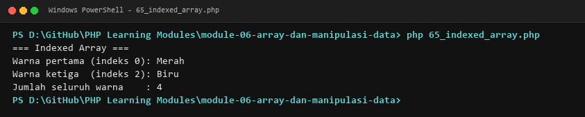

**Lokasi Source Code:** [65_indexed_array.php](65_indexed_array.php)

---

### 66. Associative array

**Tujuan Pembelajaran:**
Memahami dan menguasai konsep `Associative array` dalam bahasa pemrograman PHP serta mampu menerapkannya dalam kode program mandiri.

**Konsep Utama:**
Konsep dasar `Associative array` mencakup mekanisme kerja, sintaks resmi bahasa PHP, serta peran edukatifnya dalam pengembangan perangkat lunak.

**Penjelasan Source Code:**
Berkas `66_associative_array.php` mendemonstrasikan implementasi terisolasi dari `Associative array` dengan komentar penjelasan edukatif berbahasa Indonesia pada setiap bagian kode penting, tanpa overengineering.

**Cara Menjalankan:**
```bash
php 66_associative_array.php
```

**Hasil yang Diharapkan:**
Program menampilkan demonstrasi komputasi dan output teks yang valid sesuai topik `Associative array`.

**Screenshot Hasil Eksekusi:**
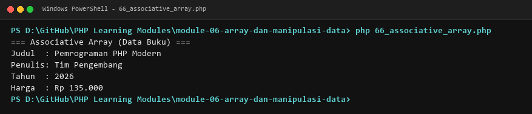

**Lokasi Source Code:** [66_associative_array.php](66_associative_array.php)

---

### 67. Multidimensional array

**Tujuan Pembelajaran:**
Memahami dan menguasai konsep `Multidimensional array` dalam bahasa pemrograman PHP serta mampu menerapkannya dalam kode program mandiri.

**Konsep Utama:**
Konsep dasar `Multidimensional array` mencakup mekanisme kerja, sintaks resmi bahasa PHP, serta peran edukatifnya dalam pengembangan perangkat lunak.

**Penjelasan Source Code:**
Berkas `67_multidimensional_array.php` mendemonstrasikan implementasi terisolasi dari `Multidimensional array` dengan komentar penjelasan edukatif berbahasa Indonesia pada setiap bagian kode penting, tanpa overengineering.

**Cara Menjalankan:**
```bash
php 67_multidimensional_array.php
```

**Hasil yang Diharapkan:**
Program menampilkan demonstrasi komputasi dan output teks yang valid sesuai topik `Multidimensional array`.

**Screenshot Hasil Eksekusi:**
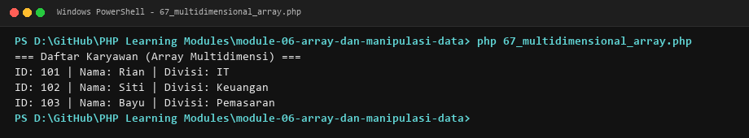

**Lokasi Source Code:** [67_multidimensional_array.php](67_multidimensional_array.php)

---

### 68. Akses elemen array

**Tujuan Pembelajaran:**
Memahami dan menguasai konsep `Akses elemen array` dalam bahasa pemrograman PHP serta mampu menerapkannya dalam kode program mandiri.

**Konsep Utama:**
Konsep dasar `Akses elemen array` mencakup mekanisme kerja, sintaks resmi bahasa PHP, serta peran edukatifnya dalam pengembangan perangkat lunak.

**Penjelasan Source Code:**
Berkas `68_array_indexing.php` mendemonstrasikan implementasi terisolasi dari `Akses elemen array` dengan komentar penjelasan edukatif berbahasa Indonesia pada setiap bagian kode penting, tanpa overengineering.

**Cara Menjalankan:**
```bash
php 68_array_indexing.php
```

**Hasil yang Diharapkan:**
Program menampilkan demonstrasi komputasi dan output teks yang valid sesuai topik `Akses elemen array`.

**Screenshot Hasil Eksekusi:**
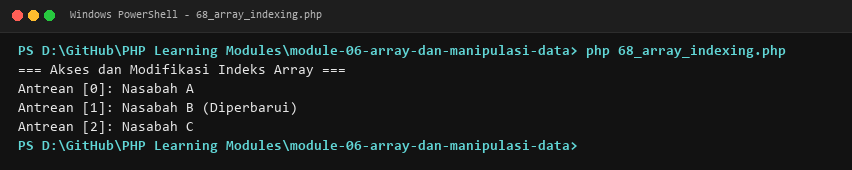

**Lokasi Source Code:** [68_array_indexing.php](68_array_indexing.php)

---

### 69. Iterasi array

**Tujuan Pembelajaran:**
Memahami dan menguasai konsep `Iterasi array` dalam bahasa pemrograman PHP serta mampu menerapkannya dalam kode program mandiri.

**Konsep Utama:**
Konsep dasar `Iterasi array` mencakup mekanisme kerja, sintaks resmi bahasa PHP, serta peran edukatifnya dalam pengembangan perangkat lunak.

**Penjelasan Source Code:**
Berkas `69_array_iteration.php` mendemonstrasikan implementasi terisolasi dari `Iterasi array` dengan komentar penjelasan edukatif berbahasa Indonesia pada setiap bagian kode penting, tanpa overengineering.

**Cara Menjalankan:**
```bash
php 69_array_iteration.php
```

**Hasil yang Diharapkan:**
Program menampilkan demonstrasi komputasi dan output teks yang valid sesuai topik `Iterasi array`.

**Screenshot Hasil Eksekusi:**
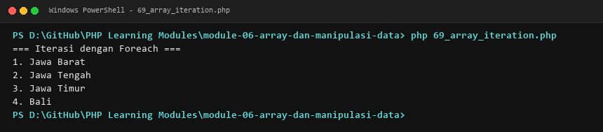

**Lokasi Source Code:** [69_array_iteration.php](69_array_iteration.php)

---

### 70. `array_push()` dan `array_pop()`

**Tujuan Pembelajaran:**
Memahami dan menguasai konsep ``array_push()` dan `array_pop()`` dalam bahasa pemrograman PHP serta mampu menerapkannya dalam kode program mandiri.

**Konsep Utama:**
Konsep dasar ``array_push()` dan `array_pop()`` mencakup mekanisme kerja, sintaks resmi bahasa PHP, serta peran edukatifnya dalam pengembangan perangkat lunak.

**Penjelasan Source Code:**
Berkas `70_array_push_pop.php` mendemonstrasikan implementasi terisolasi dari ``array_push()` dan `array_pop()`` dengan komentar penjelasan edukatif berbahasa Indonesia pada setiap bagian kode penting, tanpa overengineering.

**Cara Menjalankan:**
```bash
php 70_array_push_pop.php
```

**Hasil yang Diharapkan:**
Program menampilkan demonstrasi komputasi dan output teks yang valid sesuai topik ``array_push()` dan `array_pop()``.

**Screenshot Hasil Eksekusi:**


**Lokasi Source Code:** [70_array_push_pop.php](70_array_push_pop.php)

---

### 71. `array_shift()` dan `array_unshift()`

**Tujuan Pembelajaran:**
Memahami dan menguasai konsep ``array_shift()` dan `array_unshift()`` dalam bahasa pemrograman PHP serta mampu menerapkannya dalam kode program mandiri.

**Konsep Utama:**
Konsep dasar ``array_shift()` dan `array_unshift()`` mencakup mekanisme kerja, sintaks resmi bahasa PHP, serta peran edukatifnya dalam pengembangan perangkat lunak.

**Penjelasan Source Code:**
Berkas `71_array_shift_unshift.php` mendemonstrasikan implementasi terisolasi dari ``array_shift()` dan `array_unshift()`` dengan komentar penjelasan edukatif berbahasa Indonesia pada setiap bagian kode penting, tanpa overengineering.

**Cara Menjalankan:**
```bash
php 71_array_shift_unshift.php
```

**Hasil yang Diharapkan:**
Program menampilkan demonstrasi komputasi dan output teks yang valid sesuai topik ``array_shift()` dan `array_unshift()``.

**Screenshot Hasil Eksekusi:**


**Lokasi Source Code:** [71_array_shift_unshift.php](71_array_shift_unshift.php)

---

### 72. Penggabungan array

**Tujuan Pembelajaran:**
Memahami dan menguasai konsep `Penggabungan array` dalam bahasa pemrograman PHP serta mampu menerapkannya dalam kode program mandiri.

**Konsep Utama:**
Konsep dasar `Penggabungan array` mencakup mekanisme kerja, sintaks resmi bahasa PHP, serta peran edukatifnya dalam pengembangan perangkat lunak.

**Penjelasan Source Code:**
Berkas `72_array_merge.php` mendemonstrasikan implementasi terisolasi dari `Penggabungan array` dengan komentar penjelasan edukatif berbahasa Indonesia pada setiap bagian kode penting, tanpa overengineering.

**Cara Menjalankan:**
```bash
php 72_array_merge.php
```

**Hasil yang Diharapkan:**
Program menampilkan demonstrasi komputasi dan output teks yang valid sesuai topik `Penggabungan array`.

**Screenshot Hasil Eksekusi:**
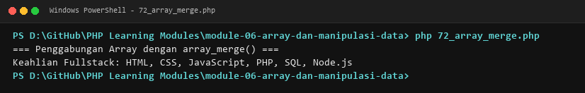

**Lokasi Source Code:** [72_array_merge.php](72_array_merge.php)

---

### 73. `array_combine()`

**Tujuan Pembelajaran:**
Memahami dan menguasai konsep ``array_combine()`` dalam bahasa pemrograman PHP serta mampu menerapkannya dalam kode program mandiri.

**Konsep Utama:**
Konsep dasar ``array_combine()`` mencakup mekanisme kerja, sintaks resmi bahasa PHP, serta peran edukatifnya dalam pengembangan perangkat lunak.

**Penjelasan Source Code:**
Berkas `73_array_combine.php` mendemonstrasikan implementasi terisolasi dari ``array_combine()`` dengan komentar penjelasan edukatif berbahasa Indonesia pada setiap bagian kode penting, tanpa overengineering.

**Cara Menjalankan:**
```bash
php 73_array_combine.php
```

**Hasil yang Diharapkan:**
Program menampilkan demonstrasi komputasi dan output teks yang valid sesuai topik ``array_combine()``.

**Screenshot Hasil Eksekusi:**


**Lokasi Source Code:** [73_array_combine.php](73_array_combine.php)

---

### 74. `array_keys()` dan `array_values()`

**Tujuan Pembelajaran:**
Memahami dan menguasai konsep ``array_keys()` dan `array_values()`` dalam bahasa pemrograman PHP serta mampu menerapkannya dalam kode program mandiri.

**Konsep Utama:**
Konsep dasar ``array_keys()` dan `array_values()`` mencakup mekanisme kerja, sintaks resmi bahasa PHP, serta peran edukatifnya dalam pengembangan perangkat lunak.

**Penjelasan Source Code:**
Berkas `74_array_keys_values.php` mendemonstrasikan implementasi terisolasi dari ``array_keys()` dan `array_values()`` dengan komentar penjelasan edukatif berbahasa Indonesia pada setiap bagian kode penting, tanpa overengineering.

**Cara Menjalankan:**
```bash
php 74_array_keys_values.php
```

**Hasil yang Diharapkan:**
Program menampilkan demonstrasi komputasi dan output teks yang valid sesuai topik ``array_keys()` dan `array_values()``.

**Screenshot Hasil Eksekusi:**


**Lokasi Source Code:** [74_array_keys_values.php](74_array_keys_values.php)

---

### 75. Pencarian elemen array

**Tujuan Pembelajaran:**
Memahami dan menguasai konsep `Pencarian elemen array` dalam bahasa pemrograman PHP serta mampu menerapkannya dalam kode program mandiri.

**Konsep Utama:**
Konsep dasar `Pencarian elemen array` mencakup mekanisme kerja, sintaks resmi bahasa PHP, serta peran edukatifnya dalam pengembangan perangkat lunak.

**Penjelasan Source Code:**
Berkas `75_array_search.php` mendemonstrasikan implementasi terisolasi dari `Pencarian elemen array` dengan komentar penjelasan edukatif berbahasa Indonesia pada setiap bagian kode penting, tanpa overengineering.

**Cara Menjalankan:**
```bash
php 75_array_search.php
```

**Hasil yang Diharapkan:**
Program menampilkan demonstrasi komputasi dan output teks yang valid sesuai topik `Pencarian elemen array`.

**Screenshot Hasil Eksekusi:**
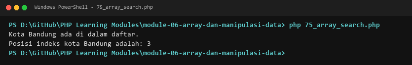

**Lokasi Source Code:** [75_array_search.php](75_array_search.php)

---

### 76. `array_filter()`

**Tujuan Pembelajaran:**
Memahami dan menguasai konsep ``array_filter()`` dalam bahasa pemrograman PHP serta mampu menerapkannya dalam kode program mandiri.

**Konsep Utama:**
Konsep dasar ``array_filter()`` mencakup mekanisme kerja, sintaks resmi bahasa PHP, serta peran edukatifnya dalam pengembangan perangkat lunak.

**Penjelasan Source Code:**
Berkas `76_array_filter.php` mendemonstrasikan implementasi terisolasi dari ``array_filter()`` dengan komentar penjelasan edukatif berbahasa Indonesia pada setiap bagian kode penting, tanpa overengineering.

**Cara Menjalankan:**
```bash
php 76_array_filter.php
```

**Hasil yang Diharapkan:**
Program menampilkan demonstrasi komputasi dan output teks yang valid sesuai topik ``array_filter()``.

**Screenshot Hasil Eksekusi:**


**Lokasi Source Code:** [76_array_filter.php](76_array_filter.php)

---

### 77. `array_map()`

**Tujuan Pembelajaran:**
Memahami dan menguasai konsep ``array_map()`` dalam bahasa pemrograman PHP serta mampu menerapkannya dalam kode program mandiri.

**Konsep Utama:**
Konsep dasar ``array_map()`` mencakup mekanisme kerja, sintaks resmi bahasa PHP, serta peran edukatifnya dalam pengembangan perangkat lunak.

**Penjelasan Source Code:**
Berkas `77_array_map.php` mendemonstrasikan implementasi terisolasi dari ``array_map()`` dengan komentar penjelasan edukatif berbahasa Indonesia pada setiap bagian kode penting, tanpa overengineering.

**Cara Menjalankan:**
```bash
php 77_array_map.php
```

**Hasil yang Diharapkan:**
Program menampilkan demonstrasi komputasi dan output teks yang valid sesuai topik ``array_map()``.

**Screenshot Hasil Eksekusi:**


**Lokasi Source Code:** [77_array_map.php](77_array_map.php)

---

### 78. `array_reduce()`

**Tujuan Pembelajaran:**
Memahami dan menguasai konsep ``array_reduce()`` dalam bahasa pemrograman PHP serta mampu menerapkannya dalam kode program mandiri.

**Konsep Utama:**
Konsep dasar ``array_reduce()`` mencakup mekanisme kerja, sintaks resmi bahasa PHP, serta peran edukatifnya dalam pengembangan perangkat lunak.

**Penjelasan Source Code:**
Berkas `78_array_reduce.php` mendemonstrasikan implementasi terisolasi dari ``array_reduce()`` dengan komentar penjelasan edukatif berbahasa Indonesia pada setiap bagian kode penting, tanpa overengineering.

**Cara Menjalankan:**
```bash
php 78_array_reduce.php
```

**Hasil yang Diharapkan:**
Program menampilkan demonstrasi komputasi dan output teks yang valid sesuai topik ``array_reduce()``.

**Screenshot Hasil Eksekusi:**


**Lokasi Source Code:** [78_array_reduce.php](78_array_reduce.php)

---

### 79. Pengurutan array

**Tujuan Pembelajaran:**
Memahami dan menguasai konsep `Pengurutan array` dalam bahasa pemrograman PHP serta mampu menerapkannya dalam kode program mandiri.

**Konsep Utama:**
Konsep dasar `Pengurutan array` mencakup mekanisme kerja, sintaks resmi bahasa PHP, serta peran edukatifnya dalam pengembangan perangkat lunak.

**Penjelasan Source Code:**
Berkas `79_array_sorting.php` mendemonstrasikan implementasi terisolasi dari `Pengurutan array` dengan komentar penjelasan edukatif berbahasa Indonesia pada setiap bagian kode penting, tanpa overengineering.

**Cara Menjalankan:**
```bash
php 79_array_sorting.php
```

**Hasil yang Diharapkan:**
Program menampilkan demonstrasi komputasi dan output teks yang valid sesuai topik `Pengurutan array`.

**Screenshot Hasil Eksekusi:**
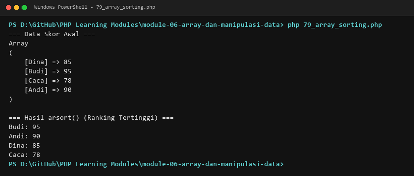

**Lokasi Source Code:** [79_array_sorting.php](79_array_sorting.php)

---

### 80. Pengurutan multidimensi

**Tujuan Pembelajaran:**
Memahami dan menguasai konsep `Pengurutan multidimensi` dalam bahasa pemrograman PHP serta mampu menerapkannya dalam kode program mandiri.

**Konsep Utama:**
Konsep dasar `Pengurutan multidimensi` mencakup mekanisme kerja, sintaks resmi bahasa PHP, serta peran edukatifnya dalam pengembangan perangkat lunak.

**Penjelasan Source Code:**
Berkas `80_array_multisort.php` mendemonstrasikan implementasi terisolasi dari `Pengurutan multidimensi` dengan komentar penjelasan edukatif berbahasa Indonesia pada setiap bagian kode penting, tanpa overengineering.

**Cara Menjalankan:**
```bash
php 80_array_multisort.php
```

**Hasil yang Diharapkan:**
Program menampilkan demonstrasi komputasi dan output teks yang valid sesuai topik `Pengurutan multidimensi`.

**Screenshot Hasil Eksekusi:**
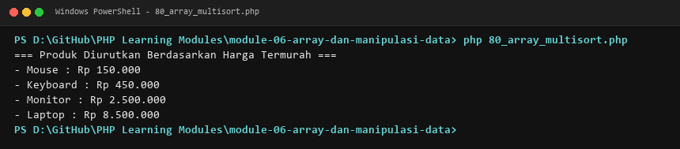

**Lokasi Source Code:** [80_array_multisort.php](80_array_multisort.php)

---

### 81. `array_slice()`

**Tujuan Pembelajaran:**
Memahami dan menguasai konsep ``array_slice()`` dalam bahasa pemrograman PHP serta mampu menerapkannya dalam kode program mandiri.

**Konsep Utama:**
Konsep dasar ``array_slice()`` mencakup mekanisme kerja, sintaks resmi bahasa PHP, serta peran edukatifnya dalam pengembangan perangkat lunak.

**Penjelasan Source Code:**
Berkas `81_array_slice.php` mendemonstrasikan implementasi terisolasi dari ``array_slice()`` dengan komentar penjelasan edukatif berbahasa Indonesia pada setiap bagian kode penting, tanpa overengineering.

**Cara Menjalankan:**
```bash
php 81_array_slice.php
```

**Hasil yang Diharapkan:**
Program menampilkan demonstrasi komputasi dan output teks yang valid sesuai topik ``array_slice()``.

**Screenshot Hasil Eksekusi:**


**Lokasi Source Code:** [81_array_slice.php](81_array_slice.php)

---

### 82. `array_splice()`

**Tujuan Pembelajaran:**
Memahami dan menguasai konsep ``array_splice()`` dalam bahasa pemrograman PHP serta mampu menerapkannya dalam kode program mandiri.

**Konsep Utama:**
Konsep dasar ``array_splice()`` mencakup mekanisme kerja, sintaks resmi bahasa PHP, serta peran edukatifnya dalam pengembangan perangkat lunak.

**Penjelasan Source Code:**
Berkas `82_array_splice.php` mendemonstrasikan implementasi terisolasi dari ``array_splice()`` dengan komentar penjelasan edukatif berbahasa Indonesia pada setiap bagian kode penting, tanpa overengineering.

**Cara Menjalankan:**
```bash
php 82_array_splice.php
```

**Hasil yang Diharapkan:**
Program menampilkan demonstrasi komputasi dan output teks yang valid sesuai topik ``array_splice()``.

**Screenshot Hasil Eksekusi:**


**Lokasi Source Code:** [82_array_splice.php](82_array_splice.php)

---

### 83. Menghapus elemen duplikat

**Tujuan Pembelajaran:**
Memahami dan menguasai konsep `Menghapus elemen duplikat` dalam bahasa pemrograman PHP serta mampu menerapkannya dalam kode program mandiri.

**Konsep Utama:**
Konsep dasar `Menghapus elemen duplikat` mencakup mekanisme kerja, sintaks resmi bahasa PHP, serta peran edukatifnya dalam pengembangan perangkat lunak.

**Penjelasan Source Code:**
Berkas `83_array_unique.php` mendemonstrasikan implementasi terisolasi dari `Menghapus elemen duplikat` dengan komentar penjelasan edukatif berbahasa Indonesia pada setiap bagian kode penting, tanpa overengineering.

**Cara Menjalankan:**
```bash
php 83_array_unique.php
```

**Hasil yang Diharapkan:**
Program menampilkan demonstrasi komputasi dan output teks yang valid sesuai topik `Menghapus elemen duplikat`.

**Screenshot Hasil Eksekusi:**
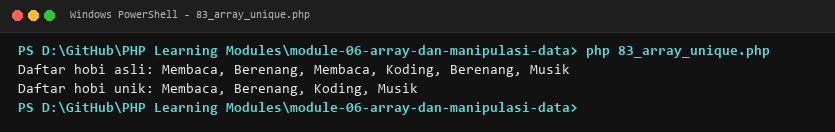

**Lokasi Source Code:** [83_array_unique.php](83_array_unique.php)

---

### 84. Array destructuring

**Tujuan Pembelajaran:**
Memahami dan menguasai konsep `Array destructuring` dalam bahasa pemrograman PHP serta mampu menerapkannya dalam kode program mandiri.

**Konsep Utama:**
Konsep dasar `Array destructuring` mencakup mekanisme kerja, sintaks resmi bahasa PHP, serta peran edukatifnya dalam pengembangan perangkat lunak.

**Penjelasan Source Code:**
Berkas `84_array_destructuring.php` mendemonstrasikan implementasi terisolasi dari `Array destructuring` dengan komentar penjelasan edukatif berbahasa Indonesia pada setiap bagian kode penting, tanpa overengineering.

**Cara Menjalankan:**
```bash
php 84_array_destructuring.php
```

**Hasil yang Diharapkan:**
Program menampilkan demonstrasi komputasi dan output teks yang valid sesuai topik `Array destructuring`.

**Screenshot Hasil Eksekusi:**
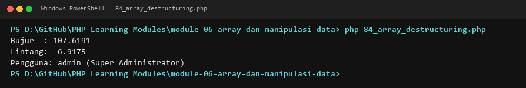

**Lokasi Source Code:** [84_array_destructuring.php](84_array_destructuring.php)

---

## Ringkasan Modul
Modul 6 (Array dan Manipulasi Data) memberikan pemahaman menyeluruh mengenai array terindeks, asosiatif, multidimensi, operasi manipulasi elemen (push, pop, shift, unshift), merge, search, filter, map, reduce, sort, slice, splice, dan destructuring. Seluruh 20 submodul dirancang terpisah dan mandiri sehingga mudah dipelajari langkah demi langkah.
