# MODUL 8: Fungsi

## Ringkasan Ruang Lingkup Materi
Deklarasi fungsi, parameter, return value, void, default parameters, named arguments, variadic, argument unpacking, type declarations, union/intersection/never types, scope, lambda, arrow functions, closures, rekursi, dan first-class callables.

## Tujuan Pembelajaran
Menguasai paradigma fungsional dan modularisasi kode untuk reusabilitas tinggi.

---

## Daftar Submodul Pembelajaran

- [105_function_basic.php](105_function_basic.php) : Fungsi dasar
- [106_function_parameters.php](106_function_parameters.php) : Parameter fungsi
- [107_return_statement.php](107_return_statement.php) : Nilai balik fungsi
- [108_void_return_type.php](108_void_return_type.php) : Fungsi dengan tipe balik `void`
- [109_default_parameters.php](109_default_parameters.php) : Default parameters
- [110_named_arguments.php](110_named_arguments.php) : Named arguments
- [111_variadic_functions.php](111_variadic_functions.php) : Variadic functions
- [112_argument_unpacking.php](112_argument_unpacking.php) : Argument unpacking
- [113_type_declarations.php](113_type_declarations.php) : Type declarations
- [114_union_types.php](114_union_types.php) : Union types
- [115_intersection_types.php](115_intersection_types.php) : Intersection types
- [116_nullable_types.php](116_nullable_types.php) : Nullable types
- [117_never_return_type.php](117_never_return_type.php) : Tipe balik `never`
- [118_function_scope.php](118_function_scope.php) : Scope variabel dalam fungsi
- [119_global_keyword.php](119_global_keyword.php) : Keyword `global`
- [120_anonymous_functions.php](120_anonymous_functions.php) : Anonymous functions
- [121_arrow_functions.php](121_arrow_functions.php) : Arrow functions
- [122_closures.php](122_closures.php) : Closures
- [123_recursive_functions.php](123_recursive_functions.php) : Fungsi rekursif
- [124_first_class_callables.php](124_first_class_callables.php) : First-class callable syntax

---

## Penjelasan Setiap Submodul

### 105. Fungsi dasar

**Tujuan Pembelajaran:**
Memahami dan menguasai konsep `Fungsi dasar` dalam bahasa pemrograman PHP serta mampu menerapkannya dalam kode program mandiri.

**Konsep Utama:**
Konsep dasar `Fungsi dasar` mencakup mekanisme kerja, sintaks resmi bahasa PHP, serta peran edukatifnya dalam pengembangan perangkat lunak.

**Penjelasan Source Code:**
Berkas `105_function_basic.php` mendemonstrasikan implementasi terisolasi dari `Fungsi dasar` dengan komentar penjelasan edukatif berbahasa Indonesia pada setiap bagian kode penting, tanpa overengineering.

**Cara Menjalankan:**
```bash
php 105_function_basic.php
```

**Hasil yang Diharapkan:**
Program menampilkan demonstrasi komputasi dan output teks yang valid sesuai topik `Fungsi dasar`.

**Screenshot Hasil Eksekusi:**
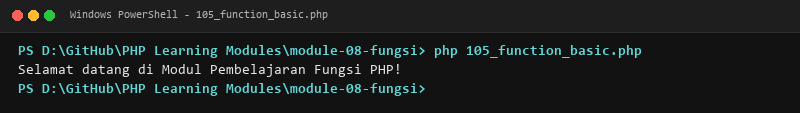

**Lokasi Source Code:** [105_function_basic.php](105_function_basic.php)

---

### 106. Parameter fungsi

**Tujuan Pembelajaran:**
Memahami dan menguasai konsep `Parameter fungsi` dalam bahasa pemrograman PHP serta mampu menerapkannya dalam kode program mandiri.

**Konsep Utama:**
Konsep dasar `Parameter fungsi` mencakup mekanisme kerja, sintaks resmi bahasa PHP, serta peran edukatifnya dalam pengembangan perangkat lunak.

**Penjelasan Source Code:**
Berkas `106_function_parameters.php` mendemonstrasikan implementasi terisolasi dari `Parameter fungsi` dengan komentar penjelasan edukatif berbahasa Indonesia pada setiap bagian kode penting, tanpa overengineering.

**Cara Menjalankan:**
```bash
php 106_function_parameters.php
```

**Hasil yang Diharapkan:**
Program menampilkan demonstrasi komputasi dan output teks yang valid sesuai topik `Parameter fungsi`.

**Screenshot Hasil Eksekusi:**
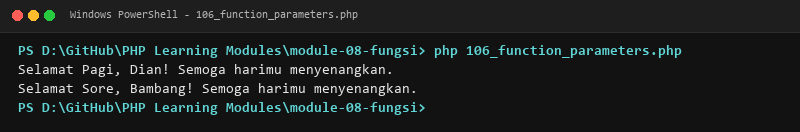

**Lokasi Source Code:** [106_function_parameters.php](106_function_parameters.php)

---

### 107. Nilai balik fungsi

**Tujuan Pembelajaran:**
Memahami dan menguasai konsep `Nilai balik fungsi` dalam bahasa pemrograman PHP serta mampu menerapkannya dalam kode program mandiri.

**Konsep Utama:**
Konsep dasar `Nilai balik fungsi` mencakup mekanisme kerja, sintaks resmi bahasa PHP, serta peran edukatifnya dalam pengembangan perangkat lunak.

**Penjelasan Source Code:**
Berkas `107_return_statement.php` mendemonstrasikan implementasi terisolasi dari `Nilai balik fungsi` dengan komentar penjelasan edukatif berbahasa Indonesia pada setiap bagian kode penting, tanpa overengineering.

**Cara Menjalankan:**
```bash
php 107_return_statement.php
```

**Hasil yang Diharapkan:**
Program menampilkan demonstrasi komputasi dan output teks yang valid sesuai topik `Nilai balik fungsi`.

**Screenshot Hasil Eksekusi:**
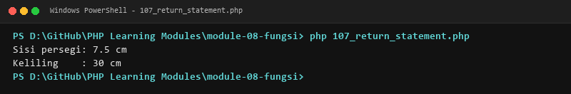

**Lokasi Source Code:** [107_return_statement.php](107_return_statement.php)

---

### 108. Fungsi dengan tipe balik `void`

**Tujuan Pembelajaran:**
Memahami dan menguasai konsep `Fungsi dengan tipe balik `void`` dalam bahasa pemrograman PHP serta mampu menerapkannya dalam kode program mandiri.

**Konsep Utama:**
Konsep dasar `Fungsi dengan tipe balik `void`` mencakup mekanisme kerja, sintaks resmi bahasa PHP, serta peran edukatifnya dalam pengembangan perangkat lunak.

**Penjelasan Source Code:**
Berkas `108_void_return_type.php` mendemonstrasikan implementasi terisolasi dari `Fungsi dengan tipe balik `void`` dengan komentar penjelasan edukatif berbahasa Indonesia pada setiap bagian kode penting, tanpa overengineering.

**Cara Menjalankan:**
```bash
php 108_void_return_type.php
```

**Hasil yang Diharapkan:**
Program menampilkan demonstrasi komputasi dan output teks yang valid sesuai topik `Fungsi dengan tipe balik `void``.

**Screenshot Hasil Eksekusi:**


**Lokasi Source Code:** [108_void_return_type.php](108_void_return_type.php)

---

### 109. Default parameters

**Tujuan Pembelajaran:**
Memahami dan menguasai konsep `Default parameters` dalam bahasa pemrograman PHP serta mampu menerapkannya dalam kode program mandiri.

**Konsep Utama:**
Konsep dasar `Default parameters` mencakup mekanisme kerja, sintaks resmi bahasa PHP, serta peran edukatifnya dalam pengembangan perangkat lunak.

**Penjelasan Source Code:**
Berkas `109_default_parameters.php` mendemonstrasikan implementasi terisolasi dari `Default parameters` dengan komentar penjelasan edukatif berbahasa Indonesia pada setiap bagian kode penting, tanpa overengineering.

**Cara Menjalankan:**
```bash
php 109_default_parameters.php
```

**Hasil yang Diharapkan:**
Program menampilkan demonstrasi komputasi dan output teks yang valid sesuai topik `Default parameters`.

**Screenshot Hasil Eksekusi:**
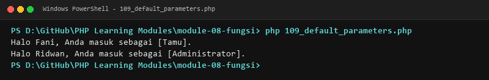

**Lokasi Source Code:** [109_default_parameters.php](109_default_parameters.php)

---

### 110. Named arguments

**Tujuan Pembelajaran:**
Memahami dan menguasai konsep `Named arguments` dalam bahasa pemrograman PHP serta mampu menerapkannya dalam kode program mandiri.

**Konsep Utama:**
Konsep dasar `Named arguments` mencakup mekanisme kerja, sintaks resmi bahasa PHP, serta peran edukatifnya dalam pengembangan perangkat lunak.

**Penjelasan Source Code:**
Berkas `110_named_arguments.php` mendemonstrasikan implementasi terisolasi dari `Named arguments` dengan komentar penjelasan edukatif berbahasa Indonesia pada setiap bagian kode penting, tanpa overengineering.

**Cara Menjalankan:**
```bash
php 110_named_arguments.php
```

**Hasil yang Diharapkan:**
Program menampilkan demonstrasi komputasi dan output teks yang valid sesuai topik `Named arguments`.

**Screenshot Hasil Eksekusi:**
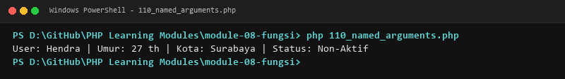

**Lokasi Source Code:** [110_named_arguments.php](110_named_arguments.php)

---

### 111. Variadic functions

**Tujuan Pembelajaran:**
Memahami dan menguasai konsep `Variadic functions` dalam bahasa pemrograman PHP serta mampu menerapkannya dalam kode program mandiri.

**Konsep Utama:**
Konsep dasar `Variadic functions` mencakup mekanisme kerja, sintaks resmi bahasa PHP, serta peran edukatifnya dalam pengembangan perangkat lunak.

**Penjelasan Source Code:**
Berkas `111_variadic_functions.php` mendemonstrasikan implementasi terisolasi dari `Variadic functions` dengan komentar penjelasan edukatif berbahasa Indonesia pada setiap bagian kode penting, tanpa overengineering.

**Cara Menjalankan:**
```bash
php 111_variadic_functions.php
```

**Hasil yang Diharapkan:**
Program menampilkan demonstrasi komputasi dan output teks yang valid sesuai topik `Variadic functions`.

**Screenshot Hasil Eksekusi:**
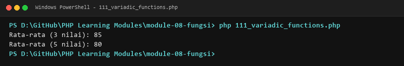

**Lokasi Source Code:** [111_variadic_functions.php](111_variadic_functions.php)

---

### 112. Argument unpacking

**Tujuan Pembelajaran:**
Memahami dan menguasai konsep `Argument unpacking` dalam bahasa pemrograman PHP serta mampu menerapkannya dalam kode program mandiri.

**Konsep Utama:**
Konsep dasar `Argument unpacking` mencakup mekanisme kerja, sintaks resmi bahasa PHP, serta peran edukatifnya dalam pengembangan perangkat lunak.

**Penjelasan Source Code:**
Berkas `112_argument_unpacking.php` mendemonstrasikan implementasi terisolasi dari `Argument unpacking` dengan komentar penjelasan edukatif berbahasa Indonesia pada setiap bagian kode penting, tanpa overengineering.

**Cara Menjalankan:**
```bash
php 112_argument_unpacking.php
```

**Hasil yang Diharapkan:**
Program menampilkan demonstrasi komputasi dan output teks yang valid sesuai topik `Argument unpacking`.

**Screenshot Hasil Eksekusi:**
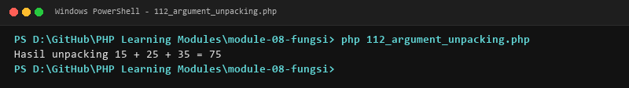

**Lokasi Source Code:** [112_argument_unpacking.php](112_argument_unpacking.php)

---

### 113. Type declarations

**Tujuan Pembelajaran:**
Memahami dan menguasai konsep `Type declarations` dalam bahasa pemrograman PHP serta mampu menerapkannya dalam kode program mandiri.

**Konsep Utama:**
Konsep dasar `Type declarations` mencakup mekanisme kerja, sintaks resmi bahasa PHP, serta peran edukatifnya dalam pengembangan perangkat lunak.

**Penjelasan Source Code:**
Berkas `113_type_declarations.php` mendemonstrasikan implementasi terisolasi dari `Type declarations` dengan komentar penjelasan edukatif berbahasa Indonesia pada setiap bagian kode penting, tanpa overengineering.

**Cara Menjalankan:**
```bash
php 113_type_declarations.php
```

**Hasil yang Diharapkan:**
Program menampilkan demonstrasi komputasi dan output teks yang valid sesuai topik `Type declarations`.

**Screenshot Hasil Eksekusi:**
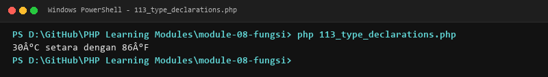

**Lokasi Source Code:** [113_type_declarations.php](113_type_declarations.php)

---

### 114. Union types

**Tujuan Pembelajaran:**
Memahami dan menguasai konsep `Union types` dalam bahasa pemrograman PHP serta mampu menerapkannya dalam kode program mandiri.

**Konsep Utama:**
Konsep dasar `Union types` mencakup mekanisme kerja, sintaks resmi bahasa PHP, serta peran edukatifnya dalam pengembangan perangkat lunak.

**Penjelasan Source Code:**
Berkas `114_union_types.php` mendemonstrasikan implementasi terisolasi dari `Union types` dengan komentar penjelasan edukatif berbahasa Indonesia pada setiap bagian kode penting, tanpa overengineering.

**Cara Menjalankan:**
```bash
php 114_union_types.php
```

**Hasil yang Diharapkan:**
Program menampilkan demonstrasi komputasi dan output teks yang valid sesuai topik `Union types`.

**Screenshot Hasil Eksekusi:**
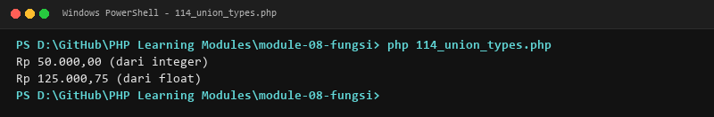

**Lokasi Source Code:** [114_union_types.php](114_union_types.php)

---

### 115. Intersection types

**Tujuan Pembelajaran:**
Memahami dan menguasai konsep `Intersection types` dalam bahasa pemrograman PHP serta mampu menerapkannya dalam kode program mandiri.

**Konsep Utama:**
Konsep dasar `Intersection types` mencakup mekanisme kerja, sintaks resmi bahasa PHP, serta peran edukatifnya dalam pengembangan perangkat lunak.

**Penjelasan Source Code:**
Berkas `115_intersection_types.php` mendemonstrasikan implementasi terisolasi dari `Intersection types` dengan komentar penjelasan edukatif berbahasa Indonesia pada setiap bagian kode penting, tanpa overengineering.

**Cara Menjalankan:**
```bash
php 115_intersection_types.php
```

**Hasil yang Diharapkan:**
Program menampilkan demonstrasi komputasi dan output teks yang valid sesuai topik `Intersection types`.

**Screenshot Hasil Eksekusi:**
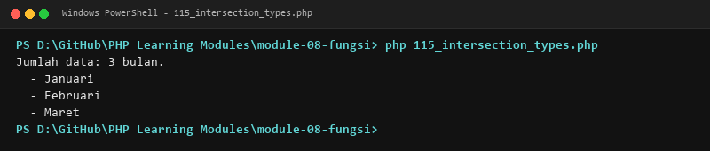

**Lokasi Source Code:** [115_intersection_types.php](115_intersection_types.php)

---

### 116. Nullable types

**Tujuan Pembelajaran:**
Memahami dan menguasai konsep `Nullable types` dalam bahasa pemrograman PHP serta mampu menerapkannya dalam kode program mandiri.

**Konsep Utama:**
Konsep dasar `Nullable types` mencakup mekanisme kerja, sintaks resmi bahasa PHP, serta peran edukatifnya dalam pengembangan perangkat lunak.

**Penjelasan Source Code:**
Berkas `116_nullable_types.php` mendemonstrasikan implementasi terisolasi dari `Nullable types` dengan komentar penjelasan edukatif berbahasa Indonesia pada setiap bagian kode penting, tanpa overengineering.

**Cara Menjalankan:**
```bash
php 116_nullable_types.php
```

**Hasil yang Diharapkan:**
Program menampilkan demonstrasi komputasi dan output teks yang valid sesuai topik `Nullable types`.

**Screenshot Hasil Eksekusi:**
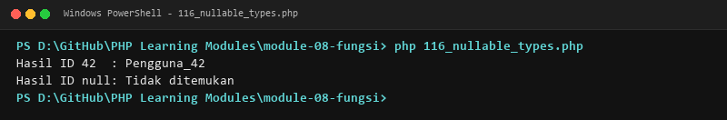

**Lokasi Source Code:** [116_nullable_types.php](116_nullable_types.php)

---

### 117. Tipe balik `never`

**Tujuan Pembelajaran:**
Memahami dan menguasai konsep `Tipe balik `never`` dalam bahasa pemrograman PHP serta mampu menerapkannya dalam kode program mandiri.

**Konsep Utama:**
Konsep dasar `Tipe balik `never`` mencakup mekanisme kerja, sintaks resmi bahasa PHP, serta peran edukatifnya dalam pengembangan perangkat lunak.

**Penjelasan Source Code:**
Berkas `117_never_return_type.php` mendemonstrasikan implementasi terisolasi dari `Tipe balik `never`` dengan komentar penjelasan edukatif berbahasa Indonesia pada setiap bagian kode penting, tanpa overengineering.

**Cara Menjalankan:**
```bash
php 117_never_return_type.php
```

**Hasil yang Diharapkan:**
Program menampilkan demonstrasi komputasi dan output teks yang valid sesuai topik `Tipe balik `never``.

**Screenshot Hasil Eksekusi:**


**Lokasi Source Code:** [117_never_return_type.php](117_never_return_type.php)

---

### 118. Scope variabel dalam fungsi

**Tujuan Pembelajaran:**
Memahami dan menguasai konsep `Scope variabel dalam fungsi` dalam bahasa pemrograman PHP serta mampu menerapkannya dalam kode program mandiri.

**Konsep Utama:**
Konsep dasar `Scope variabel dalam fungsi` mencakup mekanisme kerja, sintaks resmi bahasa PHP, serta peran edukatifnya dalam pengembangan perangkat lunak.

**Penjelasan Source Code:**
Berkas `118_function_scope.php` mendemonstrasikan implementasi terisolasi dari `Scope variabel dalam fungsi` dengan komentar penjelasan edukatif berbahasa Indonesia pada setiap bagian kode penting, tanpa overengineering.

**Cara Menjalankan:**
```bash
php 118_function_scope.php
```

**Hasil yang Diharapkan:**
Program menampilkan demonstrasi komputasi dan output teks yang valid sesuai topik `Scope variabel dalam fungsi`.

**Screenshot Hasil Eksekusi:**
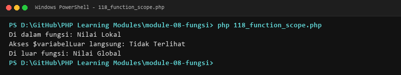

**Lokasi Source Code:** [118_function_scope.php](118_function_scope.php)

---

### 119. Keyword `global`

**Tujuan Pembelajaran:**
Memahami dan menguasai konsep `Keyword `global`` dalam bahasa pemrograman PHP serta mampu menerapkannya dalam kode program mandiri.

**Konsep Utama:**
Konsep dasar `Keyword `global`` mencakup mekanisme kerja, sintaks resmi bahasa PHP, serta peran edukatifnya dalam pengembangan perangkat lunak.

**Penjelasan Source Code:**
Berkas `119_global_keyword.php` mendemonstrasikan implementasi terisolasi dari `Keyword `global`` dengan komentar penjelasan edukatif berbahasa Indonesia pada setiap bagian kode penting, tanpa overengineering.

**Cara Menjalankan:**
```bash
php 119_global_keyword.php
```

**Hasil yang Diharapkan:**
Program menampilkan demonstrasi komputasi dan output teks yang valid sesuai topik `Keyword `global``.

**Screenshot Hasil Eksekusi:**


**Lokasi Source Code:** [119_global_keyword.php](119_global_keyword.php)

---

### 120. Anonymous functions

**Tujuan Pembelajaran:**
Memahami dan menguasai konsep `Anonymous functions` dalam bahasa pemrograman PHP serta mampu menerapkannya dalam kode program mandiri.

**Konsep Utama:**
Konsep dasar `Anonymous functions` mencakup mekanisme kerja, sintaks resmi bahasa PHP, serta peran edukatifnya dalam pengembangan perangkat lunak.

**Penjelasan Source Code:**
Berkas `120_anonymous_functions.php` mendemonstrasikan implementasi terisolasi dari `Anonymous functions` dengan komentar penjelasan edukatif berbahasa Indonesia pada setiap bagian kode penting, tanpa overengineering.

**Cara Menjalankan:**
```bash
php 120_anonymous_functions.php
```

**Hasil yang Diharapkan:**
Program menampilkan demonstrasi komputasi dan output teks yang valid sesuai topik `Anonymous functions`.

**Screenshot Hasil Eksekusi:**
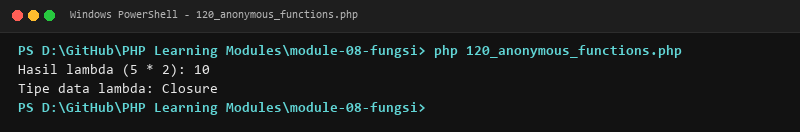

**Lokasi Source Code:** [120_anonymous_functions.php](120_anonymous_functions.php)

---

### 121. Arrow functions

**Tujuan Pembelajaran:**
Memahami dan menguasai konsep `Arrow functions` dalam bahasa pemrograman PHP serta mampu menerapkannya dalam kode program mandiri.

**Konsep Utama:**
Konsep dasar `Arrow functions` mencakup mekanisme kerja, sintaks resmi bahasa PHP, serta peran edukatifnya dalam pengembangan perangkat lunak.

**Penjelasan Source Code:**
Berkas `121_arrow_functions.php` mendemonstrasikan implementasi terisolasi dari `Arrow functions` dengan komentar penjelasan edukatif berbahasa Indonesia pada setiap bagian kode penting, tanpa overengineering.

**Cara Menjalankan:**
```bash
php 121_arrow_functions.php
```

**Hasil yang Diharapkan:**
Program menampilkan demonstrasi komputasi dan output teks yang valid sesuai topik `Arrow functions`.

**Screenshot Hasil Eksekusi:**
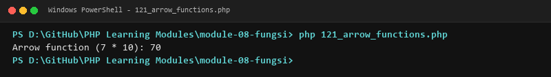

**Lokasi Source Code:** [121_arrow_functions.php](121_arrow_functions.php)

---

### 122. Closures

**Tujuan Pembelajaran:**
Memahami dan menguasai konsep `Closures` dalam bahasa pemrograman PHP serta mampu menerapkannya dalam kode program mandiri.

**Konsep Utama:**
Konsep dasar `Closures` mencakup mekanisme kerja, sintaks resmi bahasa PHP, serta peran edukatifnya dalam pengembangan perangkat lunak.

**Penjelasan Source Code:**
Berkas `122_closures.php` mendemonstrasikan implementasi terisolasi dari `Closures` dengan komentar penjelasan edukatif berbahasa Indonesia pada setiap bagian kode penting, tanpa overengineering.

**Cara Menjalankan:**
```bash
php 122_closures.php
```

**Hasil yang Diharapkan:**
Program menampilkan demonstrasi komputasi dan output teks yang valid sesuai topik `Closures`.

**Screenshot Hasil Eksekusi:**
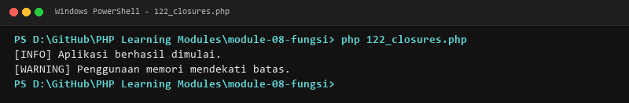

**Lokasi Source Code:** [122_closures.php](122_closures.php)

---

### 123. Fungsi rekursif

**Tujuan Pembelajaran:**
Memahami dan menguasai konsep `Fungsi rekursif` dalam bahasa pemrograman PHP serta mampu menerapkannya dalam kode program mandiri.

**Konsep Utama:**
Konsep dasar `Fungsi rekursif` mencakup mekanisme kerja, sintaks resmi bahasa PHP, serta peran edukatifnya dalam pengembangan perangkat lunak.

**Penjelasan Source Code:**
Berkas `123_recursive_functions.php` mendemonstrasikan implementasi terisolasi dari `Fungsi rekursif` dengan komentar penjelasan edukatif berbahasa Indonesia pada setiap bagian kode penting, tanpa overengineering.

**Cara Menjalankan:**
```bash
php 123_recursive_functions.php
```

**Hasil yang Diharapkan:**
Program menampilkan demonstrasi komputasi dan output teks yang valid sesuai topik `Fungsi rekursif`.

**Screenshot Hasil Eksekusi:**
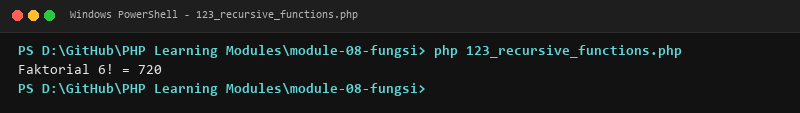

**Lokasi Source Code:** [123_recursive_functions.php](123_recursive_functions.php)

---

### 124. First-class callable syntax

**Tujuan Pembelajaran:**
Memahami dan menguasai konsep `First-class callable syntax` dalam bahasa pemrograman PHP serta mampu menerapkannya dalam kode program mandiri.

**Konsep Utama:**
Konsep dasar `First-class callable syntax` mencakup mekanisme kerja, sintaks resmi bahasa PHP, serta peran edukatifnya dalam pengembangan perangkat lunak.

**Penjelasan Source Code:**
Berkas `124_first_class_callables.php` mendemonstrasikan implementasi terisolasi dari `First-class callable syntax` dengan komentar penjelasan edukatif berbahasa Indonesia pada setiap bagian kode penting, tanpa overengineering.

**Cara Menjalankan:**
```bash
php 124_first_class_callables.php
```

**Hasil yang Diharapkan:**
Program menampilkan demonstrasi komputasi dan output teks yang valid sesuai topik `First-class callable syntax`.

**Screenshot Hasil Eksekusi:**
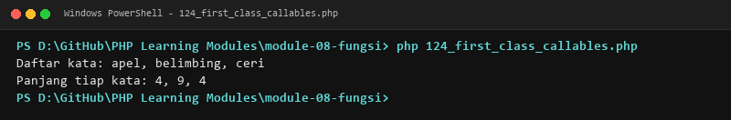

**Lokasi Source Code:** [124_first_class_callables.php](124_first_class_callables.php)

---

## Ringkasan Modul
Modul 8 (Fungsi) memberikan pemahaman menyeluruh mengenai deklarasi fungsi, parameter, return value, void, default parameters, named arguments, variadic, argument unpacking, type declarations, union/intersection/never types, scope, lambda, arrow functions, closures, rekursi, dan first-class callables. Seluruh 20 submodul dirancang terpisah dan mandiri sehingga mudah dipelajari langkah demi langkah.
