# MODUL 9: Object-Oriented Programming (OOP) Dasar

## Ringkasan Ruang Lingkup Materi
Cetak biru class dan objek, properties, methods, constructor, destructor, access modifiers, enkapsulasi, getter/setter, static members, konstanta, kloning, anonymous class, constructor promotion, readonly properties, magic methods, dan serialisasi.

## Tujuan Pembelajaran
Memahami konsep dasar Pemrograman Berorientasi Objek (OOP) untuk membangun komponen perangkat lunak yang modular.

---

## Daftar Submodul Pembelajaran

- [125_class_basic.php](125_class_basic.php) : Class dan object
- [126_class_properties.php](126_class_properties.php) : Properties
- [127_class_methods.php](127_class_methods.php) : Methods
- [128_constructor.php](128_constructor.php) : Constructor
- [129_destructor.php](129_destructor.php) : Destructor
- [130_access_modifiers.php](130_access_modifiers.php) : `public`, `protected`, dan `private`
- [131_encapsulation.php](131_encapsulation.php) : Encapsulation
- [132_getter_setter.php](132_getter_setter.php) : Getter dan setter
- [133_this_keyword.php](133_this_keyword.php) : Keyword `$this`
- [134_static_properties.php](134_static_properties.php) : Static properties
- [135_static_methods.php](135_static_methods.php) : Static methods
- [136_class_constants.php](136_class_constants.php) : Class constants
- [137_object_instantiation.php](137_object_instantiation.php) : Instansiasi object
- [138_object_cloning.php](138_object_cloning.php) : Cloning object
- [139_object_comparison.php](139_object_comparison.php) : Perbandingan object
- [140_anonymous_classes.php](140_anonymous_classes.php) : Anonymous classes
- [141_constructor_promotion.php](141_constructor_promotion.php) : Constructor property promotion
- [142_readonly_properties.php](142_readonly_properties.php) : Readonly properties
- [143_magic_methods.php](143_magic_methods.php) : Magic methods
- [144_object_serialization.php](144_object_serialization.php) : Serialisasi object

---

## Penjelasan Setiap Submodul

### 125. Class dan object

**Tujuan Pembelajaran:**
Memahami dan menguasai konsep `Class dan object` dalam bahasa pemrograman PHP serta mampu menerapkannya dalam kode program mandiri.

**Konsep Utama:**
Konsep dasar `Class dan object` mencakup mekanisme kerja, sintaks resmi bahasa PHP, serta peran edukatifnya dalam pengembangan perangkat lunak.

**Penjelasan Source Code:**
Berkas `125_class_basic.php` mendemonstrasikan implementasi terisolasi dari `Class dan object` dengan komentar penjelasan edukatif berbahasa Indonesia pada setiap bagian kode penting, tanpa overengineering.

**Cara Menjalankan:**
```bash
php 125_class_basic.php
```

**Hasil yang Diharapkan:**
Program menampilkan demonstrasi komputasi dan output teks yang valid sesuai topik `Class dan object`.

**Screenshot Hasil Eksekusi:**
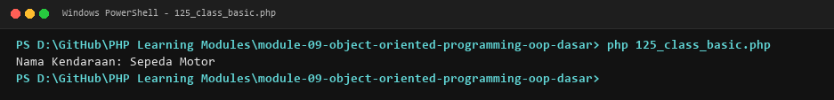

**Lokasi Source Code:** [125_class_basic.php](125_class_basic.php)

---

### 126. Properties

**Tujuan Pembelajaran:**
Memahami dan menguasai konsep `Properties` dalam bahasa pemrograman PHP serta mampu menerapkannya dalam kode program mandiri.

**Konsep Utama:**
Konsep dasar `Properties` mencakup mekanisme kerja, sintaks resmi bahasa PHP, serta peran edukatifnya dalam pengembangan perangkat lunak.

**Penjelasan Source Code:**
Berkas `126_class_properties.php` mendemonstrasikan implementasi terisolasi dari `Properties` dengan komentar penjelasan edukatif berbahasa Indonesia pada setiap bagian kode penting, tanpa overengineering.

**Cara Menjalankan:**
```bash
php 126_class_properties.php
```

**Hasil yang Diharapkan:**
Program menampilkan demonstrasi komputasi dan output teks yang valid sesuai topik `Properties`.

**Screenshot Hasil Eksekusi:**
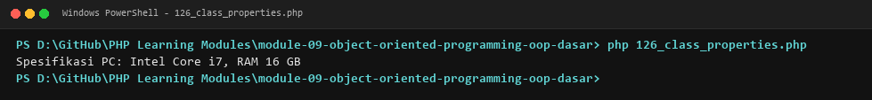

**Lokasi Source Code:** [126_class_properties.php](126_class_properties.php)

---

### 127. Methods

**Tujuan Pembelajaran:**
Memahami dan menguasai konsep `Methods` dalam bahasa pemrograman PHP serta mampu menerapkannya dalam kode program mandiri.

**Konsep Utama:**
Konsep dasar `Methods` mencakup mekanisme kerja, sintaks resmi bahasa PHP, serta peran edukatifnya dalam pengembangan perangkat lunak.

**Penjelasan Source Code:**
Berkas `127_class_methods.php` mendemonstrasikan implementasi terisolasi dari `Methods` dengan komentar penjelasan edukatif berbahasa Indonesia pada setiap bagian kode penting, tanpa overengineering.

**Cara Menjalankan:**
```bash
php 127_class_methods.php
```

**Hasil yang Diharapkan:**
Program menampilkan demonstrasi komputasi dan output teks yang valid sesuai topik `Methods`.

**Screenshot Hasil Eksekusi:**
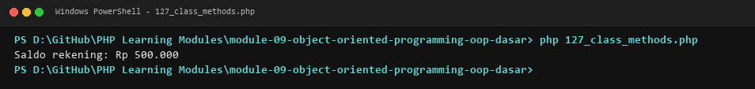

**Lokasi Source Code:** [127_class_methods.php](127_class_methods.php)

---

### 128. Constructor

**Tujuan Pembelajaran:**
Memahami dan menguasai konsep `Constructor` dalam bahasa pemrograman PHP serta mampu menerapkannya dalam kode program mandiri.

**Konsep Utama:**
Konsep dasar `Constructor` mencakup mekanisme kerja, sintaks resmi bahasa PHP, serta peran edukatifnya dalam pengembangan perangkat lunak.

**Penjelasan Source Code:**
Berkas `128_constructor.php` mendemonstrasikan implementasi terisolasi dari `Constructor` dengan komentar penjelasan edukatif berbahasa Indonesia pada setiap bagian kode penting, tanpa overengineering.

**Cara Menjalankan:**
```bash
php 128_constructor.php
```

**Hasil yang Diharapkan:**
Program menampilkan demonstrasi komputasi dan output teks yang valid sesuai topik `Constructor`.

**Screenshot Hasil Eksekusi:**
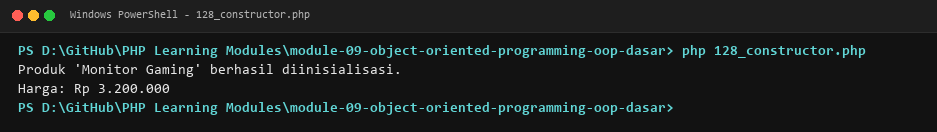

**Lokasi Source Code:** [128_constructor.php](128_constructor.php)

---

### 129. Destructor

**Tujuan Pembelajaran:**
Memahami dan menguasai konsep `Destructor` dalam bahasa pemrograman PHP serta mampu menerapkannya dalam kode program mandiri.

**Konsep Utama:**
Konsep dasar `Destructor` mencakup mekanisme kerja, sintaks resmi bahasa PHP, serta peran edukatifnya dalam pengembangan perangkat lunak.

**Penjelasan Source Code:**
Berkas `129_destructor.php` mendemonstrasikan implementasi terisolasi dari `Destructor` dengan komentar penjelasan edukatif berbahasa Indonesia pada setiap bagian kode penting, tanpa overengineering.

**Cara Menjalankan:**
```bash
php 129_destructor.php
```

**Hasil yang Diharapkan:**
Program menampilkan demonstrasi komputasi dan output teks yang valid sesuai topik `Destructor`.

**Screenshot Hasil Eksekusi:**
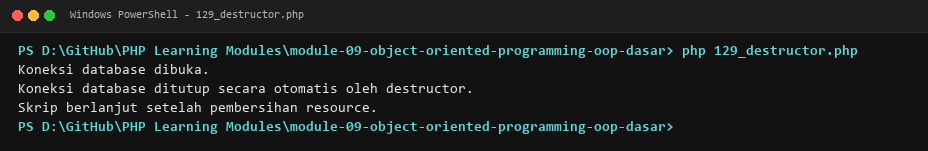

**Lokasi Source Code:** [129_destructor.php](129_destructor.php)

---

### 130. `public`, `protected`, dan `private`

**Tujuan Pembelajaran:**
Memahami dan menguasai konsep ``public`, `protected`, dan `private`` dalam bahasa pemrograman PHP serta mampu menerapkannya dalam kode program mandiri.

**Konsep Utama:**
Konsep dasar ``public`, `protected`, dan `private`` mencakup mekanisme kerja, sintaks resmi bahasa PHP, serta peran edukatifnya dalam pengembangan perangkat lunak.

**Penjelasan Source Code:**
Berkas `130_access_modifiers.php` mendemonstrasikan implementasi terisolasi dari ``public`, `protected`, dan `private`` dengan komentar penjelasan edukatif berbahasa Indonesia pada setiap bagian kode penting, tanpa overengineering.

**Cara Menjalankan:**
```bash
php 130_access_modifiers.php
```

**Hasil yang Diharapkan:**
Program menampilkan demonstrasi komputasi dan output teks yang valid sesuai topik ``public`, `protected`, dan `private``.

**Screenshot Hasil Eksekusi:**


**Lokasi Source Code:** [130_access_modifiers.php](130_access_modifiers.php)

---

### 131. Encapsulation

**Tujuan Pembelajaran:**
Memahami dan menguasai konsep `Encapsulation` dalam bahasa pemrograman PHP serta mampu menerapkannya dalam kode program mandiri.

**Konsep Utama:**
Konsep dasar `Encapsulation` mencakup mekanisme kerja, sintaks resmi bahasa PHP, serta peran edukatifnya dalam pengembangan perangkat lunak.

**Penjelasan Source Code:**
Berkas `131_encapsulation.php` mendemonstrasikan implementasi terisolasi dari `Encapsulation` dengan komentar penjelasan edukatif berbahasa Indonesia pada setiap bagian kode penting, tanpa overengineering.

**Cara Menjalankan:**
```bash
php 131_encapsulation.php
```

**Hasil yang Diharapkan:**
Program menampilkan demonstrasi komputasi dan output teks yang valid sesuai topik `Encapsulation`.

**Screenshot Hasil Eksekusi:**
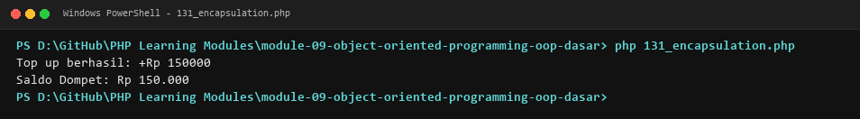

**Lokasi Source Code:** [131_encapsulation.php](131_encapsulation.php)

---

### 132. Getter dan setter

**Tujuan Pembelajaran:**
Memahami dan menguasai konsep `Getter dan setter` dalam bahasa pemrograman PHP serta mampu menerapkannya dalam kode program mandiri.

**Konsep Utama:**
Konsep dasar `Getter dan setter` mencakup mekanisme kerja, sintaks resmi bahasa PHP, serta peran edukatifnya dalam pengembangan perangkat lunak.

**Penjelasan Source Code:**
Berkas `132_getter_setter.php` mendemonstrasikan implementasi terisolasi dari `Getter dan setter` dengan komentar penjelasan edukatif berbahasa Indonesia pada setiap bagian kode penting, tanpa overengineering.

**Cara Menjalankan:**
```bash
php 132_getter_setter.php
```

**Hasil yang Diharapkan:**
Program menampilkan demonstrasi komputasi dan output teks yang valid sesuai topik `Getter dan setter`.

**Screenshot Hasil Eksekusi:**
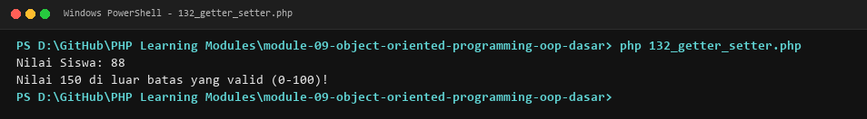

**Lokasi Source Code:** [132_getter_setter.php](132_getter_setter.php)

---

### 133. Keyword `$this`

**Tujuan Pembelajaran:**
Memahami dan menguasai konsep `Keyword `$this`` dalam bahasa pemrograman PHP serta mampu menerapkannya dalam kode program mandiri.

**Konsep Utama:**
Konsep dasar `Keyword `$this`` mencakup mekanisme kerja, sintaks resmi bahasa PHP, serta peran edukatifnya dalam pengembangan perangkat lunak.

**Penjelasan Source Code:**
Berkas `133_this_keyword.php` mendemonstrasikan implementasi terisolasi dari `Keyword `$this`` dengan komentar penjelasan edukatif berbahasa Indonesia pada setiap bagian kode penting, tanpa overengineering.

**Cara Menjalankan:**
```bash
php 133_this_keyword.php
```

**Hasil yang Diharapkan:**
Program menampilkan demonstrasi komputasi dan output teks yang valid sesuai topik `Keyword `$this``.

**Screenshot Hasil Eksekusi:**


**Lokasi Source Code:** [133_this_keyword.php](133_this_keyword.php)

---

### 134. Static properties

**Tujuan Pembelajaran:**
Memahami dan menguasai konsep `Static properties` dalam bahasa pemrograman PHP serta mampu menerapkannya dalam kode program mandiri.

**Konsep Utama:**
Konsep dasar `Static properties` mencakup mekanisme kerja, sintaks resmi bahasa PHP, serta peran edukatifnya dalam pengembangan perangkat lunak.

**Penjelasan Source Code:**
Berkas `134_static_properties.php` mendemonstrasikan implementasi terisolasi dari `Static properties` dengan komentar penjelasan edukatif berbahasa Indonesia pada setiap bagian kode penting, tanpa overengineering.

**Cara Menjalankan:**
```bash
php 134_static_properties.php
```

**Hasil yang Diharapkan:**
Program menampilkan demonstrasi komputasi dan output teks yang valid sesuai topik `Static properties`.

**Screenshot Hasil Eksekusi:**
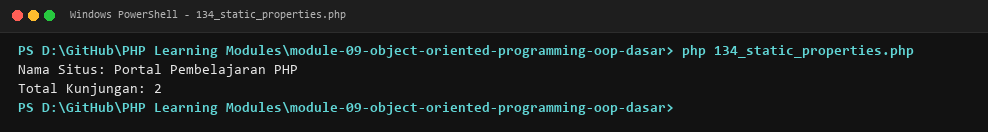

**Lokasi Source Code:** [134_static_properties.php](134_static_properties.php)

---

### 135. Static methods

**Tujuan Pembelajaran:**
Memahami dan menguasai konsep `Static methods` dalam bahasa pemrograman PHP serta mampu menerapkannya dalam kode program mandiri.

**Konsep Utama:**
Konsep dasar `Static methods` mencakup mekanisme kerja, sintaks resmi bahasa PHP, serta peran edukatifnya dalam pengembangan perangkat lunak.

**Penjelasan Source Code:**
Berkas `135_static_methods.php` mendemonstrasikan implementasi terisolasi dari `Static methods` dengan komentar penjelasan edukatif berbahasa Indonesia pada setiap bagian kode penting, tanpa overengineering.

**Cara Menjalankan:**
```bash
php 135_static_methods.php
```

**Hasil yang Diharapkan:**
Program menampilkan demonstrasi komputasi dan output teks yang valid sesuai topik `Static methods`.

**Screenshot Hasil Eksekusi:**
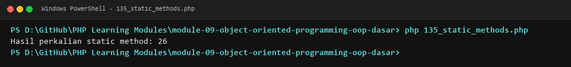

**Lokasi Source Code:** [135_static_methods.php](135_static_methods.php)

---

### 136. Class constants

**Tujuan Pembelajaran:**
Memahami dan menguasai konsep `Class constants` dalam bahasa pemrograman PHP serta mampu menerapkannya dalam kode program mandiri.

**Konsep Utama:**
Konsep dasar `Class constants` mencakup mekanisme kerja, sintaks resmi bahasa PHP, serta peran edukatifnya dalam pengembangan perangkat lunak.

**Penjelasan Source Code:**
Berkas `136_class_constants.php` mendemonstrasikan implementasi terisolasi dari `Class constants` dengan komentar penjelasan edukatif berbahasa Indonesia pada setiap bagian kode penting, tanpa overengineering.

**Cara Menjalankan:**
```bash
php 136_class_constants.php
```

**Hasil yang Diharapkan:**
Program menampilkan demonstrasi komputasi dan output teks yang valid sesuai topik `Class constants`.

**Screenshot Hasil Eksekusi:**
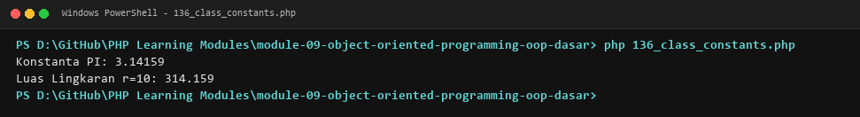

**Lokasi Source Code:** [136_class_constants.php](136_class_constants.php)

---

### 137. Instansiasi object

**Tujuan Pembelajaran:**
Memahami dan menguasai konsep `Instansiasi object` dalam bahasa pemrograman PHP serta mampu menerapkannya dalam kode program mandiri.

**Konsep Utama:**
Konsep dasar `Instansiasi object` mencakup mekanisme kerja, sintaks resmi bahasa PHP, serta peran edukatifnya dalam pengembangan perangkat lunak.

**Penjelasan Source Code:**
Berkas `137_object_instantiation.php` mendemonstrasikan implementasi terisolasi dari `Instansiasi object` dengan komentar penjelasan edukatif berbahasa Indonesia pada setiap bagian kode penting, tanpa overengineering.

**Cara Menjalankan:**
```bash
php 137_object_instantiation.php
```

**Hasil yang Diharapkan:**
Program menampilkan demonstrasi komputasi dan output teks yang valid sesuai topik `Instansiasi object`.

**Screenshot Hasil Eksekusi:**
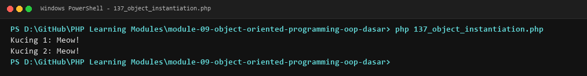

**Lokasi Source Code:** [137_object_instantiation.php](137_object_instantiation.php)

---

### 138. Cloning object

**Tujuan Pembelajaran:**
Memahami dan menguasai konsep `Cloning object` dalam bahasa pemrograman PHP serta mampu menerapkannya dalam kode program mandiri.

**Konsep Utama:**
Konsep dasar `Cloning object` mencakup mekanisme kerja, sintaks resmi bahasa PHP, serta peran edukatifnya dalam pengembangan perangkat lunak.

**Penjelasan Source Code:**
Berkas `138_object_cloning.php` mendemonstrasikan implementasi terisolasi dari `Cloning object` dengan komentar penjelasan edukatif berbahasa Indonesia pada setiap bagian kode penting, tanpa overengineering.

**Cara Menjalankan:**
```bash
php 138_object_cloning.php
```

**Hasil yang Diharapkan:**
Program menampilkan demonstrasi komputasi dan output teks yang valid sesuai topik `Cloning object`.

**Screenshot Hasil Eksekusi:**
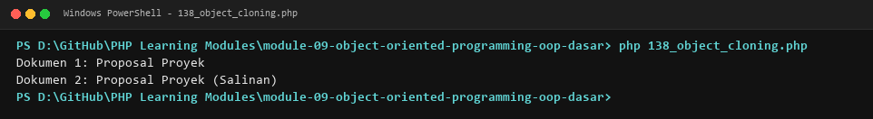

**Lokasi Source Code:** [138_object_cloning.php](138_object_cloning.php)

---

### 139. Perbandingan object

**Tujuan Pembelajaran:**
Memahami dan menguasai konsep `Perbandingan object` dalam bahasa pemrograman PHP serta mampu menerapkannya dalam kode program mandiri.

**Konsep Utama:**
Konsep dasar `Perbandingan object` mencakup mekanisme kerja, sintaks resmi bahasa PHP, serta peran edukatifnya dalam pengembangan perangkat lunak.

**Penjelasan Source Code:**
Berkas `139_object_comparison.php` mendemonstrasikan implementasi terisolasi dari `Perbandingan object` dengan komentar penjelasan edukatif berbahasa Indonesia pada setiap bagian kode penting, tanpa overengineering.

**Cara Menjalankan:**
```bash
php 139_object_comparison.php
```

**Hasil yang Diharapkan:**
Program menampilkan demonstrasi komputasi dan output teks yang valid sesuai topik `Perbandingan object`.

**Screenshot Hasil Eksekusi:**
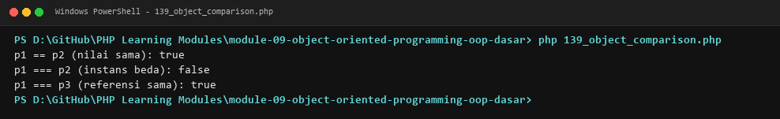

**Lokasi Source Code:** [139_object_comparison.php](139_object_comparison.php)

---

### 140. Anonymous classes

**Tujuan Pembelajaran:**
Memahami dan menguasai konsep `Anonymous classes` dalam bahasa pemrograman PHP serta mampu menerapkannya dalam kode program mandiri.

**Konsep Utama:**
Konsep dasar `Anonymous classes` mencakup mekanisme kerja, sintaks resmi bahasa PHP, serta peran edukatifnya dalam pengembangan perangkat lunak.

**Penjelasan Source Code:**
Berkas `140_anonymous_classes.php` mendemonstrasikan implementasi terisolasi dari `Anonymous classes` dengan komentar penjelasan edukatif berbahasa Indonesia pada setiap bagian kode penting, tanpa overengineering.

**Cara Menjalankan:**
```bash
php 140_anonymous_classes.php
```

**Hasil yang Diharapkan:**
Program menampilkan demonstrasi komputasi dan output teks yang valid sesuai topik `Anonymous classes`.

**Screenshot Hasil Eksekusi:**
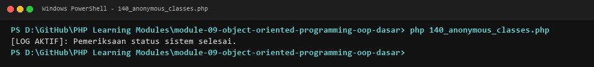

**Lokasi Source Code:** [140_anonymous_classes.php](140_anonymous_classes.php)

---

### 141. Constructor property promotion

**Tujuan Pembelajaran:**
Memahami dan menguasai konsep `Constructor property promotion` dalam bahasa pemrograman PHP serta mampu menerapkannya dalam kode program mandiri.

**Konsep Utama:**
Konsep dasar `Constructor property promotion` mencakup mekanisme kerja, sintaks resmi bahasa PHP, serta peran edukatifnya dalam pengembangan perangkat lunak.

**Penjelasan Source Code:**
Berkas `141_constructor_promotion.php` mendemonstrasikan implementasi terisolasi dari `Constructor property promotion` dengan komentar penjelasan edukatif berbahasa Indonesia pada setiap bagian kode penting, tanpa overengineering.

**Cara Menjalankan:**
```bash
php 141_constructor_promotion.php
```

**Hasil yang Diharapkan:**
Program menampilkan demonstrasi komputasi dan output teks yang valid sesuai topik `Constructor property promotion`.

**Screenshot Hasil Eksekusi:**
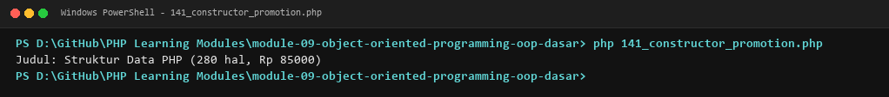

**Lokasi Source Code:** [141_constructor_promotion.php](141_constructor_promotion.php)

---

### 142. Readonly properties

**Tujuan Pembelajaran:**
Memahami dan menguasai konsep `Readonly properties` dalam bahasa pemrograman PHP serta mampu menerapkannya dalam kode program mandiri.

**Konsep Utama:**
Konsep dasar `Readonly properties` mencakup mekanisme kerja, sintaks resmi bahasa PHP, serta peran edukatifnya dalam pengembangan perangkat lunak.

**Penjelasan Source Code:**
Berkas `142_readonly_properties.php` mendemonstrasikan implementasi terisolasi dari `Readonly properties` dengan komentar penjelasan edukatif berbahasa Indonesia pada setiap bagian kode penting, tanpa overengineering.

**Cara Menjalankan:**
```bash
php 142_readonly_properties.php
```

**Hasil yang Diharapkan:**
Program menampilkan demonstrasi komputasi dan output teks yang valid sesuai topik `Readonly properties`.

**Screenshot Hasil Eksekusi:**
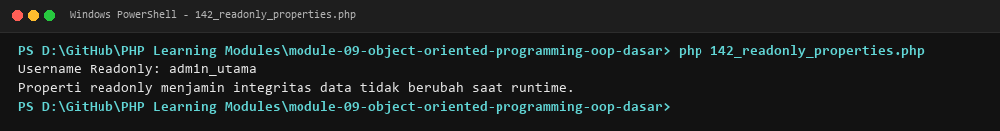

**Lokasi Source Code:** [142_readonly_properties.php](142_readonly_properties.php)

---

### 143. Magic methods

**Tujuan Pembelajaran:**
Memahami dan menguasai konsep `Magic methods` dalam bahasa pemrograman PHP serta mampu menerapkannya dalam kode program mandiri.

**Konsep Utama:**
Konsep dasar `Magic methods` mencakup mekanisme kerja, sintaks resmi bahasa PHP, serta peran edukatifnya dalam pengembangan perangkat lunak.

**Penjelasan Source Code:**
Berkas `143_magic_methods.php` mendemonstrasikan implementasi terisolasi dari `Magic methods` dengan komentar penjelasan edukatif berbahasa Indonesia pada setiap bagian kode penting, tanpa overengineering.

**Cara Menjalankan:**
```bash
php 143_magic_methods.php
```

**Hasil yang Diharapkan:**
Program menampilkan demonstrasi komputasi dan output teks yang valid sesuai topik `Magic methods`.

**Screenshot Hasil Eksekusi:**
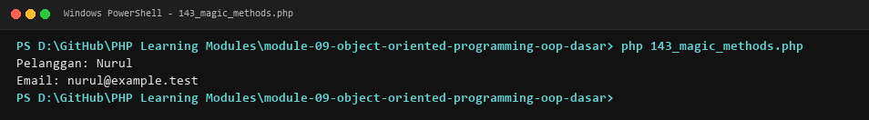

**Lokasi Source Code:** [143_magic_methods.php](143_magic_methods.php)

---

### 144. Serialisasi object

**Tujuan Pembelajaran:**
Memahami dan menguasai konsep `Serialisasi object` dalam bahasa pemrograman PHP serta mampu menerapkannya dalam kode program mandiri.

**Konsep Utama:**
Konsep dasar `Serialisasi object` mencakup mekanisme kerja, sintaks resmi bahasa PHP, serta peran edukatifnya dalam pengembangan perangkat lunak.

**Penjelasan Source Code:**
Berkas `144_object_serialization.php` mendemonstrasikan implementasi terisolasi dari `Serialisasi object` dengan komentar penjelasan edukatif berbahasa Indonesia pada setiap bagian kode penting, tanpa overengineering.

**Cara Menjalankan:**
```bash
php 144_object_serialization.php
```

**Hasil yang Diharapkan:**
Program menampilkan demonstrasi komputasi dan output teks yang valid sesuai topik `Serialisasi object`.

**Screenshot Hasil Eksekusi:**
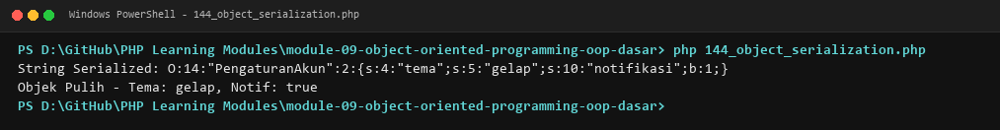

**Lokasi Source Code:** [144_object_serialization.php](144_object_serialization.php)

---

## Ringkasan Modul
Modul 9 (Object-Oriented Programming (OOP) Dasar) memberikan pemahaman menyeluruh mengenai cetak biru class dan objek, properties, methods, constructor, destructor, access modifiers, enkapsulasi, getter/setter, static members, konstanta, kloning, anonymous class, constructor promotion, readonly properties, magic methods, dan serialisasi. Seluruh 20 submodul dirancang terpisah dan mandiri sehingga mudah dipelajari langkah demi langkah.
