# MODUL 10: OOP Lanjutan

## Ringkasan Ruang Lingkup Materi
Inheritance, method overriding, parent keyword, final class/methods, abstract class & methods, interface, multiple interfaces, traits & resolusi konflik, late static binding, covariance/contravariance, composition, aggregation, dependency injection, enums, backed enums, attributes, dan Reflection API.

## Tujuan Pembelajaran
Menguasai arsitektur OOP tingkat lanjut untuk membangun sistem perangkat lunak skala menengah hingga besar.

---

## Daftar Submodul Pembelajaran

- [145_inheritance.php](145_inheritance.php) : Inheritance
- [146_method_overriding.php](146_method_overriding.php) : Method overriding
- [147_parent_keyword.php](147_parent_keyword.php) : Keyword `parent`
- [148_final_classes_methods.php](148_final_classes_methods.php) : Final class dan final method
- [149_abstract_classes.php](149_abstract_classes.php) : Abstract classes
- [150_abstract_methods.php](150_abstract_methods.php) : Abstract methods
- [151_interfaces.php](151_interfaces.php) : Interfaces
- [152_interface_implementation.php](152_interface_implementation.php) : Implementasi interface
- [153_multiple_interfaces.php](153_multiple_interfaces.php) : Implementasi beberapa interface
- [154_traits.php](154_traits.php) : Traits
- [155_trait_conflicts.php](155_trait_conflicts.php) : Penyelesaian konflik traits
- [156_late_static_binding.php](156_late_static_binding.php) : Late static binding
- [157_covariance_contravariance.php](157_covariance_contravariance.php) : Covariance dan contravariance
- [158_composition.php](158_composition.php) : Composition
- [159_aggregation.php](159_aggregation.php) : Aggregation
- [160_dependency_injection.php](160_dependency_injection.php) : Dependency injection dasar
- [161_enums.php](161_enums.php) : Enumerations
- [162_backed_enums.php](162_backed_enums.php) : Backed enums
- [163_attributes.php](163_attributes.php) : Attributes
- [164_reflection_api.php](164_reflection_api.php) : Reflection API

---

## Penjelasan Setiap Submodul

### 145. Inheritance

**Tujuan Pembelajaran:**
Memahami dan menguasai konsep `Inheritance` dalam bahasa pemrograman PHP serta mampu menerapkannya dalam kode program mandiri.

**Konsep Utama:**
Konsep dasar `Inheritance` mencakup mekanisme kerja, sintaks resmi bahasa PHP, serta peran edukatifnya dalam pengembangan perangkat lunak.

**Penjelasan Source Code:**
Berkas `145_inheritance.php` mendemonstrasikan implementasi terisolasi dari `Inheritance` dengan komentar penjelasan edukatif berbahasa Indonesia pada setiap bagian kode penting, tanpa overengineering.

**Cara Menjalankan:**
```bash
php 145_inheritance.php
```

**Hasil yang Diharapkan:**
Program menampilkan demonstrasi komputasi dan output teks yang valid sesuai topik `Inheritance`.

**Screenshot Hasil Eksekusi:**
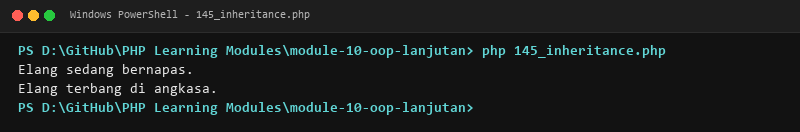

**Lokasi Source Code:** [145_inheritance.php](145_inheritance.php)

---

### 146. Method overriding

**Tujuan Pembelajaran:**
Memahami dan menguasai konsep `Method overriding` dalam bahasa pemrograman PHP serta mampu menerapkannya dalam kode program mandiri.

**Konsep Utama:**
Konsep dasar `Method overriding` mencakup mekanisme kerja, sintaks resmi bahasa PHP, serta peran edukatifnya dalam pengembangan perangkat lunak.

**Penjelasan Source Code:**
Berkas `146_method_overriding.php` mendemonstrasikan implementasi terisolasi dari `Method overriding` dengan komentar penjelasan edukatif berbahasa Indonesia pada setiap bagian kode penting, tanpa overengineering.

**Cara Menjalankan:**
```bash
php 146_method_overriding.php
```

**Hasil yang Diharapkan:**
Program menampilkan demonstrasi komputasi dan output teks yang valid sesuai topik `Method overriding`.

**Screenshot Hasil Eksekusi:**
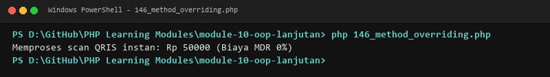

**Lokasi Source Code:** [146_method_overriding.php](146_method_overriding.php)

---

### 147. Keyword `parent`

**Tujuan Pembelajaran:**
Memahami dan menguasai konsep `Keyword `parent`` dalam bahasa pemrograman PHP serta mampu menerapkannya dalam kode program mandiri.

**Konsep Utama:**
Konsep dasar `Keyword `parent`` mencakup mekanisme kerja, sintaks resmi bahasa PHP, serta peran edukatifnya dalam pengembangan perangkat lunak.

**Penjelasan Source Code:**
Berkas `147_parent_keyword.php` mendemonstrasikan implementasi terisolasi dari `Keyword `parent`` dengan komentar penjelasan edukatif berbahasa Indonesia pada setiap bagian kode penting, tanpa overengineering.

**Cara Menjalankan:**
```bash
php 147_parent_keyword.php
```

**Hasil yang Diharapkan:**
Program menampilkan demonstrasi komputasi dan output teks yang valid sesuai topik `Keyword `parent``.

**Screenshot Hasil Eksekusi:**


**Lokasi Source Code:** [147_parent_keyword.php](147_parent_keyword.php)

---

### 148. Final class dan final method

**Tujuan Pembelajaran:**
Memahami dan menguasai konsep `Final class dan final method` dalam bahasa pemrograman PHP serta mampu menerapkannya dalam kode program mandiri.

**Konsep Utama:**
Konsep dasar `Final class dan final method` mencakup mekanisme kerja, sintaks resmi bahasa PHP, serta peran edukatifnya dalam pengembangan perangkat lunak.

**Penjelasan Source Code:**
Berkas `148_final_classes_methods.php` mendemonstrasikan implementasi terisolasi dari `Final class dan final method` dengan komentar penjelasan edukatif berbahasa Indonesia pada setiap bagian kode penting, tanpa overengineering.

**Cara Menjalankan:**
```bash
php 148_final_classes_methods.php
```

**Hasil yang Diharapkan:**
Program menampilkan demonstrasi komputasi dan output teks yang valid sesuai topik `Final class dan final method`.

**Screenshot Hasil Eksekusi:**
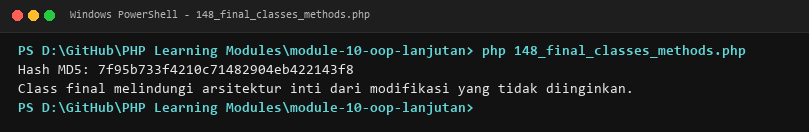

**Lokasi Source Code:** [148_final_classes_methods.php](148_final_classes_methods.php)

---

### 149. Abstract classes

**Tujuan Pembelajaran:**
Memahami dan menguasai konsep `Abstract classes` dalam bahasa pemrograman PHP serta mampu menerapkannya dalam kode program mandiri.

**Konsep Utama:**
Konsep dasar `Abstract classes` mencakup mekanisme kerja, sintaks resmi bahasa PHP, serta peran edukatifnya dalam pengembangan perangkat lunak.

**Penjelasan Source Code:**
Berkas `149_abstract_classes.php` mendemonstrasikan implementasi terisolasi dari `Abstract classes` dengan komentar penjelasan edukatif berbahasa Indonesia pada setiap bagian kode penting, tanpa overengineering.

**Cara Menjalankan:**
```bash
php 149_abstract_classes.php
```

**Hasil yang Diharapkan:**
Program menampilkan demonstrasi komputasi dan output teks yang valid sesuai topik `Abstract classes`.

**Screenshot Hasil Eksekusi:**
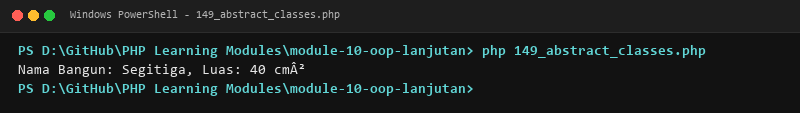

**Lokasi Source Code:** [149_abstract_classes.php](149_abstract_classes.php)

---

### 150. Abstract methods

**Tujuan Pembelajaran:**
Memahami dan menguasai konsep `Abstract methods` dalam bahasa pemrograman PHP serta mampu menerapkannya dalam kode program mandiri.

**Konsep Utama:**
Konsep dasar `Abstract methods` mencakup mekanisme kerja, sintaks resmi bahasa PHP, serta peran edukatifnya dalam pengembangan perangkat lunak.

**Penjelasan Source Code:**
Berkas `150_abstract_methods.php` mendemonstrasikan implementasi terisolasi dari `Abstract methods` dengan komentar penjelasan edukatif berbahasa Indonesia pada setiap bagian kode penting, tanpa overengineering.

**Cara Menjalankan:**
```bash
php 150_abstract_methods.php
```

**Hasil yang Diharapkan:**
Program menampilkan demonstrasi komputasi dan output teks yang valid sesuai topik `Abstract methods`.

**Screenshot Hasil Eksekusi:**
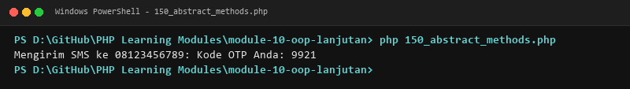

**Lokasi Source Code:** [150_abstract_methods.php](150_abstract_methods.php)

---

### 151. Interfaces

**Tujuan Pembelajaran:**
Memahami dan menguasai konsep `Interfaces` dalam bahasa pemrograman PHP serta mampu menerapkannya dalam kode program mandiri.

**Konsep Utama:**
Konsep dasar `Interfaces` mencakup mekanisme kerja, sintaks resmi bahasa PHP, serta peran edukatifnya dalam pengembangan perangkat lunak.

**Penjelasan Source Code:**
Berkas `151_interfaces.php` mendemonstrasikan implementasi terisolasi dari `Interfaces` dengan komentar penjelasan edukatif berbahasa Indonesia pada setiap bagian kode penting, tanpa overengineering.

**Cara Menjalankan:**
```bash
php 151_interfaces.php
```

**Hasil yang Diharapkan:**
Program menampilkan demonstrasi komputasi dan output teks yang valid sesuai topik `Interfaces`.

**Screenshot Hasil Eksekusi:**
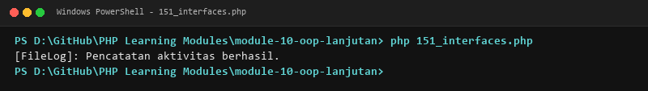

**Lokasi Source Code:** [151_interfaces.php](151_interfaces.php)

---

### 152. Implementasi interface

**Tujuan Pembelajaran:**
Memahami dan menguasai konsep `Implementasi interface` dalam bahasa pemrograman PHP serta mampu menerapkannya dalam kode program mandiri.

**Konsep Utama:**
Konsep dasar `Implementasi interface` mencakup mekanisme kerja, sintaks resmi bahasa PHP, serta peran edukatifnya dalam pengembangan perangkat lunak.

**Penjelasan Source Code:**
Berkas `152_interface_implementation.php` mendemonstrasikan implementasi terisolasi dari `Implementasi interface` dengan komentar penjelasan edukatif berbahasa Indonesia pada setiap bagian kode penting, tanpa overengineering.

**Cara Menjalankan:**
```bash
php 152_interface_implementation.php
```

**Hasil yang Diharapkan:**
Program menampilkan demonstrasi komputasi dan output teks yang valid sesuai topik `Implementasi interface`.

**Screenshot Hasil Eksekusi:**
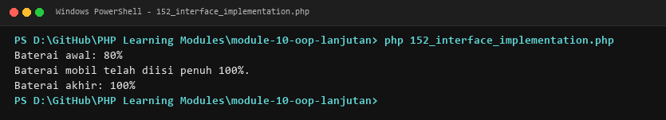

**Lokasi Source Code:** [152_interface_implementation.php](152_interface_implementation.php)

---

### 153. Implementasi beberapa interface

**Tujuan Pembelajaran:**
Memahami dan menguasai konsep `Implementasi beberapa interface` dalam bahasa pemrograman PHP serta mampu menerapkannya dalam kode program mandiri.

**Konsep Utama:**
Konsep dasar `Implementasi beberapa interface` mencakup mekanisme kerja, sintaks resmi bahasa PHP, serta peran edukatifnya dalam pengembangan perangkat lunak.

**Penjelasan Source Code:**
Berkas `153_multiple_interfaces.php` mendemonstrasikan implementasi terisolasi dari `Implementasi beberapa interface` dengan komentar penjelasan edukatif berbahasa Indonesia pada setiap bagian kode penting, tanpa overengineering.

**Cara Menjalankan:**
```bash
php 153_multiple_interfaces.php
```

**Hasil yang Diharapkan:**
Program menampilkan demonstrasi komputasi dan output teks yang valid sesuai topik `Implementasi beberapa interface`.

**Screenshot Hasil Eksekusi:**
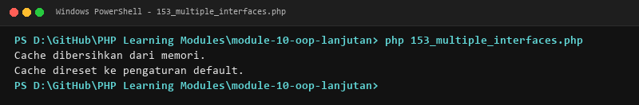

**Lokasi Source Code:** [153_multiple_interfaces.php](153_multiple_interfaces.php)

---

### 154. Traits

**Tujuan Pembelajaran:**
Memahami dan menguasai konsep `Traits` dalam bahasa pemrograman PHP serta mampu menerapkannya dalam kode program mandiri.

**Konsep Utama:**
Konsep dasar `Traits` mencakup mekanisme kerja, sintaks resmi bahasa PHP, serta peran edukatifnya dalam pengembangan perangkat lunak.

**Penjelasan Source Code:**
Berkas `154_traits.php` mendemonstrasikan implementasi terisolasi dari `Traits` dengan komentar penjelasan edukatif berbahasa Indonesia pada setiap bagian kode penting, tanpa overengineering.

**Cara Menjalankan:**
```bash
php 154_traits.php
```

**Hasil yang Diharapkan:**
Program menampilkan demonstrasi komputasi dan output teks yang valid sesuai topik `Traits`.

**Screenshot Hasil Eksekusi:**
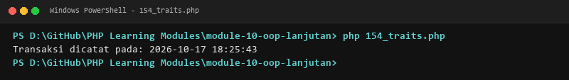

**Lokasi Source Code:** [154_traits.php](154_traits.php)

---

### 155. Penyelesaian konflik traits

**Tujuan Pembelajaran:**
Memahami dan menguasai konsep `Penyelesaian konflik traits` dalam bahasa pemrograman PHP serta mampu menerapkannya dalam kode program mandiri.

**Konsep Utama:**
Konsep dasar `Penyelesaian konflik traits` mencakup mekanisme kerja, sintaks resmi bahasa PHP, serta peran edukatifnya dalam pengembangan perangkat lunak.

**Penjelasan Source Code:**
Berkas `155_trait_conflicts.php` mendemonstrasikan implementasi terisolasi dari `Penyelesaian konflik traits` dengan komentar penjelasan edukatif berbahasa Indonesia pada setiap bagian kode penting, tanpa overengineering.

**Cara Menjalankan:**
```bash
php 155_trait_conflicts.php
```

**Hasil yang Diharapkan:**
Program menampilkan demonstrasi komputasi dan output teks yang valid sesuai topik `Penyelesaian konflik traits`.

**Screenshot Hasil Eksekusi:**
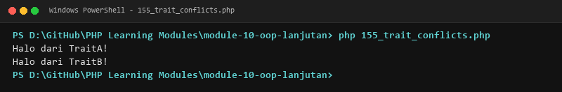

**Lokasi Source Code:** [155_trait_conflicts.php](155_trait_conflicts.php)

---

### 156. Late static binding

**Tujuan Pembelajaran:**
Memahami dan menguasai konsep `Late static binding` dalam bahasa pemrograman PHP serta mampu menerapkannya dalam kode program mandiri.

**Konsep Utama:**
Konsep dasar `Late static binding` mencakup mekanisme kerja, sintaks resmi bahasa PHP, serta peran edukatifnya dalam pengembangan perangkat lunak.

**Penjelasan Source Code:**
Berkas `156_late_static_binding.php` mendemonstrasikan implementasi terisolasi dari `Late static binding` dengan komentar penjelasan edukatif berbahasa Indonesia pada setiap bagian kode penting, tanpa overengineering.

**Cara Menjalankan:**
```bash
php 156_late_static_binding.php
```

**Hasil yang Diharapkan:**
Program menampilkan demonstrasi komputasi dan output teks yang valid sesuai topik `Late static binding`.

**Screenshot Hasil Eksekusi:**
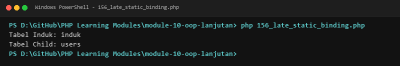

**Lokasi Source Code:** [156_late_static_binding.php](156_late_static_binding.php)

---

### 157. Covariance dan contravariance

**Tujuan Pembelajaran:**
Memahami dan menguasai konsep `Covariance dan contravariance` dalam bahasa pemrograman PHP serta mampu menerapkannya dalam kode program mandiri.

**Konsep Utama:**
Konsep dasar `Covariance dan contravariance` mencakup mekanisme kerja, sintaks resmi bahasa PHP, serta peran edukatifnya dalam pengembangan perangkat lunak.

**Penjelasan Source Code:**
Berkas `157_covariance_contravariance.php` mendemonstrasikan implementasi terisolasi dari `Covariance dan contravariance` dengan komentar penjelasan edukatif berbahasa Indonesia pada setiap bagian kode penting, tanpa overengineering.

**Cara Menjalankan:**
```bash
php 157_covariance_contravariance.php
```

**Hasil yang Diharapkan:**
Program menampilkan demonstrasi komputasi dan output teks yang valid sesuai topik `Covariance dan contravariance`.

**Screenshot Hasil Eksekusi:**
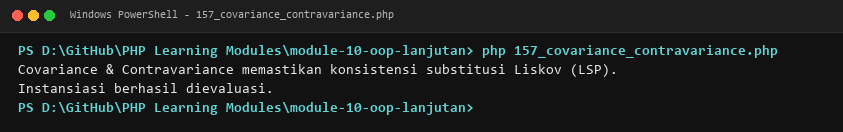

**Lokasi Source Code:** [157_covariance_contravariance.php](157_covariance_contravariance.php)

---

### 158. Composition

**Tujuan Pembelajaran:**
Memahami dan menguasai konsep `Composition` dalam bahasa pemrograman PHP serta mampu menerapkannya dalam kode program mandiri.

**Konsep Utama:**
Konsep dasar `Composition` mencakup mekanisme kerja, sintaks resmi bahasa PHP, serta peran edukatifnya dalam pengembangan perangkat lunak.

**Penjelasan Source Code:**
Berkas `158_composition.php` mendemonstrasikan implementasi terisolasi dari `Composition` dengan komentar penjelasan edukatif berbahasa Indonesia pada setiap bagian kode penting, tanpa overengineering.

**Cara Menjalankan:**
```bash
php 158_composition.php
```

**Hasil yang Diharapkan:**
Program menampilkan demonstrasi komputasi dan output teks yang valid sesuai topik `Composition`.

**Screenshot Hasil Eksekusi:**
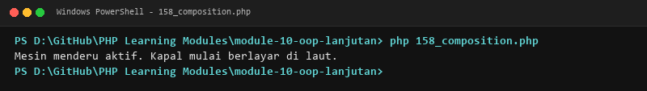

**Lokasi Source Code:** [158_composition.php](158_composition.php)

---

### 159. Aggregation

**Tujuan Pembelajaran:**
Memahami dan menguasai konsep `Aggregation` dalam bahasa pemrograman PHP serta mampu menerapkannya dalam kode program mandiri.

**Konsep Utama:**
Konsep dasar `Aggregation` mencakup mekanisme kerja, sintaks resmi bahasa PHP, serta peran edukatifnya dalam pengembangan perangkat lunak.

**Penjelasan Source Code:**
Berkas `159_aggregation.php` mendemonstrasikan implementasi terisolasi dari `Aggregation` dengan komentar penjelasan edukatif berbahasa Indonesia pada setiap bagian kode penting, tanpa overengineering.

**Cara Menjalankan:**
```bash
php 159_aggregation.php
```

**Hasil yang Diharapkan:**
Program menampilkan demonstrasi komputasi dan output teks yang valid sesuai topik `Aggregation`.

**Screenshot Hasil Eksekusi:**
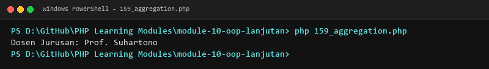

**Lokasi Source Code:** [159_aggregation.php](159_aggregation.php)

---

### 160. Dependency injection dasar

**Tujuan Pembelajaran:**
Memahami dan menguasai konsep `Dependency injection dasar` dalam bahasa pemrograman PHP serta mampu menerapkannya dalam kode program mandiri.

**Konsep Utama:**
Konsep dasar `Dependency injection dasar` mencakup mekanisme kerja, sintaks resmi bahasa PHP, serta peran edukatifnya dalam pengembangan perangkat lunak.

**Penjelasan Source Code:**
Berkas `160_dependency_injection.php` mendemonstrasikan implementasi terisolasi dari `Dependency injection dasar` dengan komentar penjelasan edukatif berbahasa Indonesia pada setiap bagian kode penting, tanpa overengineering.

**Cara Menjalankan:**
```bash
php 160_dependency_injection.php
```

**Hasil yang Diharapkan:**
Program menampilkan demonstrasi komputasi dan output teks yang valid sesuai topik `Dependency injection dasar`.

**Screenshot Hasil Eksekusi:**
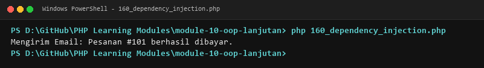

**Lokasi Source Code:** [160_dependency_injection.php](160_dependency_injection.php)

---

### 161. Enumerations

**Tujuan Pembelajaran:**
Memahami dan menguasai konsep `Enumerations` dalam bahasa pemrograman PHP serta mampu menerapkannya dalam kode program mandiri.

**Konsep Utama:**
Konsep dasar `Enumerations` mencakup mekanisme kerja, sintaks resmi bahasa PHP, serta peran edukatifnya dalam pengembangan perangkat lunak.

**Penjelasan Source Code:**
Berkas `161_enums.php` mendemonstrasikan implementasi terisolasi dari `Enumerations` dengan komentar penjelasan edukatif berbahasa Indonesia pada setiap bagian kode penting, tanpa overengineering.

**Cara Menjalankan:**
```bash
php 161_enums.php
```

**Hasil yang Diharapkan:**
Program menampilkan demonstrasi komputasi dan output teks yang valid sesuai topik `Enumerations`.

**Screenshot Hasil Eksekusi:**
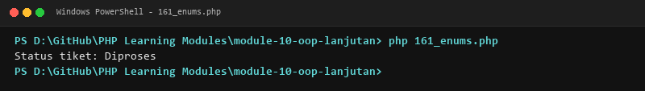

**Lokasi Source Code:** [161_enums.php](161_enums.php)

---

### 162. Backed enums

**Tujuan Pembelajaran:**
Memahami dan menguasai konsep `Backed enums` dalam bahasa pemrograman PHP serta mampu menerapkannya dalam kode program mandiri.

**Konsep Utama:**
Konsep dasar `Backed enums` mencakup mekanisme kerja, sintaks resmi bahasa PHP, serta peran edukatifnya dalam pengembangan perangkat lunak.

**Penjelasan Source Code:**
Berkas `162_backed_enums.php` mendemonstrasikan implementasi terisolasi dari `Backed enums` dengan komentar penjelasan edukatif berbahasa Indonesia pada setiap bagian kode penting, tanpa overengineering.

**Cara Menjalankan:**
```bash
php 162_backed_enums.php
```

**Hasil yang Diharapkan:**
Program menampilkan demonstrasi komputasi dan output teks yang valid sesuai topik `Backed enums`.

**Screenshot Hasil Eksekusi:**
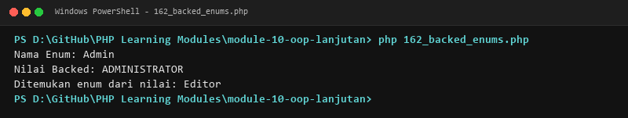

**Lokasi Source Code:** [162_backed_enums.php](162_backed_enums.php)

---

### 163. Attributes

**Tujuan Pembelajaran:**
Memahami dan menguasai konsep `Attributes` dalam bahasa pemrograman PHP serta mampu menerapkannya dalam kode program mandiri.

**Konsep Utama:**
Konsep dasar `Attributes` mencakup mekanisme kerja, sintaks resmi bahasa PHP, serta peran edukatifnya dalam pengembangan perangkat lunak.

**Penjelasan Source Code:**
Berkas `163_attributes.php` mendemonstrasikan implementasi terisolasi dari `Attributes` dengan komentar penjelasan edukatif berbahasa Indonesia pada setiap bagian kode penting, tanpa overengineering.

**Cara Menjalankan:**
```bash
php 163_attributes.php
```

**Hasil yang Diharapkan:**
Program menampilkan demonstrasi komputasi dan output teks yang valid sesuai topik `Attributes`.

**Screenshot Hasil Eksekusi:**
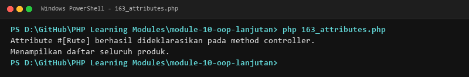

**Lokasi Source Code:** [163_attributes.php](163_attributes.php)

---

### 164. Reflection API

**Tujuan Pembelajaran:**
Memahami dan menguasai konsep `Reflection API` dalam bahasa pemrograman PHP serta mampu menerapkannya dalam kode program mandiri.

**Konsep Utama:**
Konsep dasar `Reflection API` mencakup mekanisme kerja, sintaks resmi bahasa PHP, serta peran edukatifnya dalam pengembangan perangkat lunak.

**Penjelasan Source Code:**
Berkas `164_reflection_api.php` mendemonstrasikan implementasi terisolasi dari `Reflection API` dengan komentar penjelasan edukatif berbahasa Indonesia pada setiap bagian kode penting, tanpa overengineering.

**Cara Menjalankan:**
```bash
php 164_reflection_api.php
```

**Hasil yang Diharapkan:**
Program menampilkan demonstrasi komputasi dan output teks yang valid sesuai topik `Reflection API`.

**Screenshot Hasil Eksekusi:**
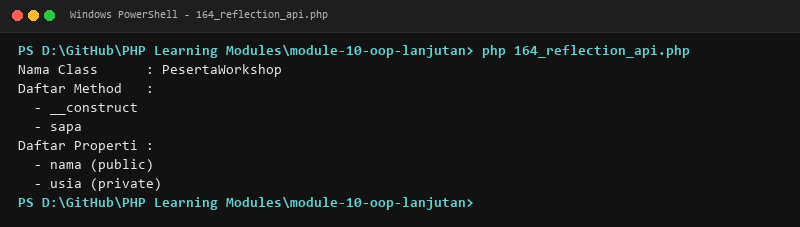

**Lokasi Source Code:** [164_reflection_api.php](164_reflection_api.php)

---

## Ringkasan Modul
Modul 10 (OOP Lanjutan) memberikan pemahaman menyeluruh mengenai inheritance, method overriding, parent keyword, final class/methods, abstract class & methods, interface, multiple interfaces, traits & resolusi konflik, late static binding, covariance/contravariance, composition, aggregation, dependency injection, enums, backed enums, attributes, dan reflection api. Seluruh 20 submodul dirancang terpisah dan mandiri sehingga mudah dipelajari langkah demi langkah.
