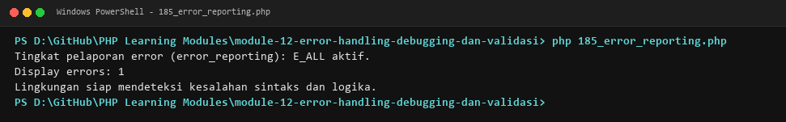
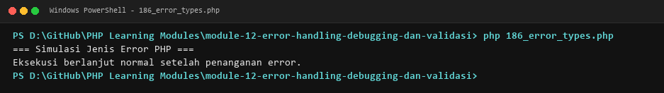
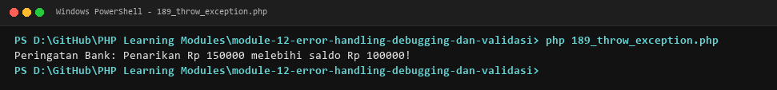
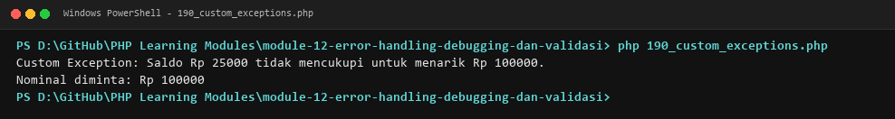
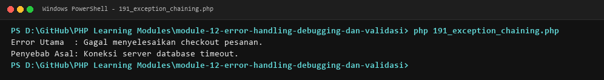
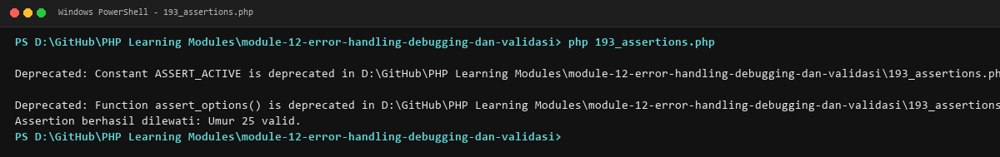
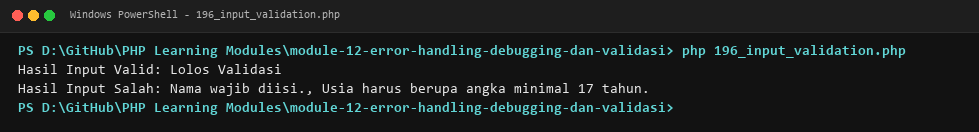
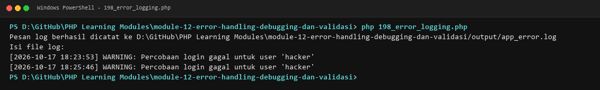

# MODUL 12: Error Handling, Debugging, dan Validasi

## Ringkasan Ruang Lingkup Materi
Konfigurasi error reporting, klasifikasi jenis error (Notice, Warning, Fatal), blok try-catch-finally, melempar exception, custom exceptions, exception chaining, interface Throwable, assertions, debugging tools (var_dump, debug_backtrace), validasi filter_var, dan error logging.

## Tujuan Pembelajaran
Mampu mendeteksi kesalahan, mencegah kegagalan sistem tak tertangani, dan memastikan keandalan aplikasi.

---

## Daftar Submodul Pembelajaran

- [185_error_reporting.php](185_error_reporting.php) : Error reporting
- [186_error_types.php](186_error_types.php) : Jenis kesalahan PHP
- [187_try_catch.php](187_try_catch.php) : `try-catch`
- [188_finally_block.php](188_finally_block.php) : Blok `finally`
- [189_throw_exception.php](189_throw_exception.php) : Melempar exception
- [190_custom_exceptions.php](190_custom_exceptions.php) : Custom exceptions
- [191_exception_chaining.php](191_exception_chaining.php) : Exception chaining
- [192_throwable_interface.php](192_throwable_interface.php) : Interface `Throwable`
- [193_assertions.php](193_assertions.php) : Assertion
- [194_var_dump_debugging.php](194_var_dump_debugging.php) : Debugging dengan `var_dump()`
- [195_debug_backtrace.php](195_debug_backtrace.php) : `debug_backtrace()`
- [196_input_validation.php](196_input_validation.php) : Validasi input
- [197_filter_var.php](197_filter_var.php) : Validasi menggunakan `filter_var()`
- [198_error_logging.php](198_error_logging.php) : Pencatatan error ke log

---

## Penjelasan Setiap Submodul

### 185. Error reporting

**Tujuan Pembelajaran:**
Memahami dan menguasai konsep `Error reporting` dalam bahasa pemrograman PHP serta mampu menerapkannya dalam kode program mandiri.

**Konsep Utama:**
Konsep dasar `Error reporting` mencakup mekanisme kerja, sintaks resmi bahasa PHP, serta peran edukatifnya dalam pengembangan perangkat lunak.

**Penjelasan Source Code:**
Berkas `185_error_reporting.php` mendemonstrasikan implementasi terisolasi dari `Error reporting` dengan komentar penjelasan edukatif berbahasa Indonesia pada setiap bagian kode penting, tanpa overengineering.

**Cara Menjalankan:**
```bash
php 185_error_reporting.php
```

**Hasil yang Diharapkan:**
Program menampilkan demonstrasi komputasi dan output teks yang valid sesuai topik `Error reporting`.

**Screenshot Hasil Eksekusi:**


**Lokasi Source Code:** [185_error_reporting.php](185_error_reporting.php)

---

### 186. Jenis kesalahan PHP

**Tujuan Pembelajaran:**
Memahami dan menguasai konsep `Jenis kesalahan PHP` dalam bahasa pemrograman PHP serta mampu menerapkannya dalam kode program mandiri.

**Konsep Utama:**
Konsep dasar `Jenis kesalahan PHP` mencakup mekanisme kerja, sintaks resmi bahasa PHP, serta peran edukatifnya dalam pengembangan perangkat lunak.

**Penjelasan Source Code:**
Berkas `186_error_types.php` mendemonstrasikan implementasi terisolasi dari `Jenis kesalahan PHP` dengan komentar penjelasan edukatif berbahasa Indonesia pada setiap bagian kode penting, tanpa overengineering.

**Cara Menjalankan:**
```bash
php 186_error_types.php
```

**Hasil yang Diharapkan:**
Program menampilkan demonstrasi komputasi dan output teks yang valid sesuai topik `Jenis kesalahan PHP`.

**Screenshot Hasil Eksekusi:**


**Lokasi Source Code:** [186_error_types.php](186_error_types.php)

---

### 187. `try-catch`

**Tujuan Pembelajaran:**
Memahami dan menguasai konsep ``try-catch`` dalam bahasa pemrograman PHP serta mampu menerapkannya dalam kode program mandiri.

**Konsep Utama:**
Konsep dasar ``try-catch`` mencakup mekanisme kerja, sintaks resmi bahasa PHP, serta peran edukatifnya dalam pengembangan perangkat lunak.

**Penjelasan Source Code:**
Berkas `187_try_catch.php` mendemonstrasikan implementasi terisolasi dari ``try-catch`` dengan komentar penjelasan edukatif berbahasa Indonesia pada setiap bagian kode penting, tanpa overengineering.

**Cara Menjalankan:**
```bash
php 187_try_catch.php
```

**Hasil yang Diharapkan:**
Program menampilkan demonstrasi komputasi dan output teks yang valid sesuai topik ``try-catch``.

**Screenshot Hasil Eksekusi:**


**Lokasi Source Code:** [187_try_catch.php](187_try_catch.php)

---

### 188. Blok `finally`

**Tujuan Pembelajaran:**
Memahami dan menguasai konsep `Blok `finally`` dalam bahasa pemrograman PHP serta mampu menerapkannya dalam kode program mandiri.

**Konsep Utama:**
Konsep dasar `Blok `finally`` mencakup mekanisme kerja, sintaks resmi bahasa PHP, serta peran edukatifnya dalam pengembangan perangkat lunak.

**Penjelasan Source Code:**
Berkas `188_finally_block.php` mendemonstrasikan implementasi terisolasi dari `Blok `finally`` dengan komentar penjelasan edukatif berbahasa Indonesia pada setiap bagian kode penting, tanpa overengineering.

**Cara Menjalankan:**
```bash
php 188_finally_block.php
```

**Hasil yang Diharapkan:**
Program menampilkan demonstrasi komputasi dan output teks yang valid sesuai topik `Blok `finally``.

**Screenshot Hasil Eksekusi:**


**Lokasi Source Code:** [188_finally_block.php](188_finally_block.php)

---

### 189. Melempar exception

**Tujuan Pembelajaran:**
Memahami dan menguasai konsep `Melempar exception` dalam bahasa pemrograman PHP serta mampu menerapkannya dalam kode program mandiri.

**Konsep Utama:**
Konsep dasar `Melempar exception` mencakup mekanisme kerja, sintaks resmi bahasa PHP, serta peran edukatifnya dalam pengembangan perangkat lunak.

**Penjelasan Source Code:**
Berkas `189_throw_exception.php` mendemonstrasikan implementasi terisolasi dari `Melempar exception` dengan komentar penjelasan edukatif berbahasa Indonesia pada setiap bagian kode penting, tanpa overengineering.

**Cara Menjalankan:**
```bash
php 189_throw_exception.php
```

**Hasil yang Diharapkan:**
Program menampilkan demonstrasi komputasi dan output teks yang valid sesuai topik `Melempar exception`.

**Screenshot Hasil Eksekusi:**


**Lokasi Source Code:** [189_throw_exception.php](189_throw_exception.php)

---

### 190. Custom exceptions

**Tujuan Pembelajaran:**
Memahami dan menguasai konsep `Custom exceptions` dalam bahasa pemrograman PHP serta mampu menerapkannya dalam kode program mandiri.

**Konsep Utama:**
Konsep dasar `Custom exceptions` mencakup mekanisme kerja, sintaks resmi bahasa PHP, serta peran edukatifnya dalam pengembangan perangkat lunak.

**Penjelasan Source Code:**
Berkas `190_custom_exceptions.php` mendemonstrasikan implementasi terisolasi dari `Custom exceptions` dengan komentar penjelasan edukatif berbahasa Indonesia pada setiap bagian kode penting, tanpa overengineering.

**Cara Menjalankan:**
```bash
php 190_custom_exceptions.php
```

**Hasil yang Diharapkan:**
Program menampilkan demonstrasi komputasi dan output teks yang valid sesuai topik `Custom exceptions`.

**Screenshot Hasil Eksekusi:**


**Lokasi Source Code:** [190_custom_exceptions.php](190_custom_exceptions.php)

---

### 191. Exception chaining

**Tujuan Pembelajaran:**
Memahami dan menguasai konsep `Exception chaining` dalam bahasa pemrograman PHP serta mampu menerapkannya dalam kode program mandiri.

**Konsep Utama:**
Konsep dasar `Exception chaining` mencakup mekanisme kerja, sintaks resmi bahasa PHP, serta peran edukatifnya dalam pengembangan perangkat lunak.

**Penjelasan Source Code:**
Berkas `191_exception_chaining.php` mendemonstrasikan implementasi terisolasi dari `Exception chaining` dengan komentar penjelasan edukatif berbahasa Indonesia pada setiap bagian kode penting, tanpa overengineering.

**Cara Menjalankan:**
```bash
php 191_exception_chaining.php
```

**Hasil yang Diharapkan:**
Program menampilkan demonstrasi komputasi dan output teks yang valid sesuai topik `Exception chaining`.

**Screenshot Hasil Eksekusi:**


**Lokasi Source Code:** [191_exception_chaining.php](191_exception_chaining.php)

---

### 192. Interface `Throwable`

**Tujuan Pembelajaran:**
Memahami dan menguasai konsep `Interface `Throwable`` dalam bahasa pemrograman PHP serta mampu menerapkannya dalam kode program mandiri.

**Konsep Utama:**
Konsep dasar `Interface `Throwable`` mencakup mekanisme kerja, sintaks resmi bahasa PHP, serta peran edukatifnya dalam pengembangan perangkat lunak.

**Penjelasan Source Code:**
Berkas `192_throwable_interface.php` mendemonstrasikan implementasi terisolasi dari `Interface `Throwable`` dengan komentar penjelasan edukatif berbahasa Indonesia pada setiap bagian kode penting, tanpa overengineering.

**Cara Menjalankan:**
```bash
php 192_throwable_interface.php
```

**Hasil yang Diharapkan:**
Program menampilkan demonstrasi komputasi dan output teks yang valid sesuai topik `Interface `Throwable``.

**Screenshot Hasil Eksekusi:**


**Lokasi Source Code:** [192_throwable_interface.php](192_throwable_interface.php)

---

### 193. Assertion

**Tujuan Pembelajaran:**
Memahami dan menguasai konsep `Assertion` dalam bahasa pemrograman PHP serta mampu menerapkannya dalam kode program mandiri.

**Konsep Utama:**
Konsep dasar `Assertion` mencakup mekanisme kerja, sintaks resmi bahasa PHP, serta peran edukatifnya dalam pengembangan perangkat lunak.

**Penjelasan Source Code:**
Berkas `193_assertions.php` mendemonstrasikan implementasi terisolasi dari `Assertion` dengan komentar penjelasan edukatif berbahasa Indonesia pada setiap bagian kode penting, tanpa overengineering.

**Cara Menjalankan:**
```bash
php 193_assertions.php
```

**Hasil yang Diharapkan:**
Program menampilkan demonstrasi komputasi dan output teks yang valid sesuai topik `Assertion`.

**Screenshot Hasil Eksekusi:**


**Lokasi Source Code:** [193_assertions.php](193_assertions.php)

---

### 194. Debugging dengan `var_dump()`

**Tujuan Pembelajaran:**
Memahami dan menguasai konsep `Debugging dengan `var_dump()`` dalam bahasa pemrograman PHP serta mampu menerapkannya dalam kode program mandiri.

**Konsep Utama:**
Konsep dasar `Debugging dengan `var_dump()`` mencakup mekanisme kerja, sintaks resmi bahasa PHP, serta peran edukatifnya dalam pengembangan perangkat lunak.

**Penjelasan Source Code:**
Berkas `194_var_dump_debugging.php` mendemonstrasikan implementasi terisolasi dari `Debugging dengan `var_dump()`` dengan komentar penjelasan edukatif berbahasa Indonesia pada setiap bagian kode penting, tanpa overengineering.

**Cara Menjalankan:**
```bash
php 194_var_dump_debugging.php
```

**Hasil yang Diharapkan:**
Program menampilkan demonstrasi komputasi dan output teks yang valid sesuai topik `Debugging dengan `var_dump()``.

**Screenshot Hasil Eksekusi:**


**Lokasi Source Code:** [194_var_dump_debugging.php](194_var_dump_debugging.php)

---

### 195. `debug_backtrace()`

**Tujuan Pembelajaran:**
Memahami dan menguasai konsep ``debug_backtrace()`` dalam bahasa pemrograman PHP serta mampu menerapkannya dalam kode program mandiri.

**Konsep Utama:**
Konsep dasar ``debug_backtrace()`` mencakup mekanisme kerja, sintaks resmi bahasa PHP, serta peran edukatifnya dalam pengembangan perangkat lunak.

**Penjelasan Source Code:**
Berkas `195_debug_backtrace.php` mendemonstrasikan implementasi terisolasi dari ``debug_backtrace()`` dengan komentar penjelasan edukatif berbahasa Indonesia pada setiap bagian kode penting, tanpa overengineering.

**Cara Menjalankan:**
```bash
php 195_debug_backtrace.php
```

**Hasil yang Diharapkan:**
Program menampilkan demonstrasi komputasi dan output teks yang valid sesuai topik ``debug_backtrace()``.

**Screenshot Hasil Eksekusi:**


**Lokasi Source Code:** [195_debug_backtrace.php](195_debug_backtrace.php)

---

### 196. Validasi input

**Tujuan Pembelajaran:**
Memahami dan menguasai konsep `Validasi input` dalam bahasa pemrograman PHP serta mampu menerapkannya dalam kode program mandiri.

**Konsep Utama:**
Konsep dasar `Validasi input` mencakup mekanisme kerja, sintaks resmi bahasa PHP, serta peran edukatifnya dalam pengembangan perangkat lunak.

**Penjelasan Source Code:**
Berkas `196_input_validation.php` mendemonstrasikan implementasi terisolasi dari `Validasi input` dengan komentar penjelasan edukatif berbahasa Indonesia pada setiap bagian kode penting, tanpa overengineering.

**Cara Menjalankan:**
```bash
php 196_input_validation.php
```

**Hasil yang Diharapkan:**
Program menampilkan demonstrasi komputasi dan output teks yang valid sesuai topik `Validasi input`.

**Screenshot Hasil Eksekusi:**


**Lokasi Source Code:** [196_input_validation.php](196_input_validation.php)

---

### 197. Validasi menggunakan `filter_var()`

**Tujuan Pembelajaran:**
Memahami dan menguasai konsep `Validasi menggunakan `filter_var()`` dalam bahasa pemrograman PHP serta mampu menerapkannya dalam kode program mandiri.

**Konsep Utama:**
Konsep dasar `Validasi menggunakan `filter_var()`` mencakup mekanisme kerja, sintaks resmi bahasa PHP, serta peran edukatifnya dalam pengembangan perangkat lunak.

**Penjelasan Source Code:**
Berkas `197_filter_var.php` mendemonstrasikan implementasi terisolasi dari `Validasi menggunakan `filter_var()`` dengan komentar penjelasan edukatif berbahasa Indonesia pada setiap bagian kode penting, tanpa overengineering.

**Cara Menjalankan:**
```bash
php 197_filter_var.php
```

**Hasil yang Diharapkan:**
Program menampilkan demonstrasi komputasi dan output teks yang valid sesuai topik `Validasi menggunakan `filter_var()``.

**Screenshot Hasil Eksekusi:**


**Lokasi Source Code:** [197_filter_var.php](197_filter_var.php)

---

### 198. Pencatatan error ke log

**Tujuan Pembelajaran:**
Memahami dan menguasai konsep `Pencatatan error ke log` dalam bahasa pemrograman PHP serta mampu menerapkannya dalam kode program mandiri.

**Konsep Utama:**
Konsep dasar `Pencatatan error ke log` mencakup mekanisme kerja, sintaks resmi bahasa PHP, serta peran edukatifnya dalam pengembangan perangkat lunak.

**Penjelasan Source Code:**
Berkas `198_error_logging.php` mendemonstrasikan implementasi terisolasi dari `Pencatatan error ke log` dengan komentar penjelasan edukatif berbahasa Indonesia pada setiap bagian kode penting, tanpa overengineering.

**Cara Menjalankan:**
```bash
php 198_error_logging.php
```

**Hasil yang Diharapkan:**
Program menampilkan demonstrasi komputasi dan output teks yang valid sesuai topik `Pencatatan error ke log`.

**Screenshot Hasil Eksekusi:**


**Lokasi Source Code:** [198_error_logging.php](198_error_logging.php)

---

## Ringkasan Modul
Modul 12 (Error Handling, Debugging, dan Validasi) memberikan pemahaman menyeluruh mengenai konfigurasi error reporting, klasifikasi jenis error (notice, warning, fatal), blok try-catch-finally, melempar exception, custom exceptions, exception chaining, interface throwable, assertions, debugging tools (var_dump, debug_backtrace), validasi filter_var, dan error logging. Seluruh 14 submodul dirancang terpisah dan mandiri sehingga mudah dipelajari langkah demi langkah.
