# MODUL 13: File Handling dan Pengelolaan Data

## Ringkasan Ruang Lingkup Materi
Operasi membaca dan menulis file, manipulasi berkas aman, pemeriksaan status file, operasi folder/direktori, hak akses, file sementara (temp), pengolahan format CSV, persistensi data JSON, simulasi upload berkas, stream I/O, dan penanganan path file.

## Tujuan Pembelajaran
Menguasai persistensi berkas lokal dan pengelolaan data non-database secara mandiri.

---

## Daftar Submodul Pembelajaran

- [199_file_reading.php](199_file_reading.php) : Membaca file
- [200_file_writing.php](200_file_writing.php) : Menulis file
- [201_file_append.php](201_file_append.php) : Menambahkan isi file
- [202_file_get_contents.php](202_file_get_contents.php) : Mengambil isi file
- [203_file_put_contents.php](203_file_put_contents.php) : Menulis isi file
- [204_file_exists.php](204_file_exists.php) : Memeriksa keberadaan file
- [205_directory_operations.php](205_directory_operations.php) : Operasi direktori
- [206_directory_iteration.php](206_directory_iteration.php) : Iterasi isi direktori
- [207_file_permissions.php](207_file_permissions.php) : Pemeriksaan izin file
- [208_temporary_files.php](208_temporary_files.php) : File sementara
- [209_csv_read.php](209_csv_read.php) : Membaca CSV
- [210_csv_write.php](210_csv_write.php) : Menulis CSV
- [211_json_file_storage.php](211_json_file_storage.php) : Penyimpanan data dalam JSON
- [212_file_upload_storage.php](212_file_upload_storage.php) : Penyimpanan file unggahan
- [213_streams.php](213_streams.php) : PHP streams
- [214_filesystem_paths.php](214_filesystem_paths.php) : Pengelolaan path file

---

## Penjelasan Setiap Submodul

### 199. Membaca file

**Tujuan Pembelajaran:**
Memahami dan menguasai konsep `Membaca file` dalam bahasa pemrograman PHP serta mampu menerapkannya dalam kode program mandiri.

**Konsep Utama:**
Konsep dasar `Membaca file` mencakup mekanisme kerja, sintaks resmi bahasa PHP, serta peran edukatifnya dalam pengembangan perangkat lunak.

**Penjelasan Source Code:**
Berkas `199_file_reading.php` mendemonstrasikan implementasi terisolasi dari `Membaca file` dengan komentar penjelasan edukatif berbahasa Indonesia pada setiap bagian kode penting, tanpa overengineering.

**Cara Menjalankan:**
```bash
php 199_file_reading.php
```

**Hasil yang Diharapkan:**
Program menampilkan demonstrasi komputasi dan output teks yang valid sesuai topik `Membaca file`.

**Screenshot Hasil Eksekusi:**
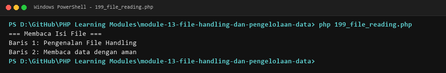

**Lokasi Source Code:** [199_file_reading.php](199_file_reading.php)

---

### 200. Menulis file

**Tujuan Pembelajaran:**
Memahami dan menguasai konsep `Menulis file` dalam bahasa pemrograman PHP serta mampu menerapkannya dalam kode program mandiri.

**Konsep Utama:**
Konsep dasar `Menulis file` mencakup mekanisme kerja, sintaks resmi bahasa PHP, serta peran edukatifnya dalam pengembangan perangkat lunak.

**Penjelasan Source Code:**
Berkas `200_file_writing.php` mendemonstrasikan implementasi terisolasi dari `Menulis file` dengan komentar penjelasan edukatif berbahasa Indonesia pada setiap bagian kode penting, tanpa overengineering.

**Cara Menjalankan:**
```bash
php 200_file_writing.php
```

**Hasil yang Diharapkan:**
Program menampilkan demonstrasi komputasi dan output teks yang valid sesuai topik `Menulis file`.

**Screenshot Hasil Eksekusi:**
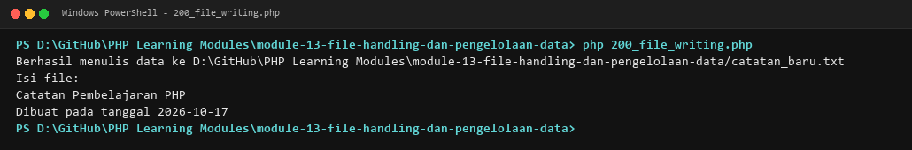

**Lokasi Source Code:** [200_file_writing.php](200_file_writing.php)

---

### 201. Menambahkan isi file

**Tujuan Pembelajaran:**
Memahami dan menguasai konsep `Menambahkan isi file` dalam bahasa pemrograman PHP serta mampu menerapkannya dalam kode program mandiri.

**Konsep Utama:**
Konsep dasar `Menambahkan isi file` mencakup mekanisme kerja, sintaks resmi bahasa PHP, serta peran edukatifnya dalam pengembangan perangkat lunak.

**Penjelasan Source Code:**
Berkas `201_file_append.php` mendemonstrasikan implementasi terisolasi dari `Menambahkan isi file` dengan komentar penjelasan edukatif berbahasa Indonesia pada setiap bagian kode penting, tanpa overengineering.

**Cara Menjalankan:**
```bash
php 201_file_append.php
```

**Hasil yang Diharapkan:**
Program menampilkan demonstrasi komputasi dan output teks yang valid sesuai topik `Menambahkan isi file`.

**Screenshot Hasil Eksekusi:**
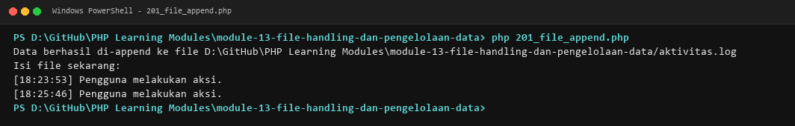

**Lokasi Source Code:** [201_file_append.php](201_file_append.php)

---

### 202. Mengambil isi file

**Tujuan Pembelajaran:**
Memahami dan menguasai konsep `Mengambil isi file` dalam bahasa pemrograman PHP serta mampu menerapkannya dalam kode program mandiri.

**Konsep Utama:**
Konsep dasar `Mengambil isi file` mencakup mekanisme kerja, sintaks resmi bahasa PHP, serta peran edukatifnya dalam pengembangan perangkat lunak.

**Penjelasan Source Code:**
Berkas `202_file_get_contents.php` mendemonstrasikan implementasi terisolasi dari `Mengambil isi file` dengan komentar penjelasan edukatif berbahasa Indonesia pada setiap bagian kode penting, tanpa overengineering.

**Cara Menjalankan:**
```bash
php 202_file_get_contents.php
```

**Hasil yang Diharapkan:**
Program menampilkan demonstrasi komputasi dan output teks yang valid sesuai topik `Mengambil isi file`.

**Screenshot Hasil Eksekusi:**
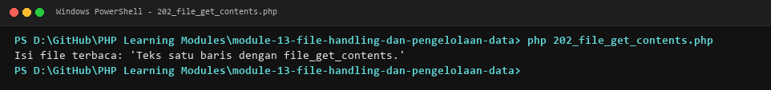

**Lokasi Source Code:** [202_file_get_contents.php](202_file_get_contents.php)

---

### 203. Menulis isi file

**Tujuan Pembelajaran:**
Memahami dan menguasai konsep `Menulis isi file` dalam bahasa pemrograman PHP serta mampu menerapkannya dalam kode program mandiri.

**Konsep Utama:**
Konsep dasar `Menulis isi file` mencakup mekanisme kerja, sintaks resmi bahasa PHP, serta peran edukatifnya dalam pengembangan perangkat lunak.

**Penjelasan Source Code:**
Berkas `203_file_put_contents.php` mendemonstrasikan implementasi terisolasi dari `Menulis isi file` dengan komentar penjelasan edukatif berbahasa Indonesia pada setiap bagian kode penting, tanpa overengineering.

**Cara Menjalankan:**
```bash
php 203_file_put_contents.php
```

**Hasil yang Diharapkan:**
Program menampilkan demonstrasi komputasi dan output teks yang valid sesuai topik `Menulis isi file`.

**Screenshot Hasil Eksekusi:**
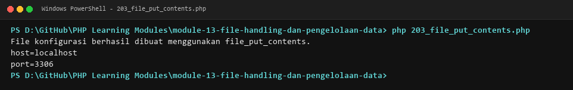

**Lokasi Source Code:** [203_file_put_contents.php](203_file_put_contents.php)

---

### 204. Memeriksa keberadaan file

**Tujuan Pembelajaran:**
Memahami dan menguasai konsep `Memeriksa keberadaan file` dalam bahasa pemrograman PHP serta mampu menerapkannya dalam kode program mandiri.

**Konsep Utama:**
Konsep dasar `Memeriksa keberadaan file` mencakup mekanisme kerja, sintaks resmi bahasa PHP, serta peran edukatifnya dalam pengembangan perangkat lunak.

**Penjelasan Source Code:**
Berkas `204_file_exists.php` mendemonstrasikan implementasi terisolasi dari `Memeriksa keberadaan file` dengan komentar penjelasan edukatif berbahasa Indonesia pada setiap bagian kode penting, tanpa overengineering.

**Cara Menjalankan:**
```bash
php 204_file_exists.php
```

**Hasil yang Diharapkan:**
Program menampilkan demonstrasi komputasi dan output teks yang valid sesuai topik `Memeriksa keberadaan file`.

**Screenshot Hasil Eksekusi:**
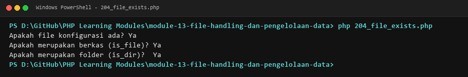

**Lokasi Source Code:** [204_file_exists.php](204_file_exists.php)

---

### 205. Operasi direktori

**Tujuan Pembelajaran:**
Memahami dan menguasai konsep `Operasi direktori` dalam bahasa pemrograman PHP serta mampu menerapkannya dalam kode program mandiri.

**Konsep Utama:**
Konsep dasar `Operasi direktori` mencakup mekanisme kerja, sintaks resmi bahasa PHP, serta peran edukatifnya dalam pengembangan perangkat lunak.

**Penjelasan Source Code:**
Berkas `205_directory_operations.php` mendemonstrasikan implementasi terisolasi dari `Operasi direktori` dengan komentar penjelasan edukatif berbahasa Indonesia pada setiap bagian kode penting, tanpa overengineering.

**Cara Menjalankan:**
```bash
php 205_directory_operations.php
```

**Hasil yang Diharapkan:**
Program menampilkan demonstrasi komputasi dan output teks yang valid sesuai topik `Operasi direktori`.

**Screenshot Hasil Eksekusi:**
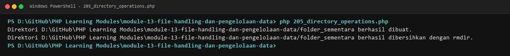

**Lokasi Source Code:** [205_directory_operations.php](205_directory_operations.php)

---

### 206. Iterasi isi direktori

**Tujuan Pembelajaran:**
Memahami dan menguasai konsep `Iterasi isi direktori` dalam bahasa pemrograman PHP serta mampu menerapkannya dalam kode program mandiri.

**Konsep Utama:**
Konsep dasar `Iterasi isi direktori` mencakup mekanisme kerja, sintaks resmi bahasa PHP, serta peran edukatifnya dalam pengembangan perangkat lunak.

**Penjelasan Source Code:**
Berkas `206_directory_iteration.php` mendemonstrasikan implementasi terisolasi dari `Iterasi isi direktori` dengan komentar penjelasan edukatif berbahasa Indonesia pada setiap bagian kode penting, tanpa overengineering.

**Cara Menjalankan:**
```bash
php 206_directory_iteration.php
```

**Hasil yang Diharapkan:**
Program menampilkan demonstrasi komputasi dan output teks yang valid sesuai topik `Iterasi isi direktori`.

**Screenshot Hasil Eksekusi:**
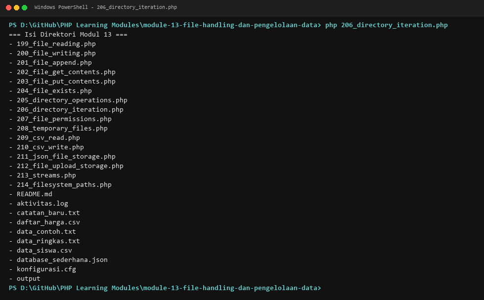

**Lokasi Source Code:** [206_directory_iteration.php](206_directory_iteration.php)

---

### 207. Pemeriksaan izin file

**Tujuan Pembelajaran:**
Memahami dan menguasai konsep `Pemeriksaan izin file` dalam bahasa pemrograman PHP serta mampu menerapkannya dalam kode program mandiri.

**Konsep Utama:**
Konsep dasar `Pemeriksaan izin file` mencakup mekanisme kerja, sintaks resmi bahasa PHP, serta peran edukatifnya dalam pengembangan perangkat lunak.

**Penjelasan Source Code:**
Berkas `207_file_permissions.php` mendemonstrasikan implementasi terisolasi dari `Pemeriksaan izin file` dengan komentar penjelasan edukatif berbahasa Indonesia pada setiap bagian kode penting, tanpa overengineering.

**Cara Menjalankan:**
```bash
php 207_file_permissions.php
```

**Hasil yang Diharapkan:**
Program menampilkan demonstrasi komputasi dan output teks yang valid sesuai topik `Pemeriksaan izin file`.

**Screenshot Hasil Eksekusi:**
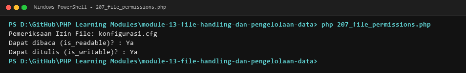

**Lokasi Source Code:** [207_file_permissions.php](207_file_permissions.php)

---

### 208. File sementara

**Tujuan Pembelajaran:**
Memahami dan menguasai konsep `File sementara` dalam bahasa pemrograman PHP serta mampu menerapkannya dalam kode program mandiri.

**Konsep Utama:**
Konsep dasar `File sementara` mencakup mekanisme kerja, sintaks resmi bahasa PHP, serta peran edukatifnya dalam pengembangan perangkat lunak.

**Penjelasan Source Code:**
Berkas `208_temporary_files.php` mendemonstrasikan implementasi terisolasi dari `File sementara` dengan komentar penjelasan edukatif berbahasa Indonesia pada setiap bagian kode penting, tanpa overengineering.

**Cara Menjalankan:**
```bash
php 208_temporary_files.php
```

**Hasil yang Diharapkan:**
Program menampilkan demonstrasi komputasi dan output teks yang valid sesuai topik `File sementara`.

**Screenshot Hasil Eksekusi:**
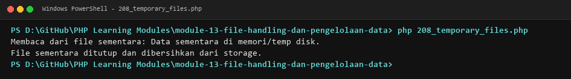

**Lokasi Source Code:** [208_temporary_files.php](208_temporary_files.php)

---

### 209. Membaca CSV

**Tujuan Pembelajaran:**
Memahami dan menguasai konsep `Membaca CSV` dalam bahasa pemrograman PHP serta mampu menerapkannya dalam kode program mandiri.

**Konsep Utama:**
Konsep dasar `Membaca CSV` mencakup mekanisme kerja, sintaks resmi bahasa PHP, serta peran edukatifnya dalam pengembangan perangkat lunak.

**Penjelasan Source Code:**
Berkas `209_csv_read.php` mendemonstrasikan implementasi terisolasi dari `Membaca CSV` dengan komentar penjelasan edukatif berbahasa Indonesia pada setiap bagian kode penting, tanpa overengineering.

**Cara Menjalankan:**
```bash
php 209_csv_read.php
```

**Hasil yang Diharapkan:**
Program menampilkan demonstrasi komputasi dan output teks yang valid sesuai topik `Membaca CSV`.

**Screenshot Hasil Eksekusi:**
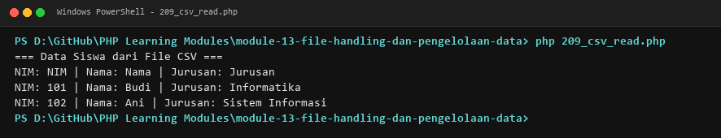

**Lokasi Source Code:** [209_csv_read.php](209_csv_read.php)

---

### 210. Menulis CSV

**Tujuan Pembelajaran:**
Memahami dan menguasai konsep `Menulis CSV` dalam bahasa pemrograman PHP serta mampu menerapkannya dalam kode program mandiri.

**Konsep Utama:**
Konsep dasar `Menulis CSV` mencakup mekanisme kerja, sintaks resmi bahasa PHP, serta peran edukatifnya dalam pengembangan perangkat lunak.

**Penjelasan Source Code:**
Berkas `210_csv_write.php` mendemonstrasikan implementasi terisolasi dari `Menulis CSV` dengan komentar penjelasan edukatif berbahasa Indonesia pada setiap bagian kode penting, tanpa overengineering.

**Cara Menjalankan:**
```bash
php 210_csv_write.php
```

**Hasil yang Diharapkan:**
Program menampilkan demonstrasi komputasi dan output teks yang valid sesuai topik `Menulis CSV`.

**Screenshot Hasil Eksekusi:**
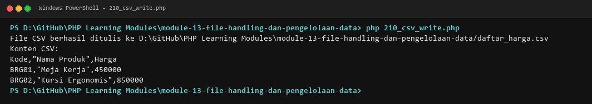

**Lokasi Source Code:** [210_csv_write.php](210_csv_write.php)

---

### 211. Penyimpanan data dalam JSON

**Tujuan Pembelajaran:**
Memahami dan menguasai konsep `Penyimpanan data dalam JSON` dalam bahasa pemrograman PHP serta mampu menerapkannya dalam kode program mandiri.

**Konsep Utama:**
Konsep dasar `Penyimpanan data dalam JSON` mencakup mekanisme kerja, sintaks resmi bahasa PHP, serta peran edukatifnya dalam pengembangan perangkat lunak.

**Penjelasan Source Code:**
Berkas `211_json_file_storage.php` mendemonstrasikan implementasi terisolasi dari `Penyimpanan data dalam JSON` dengan komentar penjelasan edukatif berbahasa Indonesia pada setiap bagian kode penting, tanpa overengineering.

**Cara Menjalankan:**
```bash
php 211_json_file_storage.php
```

**Hasil yang Diharapkan:**
Program menampilkan demonstrasi komputasi dan output teks yang valid sesuai topik `Penyimpanan data dalam JSON`.

**Screenshot Hasil Eksekusi:**
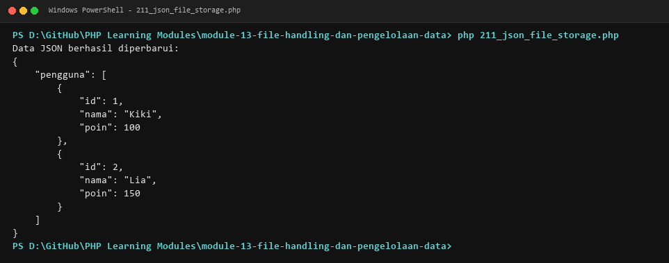

**Lokasi Source Code:** [211_json_file_storage.php](211_json_file_storage.php)

---

### 212. Penyimpanan file unggahan

**Tujuan Pembelajaran:**
Memahami dan menguasai konsep `Penyimpanan file unggahan` dalam bahasa pemrograman PHP serta mampu menerapkannya dalam kode program mandiri.

**Konsep Utama:**
Konsep dasar `Penyimpanan file unggahan` mencakup mekanisme kerja, sintaks resmi bahasa PHP, serta peran edukatifnya dalam pengembangan perangkat lunak.

**Penjelasan Source Code:**
Berkas `212_file_upload_storage.php` mendemonstrasikan implementasi terisolasi dari `Penyimpanan file unggahan` dengan komentar penjelasan edukatif berbahasa Indonesia pada setiap bagian kode penting, tanpa overengineering.

**Cara Menjalankan:**
```bash
php 212_file_upload_storage.php
```

**Hasil yang Diharapkan:**
Program menampilkan demonstrasi komputasi dan output teks yang valid sesuai topik `Penyimpanan file unggahan`.

**Screenshot Hasil Eksekusi:**
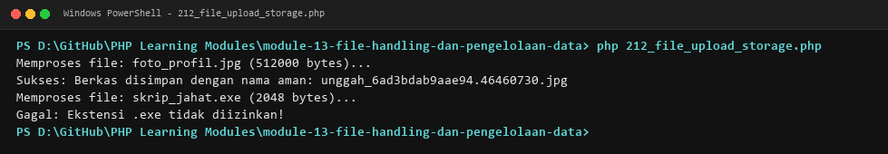

**Lokasi Source Code:** [212_file_upload_storage.php](212_file_upload_storage.php)

---

### 213. PHP streams

**Tujuan Pembelajaran:**
Memahami dan menguasai konsep `PHP streams` dalam bahasa pemrograman PHP serta mampu menerapkannya dalam kode program mandiri.

**Konsep Utama:**
Konsep dasar `PHP streams` mencakup mekanisme kerja, sintaks resmi bahasa PHP, serta peran edukatifnya dalam pengembangan perangkat lunak.

**Penjelasan Source Code:**
Berkas `213_streams.php` mendemonstrasikan implementasi terisolasi dari `PHP streams` dengan komentar penjelasan edukatif berbahasa Indonesia pada setiap bagian kode penting, tanpa overengineering.

**Cara Menjalankan:**
```bash
php 213_streams.php
```

**Hasil yang Diharapkan:**
Program menampilkan demonstrasi komputasi dan output teks yang valid sesuai topik `PHP streams`.

**Screenshot Hasil Eksekusi:**
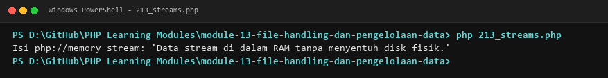

**Lokasi Source Code:** [213_streams.php](213_streams.php)

---

### 214. Pengelolaan path file

**Tujuan Pembelajaran:**
Memahami dan menguasai konsep `Pengelolaan path file` dalam bahasa pemrograman PHP serta mampu menerapkannya dalam kode program mandiri.

**Konsep Utama:**
Konsep dasar `Pengelolaan path file` mencakup mekanisme kerja, sintaks resmi bahasa PHP, serta peran edukatifnya dalam pengembangan perangkat lunak.

**Penjelasan Source Code:**
Berkas `214_filesystem_paths.php` mendemonstrasikan implementasi terisolasi dari `Pengelolaan path file` dengan komentar penjelasan edukatif berbahasa Indonesia pada setiap bagian kode penting, tanpa overengineering.

**Cara Menjalankan:**
```bash
php 214_filesystem_paths.php
```

**Hasil yang Diharapkan:**
Program menampilkan demonstrasi komputasi dan output teks yang valid sesuai topik `Pengelolaan path file`.

**Screenshot Hasil Eksekusi:**
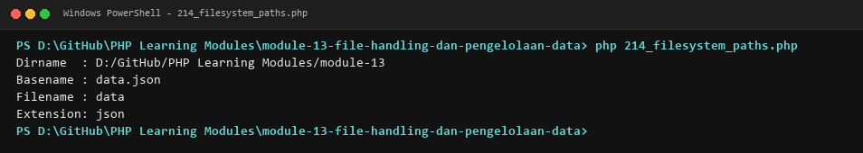

**Lokasi Source Code:** [214_filesystem_paths.php](214_filesystem_paths.php)

---

## Ringkasan Modul
Modul 13 (File Handling dan Pengelolaan Data) memberikan pemahaman menyeluruh mengenai operasi membaca dan menulis file, manipulasi berkas aman, pemeriksaan status file, operasi folder/direktori, hak akses, file sementara (temp), pengolahan format csv, persistensi data json, simulasi upload berkas, stream i/o, dan penanganan path file. Seluruh 16 submodul dirancang terpisah dan mandiri sehingga mudah dipelajari langkah demi langkah.
