# MODUL 14: PHP untuk Web dan HTTP

## Ringkasan Ruang Lingkup Materi
Integrasi PHP dan HTML, templating dinamis, superglobals ($_GET, $_POST, $_SERVER, $_SESSION, $_COOKIE, $_FILES), penanganan form, validasi formulir, sanitasi input, proteksi XSS (escaping), autentikasi session, manipulasi HTTP header, status code, redirect, dan perancangan router web.

## Tujuan Pembelajaran
Mampu mengembangkan aplikasi web dinamis di sisi server yang aman dan berkinerja tinggi.

---

## Daftar Submodul Pembelajaran

- [215_php_html_integration.php](215_php_html_integration.php) : Integrasi PHP dan HTML
- [216_php_template_output.php](216_php_template_output.php) : Menampilkan data dinamis
- [217_superglobal_variables.php](217_superglobal_variables.php) : Superglobals PHP
- [218_get_parameters.php](218_get_parameters.php) : Parameter `$_GET`
- [219_post_parameters.php](219_post_parameters.php) : Parameter `$_POST`
- [220_request_method.php](220_request_method.php) : Pemeriksaan metode HTTP
- [221_form_submission.php](221_form_submission.php) : Pemrosesan formulir
- [222_form_validation.php](222_form_validation.php) : Validasi formulir web
- [223_form_sanitization.php](223_form_sanitization.php) : Sanitasi output dan input sesuai konteks
- [224_html_escaping.php](224_html_escaping.php) : HTML escaping
- [225_file_upload.php](225_file_upload.php) : Unggah file
- [226_cookie_management.php](226_cookie_management.php) : Pengelolaan cookie
- [227_session_basic.php](227_session_basic.php) : Session
- [228_session_login.php](228_session_login.php) : Session untuk autentikasi
- [229_http_headers.php](229_http_headers.php) : HTTP headers
- [230_http_status_codes.php](230_http_status_codes.php) : HTTP status codes
- [231_redirect_handling.php](231_redirect_handling.php) : Redirect
- [232_response_content_type.php](232_response_content_type.php) : Content-Type
- [233_server_variables.php](233_server_variables.php) : Variabel `$_SERVER`
- [234_php_router_basic.php](234_php_router_basic.php) : Routing web dasar

---

## Penjelasan Setiap Submodul

### 215. Integrasi PHP dan HTML

**Tujuan Pembelajaran:**
Memahami dan menguasai konsep `Integrasi PHP dan HTML` dalam bahasa pemrograman PHP serta mampu menerapkannya dalam kode program mandiri.

**Konsep Utama:**
Konsep dasar `Integrasi PHP dan HTML` mencakup mekanisme kerja, sintaks resmi bahasa PHP, serta peran edukatifnya dalam pengembangan perangkat lunak.

**Penjelasan Source Code:**
Berkas `215_php_html_integration.php` mendemonstrasikan implementasi terisolasi dari `Integrasi PHP dan HTML` dengan komentar penjelasan edukatif berbahasa Indonesia pada setiap bagian kode penting, tanpa overengineering.

**Cara Menjalankan:**
```bash
php 215_php_html_integration.php
```

**Hasil yang Diharapkan:**
Program menampilkan demonstrasi komputasi dan output teks yang valid sesuai topik `Integrasi PHP dan HTML`.

**Screenshot Hasil Eksekusi:**
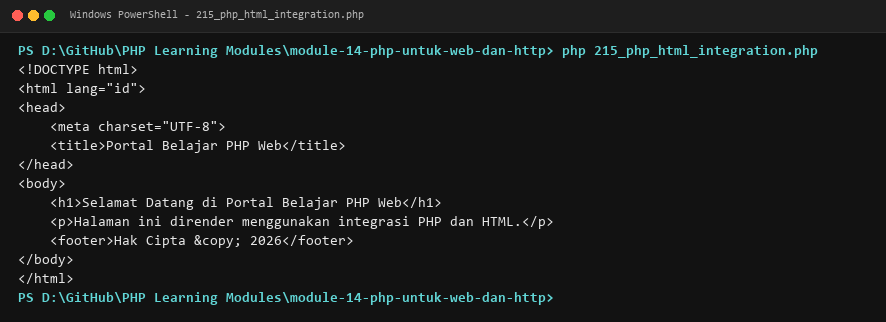

**Lokasi Source Code:** [215_php_html_integration.php](215_php_html_integration.php)

---

### 216. Menampilkan data dinamis

**Tujuan Pembelajaran:**
Memahami dan menguasai konsep `Menampilkan data dinamis` dalam bahasa pemrograman PHP serta mampu menerapkannya dalam kode program mandiri.

**Konsep Utama:**
Konsep dasar `Menampilkan data dinamis` mencakup mekanisme kerja, sintaks resmi bahasa PHP, serta peran edukatifnya dalam pengembangan perangkat lunak.

**Penjelasan Source Code:**
Berkas `216_php_template_output.php` mendemonstrasikan implementasi terisolasi dari `Menampilkan data dinamis` dengan komentar penjelasan edukatif berbahasa Indonesia pada setiap bagian kode penting, tanpa overengineering.

**Cara Menjalankan:**
```bash
php 216_php_template_output.php
```

**Hasil yang Diharapkan:**
Program menampilkan demonstrasi komputasi dan output teks yang valid sesuai topik `Menampilkan data dinamis`.

**Screenshot Hasil Eksekusi:**
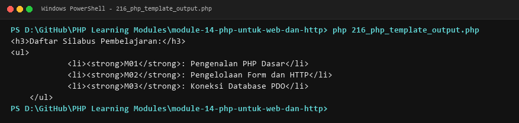

**Lokasi Source Code:** [216_php_template_output.php](216_php_template_output.php)

---

### 217. Superglobals PHP

**Tujuan Pembelajaran:**
Memahami dan menguasai konsep `Superglobals PHP` dalam bahasa pemrograman PHP serta mampu menerapkannya dalam kode program mandiri.

**Konsep Utama:**
Konsep dasar `Superglobals PHP` mencakup mekanisme kerja, sintaks resmi bahasa PHP, serta peran edukatifnya dalam pengembangan perangkat lunak.

**Penjelasan Source Code:**
Berkas `217_superglobal_variables.php` mendemonstrasikan implementasi terisolasi dari `Superglobals PHP` dengan komentar penjelasan edukatif berbahasa Indonesia pada setiap bagian kode penting, tanpa overengineering.

**Cara Menjalankan:**
```bash
php 217_superglobal_variables.php
```

**Hasil yang Diharapkan:**
Program menampilkan demonstrasi komputasi dan output teks yang valid sesuai topik `Superglobals PHP`.

**Screenshot Hasil Eksekusi:**
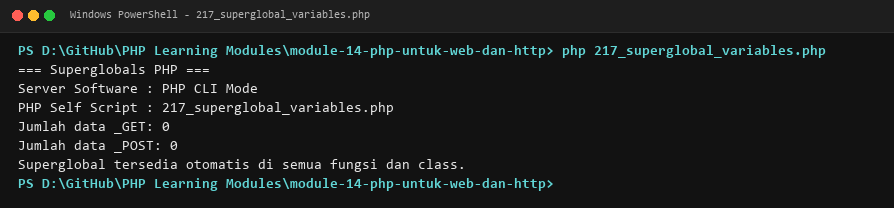

**Lokasi Source Code:** [217_superglobal_variables.php](217_superglobal_variables.php)

---

### 218. Parameter `$_GET`

**Tujuan Pembelajaran:**
Memahami dan menguasai konsep `Parameter `$_GET`` dalam bahasa pemrograman PHP serta mampu menerapkannya dalam kode program mandiri.

**Konsep Utama:**
Konsep dasar `Parameter `$_GET`` mencakup mekanisme kerja, sintaks resmi bahasa PHP, serta peran edukatifnya dalam pengembangan perangkat lunak.

**Penjelasan Source Code:**
Berkas `218_get_parameters.php` mendemonstrasikan implementasi terisolasi dari `Parameter `$_GET`` dengan komentar penjelasan edukatif berbahasa Indonesia pada setiap bagian kode penting, tanpa overengineering.

**Cara Menjalankan:**
```bash
php 218_get_parameters.php
```

**Hasil yang Diharapkan:**
Program menampilkan demonstrasi komputasi dan output teks yang valid sesuai topik `Parameter `$_GET``.

**Screenshot Hasil Eksekusi:**


**Lokasi Source Code:** [218_get_parameters.php](218_get_parameters.php)

---

### 219. Parameter `$_POST`

**Tujuan Pembelajaran:**
Memahami dan menguasai konsep `Parameter `$_POST`` dalam bahasa pemrograman PHP serta mampu menerapkannya dalam kode program mandiri.

**Konsep Utama:**
Konsep dasar `Parameter `$_POST`` mencakup mekanisme kerja, sintaks resmi bahasa PHP, serta peran edukatifnya dalam pengembangan perangkat lunak.

**Penjelasan Source Code:**
Berkas `219_post_parameters.php` mendemonstrasikan implementasi terisolasi dari `Parameter `$_POST`` dengan komentar penjelasan edukatif berbahasa Indonesia pada setiap bagian kode penting, tanpa overengineering.

**Cara Menjalankan:**
```bash
php 219_post_parameters.php
```

**Hasil yang Diharapkan:**
Program menampilkan demonstrasi komputasi dan output teks yang valid sesuai topik `Parameter `$_POST``.

**Screenshot Hasil Eksekusi:**


**Lokasi Source Code:** [219_post_parameters.php](219_post_parameters.php)

---

### 220. Pemeriksaan metode HTTP

**Tujuan Pembelajaran:**
Memahami dan menguasai konsep `Pemeriksaan metode HTTP` dalam bahasa pemrograman PHP serta mampu menerapkannya dalam kode program mandiri.

**Konsep Utama:**
Konsep dasar `Pemeriksaan metode HTTP` mencakup mekanisme kerja, sintaks resmi bahasa PHP, serta peran edukatifnya dalam pengembangan perangkat lunak.

**Penjelasan Source Code:**
Berkas `220_request_method.php` mendemonstrasikan implementasi terisolasi dari `Pemeriksaan metode HTTP` dengan komentar penjelasan edukatif berbahasa Indonesia pada setiap bagian kode penting, tanpa overengineering.

**Cara Menjalankan:**
```bash
php 220_request_method.php
```

**Hasil yang Diharapkan:**
Program menampilkan demonstrasi komputasi dan output teks yang valid sesuai topik `Pemeriksaan metode HTTP`.

**Screenshot Hasil Eksekusi:**
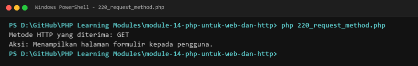

**Lokasi Source Code:** [220_request_method.php](220_request_method.php)

---

### 221. Pemrosesan formulir

**Tujuan Pembelajaran:**
Memahami dan menguasai konsep `Pemrosesan formulir` dalam bahasa pemrograman PHP serta mampu menerapkannya dalam kode program mandiri.

**Konsep Utama:**
Konsep dasar `Pemrosesan formulir` mencakup mekanisme kerja, sintaks resmi bahasa PHP, serta peran edukatifnya dalam pengembangan perangkat lunak.

**Penjelasan Source Code:**
Berkas `221_form_submission.php` mendemonstrasikan implementasi terisolasi dari `Pemrosesan formulir` dengan komentar penjelasan edukatif berbahasa Indonesia pada setiap bagian kode penting, tanpa overengineering.

**Cara Menjalankan:**
```bash
php 221_form_submission.php
```

**Hasil yang Diharapkan:**
Program menampilkan demonstrasi komputasi dan output teks yang valid sesuai topik `Pemrosesan formulir`.

**Screenshot Hasil Eksekusi:**
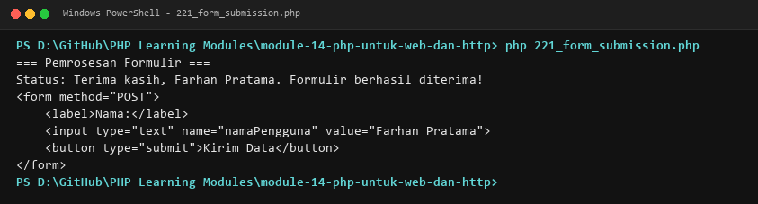

**Lokasi Source Code:** [221_form_submission.php](221_form_submission.php)

---

### 222. Validasi formulir web

**Tujuan Pembelajaran:**
Memahami dan menguasai konsep `Validasi formulir web` dalam bahasa pemrograman PHP serta mampu menerapkannya dalam kode program mandiri.

**Konsep Utama:**
Konsep dasar `Validasi formulir web` mencakup mekanisme kerja, sintaks resmi bahasa PHP, serta peran edukatifnya dalam pengembangan perangkat lunak.

**Penjelasan Source Code:**
Berkas `222_form_validation.php` mendemonstrasikan implementasi terisolasi dari `Validasi formulir web` dengan komentar penjelasan edukatif berbahasa Indonesia pada setiap bagian kode penting, tanpa overengineering.

**Cara Menjalankan:**
```bash
php 222_form_validation.php
```

**Hasil yang Diharapkan:**
Program menampilkan demonstrasi komputasi dan output teks yang valid sesuai topik `Validasi formulir web`.

**Screenshot Hasil Eksekusi:**
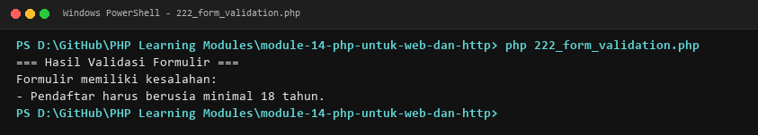

**Lokasi Source Code:** [222_form_validation.php](222_form_validation.php)

---

### 223. Sanitasi output dan input sesuai konteks

**Tujuan Pembelajaran:**
Memahami dan menguasai konsep `Sanitasi output dan input sesuai konteks` dalam bahasa pemrograman PHP serta mampu menerapkannya dalam kode program mandiri.

**Konsep Utama:**
Konsep dasar `Sanitasi output dan input sesuai konteks` mencakup mekanisme kerja, sintaks resmi bahasa PHP, serta peran edukatifnya dalam pengembangan perangkat lunak.

**Penjelasan Source Code:**
Berkas `223_form_sanitization.php` mendemonstrasikan implementasi terisolasi dari `Sanitasi output dan input sesuai konteks` dengan komentar penjelasan edukatif berbahasa Indonesia pada setiap bagian kode penting, tanpa overengineering.

**Cara Menjalankan:**
```bash
php 223_form_sanitization.php
```

**Hasil yang Diharapkan:**
Program menampilkan demonstrasi komputasi dan output teks yang valid sesuai topik `Sanitasi output dan input sesuai konteks`.

**Screenshot Hasil Eksekusi:**
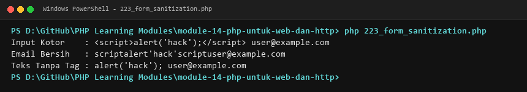

**Lokasi Source Code:** [223_form_sanitization.php](223_form_sanitization.php)

---

### 224. HTML escaping

**Tujuan Pembelajaran:**
Memahami dan menguasai konsep `HTML escaping` dalam bahasa pemrograman PHP serta mampu menerapkannya dalam kode program mandiri.

**Konsep Utama:**
Konsep dasar `HTML escaping` mencakup mekanisme kerja, sintaks resmi bahasa PHP, serta peran edukatifnya dalam pengembangan perangkat lunak.

**Penjelasan Source Code:**
Berkas `224_html_escaping.php` mendemonstrasikan implementasi terisolasi dari `HTML escaping` dengan komentar penjelasan edukatif berbahasa Indonesia pada setiap bagian kode penting, tanpa overengineering.

**Cara Menjalankan:**
```bash
php 224_html_escaping.php
```

**Hasil yang Diharapkan:**
Program menampilkan demonstrasi komputasi dan output teks yang valid sesuai topik `HTML escaping`.

**Screenshot Hasil Eksekusi:**
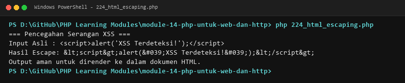

**Lokasi Source Code:** [224_html_escaping.php](224_html_escaping.php)

---

### 225. Unggah file

**Tujuan Pembelajaran:**
Memahami dan menguasai konsep `Unggah file` dalam bahasa pemrograman PHP serta mampu menerapkannya dalam kode program mandiri.

**Konsep Utama:**
Konsep dasar `Unggah file` mencakup mekanisme kerja, sintaks resmi bahasa PHP, serta peran edukatifnya dalam pengembangan perangkat lunak.

**Penjelasan Source Code:**
Berkas `225_file_upload.php` mendemonstrasikan implementasi terisolasi dari `Unggah file` dengan komentar penjelasan edukatif berbahasa Indonesia pada setiap bagian kode penting, tanpa overengineering.

**Cara Menjalankan:**
```bash
php 225_file_upload.php
```

**Hasil yang Diharapkan:**
Program menampilkan demonstrasi komputasi dan output teks yang valid sesuai topik `Unggah file`.

**Screenshot Hasil Eksekusi:**
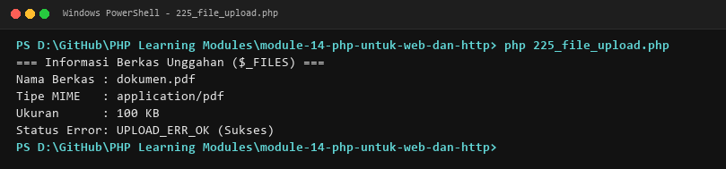

**Lokasi Source Code:** [225_file_upload.php](225_file_upload.php)

---

### 226. Pengelolaan cookie

**Tujuan Pembelajaran:**
Memahami dan menguasai konsep `Pengelolaan cookie` dalam bahasa pemrograman PHP serta mampu menerapkannya dalam kode program mandiri.

**Konsep Utama:**
Konsep dasar `Pengelolaan cookie` mencakup mekanisme kerja, sintaks resmi bahasa PHP, serta peran edukatifnya dalam pengembangan perangkat lunak.

**Penjelasan Source Code:**
Berkas `226_cookie_management.php` mendemonstrasikan implementasi terisolasi dari `Pengelolaan cookie` dengan komentar penjelasan edukatif berbahasa Indonesia pada setiap bagian kode penting, tanpa overengineering.

**Cara Menjalankan:**
```bash
php 226_cookie_management.php
```

**Hasil yang Diharapkan:**
Program menampilkan demonstrasi komputasi dan output teks yang valid sesuai topik `Pengelolaan cookie`.

**Screenshot Hasil Eksekusi:**
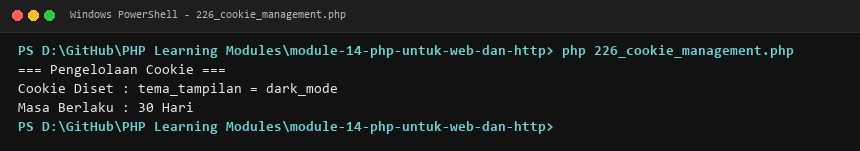

**Lokasi Source Code:** [226_cookie_management.php](226_cookie_management.php)

---

### 227. Session

**Tujuan Pembelajaran:**
Memahami dan menguasai konsep `Session` dalam bahasa pemrograman PHP serta mampu menerapkannya dalam kode program mandiri.

**Konsep Utama:**
Konsep dasar `Session` mencakup mekanisme kerja, sintaks resmi bahasa PHP, serta peran edukatifnya dalam pengembangan perangkat lunak.

**Penjelasan Source Code:**
Berkas `227_session_basic.php` mendemonstrasikan implementasi terisolasi dari `Session` dengan komentar penjelasan edukatif berbahasa Indonesia pada setiap bagian kode penting, tanpa overengineering.

**Cara Menjalankan:**
```bash
php 227_session_basic.php
```

**Hasil yang Diharapkan:**
Program menampilkan demonstrasi komputasi dan output teks yang valid sesuai topik `Session`.

**Screenshot Hasil Eksekusi:**
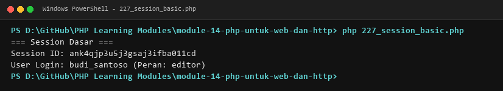

**Lokasi Source Code:** [227_session_basic.php](227_session_basic.php)

---

### 228. Session untuk autentikasi

**Tujuan Pembelajaran:**
Memahami dan menguasai konsep `Session untuk autentikasi` dalam bahasa pemrograman PHP serta mampu menerapkannya dalam kode program mandiri.

**Konsep Utama:**
Konsep dasar `Session untuk autentikasi` mencakup mekanisme kerja, sintaks resmi bahasa PHP, serta peran edukatifnya dalam pengembangan perangkat lunak.

**Penjelasan Source Code:**
Berkas `228_session_login.php` mendemonstrasikan implementasi terisolasi dari `Session untuk autentikasi` dengan komentar penjelasan edukatif berbahasa Indonesia pada setiap bagian kode penting, tanpa overengineering.

**Cara Menjalankan:**
```bash
php 228_session_login.php
```

**Hasil yang Diharapkan:**
Program menampilkan demonstrasi komputasi dan output teks yang valid sesuai topik `Session untuk autentikasi`.

**Screenshot Hasil Eksekusi:**
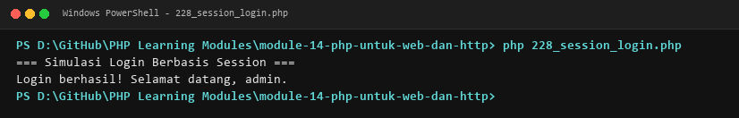

**Lokasi Source Code:** [228_session_login.php](228_session_login.php)

---

### 229. HTTP headers

**Tujuan Pembelajaran:**
Memahami dan menguasai konsep `HTTP headers` dalam bahasa pemrograman PHP serta mampu menerapkannya dalam kode program mandiri.

**Konsep Utama:**
Konsep dasar `HTTP headers` mencakup mekanisme kerja, sintaks resmi bahasa PHP, serta peran edukatifnya dalam pengembangan perangkat lunak.

**Penjelasan Source Code:**
Berkas `229_http_headers.php` mendemonstrasikan implementasi terisolasi dari `HTTP headers` dengan komentar penjelasan edukatif berbahasa Indonesia pada setiap bagian kode penting, tanpa overengineering.

**Cara Menjalankan:**
```bash
php 229_http_headers.php
```

**Hasil yang Diharapkan:**
Program menampilkan demonstrasi komputasi dan output teks yang valid sesuai topik `HTTP headers`.

**Screenshot Hasil Eksekusi:**
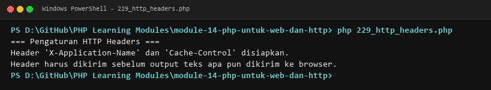

**Lokasi Source Code:** [229_http_headers.php](229_http_headers.php)

---

### 230. HTTP status codes

**Tujuan Pembelajaran:**
Memahami dan menguasai konsep `HTTP status codes` dalam bahasa pemrograman PHP serta mampu menerapkannya dalam kode program mandiri.

**Konsep Utama:**
Konsep dasar `HTTP status codes` mencakup mekanisme kerja, sintaks resmi bahasa PHP, serta peran edukatifnya dalam pengembangan perangkat lunak.

**Penjelasan Source Code:**
Berkas `230_http_status_codes.php` mendemonstrasikan implementasi terisolasi dari `HTTP status codes` dengan komentar penjelasan edukatif berbahasa Indonesia pada setiap bagian kode penting, tanpa overengineering.

**Cara Menjalankan:**
```bash
php 230_http_status_codes.php
```

**Hasil yang Diharapkan:**
Program menampilkan demonstrasi komputasi dan output teks yang valid sesuai topik `HTTP status codes`.

**Screenshot Hasil Eksekusi:**
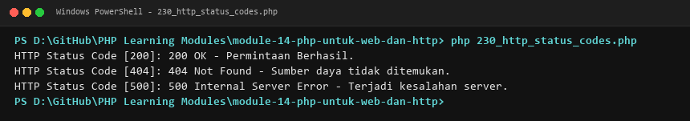

**Lokasi Source Code:** [230_http_status_codes.php](230_http_status_codes.php)

---

### 231. Redirect

**Tujuan Pembelajaran:**
Memahami dan menguasai konsep `Redirect` dalam bahasa pemrograman PHP serta mampu menerapkannya dalam kode program mandiri.

**Konsep Utama:**
Konsep dasar `Redirect` mencakup mekanisme kerja, sintaks resmi bahasa PHP, serta peran edukatifnya dalam pengembangan perangkat lunak.

**Penjelasan Source Code:**
Berkas `231_redirect_handling.php` mendemonstrasikan implementasi terisolasi dari `Redirect` dengan komentar penjelasan edukatif berbahasa Indonesia pada setiap bagian kode penting, tanpa overengineering.

**Cara Menjalankan:**
```bash
php 231_redirect_handling.php
```

**Hasil yang Diharapkan:**
Program menampilkan demonstrasi komputasi dan output teks yang valid sesuai topik `Redirect`.

**Screenshot Hasil Eksekusi:**
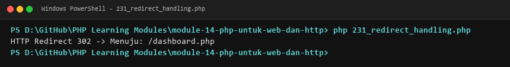

**Lokasi Source Code:** [231_redirect_handling.php](231_redirect_handling.php)

---

### 232. Content-Type

**Tujuan Pembelajaran:**
Memahami dan menguasai konsep `Content-Type` dalam bahasa pemrograman PHP serta mampu menerapkannya dalam kode program mandiri.

**Konsep Utama:**
Konsep dasar `Content-Type` mencakup mekanisme kerja, sintaks resmi bahasa PHP, serta peran edukatifnya dalam pengembangan perangkat lunak.

**Penjelasan Source Code:**
Berkas `232_response_content_type.php` mendemonstrasikan implementasi terisolasi dari `Content-Type` dengan komentar penjelasan edukatif berbahasa Indonesia pada setiap bagian kode penting, tanpa overengineering.

**Cara Menjalankan:**
```bash
php 232_response_content_type.php
```

**Hasil yang Diharapkan:**
Program menampilkan demonstrasi komputasi dan output teks yang valid sesuai topik `Content-Type`.

**Screenshot Hasil Eksekusi:**
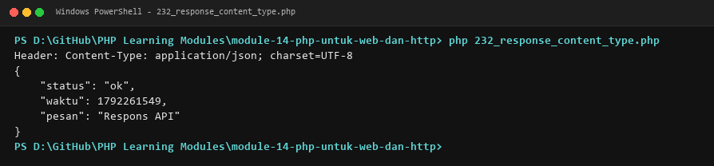

**Lokasi Source Code:** [232_response_content_type.php](232_response_content_type.php)

---

### 233. Variabel `$_SERVER`

**Tujuan Pembelajaran:**
Memahami dan menguasai konsep `Variabel `$_SERVER`` dalam bahasa pemrograman PHP serta mampu menerapkannya dalam kode program mandiri.

**Konsep Utama:**
Konsep dasar `Variabel `$_SERVER`` mencakup mekanisme kerja, sintaks resmi bahasa PHP, serta peran edukatifnya dalam pengembangan perangkat lunak.

**Penjelasan Source Code:**
Berkas `233_server_variables.php` mendemonstrasikan implementasi terisolasi dari `Variabel `$_SERVER`` dengan komentar penjelasan edukatif berbahasa Indonesia pada setiap bagian kode penting, tanpa overengineering.

**Cara Menjalankan:**
```bash
php 233_server_variables.php
```

**Hasil yang Diharapkan:**
Program menampilkan demonstrasi komputasi dan output teks yang valid sesuai topik `Variabel `$_SERVER``.

**Screenshot Hasil Eksekusi:**


**Lokasi Source Code:** [233_server_variables.php](233_server_variables.php)

---

### 234. Routing web dasar

**Tujuan Pembelajaran:**
Memahami dan menguasai konsep `Routing web dasar` dalam bahasa pemrograman PHP serta mampu menerapkannya dalam kode program mandiri.

**Konsep Utama:**
Konsep dasar `Routing web dasar` mencakup mekanisme kerja, sintaks resmi bahasa PHP, serta peran edukatifnya dalam pengembangan perangkat lunak.

**Penjelasan Source Code:**
Berkas `234_php_router_basic.php` mendemonstrasikan implementasi terisolasi dari `Routing web dasar` dengan komentar penjelasan edukatif berbahasa Indonesia pada setiap bagian kode penting, tanpa overengineering.

**Cara Menjalankan:**
```bash
php 234_php_router_basic.php
```

**Hasil yang Diharapkan:**
Program menampilkan demonstrasi komputasi dan output teks yang valid sesuai topik `Routing web dasar`.

**Screenshot Hasil Eksekusi:**
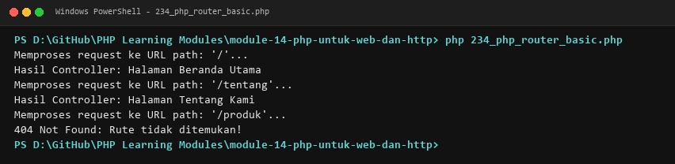

**Lokasi Source Code:** [234_php_router_basic.php](234_php_router_basic.php)

---

## Ringkasan Modul
Modul 14 (PHP untuk Web dan HTTP) memberikan pemahaman menyeluruh mengenai integrasi php dan html, templating dinamis, superglobals ($_get, $_post, $_server, $_session, $_cookie, $_files), penanganan form, validasi formulir, sanitasi input, proteksi xss (escaping), autentikasi session, manipulasi http header, status code, redirect, dan perancangan router web. Seluruh 20 submodul dirancang terpisah dan mandiri sehingga mudah dipelajari langkah demi langkah.
