# MODUL 15: Database dan SQL dengan PHP

## Ringkasan Ruang Lingkup Materi
PHP Data Objects (PDO), koneksi basis data aman, eksekusi query SQL, prepared statements, parameter binding, operasi CRUD, transaksi database (ACID), penanganan error database, pagination, pencarian data, relasi tabel (JOIN), repository pattern, dan migrasi skema basis data.

## Tujuan Pembelajaran
Mahir mengintegrasikan aplikasi PHP dengan basis data relasional secara aman dan terstruktur.

---

## Daftar Submodul Pembelajaran

- [235_pdo_connection.php](235_pdo_connection.php) : Koneksi database menggunakan PDO
- [236_pdo_query.php](236_pdo_query.php) : Menjalankan query
- [237_pdo_prepared_statements.php](237_pdo_prepared_statements.php) : Prepared statements
- [238_pdo_parameter_binding.php](238_pdo_parameter_binding.php) : Parameter binding
- [239_pdo_insert.php](239_pdo_insert.php) : Insert data
- [240_pdo_select.php](240_pdo_select.php) : Select data
- [241_pdo_update.php](241_pdo_update.php) : Update data
- [242_pdo_delete.php](242_pdo_delete.php) : Delete data
- [243_pdo_transactions.php](243_pdo_transactions.php) : Transaksi database
- [244_pdo_error_handling.php](244_pdo_error_handling.php) : Penanganan error database
- [245_pagination.php](245_pagination.php) : Pagination data
- [246_search_database.php](246_search_database.php) : Pencarian data
- [247_mysql_relationships.php](247_mysql_relationships.php) : Relasi tabel database
- [248_database_repository.php](248_database_repository.php) : Repository database
- [249_sqlite_database.php](249_sqlite_database.php) : Integrasi SQLite
- [250_database_migrations_basic.php](250_database_migrations_basic.php) : Konsep migrasi database

---

## Penjelasan Setiap Submodul

### 235. Koneksi database menggunakan PDO

**Tujuan Pembelajaran:**
Memahami dan menguasai konsep `Koneksi database menggunakan PDO` dalam bahasa pemrograman PHP serta mampu menerapkannya dalam kode program mandiri.

**Konsep Utama:**
Konsep dasar `Koneksi database menggunakan PDO` mencakup mekanisme kerja, sintaks resmi bahasa PHP, serta peran edukatifnya dalam pengembangan perangkat lunak.

**Penjelasan Source Code:**
Berkas `235_pdo_connection.php` mendemonstrasikan implementasi terisolasi dari `Koneksi database menggunakan PDO` dengan komentar penjelasan edukatif berbahasa Indonesia pada setiap bagian kode penting, tanpa overengineering.

**Cara Menjalankan:**
```bash
php 235_pdo_connection.php
```

**Hasil yang Diharapkan:**
Program menampilkan demonstrasi komputasi dan output teks yang valid sesuai topik `Koneksi database menggunakan PDO`.

**Screenshot Hasil Eksekusi:**
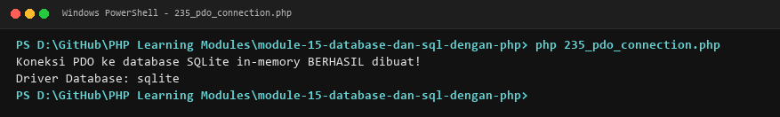

**Lokasi Source Code:** [235_pdo_connection.php](235_pdo_connection.php)

---

### 236. Menjalankan query

**Tujuan Pembelajaran:**
Memahami dan menguasai konsep `Menjalankan query` dalam bahasa pemrograman PHP serta mampu menerapkannya dalam kode program mandiri.

**Konsep Utama:**
Konsep dasar `Menjalankan query` mencakup mekanisme kerja, sintaks resmi bahasa PHP, serta peran edukatifnya dalam pengembangan perangkat lunak.

**Penjelasan Source Code:**
Berkas `236_pdo_query.php` mendemonstrasikan implementasi terisolasi dari `Menjalankan query` dengan komentar penjelasan edukatif berbahasa Indonesia pada setiap bagian kode penting, tanpa overengineering.

**Cara Menjalankan:**
```bash
php 236_pdo_query.php
```

**Hasil yang Diharapkan:**
Program menampilkan demonstrasi komputasi dan output teks yang valid sesuai topik `Menjalankan query`.

**Screenshot Hasil Eksekusi:**
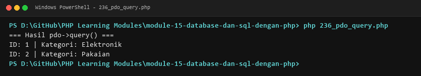

**Lokasi Source Code:** [236_pdo_query.php](236_pdo_query.php)

---

### 237. Prepared statements

**Tujuan Pembelajaran:**
Memahami dan menguasai konsep `Prepared statements` dalam bahasa pemrograman PHP serta mampu menerapkannya dalam kode program mandiri.

**Konsep Utama:**
Konsep dasar `Prepared statements` mencakup mekanisme kerja, sintaks resmi bahasa PHP, serta peran edukatifnya dalam pengembangan perangkat lunak.

**Penjelasan Source Code:**
Berkas `237_pdo_prepared_statements.php` mendemonstrasikan implementasi terisolasi dari `Prepared statements` dengan komentar penjelasan edukatif berbahasa Indonesia pada setiap bagian kode penting, tanpa overengineering.

**Cara Menjalankan:**
```bash
php 237_pdo_prepared_statements.php
```

**Hasil yang Diharapkan:**
Program menampilkan demonstrasi komputasi dan output teks yang valid sesuai topik `Prepared statements`.

**Screenshot Hasil Eksekusi:**
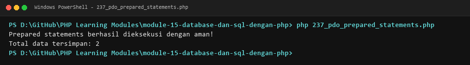

**Lokasi Source Code:** [237_pdo_prepared_statements.php](237_pdo_prepared_statements.php)

---

### 238. Parameter binding

**Tujuan Pembelajaran:**
Memahami dan menguasai konsep `Parameter binding` dalam bahasa pemrograman PHP serta mampu menerapkannya dalam kode program mandiri.

**Konsep Utama:**
Konsep dasar `Parameter binding` mencakup mekanisme kerja, sintaks resmi bahasa PHP, serta peran edukatifnya dalam pengembangan perangkat lunak.

**Penjelasan Source Code:**
Berkas `238_pdo_parameter_binding.php` mendemonstrasikan implementasi terisolasi dari `Parameter binding` dengan komentar penjelasan edukatif berbahasa Indonesia pada setiap bagian kode penting, tanpa overengineering.

**Cara Menjalankan:**
```bash
php 238_pdo_parameter_binding.php
```

**Hasil yang Diharapkan:**
Program menampilkan demonstrasi komputasi dan output teks yang valid sesuai topik `Parameter binding`.

**Screenshot Hasil Eksekusi:**
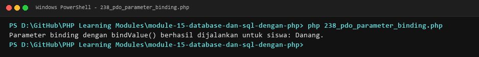

**Lokasi Source Code:** [238_pdo_parameter_binding.php](238_pdo_parameter_binding.php)

---

### 239. Insert data

**Tujuan Pembelajaran:**
Memahami dan menguasai konsep `Insert data` dalam bahasa pemrograman PHP serta mampu menerapkannya dalam kode program mandiri.

**Konsep Utama:**
Konsep dasar `Insert data` mencakup mekanisme kerja, sintaks resmi bahasa PHP, serta peran edukatifnya dalam pengembangan perangkat lunak.

**Penjelasan Source Code:**
Berkas `239_pdo_insert.php` mendemonstrasikan implementasi terisolasi dari `Insert data` dengan komentar penjelasan edukatif berbahasa Indonesia pada setiap bagian kode penting, tanpa overengineering.

**Cara Menjalankan:**
```bash
php 239_pdo_insert.php
```

**Hasil yang Diharapkan:**
Program menampilkan demonstrasi komputasi dan output teks yang valid sesuai topik `Insert data`.

**Screenshot Hasil Eksekusi:**
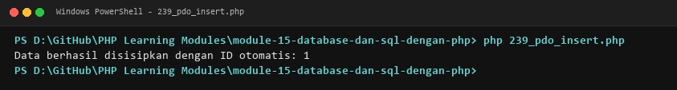

**Lokasi Source Code:** [239_pdo_insert.php](239_pdo_insert.php)

---

### 240. Select data

**Tujuan Pembelajaran:**
Memahami dan menguasai konsep `Select data` dalam bahasa pemrograman PHP serta mampu menerapkannya dalam kode program mandiri.

**Konsep Utama:**
Konsep dasar `Select data` mencakup mekanisme kerja, sintaks resmi bahasa PHP, serta peran edukatifnya dalam pengembangan perangkat lunak.

**Penjelasan Source Code:**
Berkas `240_pdo_select.php` mendemonstrasikan implementasi terisolasi dari `Select data` dengan komentar penjelasan edukatif berbahasa Indonesia pada setiap bagian kode penting, tanpa overengineering.

**Cara Menjalankan:**
```bash
php 240_pdo_select.php
```

**Hasil yang Diharapkan:**
Program menampilkan demonstrasi komputasi dan output teks yang valid sesuai topik `Select data`.

**Screenshot Hasil Eksekusi:**
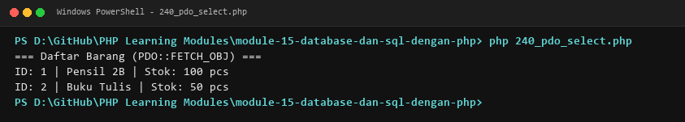

**Lokasi Source Code:** [240_pdo_select.php](240_pdo_select.php)

---

### 241. Update data

**Tujuan Pembelajaran:**
Memahami dan menguasai konsep `Update data` dalam bahasa pemrograman PHP serta mampu menerapkannya dalam kode program mandiri.

**Konsep Utama:**
Konsep dasar `Update data` mencakup mekanisme kerja, sintaks resmi bahasa PHP, serta peran edukatifnya dalam pengembangan perangkat lunak.

**Penjelasan Source Code:**
Berkas `241_pdo_update.php` mendemonstrasikan implementasi terisolasi dari `Update data` dengan komentar penjelasan edukatif berbahasa Indonesia pada setiap bagian kode penting, tanpa overengineering.

**Cara Menjalankan:**
```bash
php 241_pdo_update.php
```

**Hasil yang Diharapkan:**
Program menampilkan demonstrasi komputasi dan output teks yang valid sesuai topik `Update data`.

**Screenshot Hasil Eksekusi:**
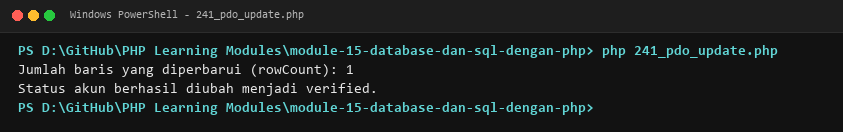

**Lokasi Source Code:** [241_pdo_update.php](241_pdo_update.php)

---

### 242. Delete data

**Tujuan Pembelajaran:**
Memahami dan menguasai konsep `Delete data` dalam bahasa pemrograman PHP serta mampu menerapkannya dalam kode program mandiri.

**Konsep Utama:**
Konsep dasar `Delete data` mencakup mekanisme kerja, sintaks resmi bahasa PHP, serta peran edukatifnya dalam pengembangan perangkat lunak.

**Penjelasan Source Code:**
Berkas `242_pdo_delete.php` mendemonstrasikan implementasi terisolasi dari `Delete data` dengan komentar penjelasan edukatif berbahasa Indonesia pada setiap bagian kode penting, tanpa overengineering.

**Cara Menjalankan:**
```bash
php 242_pdo_delete.php
```

**Hasil yang Diharapkan:**
Program menampilkan demonstrasi komputasi dan output teks yang valid sesuai topik `Delete data`.

**Screenshot Hasil Eksekusi:**
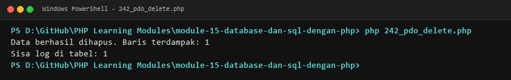

**Lokasi Source Code:** [242_pdo_delete.php](242_pdo_delete.php)

---

### 243. Transaksi database

**Tujuan Pembelajaran:**
Memahami dan menguasai konsep `Transaksi database` dalam bahasa pemrograman PHP serta mampu menerapkannya dalam kode program mandiri.

**Konsep Utama:**
Konsep dasar `Transaksi database` mencakup mekanisme kerja, sintaks resmi bahasa PHP, serta peran edukatifnya dalam pengembangan perangkat lunak.

**Penjelasan Source Code:**
Berkas `243_pdo_transactions.php` mendemonstrasikan implementasi terisolasi dari `Transaksi database` dengan komentar penjelasan edukatif berbahasa Indonesia pada setiap bagian kode penting, tanpa overengineering.

**Cara Menjalankan:**
```bash
php 243_pdo_transactions.php
```

**Hasil yang Diharapkan:**
Program menampilkan demonstrasi komputasi dan output teks yang valid sesuai topik `Transaksi database`.

**Screenshot Hasil Eksekusi:**
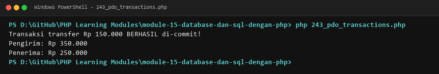

**Lokasi Source Code:** [243_pdo_transactions.php](243_pdo_transactions.php)

---

### 244. Penanganan error database

**Tujuan Pembelajaran:**
Memahami dan menguasai konsep `Penanganan error database` dalam bahasa pemrograman PHP serta mampu menerapkannya dalam kode program mandiri.

**Konsep Utama:**
Konsep dasar `Penanganan error database` mencakup mekanisme kerja, sintaks resmi bahasa PHP, serta peran edukatifnya dalam pengembangan perangkat lunak.

**Penjelasan Source Code:**
Berkas `244_pdo_error_handling.php` mendemonstrasikan implementasi terisolasi dari `Penanganan error database` dengan komentar penjelasan edukatif berbahasa Indonesia pada setiap bagian kode penting, tanpa overengineering.

**Cara Menjalankan:**
```bash
php 244_pdo_error_handling.php
```

**Hasil yang Diharapkan:**
Program menampilkan demonstrasi komputasi dan output teks yang valid sesuai topik `Penanganan error database`.

**Screenshot Hasil Eksekusi:**
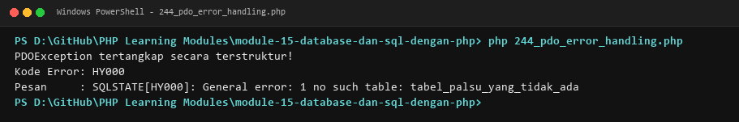

**Lokasi Source Code:** [244_pdo_error_handling.php](244_pdo_error_handling.php)

---

### 245. Pagination data

**Tujuan Pembelajaran:**
Memahami dan menguasai konsep `Pagination data` dalam bahasa pemrograman PHP serta mampu menerapkannya dalam kode program mandiri.

**Konsep Utama:**
Konsep dasar `Pagination data` mencakup mekanisme kerja, sintaks resmi bahasa PHP, serta peran edukatifnya dalam pengembangan perangkat lunak.

**Penjelasan Source Code:**
Berkas `245_pagination.php` mendemonstrasikan implementasi terisolasi dari `Pagination data` dengan komentar penjelasan edukatif berbahasa Indonesia pada setiap bagian kode penting, tanpa overengineering.

**Cara Menjalankan:**
```bash
php 245_pagination.php
```

**Hasil yang Diharapkan:**
Program menampilkan demonstrasi komputasi dan output teks yang valid sesuai topik `Pagination data`.

**Screenshot Hasil Eksekusi:**
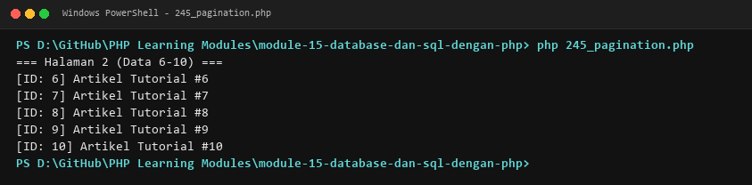

**Lokasi Source Code:** [245_pagination.php](245_pagination.php)

---

### 246. Pencarian data

**Tujuan Pembelajaran:**
Memahami dan menguasai konsep `Pencarian data` dalam bahasa pemrograman PHP serta mampu menerapkannya dalam kode program mandiri.

**Konsep Utama:**
Konsep dasar `Pencarian data` mencakup mekanisme kerja, sintaks resmi bahasa PHP, serta peran edukatifnya dalam pengembangan perangkat lunak.

**Penjelasan Source Code:**
Berkas `246_search_database.php` mendemonstrasikan implementasi terisolasi dari `Pencarian data` dengan komentar penjelasan edukatif berbahasa Indonesia pada setiap bagian kode penting, tanpa overengineering.

**Cara Menjalankan:**
```bash
php 246_search_database.php
```

**Hasil yang Diharapkan:**
Program menampilkan demonstrasi komputasi dan output teks yang valid sesuai topik `Pencarian data`.

**Screenshot Hasil Eksekusi:**
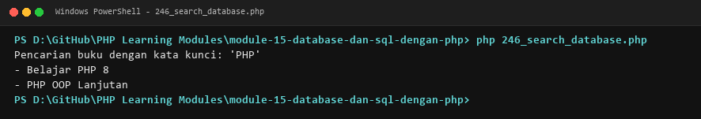

**Lokasi Source Code:** [246_search_database.php](246_search_database.php)

---

### 247. Relasi tabel database

**Tujuan Pembelajaran:**
Memahami dan menguasai konsep `Relasi tabel database` dalam bahasa pemrograman PHP serta mampu menerapkannya dalam kode program mandiri.

**Konsep Utama:**
Konsep dasar `Relasi tabel database` mencakup mekanisme kerja, sintaks resmi bahasa PHP, serta peran edukatifnya dalam pengembangan perangkat lunak.

**Penjelasan Source Code:**
Berkas `247_mysql_relationships.php` mendemonstrasikan implementasi terisolasi dari `Relasi tabel database` dengan komentar penjelasan edukatif berbahasa Indonesia pada setiap bagian kode penting, tanpa overengineering.

**Cara Menjalankan:**
```bash
php 247_mysql_relationships.php
```

**Hasil yang Diharapkan:**
Program menampilkan demonstrasi komputasi dan output teks yang valid sesuai topik `Relasi tabel database`.

**Screenshot Hasil Eksekusi:**
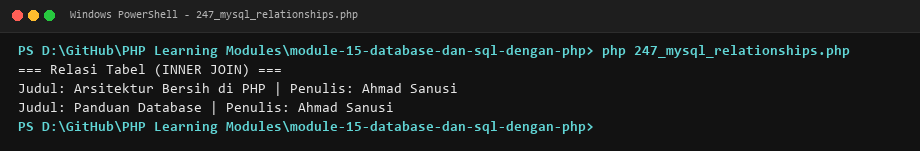

**Lokasi Source Code:** [247_mysql_relationships.php](247_mysql_relationships.php)

---

### 248. Repository database

**Tujuan Pembelajaran:**
Memahami dan menguasai konsep `Repository database` dalam bahasa pemrograman PHP serta mampu menerapkannya dalam kode program mandiri.

**Konsep Utama:**
Konsep dasar `Repository database` mencakup mekanisme kerja, sintaks resmi bahasa PHP, serta peran edukatifnya dalam pengembangan perangkat lunak.

**Penjelasan Source Code:**
Berkas `248_database_repository.php` mendemonstrasikan implementasi terisolasi dari `Repository database` dengan komentar penjelasan edukatif berbahasa Indonesia pada setiap bagian kode penting, tanpa overengineering.

**Cara Menjalankan:**
```bash
php 248_database_repository.php
```

**Hasil yang Diharapkan:**
Program menampilkan demonstrasi komputasi dan output teks yang valid sesuai topik `Repository database`.

**Screenshot Hasil Eksekusi:**
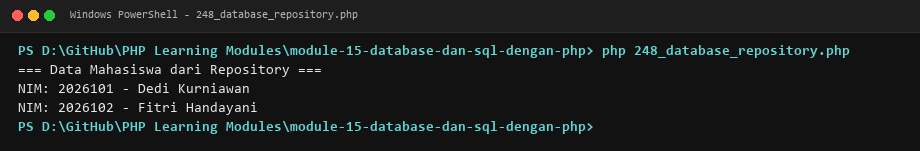

**Lokasi Source Code:** [248_database_repository.php](248_database_repository.php)

---

### 249. Integrasi SQLite

**Tujuan Pembelajaran:**
Memahami dan menguasai konsep `Integrasi SQLite` dalam bahasa pemrograman PHP serta mampu menerapkannya dalam kode program mandiri.

**Konsep Utama:**
Konsep dasar `Integrasi SQLite` mencakup mekanisme kerja, sintaks resmi bahasa PHP, serta peran edukatifnya dalam pengembangan perangkat lunak.

**Penjelasan Source Code:**
Berkas `249_sqlite_database.php` mendemonstrasikan implementasi terisolasi dari `Integrasi SQLite` dengan komentar penjelasan edukatif berbahasa Indonesia pada setiap bagian kode penting, tanpa overengineering.

**Cara Menjalankan:**
```bash
php 249_sqlite_database.php
```

**Hasil yang Diharapkan:**
Program menampilkan demonstrasi komputasi dan output teks yang valid sesuai topik `Integrasi SQLite`.

**Screenshot Hasil Eksekusi:**
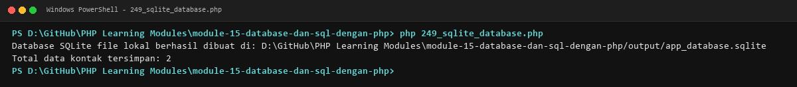

**Lokasi Source Code:** [249_sqlite_database.php](249_sqlite_database.php)

---

### 250. Konsep migrasi database

**Tujuan Pembelajaran:**
Memahami dan menguasai konsep `Konsep migrasi database` dalam bahasa pemrograman PHP serta mampu menerapkannya dalam kode program mandiri.

**Konsep Utama:**
Konsep dasar `Konsep migrasi database` mencakup mekanisme kerja, sintaks resmi bahasa PHP, serta peran edukatifnya dalam pengembangan perangkat lunak.

**Penjelasan Source Code:**
Berkas `250_database_migrations_basic.php` mendemonstrasikan implementasi terisolasi dari `Konsep migrasi database` dengan komentar penjelasan edukatif berbahasa Indonesia pada setiap bagian kode penting, tanpa overengineering.

**Cara Menjalankan:**
```bash
php 250_database_migrations_basic.php
```

**Hasil yang Diharapkan:**
Program menampilkan demonstrasi komputasi dan output teks yang valid sesuai topik `Konsep migrasi database`.

**Screenshot Hasil Eksekusi:**
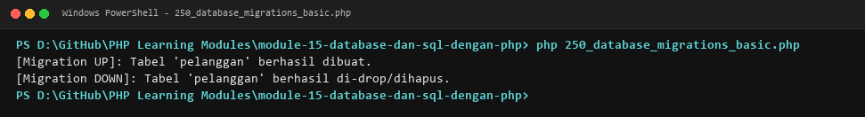

**Lokasi Source Code:** [250_database_migrations_basic.php](250_database_migrations_basic.php)

---

## Ringkasan Modul
Modul 15 (Database dan SQL dengan PHP) memberikan pemahaman menyeluruh mengenai php data objects (pdo), koneksi basis data aman, eksekusi query sql, prepared statements, parameter binding, operasi crud, transaksi database (acid), penanganan error database, pagination, pencarian data, relasi tabel (join), repository pattern, dan migrasi skema basis data. Seluruh 16 submodul dirancang terpisah dan mandiri sehingga mudah dipelajari langkah demi langkah.
