# MODUL 16: Composer, Namespace, dan Arsitektur Proyek

## Ringkasan Ruang Lingkup Materi
Namespace, import dan aliasing class, autoloading manual dan PSR-4, konfigurasi Composer, manajemen dependensi (semver), skrip automasi Composer, konfigurasi lingkungan (.env), class Config terpusat, standar PSR, dan implementasi arsitektur MVC, Service Layer, serta Repository Pattern.

## Tujuan Pembelajaran
Menguasai tata kelola proyek PHP profesional dan standar industri modern.

---

## Daftar Submodul Pembelajaran

- [251_namespace_basic.php](251_namespace_basic.php) : Namespace
- [252_namespace_import.php](252_namespace_import.php) : Import dengan `use`
- [253_namespace_alias.php](253_namespace_alias.php) : Alias namespace
- [254_autoload_basic.php](254_autoload_basic.php) : Autoloading
- [255_composer_setup.php](255_composer_setup.php) : Setup Composer
- [256_composer_autoload.php](256_composer_autoload.php) : Composer autoload
- [257_psr4_autoloading.php](257_psr4_autoloading.php) : PSR-4 autoloading
- [258_composer_dependencies.php](258_composer_dependencies.php) : Pengelolaan dependensi
- [259_composer_scripts.php](259_composer_scripts.php) : Composer scripts
- [260_environment_configuration.php](260_environment_configuration.php) : Konfigurasi environment
- [261_dotenv_configuration.php](261_dotenv_configuration.php) : Environment variables dengan dotenv
- [262_config_management.php](262_config_management.php) : Pengelolaan konfigurasi
- [263_psr_standards.php](263_psr_standards.php) : Standar PSR
- [264_mvc_architecture.php](264_mvc_architecture.php) : Arsitektur Model-View-Controller
- [265_service_layer.php](265_service_layer.php) : Service layer
- [266_repository_pattern.php](266_repository_pattern.php) : Repository pattern

---

## Penjelasan Setiap Submodul

### 251. Namespace

**Tujuan Pembelajaran:**
Memahami dan menguasai konsep `Namespace` dalam bahasa pemrograman PHP serta mampu menerapkannya dalam kode program mandiri.

**Konsep Utama:**
Konsep dasar `Namespace` mencakup mekanisme kerja, sintaks resmi bahasa PHP, serta peran edukatifnya dalam pengembangan perangkat lunak.

**Penjelasan Source Code:**
Berkas `251_namespace_basic.php` mendemonstrasikan implementasi terisolasi dari `Namespace` dengan komentar penjelasan edukatif berbahasa Indonesia pada setiap bagian kode penting, tanpa overengineering.

**Cara Menjalankan:**
```bash
php 251_namespace_basic.php
```

**Hasil yang Diharapkan:**
Program menampilkan demonstrasi komputasi dan output teks yang valid sesuai topik `Namespace`.

**Screenshot Hasil Eksekusi:**
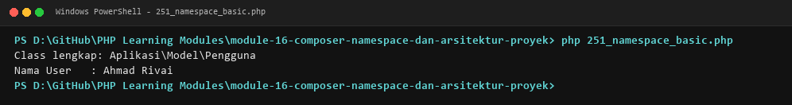

**Lokasi Source Code:** [251_namespace_basic.php](251_namespace_basic.php)

---

### 252. Import dengan `use`

**Tujuan Pembelajaran:**
Memahami dan menguasai konsep `Import dengan `use`` dalam bahasa pemrograman PHP serta mampu menerapkannya dalam kode program mandiri.

**Konsep Utama:**
Konsep dasar `Import dengan `use`` mencakup mekanisme kerja, sintaks resmi bahasa PHP, serta peran edukatifnya dalam pengembangan perangkat lunak.

**Penjelasan Source Code:**
Berkas `252_namespace_import.php` mendemonstrasikan implementasi terisolasi dari `Import dengan `use`` dengan komentar penjelasan edukatif berbahasa Indonesia pada setiap bagian kode penting, tanpa overengineering.

**Cara Menjalankan:**
```bash
php 252_namespace_import.php
```

**Hasil yang Diharapkan:**
Program menampilkan demonstrasi komputasi dan output teks yang valid sesuai topik `Import dengan `use``.

**Screenshot Hasil Eksekusi:**


**Lokasi Source Code:** [252_namespace_import.php](252_namespace_import.php)

---

### 253. Alias namespace

**Tujuan Pembelajaran:**
Memahami dan menguasai konsep `Alias namespace` dalam bahasa pemrograman PHP serta mampu menerapkannya dalam kode program mandiri.

**Konsep Utama:**
Konsep dasar `Alias namespace` mencakup mekanisme kerja, sintaks resmi bahasa PHP, serta peran edukatifnya dalam pengembangan perangkat lunak.

**Penjelasan Source Code:**
Berkas `253_namespace_alias.php` mendemonstrasikan implementasi terisolasi dari `Alias namespace` dengan komentar penjelasan edukatif berbahasa Indonesia pada setiap bagian kode penting, tanpa overengineering.

**Cara Menjalankan:**
```bash
php 253_namespace_alias.php
```

**Hasil yang Diharapkan:**
Program menampilkan demonstrasi komputasi dan output teks yang valid sesuai topik `Alias namespace`.

**Screenshot Hasil Eksekusi:**
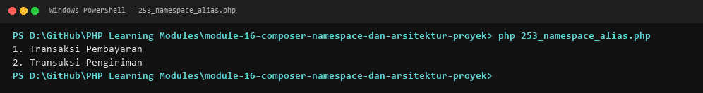

**Lokasi Source Code:** [253_namespace_alias.php](253_namespace_alias.php)

---

### 254. Autoloading

**Tujuan Pembelajaran:**
Memahami dan menguasai konsep `Autoloading` dalam bahasa pemrograman PHP serta mampu menerapkannya dalam kode program mandiri.

**Konsep Utama:**
Konsep dasar `Autoloading` mencakup mekanisme kerja, sintaks resmi bahasa PHP, serta peran edukatifnya dalam pengembangan perangkat lunak.

**Penjelasan Source Code:**
Berkas `254_autoload_basic.php` mendemonstrasikan implementasi terisolasi dari `Autoloading` dengan komentar penjelasan edukatif berbahasa Indonesia pada setiap bagian kode penting, tanpa overengineering.

**Cara Menjalankan:**
```bash
php 254_autoload_basic.php
```

**Hasil yang Diharapkan:**
Program menampilkan demonstrasi komputasi dan output teks yang valid sesuai topik `Autoloading`.

**Screenshot Hasil Eksekusi:**
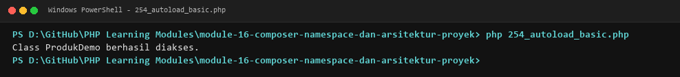

**Lokasi Source Code:** [254_autoload_basic.php](254_autoload_basic.php)

---

### 255. Setup Composer

**Tujuan Pembelajaran:**
Memahami dan menguasai konsep `Setup Composer` dalam bahasa pemrograman PHP serta mampu menerapkannya dalam kode program mandiri.

**Konsep Utama:**
Konsep dasar `Setup Composer` mencakup mekanisme kerja, sintaks resmi bahasa PHP, serta peran edukatifnya dalam pengembangan perangkat lunak.

**Penjelasan Source Code:**
Berkas `255_composer_setup.php` mendemonstrasikan implementasi terisolasi dari `Setup Composer` dengan komentar penjelasan edukatif berbahasa Indonesia pada setiap bagian kode penting, tanpa overengineering.

**Cara Menjalankan:**
```bash
php 255_composer_setup.php
```

**Hasil yang Diharapkan:**
Program menampilkan demonstrasi komputasi dan output teks yang valid sesuai topik `Setup Composer`.

**Screenshot Hasil Eksekusi:**
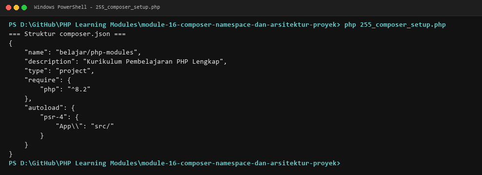

**Lokasi Source Code:** [255_composer_setup.php](255_composer_setup.php)

---

### 256. Composer autoload

**Tujuan Pembelajaran:**
Memahami dan menguasai konsep `Composer autoload` dalam bahasa pemrograman PHP serta mampu menerapkannya dalam kode program mandiri.

**Konsep Utama:**
Konsep dasar `Composer autoload` mencakup mekanisme kerja, sintaks resmi bahasa PHP, serta peran edukatifnya dalam pengembangan perangkat lunak.

**Penjelasan Source Code:**
Berkas `256_composer_autoload.php` mendemonstrasikan implementasi terisolasi dari `Composer autoload` dengan komentar penjelasan edukatif berbahasa Indonesia pada setiap bagian kode penting, tanpa overengineering.

**Cara Menjalankan:**
```bash
php 256_composer_autoload.php
```

**Hasil yang Diharapkan:**
Program menampilkan demonstrasi komputasi dan output teks yang valid sesuai topik `Composer autoload`.

**Screenshot Hasil Eksekusi:**
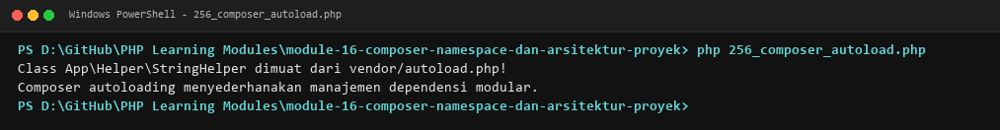

**Lokasi Source Code:** [256_composer_autoload.php](256_composer_autoload.php)

---

### 257. PSR-4 autoloading

**Tujuan Pembelajaran:**
Memahami dan menguasai konsep `PSR-4 autoloading` dalam bahasa pemrograman PHP serta mampu menerapkannya dalam kode program mandiri.

**Konsep Utama:**
Konsep dasar `PSR-4 autoloading` mencakup mekanisme kerja, sintaks resmi bahasa PHP, serta peran edukatifnya dalam pengembangan perangkat lunak.

**Penjelasan Source Code:**
Berkas `257_psr4_autoloading.php` mendemonstrasikan implementasi terisolasi dari `PSR-4 autoloading` dengan komentar penjelasan edukatif berbahasa Indonesia pada setiap bagian kode penting, tanpa overengineering.

**Cara Menjalankan:**
```bash
php 257_psr4_autoloading.php
```

**Hasil yang Diharapkan:**
Program menampilkan demonstrasi komputasi dan output teks yang valid sesuai topik `PSR-4 autoloading`.

**Screenshot Hasil Eksekusi:**
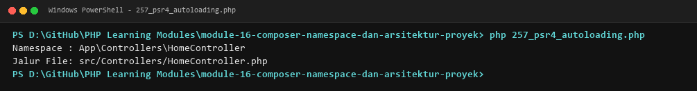

**Lokasi Source Code:** [257_psr4_autoloading.php](257_psr4_autoloading.php)

---

### 258. Pengelolaan dependensi

**Tujuan Pembelajaran:**
Memahami dan menguasai konsep `Pengelolaan dependensi` dalam bahasa pemrograman PHP serta mampu menerapkannya dalam kode program mandiri.

**Konsep Utama:**
Konsep dasar `Pengelolaan dependensi` mencakup mekanisme kerja, sintaks resmi bahasa PHP, serta peran edukatifnya dalam pengembangan perangkat lunak.

**Penjelasan Source Code:**
Berkas `258_composer_dependencies.php` mendemonstrasikan implementasi terisolasi dari `Pengelolaan dependensi` dengan komentar penjelasan edukatif berbahasa Indonesia pada setiap bagian kode penting, tanpa overengineering.

**Cara Menjalankan:**
```bash
php 258_composer_dependencies.php
```

**Hasil yang Diharapkan:**
Program menampilkan demonstrasi komputasi dan output teks yang valid sesuai topik `Pengelolaan dependensi`.

**Screenshot Hasil Eksekusi:**
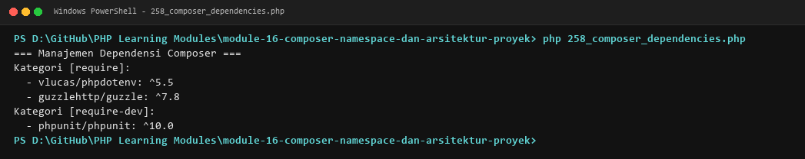

**Lokasi Source Code:** [258_composer_dependencies.php](258_composer_dependencies.php)

---

### 259. Composer scripts

**Tujuan Pembelajaran:**
Memahami dan menguasai konsep `Composer scripts` dalam bahasa pemrograman PHP serta mampu menerapkannya dalam kode program mandiri.

**Konsep Utama:**
Konsep dasar `Composer scripts` mencakup mekanisme kerja, sintaks resmi bahasa PHP, serta peran edukatifnya dalam pengembangan perangkat lunak.

**Penjelasan Source Code:**
Berkas `259_composer_scripts.php` mendemonstrasikan implementasi terisolasi dari `Composer scripts` dengan komentar penjelasan edukatif berbahasa Indonesia pada setiap bagian kode penting, tanpa overengineering.

**Cara Menjalankan:**
```bash
php 259_composer_scripts.php
```

**Hasil yang Diharapkan:**
Program menampilkan demonstrasi komputasi dan output teks yang valid sesuai topik `Composer scripts`.

**Screenshot Hasil Eksekusi:**
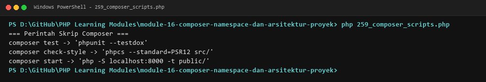

**Lokasi Source Code:** [259_composer_scripts.php](259_composer_scripts.php)

---

### 260. Konfigurasi environment

**Tujuan Pembelajaran:**
Memahami dan menguasai konsep `Konfigurasi environment` dalam bahasa pemrograman PHP serta mampu menerapkannya dalam kode program mandiri.

**Konsep Utama:**
Konsep dasar `Konfigurasi environment` mencakup mekanisme kerja, sintaks resmi bahasa PHP, serta peran edukatifnya dalam pengembangan perangkat lunak.

**Penjelasan Source Code:**
Berkas `260_environment_configuration.php` mendemonstrasikan implementasi terisolasi dari `Konfigurasi environment` dengan komentar penjelasan edukatif berbahasa Indonesia pada setiap bagian kode penting, tanpa overengineering.

**Cara Menjalankan:**
```bash
php 260_environment_configuration.php
```

**Hasil yang Diharapkan:**
Program menampilkan demonstrasi komputasi dan output teks yang valid sesuai topik `Konfigurasi environment`.

**Screenshot Hasil Eksekusi:**
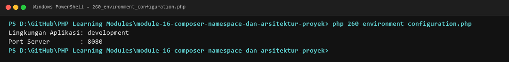

**Lokasi Source Code:** [260_environment_configuration.php](260_environment_configuration.php)

---

### 261. Environment variables dengan dotenv

**Tujuan Pembelajaran:**
Memahami dan menguasai konsep `Environment variables dengan dotenv` dalam bahasa pemrograman PHP serta mampu menerapkannya dalam kode program mandiri.

**Konsep Utama:**
Konsep dasar `Environment variables dengan dotenv` mencakup mekanisme kerja, sintaks resmi bahasa PHP, serta peran edukatifnya dalam pengembangan perangkat lunak.

**Penjelasan Source Code:**
Berkas `261_dotenv_configuration.php` mendemonstrasikan implementasi terisolasi dari `Environment variables dengan dotenv` dengan komentar penjelasan edukatif berbahasa Indonesia pada setiap bagian kode penting, tanpa overengineering.

**Cara Menjalankan:**
```bash
php 261_dotenv_configuration.php
```

**Hasil yang Diharapkan:**
Program menampilkan demonstrasi komputasi dan output teks yang valid sesuai topik `Environment variables dengan dotenv`.

**Screenshot Hasil Eksekusi:**
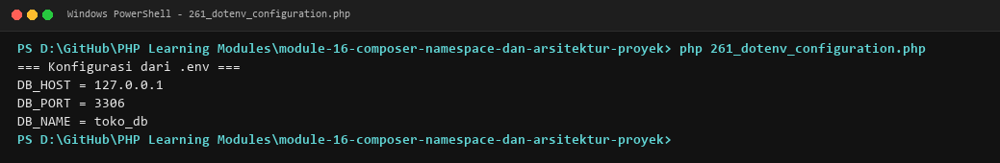

**Lokasi Source Code:** [261_dotenv_configuration.php](261_dotenv_configuration.php)

---

### 262. Pengelolaan konfigurasi

**Tujuan Pembelajaran:**
Memahami dan menguasai konsep `Pengelolaan konfigurasi` dalam bahasa pemrograman PHP serta mampu menerapkannya dalam kode program mandiri.

**Konsep Utama:**
Konsep dasar `Pengelolaan konfigurasi` mencakup mekanisme kerja, sintaks resmi bahasa PHP, serta peran edukatifnya dalam pengembangan perangkat lunak.

**Penjelasan Source Code:**
Berkas `262_config_management.php` mendemonstrasikan implementasi terisolasi dari `Pengelolaan konfigurasi` dengan komentar penjelasan edukatif berbahasa Indonesia pada setiap bagian kode penting, tanpa overengineering.

**Cara Menjalankan:**
```bash
php 262_config_management.php
```

**Hasil yang Diharapkan:**
Program menampilkan demonstrasi komputasi dan output teks yang valid sesuai topik `Pengelolaan konfigurasi`.

**Screenshot Hasil Eksekusi:**
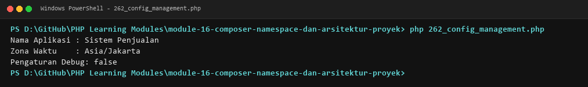

**Lokasi Source Code:** [262_config_management.php](262_config_management.php)

---

### 263. Standar PSR

**Tujuan Pembelajaran:**
Memahami dan menguasai konsep `Standar PSR` dalam bahasa pemrograman PHP serta mampu menerapkannya dalam kode program mandiri.

**Konsep Utama:**
Konsep dasar `Standar PSR` mencakup mekanisme kerja, sintaks resmi bahasa PHP, serta peran edukatifnya dalam pengembangan perangkat lunak.

**Penjelasan Source Code:**
Berkas `263_psr_standards.php` mendemonstrasikan implementasi terisolasi dari `Standar PSR` dengan komentar penjelasan edukatif berbahasa Indonesia pada setiap bagian kode penting, tanpa overengineering.

**Cara Menjalankan:**
```bash
php 263_psr_standards.php
```

**Hasil yang Diharapkan:**
Program menampilkan demonstrasi komputasi dan output teks yang valid sesuai topik `Standar PSR`.

**Screenshot Hasil Eksekusi:**
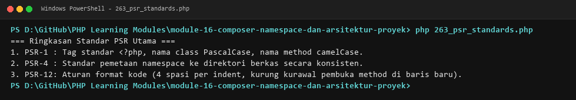

**Lokasi Source Code:** [263_psr_standards.php](263_psr_standards.php)

---

### 264. Arsitektur Model-View-Controller

**Tujuan Pembelajaran:**
Memahami dan menguasai konsep `Arsitektur Model-View-Controller` dalam bahasa pemrograman PHP serta mampu menerapkannya dalam kode program mandiri.

**Konsep Utama:**
Konsep dasar `Arsitektur Model-View-Controller` mencakup mekanisme kerja, sintaks resmi bahasa PHP, serta peran edukatifnya dalam pengembangan perangkat lunak.

**Penjelasan Source Code:**
Berkas `264_mvc_architecture.php` mendemonstrasikan implementasi terisolasi dari `Arsitektur Model-View-Controller` dengan komentar penjelasan edukatif berbahasa Indonesia pada setiap bagian kode penting, tanpa overengineering.

**Cara Menjalankan:**
```bash
php 264_mvc_architecture.php
```

**Hasil yang Diharapkan:**
Program menampilkan demonstrasi komputasi dan output teks yang valid sesuai topik `Arsitektur Model-View-Controller`.

**Screenshot Hasil Eksekusi:**
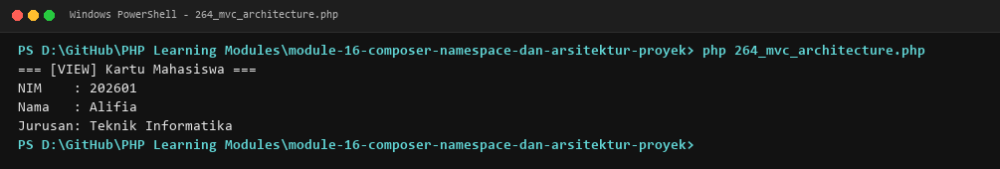

**Lokasi Source Code:** [264_mvc_architecture.php](264_mvc_architecture.php)

---

### 265. Service layer

**Tujuan Pembelajaran:**
Memahami dan menguasai konsep `Service layer` dalam bahasa pemrograman PHP serta mampu menerapkannya dalam kode program mandiri.

**Konsep Utama:**
Konsep dasar `Service layer` mencakup mekanisme kerja, sintaks resmi bahasa PHP, serta peran edukatifnya dalam pengembangan perangkat lunak.

**Penjelasan Source Code:**
Berkas `265_service_layer.php` mendemonstrasikan implementasi terisolasi dari `Service layer` dengan komentar penjelasan edukatif berbahasa Indonesia pada setiap bagian kode penting, tanpa overengineering.

**Cara Menjalankan:**
```bash
php 265_service_layer.php
```

**Hasil yang Diharapkan:**
Program menampilkan demonstrasi komputasi dan output teks yang valid sesuai topik `Service layer`.

**Screenshot Hasil Eksekusi:**
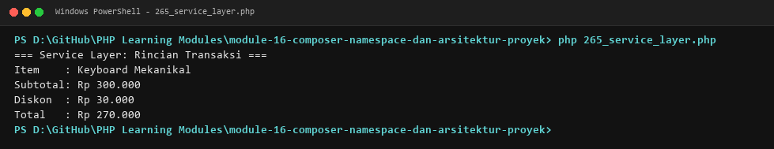

**Lokasi Source Code:** [265_service_layer.php](265_service_layer.php)

---

### 266. Repository pattern

**Tujuan Pembelajaran:**
Memahami dan menguasai konsep `Repository pattern` dalam bahasa pemrograman PHP serta mampu menerapkannya dalam kode program mandiri.

**Konsep Utama:**
Konsep dasar `Repository pattern` mencakup mekanisme kerja, sintaks resmi bahasa PHP, serta peran edukatifnya dalam pengembangan perangkat lunak.

**Penjelasan Source Code:**
Berkas `266_repository_pattern.php` mendemonstrasikan implementasi terisolasi dari `Repository pattern` dengan komentar penjelasan edukatif berbahasa Indonesia pada setiap bagian kode penting, tanpa overengineering.

**Cara Menjalankan:**
```bash
php 266_repository_pattern.php
```

**Hasil yang Diharapkan:**
Program menampilkan demonstrasi komputasi dan output teks yang valid sesuai topik `Repository pattern`.

**Screenshot Hasil Eksekusi:**
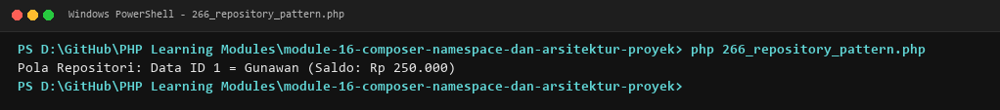

**Lokasi Source Code:** [266_repository_pattern.php](266_repository_pattern.php)

---

## Ringkasan Modul
Modul 16 (Composer, Namespace, dan Arsitektur Proyek) memberikan pemahaman menyeluruh mengenai namespace, import dan aliasing class, autoloading manual dan psr-4, konfigurasi composer, manajemen dependensi (semver), skrip automasi composer, konfigurasi lingkungan (.env), class config terpusat, standar psr, dan implementasi arsitektur mvc, service layer, serta repository pattern. Seluruh 16 submodul dirancang terpisah dan mandiri sehingga mudah dipelajari langkah demi langkah.
