# MODUL 18: Framework dan Proyek Praktik PHP

## Ringkasan Ruang Lingkup Materi
Konsep dasar arsitektur Laravel (Routing, Controller, Eloquent Model, Migration Schema, Validator, Authentication Guard) dan 6 proyek praktik aplikasi mandiri: Kalkulator Berorientasi Objek, Sistem Pengelolaan Mahasiswa, Sistem Inventaris Gudang, Sistem Kasir Toko, Sistem Perpustakaan, dan Layanan REST API Terpadu.

## Tujuan Pembelajaran
Mampu mengintegrasikan seluruh keahlian PHP dalam proyek praktik aplikasi komprehensif dan memahami pola kerja framework modern.

---

## Daftar Submodul Pembelajaran

- [289_laravel_routes.php](289_laravel_routes.php) : Routing Laravel
- [290_laravel_controllers.php](290_laravel_controllers.php) : Controller Laravel
- [291_laravel_models.php](291_laravel_models.php) : Model Eloquent
- [292_laravel_migrations.php](292_laravel_migrations.php) : Database migrations Laravel
- [293_laravel_validation.php](293_laravel_validation.php) : Validasi Laravel
- [294_laravel_authentication.php](294_laravel_authentication.php) : Autentikasi Laravel
- [295_calculator_project.php](295_calculator_project.php) : Aplikasi kalkulator
- [296_student_management_project.php](296_student_management_project.php) : Sistem pengelolaan mahasiswa
- [297_inventory_management_project.php](297_inventory_management_project.php) : Sistem inventaris barang
- [298_cashier_system_project.php](298_cashier_system_project.php) : Sistem kasir
- [299_library_management_project.php](299_library_management_project.php) : Sistem perpustakaan
- [300_rest_api_project.php](300_rest_api_project.php) : Proyek REST API lengkap

---

## Penjelasan Setiap Submodul

### 289. Routing Laravel

**Tujuan Pembelajaran:**
Memahami dan menguasai konsep `Routing Laravel` dalam bahasa pemrograman PHP serta mampu menerapkannya dalam kode program mandiri.

**Konsep Utama:**
Konsep dasar `Routing Laravel` mencakup mekanisme kerja, sintaks resmi bahasa PHP, serta peran edukatifnya dalam pengembangan perangkat lunak.

**Penjelasan Source Code:**
Berkas `289_laravel_routes.php` mendemonstrasikan implementasi terisolasi dari `Routing Laravel` dengan komentar penjelasan edukatif berbahasa Indonesia pada setiap bagian kode penting, tanpa overengineering.

**Cara Menjalankan:**
```bash
php 289_laravel_routes.php
```

**Hasil yang Diharapkan:**
Program menampilkan demonstrasi komputasi dan output teks yang valid sesuai topik `Routing Laravel`.

**Screenshot Hasil Eksekusi:**
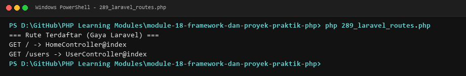

**Lokasi Source Code:** [289_laravel_routes.php](289_laravel_routes.php)

---

### 290. Controller Laravel

**Tujuan Pembelajaran:**
Memahami dan menguasai konsep `Controller Laravel` dalam bahasa pemrograman PHP serta mampu menerapkannya dalam kode program mandiri.

**Konsep Utama:**
Konsep dasar `Controller Laravel` mencakup mekanisme kerja, sintaks resmi bahasa PHP, serta peran edukatifnya dalam pengembangan perangkat lunak.

**Penjelasan Source Code:**
Berkas `290_laravel_controllers.php` mendemonstrasikan implementasi terisolasi dari `Controller Laravel` dengan komentar penjelasan edukatif berbahasa Indonesia pada setiap bagian kode penting, tanpa overengineering.

**Cara Menjalankan:**
```bash
php 290_laravel_controllers.php
```

**Hasil yang Diharapkan:**
Program menampilkan demonstrasi komputasi dan output teks yang valid sesuai topik `Controller Laravel`.

**Screenshot Hasil Eksekusi:**
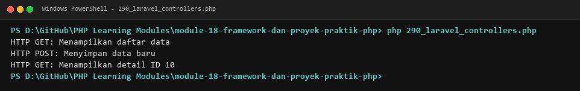

**Lokasi Source Code:** [290_laravel_controllers.php](290_laravel_controllers.php)

---

### 291. Model Eloquent

**Tujuan Pembelajaran:**
Memahami dan menguasai konsep `Model Eloquent` dalam bahasa pemrograman PHP serta mampu menerapkannya dalam kode program mandiri.

**Konsep Utama:**
Konsep dasar `Model Eloquent` mencakup mekanisme kerja, sintaks resmi bahasa PHP, serta peran edukatifnya dalam pengembangan perangkat lunak.

**Penjelasan Source Code:**
Berkas `291_laravel_models.php` mendemonstrasikan implementasi terisolasi dari `Model Eloquent` dengan komentar penjelasan edukatif berbahasa Indonesia pada setiap bagian kode penting, tanpa overengineering.

**Cara Menjalankan:**
```bash
php 291_laravel_models.php
```

**Hasil yang Diharapkan:**
Program menampilkan demonstrasi komputasi dan output teks yang valid sesuai topik `Model Eloquent`.

**Screenshot Hasil Eksekusi:**
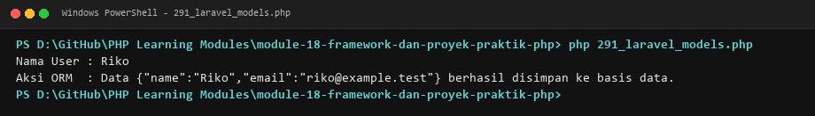

**Lokasi Source Code:** [291_laravel_models.php](291_laravel_models.php)

---

### 292. Database migrations Laravel

**Tujuan Pembelajaran:**
Memahami dan menguasai konsep `Database migrations Laravel` dalam bahasa pemrograman PHP serta mampu menerapkannya dalam kode program mandiri.

**Konsep Utama:**
Konsep dasar `Database migrations Laravel` mencakup mekanisme kerja, sintaks resmi bahasa PHP, serta peran edukatifnya dalam pengembangan perangkat lunak.

**Penjelasan Source Code:**
Berkas `292_laravel_migrations.php` mendemonstrasikan implementasi terisolasi dari `Database migrations Laravel` dengan komentar penjelasan edukatif berbahasa Indonesia pada setiap bagian kode penting, tanpa overengineering.

**Cara Menjalankan:**
```bash
php 292_laravel_migrations.php
```

**Hasil yang Diharapkan:**
Program menampilkan demonstrasi komputasi dan output teks yang valid sesuai topik `Database migrations Laravel`.

**Screenshot Hasil Eksekusi:**
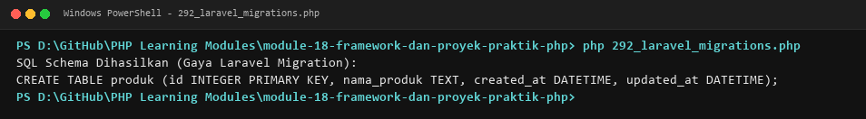

**Lokasi Source Code:** [292_laravel_migrations.php](292_laravel_migrations.php)

---

### 293. Validasi Laravel

**Tujuan Pembelajaran:**
Memahami dan menguasai konsep `Validasi Laravel` dalam bahasa pemrograman PHP serta mampu menerapkannya dalam kode program mandiri.

**Konsep Utama:**
Konsep dasar `Validasi Laravel` mencakup mekanisme kerja, sintaks resmi bahasa PHP, serta peran edukatifnya dalam pengembangan perangkat lunak.

**Penjelasan Source Code:**
Berkas `293_laravel_validation.php` mendemonstrasikan implementasi terisolasi dari `Validasi Laravel` dengan komentar penjelasan edukatif berbahasa Indonesia pada setiap bagian kode penting, tanpa overengineering.

**Cara Menjalankan:**
```bash
php 293_laravel_validation.php
```

**Hasil yang Diharapkan:**
Program menampilkan demonstrasi komputasi dan output teks yang valid sesuai topik `Validasi Laravel`.

**Screenshot Hasil Eksekusi:**
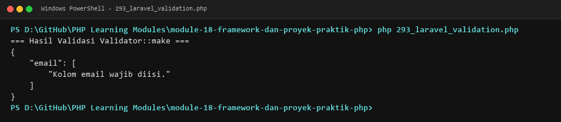

**Lokasi Source Code:** [293_laravel_validation.php](293_laravel_validation.php)

---

### 294. Autentikasi Laravel

**Tujuan Pembelajaran:**
Memahami dan menguasai konsep `Autentikasi Laravel` dalam bahasa pemrograman PHP serta mampu menerapkannya dalam kode program mandiri.

**Konsep Utama:**
Konsep dasar `Autentikasi Laravel` mencakup mekanisme kerja, sintaks resmi bahasa PHP, serta peran edukatifnya dalam pengembangan perangkat lunak.

**Penjelasan Source Code:**
Berkas `294_laravel_authentication.php` mendemonstrasikan implementasi terisolasi dari `Autentikasi Laravel` dengan komentar penjelasan edukatif berbahasa Indonesia pada setiap bagian kode penting, tanpa overengineering.

**Cara Menjalankan:**
```bash
php 294_laravel_authentication.php
```

**Hasil yang Diharapkan:**
Program menampilkan demonstrasi komputasi dan output teks yang valid sesuai topik `Autentikasi Laravel`.

**Screenshot Hasil Eksekusi:**
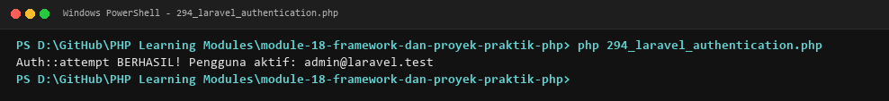

**Lokasi Source Code:** [294_laravel_authentication.php](294_laravel_authentication.php)

---

### 295. Aplikasi kalkulator

**Tujuan Pembelajaran:**
Memahami dan menguasai konsep `Aplikasi kalkulator` dalam bahasa pemrograman PHP serta mampu menerapkannya dalam kode program mandiri.

**Konsep Utama:**
Konsep dasar `Aplikasi kalkulator` mencakup mekanisme kerja, sintaks resmi bahasa PHP, serta peran edukatifnya dalam pengembangan perangkat lunak.

**Penjelasan Source Code:**
Berkas `295_calculator_project.php` mendemonstrasikan implementasi terisolasi dari `Aplikasi kalkulator` dengan komentar penjelasan edukatif berbahasa Indonesia pada setiap bagian kode penting, tanpa overengineering.

**Cara Menjalankan:**
```bash
php 295_calculator_project.php
```

**Hasil yang Diharapkan:**
Program menampilkan demonstrasi komputasi dan output teks yang valid sesuai topik `Aplikasi kalkulator`.

**Screenshot Hasil Eksekusi:**
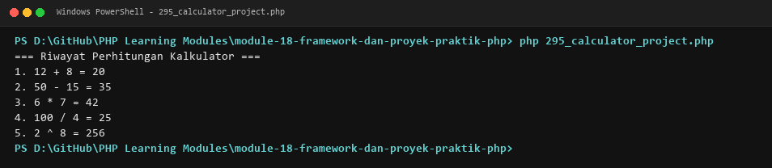

**Lokasi Source Code:** [295_calculator_project.php](295_calculator_project.php)

---

### 296. Sistem pengelolaan mahasiswa

**Tujuan Pembelajaran:**
Memahami dan menguasai konsep `Sistem pengelolaan mahasiswa` dalam bahasa pemrograman PHP serta mampu menerapkannya dalam kode program mandiri.

**Konsep Utama:**
Konsep dasar `Sistem pengelolaan mahasiswa` mencakup mekanisme kerja, sintaks resmi bahasa PHP, serta peran edukatifnya dalam pengembangan perangkat lunak.

**Penjelasan Source Code:**
Berkas `296_student_management_project.php` mendemonstrasikan implementasi terisolasi dari `Sistem pengelolaan mahasiswa` dengan komentar penjelasan edukatif berbahasa Indonesia pada setiap bagian kode penting, tanpa overengineering.

**Cara Menjalankan:**
```bash
php 296_student_management_project.php
```

**Hasil yang Diharapkan:**
Program menampilkan demonstrasi komputasi dan output teks yang valid sesuai topik `Sistem pengelolaan mahasiswa`.

**Screenshot Hasil Eksekusi:**
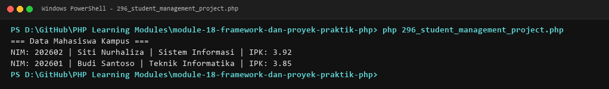

**Lokasi Source Code:** [296_student_management_project.php](296_student_management_project.php)

---

### 297. Sistem inventaris barang

**Tujuan Pembelajaran:**
Memahami dan menguasai konsep `Sistem inventaris barang` dalam bahasa pemrograman PHP serta mampu menerapkannya dalam kode program mandiri.

**Konsep Utama:**
Konsep dasar `Sistem inventaris barang` mencakup mekanisme kerja, sintaks resmi bahasa PHP, serta peran edukatifnya dalam pengembangan perangkat lunak.

**Penjelasan Source Code:**
Berkas `297_inventory_management_project.php` mendemonstrasikan implementasi terisolasi dari `Sistem inventaris barang` dengan komentar penjelasan edukatif berbahasa Indonesia pada setiap bagian kode penting, tanpa overengineering.

**Cara Menjalankan:**
```bash
php 297_inventory_management_project.php
```

**Hasil yang Diharapkan:**
Program menampilkan demonstrasi komputasi dan output teks yang valid sesuai topik `Sistem inventaris barang`.

**Screenshot Hasil Eksekusi:**
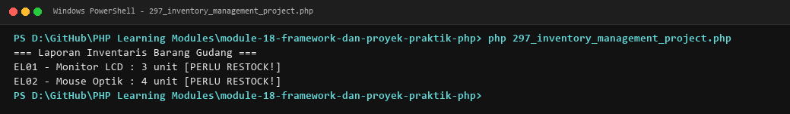

**Lokasi Source Code:** [297_inventory_management_project.php](297_inventory_management_project.php)

---

### 298. Sistem kasir

**Tujuan Pembelajaran:**
Memahami dan menguasai konsep `Sistem kasir` dalam bahasa pemrograman PHP serta mampu menerapkannya dalam kode program mandiri.

**Konsep Utama:**
Konsep dasar `Sistem kasir` mencakup mekanisme kerja, sintaks resmi bahasa PHP, serta peran edukatifnya dalam pengembangan perangkat lunak.

**Penjelasan Source Code:**
Berkas `298_cashier_system_project.php` mendemonstrasikan implementasi terisolasi dari `Sistem kasir` dengan komentar penjelasan edukatif berbahasa Indonesia pada setiap bagian kode penting, tanpa overengineering.

**Cara Menjalankan:**
```bash
php 298_cashier_system_project.php
```

**Hasil yang Diharapkan:**
Program menampilkan demonstrasi komputasi dan output teks yang valid sesuai topik `Sistem kasir`.

**Screenshot Hasil Eksekusi:**
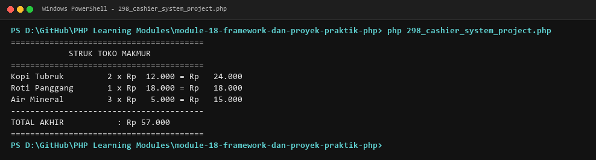

**Lokasi Source Code:** [298_cashier_system_project.php](298_cashier_system_project.php)

---

### 299. Sistem perpustakaan

**Tujuan Pembelajaran:**
Memahami dan menguasai konsep `Sistem perpustakaan` dalam bahasa pemrograman PHP serta mampu menerapkannya dalam kode program mandiri.

**Konsep Utama:**
Konsep dasar `Sistem perpustakaan` mencakup mekanisme kerja, sintaks resmi bahasa PHP, serta peran edukatifnya dalam pengembangan perangkat lunak.

**Penjelasan Source Code:**
Berkas `299_library_management_project.php` mendemonstrasikan implementasi terisolasi dari `Sistem perpustakaan` dengan komentar penjelasan edukatif berbahasa Indonesia pada setiap bagian kode penting, tanpa overengineering.

**Cara Menjalankan:**
```bash
php 299_library_management_project.php
```

**Hasil yang Diharapkan:**
Program menampilkan demonstrasi komputasi dan output teks yang valid sesuai topik `Sistem perpustakaan`.

**Screenshot Hasil Eksekusi:**
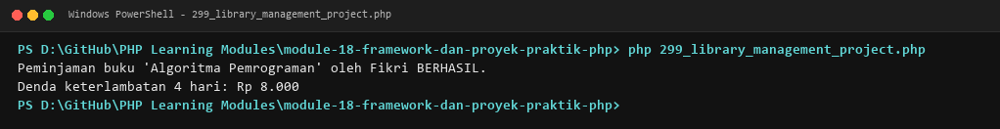

**Lokasi Source Code:** [299_library_management_project.php](299_library_management_project.php)

---

### 300. Proyek REST API lengkap

**Tujuan Pembelajaran:**
Memahami dan menguasai konsep `Proyek REST API lengkap` dalam bahasa pemrograman PHP serta mampu menerapkannya dalam kode program mandiri.

**Konsep Utama:**
Konsep dasar `Proyek REST API lengkap` mencakup mekanisme kerja, sintaks resmi bahasa PHP, serta peran edukatifnya dalam pengembangan perangkat lunak.

**Penjelasan Source Code:**
Berkas `300_rest_api_project.php` mendemonstrasikan implementasi terisolasi dari `Proyek REST API lengkap` dengan komentar penjelasan edukatif berbahasa Indonesia pada setiap bagian kode penting, tanpa overengineering.

**Cara Menjalankan:**
```bash
php 300_rest_api_project.php
```

**Hasil yang Diharapkan:**
Program menampilkan demonstrasi komputasi dan output teks yang valid sesuai topik `Proyek REST API lengkap`.

**Screenshot Hasil Eksekusi:**
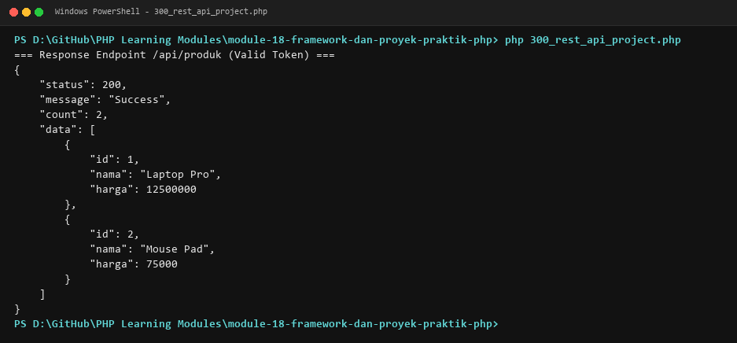

**Lokasi Source Code:** [300_rest_api_project.php](300_rest_api_project.php)

---

## Ringkasan Modul
Modul 18 (Framework dan Proyek Praktik PHP) memberikan pemahaman menyeluruh mengenai konsep dasar arsitektur laravel (routing, controller, eloquent model, migration schema, validator, authentication guard) dan 6 proyek praktik aplikasi mandiri: kalkulator berorientasi objek, sistem pengelolaan mahasiswa, sistem inventaris gudang, sistem kasir toko, sistem perpustakaan, dan layanan rest api terpadu. Seluruh 12 submodul dirancang terpisah dan mandiri sehingga mudah dipelajari langkah demi langkah.
